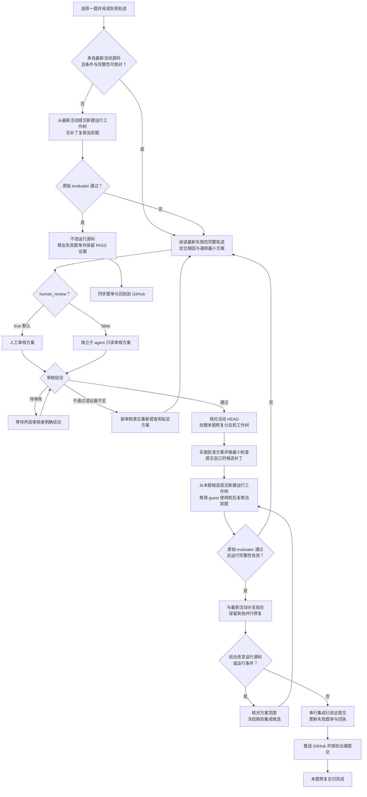

# OSWorld 单题修复工作流

状态：执行约定。`human_review=true` 时必须先把每题的结构化审核材料交给人工；人工明确批准某个方案版本后，才可实施该题。审核本工作流或开启审核不等于批准任一修复方案。

## 目标与入口

从失败题单选择一题，先核对失败证据是否对应最新活动源码。最新源码已通过的题目直接移出待修复清单；仍失败的题目，定位根因、审核方案、隔离修复、正式复跑，通过后才集成到活动分支并推送 GitHub。

执行前阅读仓库根目录 `README.md`、适用的 `AGENTS.md`、当前题目的开发记录和失败轨迹。本文件细化单题修复流程；旧日期文档中的模型、分数、分支与任务范围不能覆盖用户最新要求和当前 README。

当前项目入口如下，执行时重新核对，不固定历史提交 SHA：

| 项目 | 当前约定 |
| --- | --- |
| 活动目录与分支 | `/home/liuxv/liteagent`，`codex/v4`；2026-10-26 用户指定 v4 为主活动源码；修复基点取该分支启动时最新 HEAD，不指 Git 的 `main` |
| 运行源码 | `src/adapter_versions/v2_expanded/` |
| 单题运行入口 | `bin/run-osworld.py --orders <ORDER>` |
| 默认配置 | `configs/single-task-active-thinking.json` |
| 模型条件 | 华为云昇腾 Qwen3.5-9B thinking；机器配置由 `~/.config/liteagent/model.env` 提供 |
| 当前预算 | 每题 100 步、1800 秒；其余条件沿用当前默认配置 |
| 工作树与结果 | `/home/liuxv/liteagent-local-runs/` 下每次修复独占一个目录 |

本轮**活动失败题单**和**已修复题单**维护在本文末尾的“本轮修复台账”。范围以用户最新指定的批次和题号为准；旧批次台账保留为历史记录，不用于本轮销项。按 Order 与 task ID 共同核对身份，不混入其他轮次的任务。当前代理一次处理一题。

### 审核选项

启动修复时记录 `human_review` 选项；这是本工作流的执行约定，不是现有运行器的命令行参数。可以在请求中写“按 repair_skill 修复第 N 题，human_review=false”。

| 选项 | 审核方式 | 通过后行为 |
| --- | --- | --- |
| `human_review=true`（默认） | 由人工审核根因和方案 | 等待人工明确通过后实施 |
| `human_review=false` | 开一个独立子 agent 审核根因和方案，代替人工审核 | 子 agent 明确通过后继续实施，无需再等待人工审核方案 |

用户明确关闭人工审核时，本 skill 要求使用子 agent 进行审核。该选项在本次修复及其失败重试循环中持续有效，直到用户修改；不因一次否决而自动切换审核方式，也不把“无人工审核”理解为跳过审核。每次在回执和题单条目中记录实际审核方式。

### 人工审核材料格式

`human_review=true` 时，直接在对话中提交可追踪的 review 记录，每道题一节。每节至少填写以下字段；题目描述可简述，失败轨迹必须对应本轮原始事件/结果，方案须标明版本并等待选择或批准。多个方案是供人工比较的备选项，不得在批准前实施。

```text
题目：Order / task ID / 应用
题目描述：一句话概括用户要求
正确轨迹描述：满足要求的关键状态变化与原始 evaluator 验收条件
失败轨迹描述：按事件/步骤顺序列出实际关键操作、结果与终态
卡在哪里：最早偏离正确契约的已证实位置；区分事实与假设
修复方案 1：责任层、最小通用改动、影响边界、验证方式
修复方案 2：...
修复方案 3：...
建议：可留空；若提出，说明证据与取舍
人工审核：待审核 / 通过（明确方案版本）/ 不通过 / 证据不足
审核意见：需解决的问题及批准边界
```

轨迹描述只引用日志证明的事实；若缺少 artifact 或运行源码身份，明确写“待核实”，不得补造正确轨迹、根因或方案效果。人工结论必须由人工消息明确给出，沉默不算批准。修改根因、方案边界或验证条件后须提升方案版本并重新审核。

人工审核材料默认直接在当前 Codex 对话中提交，不另建审核文档；后续题目也沿用此方式。按本 skill 一次处理一题：先在对话中提交当前题审核材料并取得明确结论，完成该题后再认领下一题。只有用户明确要求留存文件时，才将审核材料写入文档。

## 1. 先读失败轨迹，核对源码身份

打开单题日志，先读用户指令、运行元数据和完整事件链。至少追踪模型实际看到的工具说明/schema、请求与参数、服务响应、Adapter 返回、执行结果、verification、最终终止原因及原始 evaluator 结果。不要只凭日志摘要或最终错误文字推断根因。

记录启动时活动分支最新提交为 `base_commit`，并与失败运行的提交 SHA、源码摘要、配置快照和运行完整性核对。以下任一情况都应先做无补丁复跑：

- 失败运行来自旧提交，或无法证明它来自当前 `base_commit`。
- 缺少源码身份、运行前后完整性证据，或带有无法追溯的未提交改动。
- 模型、推理服务、thinking 模式或关键运行条件与当前约定不同。

无补丁复跑必须从 `base_commit` 新建独立、干净的运行工作树，使用当前约定条件，只跑当前题；不能先按旧轨迹修改源码再称为基线复跑。

- **复跑通过：**不做运行源码修复；记录“最新活动源码复跑通过，无新增补丁”，将本题从活动待修复集合移除，保留历史失败及本次 PASS 的证据链接。题单/回执按正常 Git 流程同步。
- **复跑失败：**以这次最新运行的完整轨迹作为诊断依据，进入第 2 步。
- **已有轨迹已确认来自当前源码与条件：**直接进入第 2 步，无需为了重复确认再跑一次。

提交 SHA 不同但仅文档变化时，应核对运行源码范围、seal、脚本、依赖和实际配置。能证明运行条件完全相同的已有正式失败可直接诊断，不为文档提交重复运行基线；保留等价性证据。

通过以原始 OSWorld evaluator 的正式结果为准，同时核验结果对应当前题及源码、配置完整性。HTTP 200、进程退出码 0、模型声明完成、单元测试通过或手工查看输出，都不能替代题目 PASS。

核对任务中的 evaluator options 时，必须阅读原函数实际读取和使用的选项，不能仅凭配置中的键名推断其生效。逐段 strip、空白归一化等只读诊断必须与原始逐字符差异并列记录，不得将归一化相等当作原 evaluator 相等；不修改 evaluator 或任务选项迁就产物。

## 2. 找到根因，提出通用最小方案

从最早偏离正确契约的环节向后追踪因果链，区分模型决策、工具 schema/生成约束、传输协议、Adapter 实现、执行环境、观察反馈和完成判定。基础设施错误也要保留原始响应；例如 HTTP 200 中的 grammar 错误不能归为正常模型回复或直接当成断流。

先说明证据证明了什么、仍有哪些不确定性，再提出作用于责任层的最小可行修复。说明为什么它能修正一类同源问题，如何保持其他合法行为，以及如何验证，而不是为当前题安排一套固定操作顺序。

修复必须满足：

- 不拆东墙补西墙：不靠吞错、伪造成功、放松正确性检查、删掉必要验证或全局放大重试/超时掩盖根因。
- 不定制 API 流或任务工作流：不按 Order、task ID、题目短语、文件名、golden 答案或固定坐标分支，不把单题答案或完整操作序列写进运行代码、schema、提示词。
- 不靠强制工具顺序、脚本接管模型决策或为该题新造宏操作来取得 PASS。必要的通用契约修复必须说明适用条件与边界。
- 修改发生在正确责任层；涉及公开契约时同步核对 schema、校验、dispatch/worker、返回与调用方。协议兼容转换不得悄悄取消参数本地校验。
- 不更换模型、降低题目难度、改变 evaluator、任务定义、参考数据或测试预算来规避失败；必要的条件变更必须单独说明并按所选方式审核。审核通过不扩大用户授权范围，也不允许干扰其他并行进程。

提交下面的审核材料，**尚未批准时只做阅读、诊断和必要的最小复现，不实施候选修复，也不改共享模型服务或运行条件**：

```text
题目：Order / task ID / 活动失败题单位置
源码与条件：base_commit、失败运行 commit/摘要、模型与配置身份
失败证据：日志路径、关键 step/事件、请求/响应或最小复现
根因：责任层、因果链、已确认事实与未确认假设
拟修复方案：拟改文件/契约、最小改动、为何具有普遍性
影响边界：需保留的合法行为、潜在副作用、为何不属于任务定制
验证：最小 focused check + 当前题原始 evaluator 复跑
审核方式：human_review=true / false
审核结论：待审核 / 通过的方案版本 / 不通过及建议
审核者与证据：人工回复引用，或子 agent ID 和完整审核记录
```

## 3. 按选项审核方案

- **待审核：**提交可审阅的材料；人工模式等待人工明确结论，子 agent 模式等待独立审核结果。不将沉默、未完成的子 agent 任务或对本 skill 的认可当作本题方案获批。
- **不通过：**保留审核建议，按建议重新调查或修订方案，再交同一审核方式复审；不执行被否决方案，也不通过换审核者来规避意见。
- **通过：**记录方案版本、批准内容及适用源码，才进入第 4 步。实施发现需要改变根因、扩大范围或更换策略时，返回第 2、3 步。

### `human_review=false` 的独立子 agent 审核

主 agent 负责诊断、提出方案和实施；审核必须由另一个子 agent 完成，不能由主 agent 自己宣布审核通过。使用子 agent 工具创建审核任务，不创建用户侧的新聊天。

给审核子 agent 提供本 skill、方案版本、基点提交、当前题目身份、原始失败日志与轨迹、相关源码位置和拟议改动。说明方案是待验证的假设，要求独立阅读原始证据，不预设通过结论。审核权限为只读；不得修改源码、台账或共享服务，不得启动完整 OSWorld 任务。

要求审核者逐项确认：根因是否有直接证据，方案是否作用于正确责任层，是否为通用且最小的改动，是否包含任务定制 API 流或工作流，是否破坏已有合法行为，以及验证与并行隔离是否充分。证据不足时指出缺项，不以经验猜测代替确认。

审核结果至少包含：

```text
reviewer_agent_id：审核子 agent ID
plan_version / base_commit：审核的确切方案与源码
verdict：通过 / 不通过 / 证据不足
evidence：独立核对的轨迹事件、源码位置和因果依据
findings：缺陷、影响范围或缺失证据；通过时也说明理由
required_changes：重新提交审核前必须解决的事项
```

仅“通过”允许进入实施；“不通过”或“证据不足”均返回第 2 步，按意见修订后复审。复审应回应上一轮意见，并保留历次结论；可以让同一审核子 agent 继续复审。审核子 agent 不可用或未返回明确结果时，保留“待子 agent 审核”状态并报告原因，不由主 agent 自审替代，也不默默切回人工模式。

子 agent 审核只替代本题方案的人工审核，不能替代真实 OSWorld evaluator 复跑、源码完整性检查或 GitHub 推送核验，也不能批准用户范围之外的操作。

## 4. 在本题独立工作树实施修复

批准后重新读取活动分支 HEAD。若它比审核依据更新，先检查新提交是否已消除故障或改变根因；需要时按第 1 步复跑。影响审核结论时更新方案并重审。

从此时确认的活动提交创建本题专属分支和工作树，例如 `codex/repair-<order>-<unique-id>`。不要借用另一个修复的工作树，也不要在主活动目录编写候选补丁。目录示例：

```text
/home/liuxv/liteagent-local-runs/repair-<order>-<unique-id>/
  repair/                本题可编辑的 Git 工作树
  run-001/source/        从无补丁或候选提交检出的干净运行工作树
  run-001/output/        本轮 runner 输出与原始轨迹
  run-002/...            下一轮，始终使用新目录
  # 人工审核内容留在对话；本文件台账只索引提交、状态与运行证据
```

只实施已批准的最小修复，在自己的工作树完成必要的 focused check、改动 Python 文件的 Ruff、`git diff --check` 和 README 要求的 `bin/check.sh`。不扩建通用回归套件，不启动跨题或全量评测。

定向暂存本题文件，在**自己的修复分支**提交候选补丁，记为 `candidate_commit`。此处提交用于冻结复跑源码，不代表修复成功；候选失败时不得把它集成到活动分支。

## 5. 用自己的补丁源码复跑当前题

遵循 README：先提交候选，再从 `candidate_commit` 创建本题新的 detached 运行工作树。复跑的是自己带补丁的源码，不是主活动目录或别人的源码；运行中不编辑这个工作树、它的配置或运行器复制的源码快照。

使用自己的运行工作树中的 `bin/run-osworld.py`，显式指定本题 `--orders` 和仓库外的 `--result-dir`。先核对题目确实在配置中；若缺失，按现有任务定义补齐任务身份，保留模型、协议和预算条件，不添加答案、特殊策略或题目专用提示。

按 README 使用 `HF_ENDPOINT=https://hf-mirror.com`。若原下载域名连接超时，应先检查下载链路，不能归为模型失败。`--result-dir` 必须是尚不存在的新路径，只提前创建它的父目录。当前运行器创建独立任务 guest 并在其中部署 Adapter；空闲共享 guest 的 Adapter 端口未监听，不能单独据此判定复跑环境不可用。以实际任务 guest 的准备、部署和调用结果判断。

每轮保留提交 SHA、源码 seal、配置与摘要、实际模型/服务身份、完整启动命令和运行前后完整性。至少索引 `runner.log`、`results/results.json`、`lite_agent_events.jsonl`、`trajectory_manifest.json`、evaluator 产物，以及可用的 `model_transport/` 原始请求响应。不同服务上的同名 9B 不自动视为同一运行条件。

### 并行修复必须隔离共享资源

工作树只隔离源码；共享 guest、模型配置和主活动分支仍是共享状态：

- 同一 guest 一次只跑一题。复跑前确认占用及所有者，使用参与进程共同约定的**同一绝对路径锁**，持锁覆盖 guest 准备、整题执行、evaluator 和清理；等待期间可继续只读诊断。
- 当前 `run-osworld.py` 的内置锁位于 `ROOT.parent/liteagent-reproduction-jobs/v3-repair-vm.lock`，不同工作树可能得到不同锁文件，不能据此认定跨工作树互斥。可协调统一外层锁；未遵守该锁的既有进程仍需先确认占用，不能直接启动或抢占。
- 真正并行跑题需分配独立 guest、可写磁盘、端口及结果目录；可复用只读基盘。未获分配时排队，不停止或重置其他人的 guest、隧道或模型服务。
- 不改共享 `model.env`、全局服务参数，不清理其他工作树，不使用 `pkill`、`reset --hard`、强推或全局缓存清理来解决并行冲突。

#### 空闲资源轮询与排队

当用户要求资源空闲后自动继续或明确设置 15 分钟巡检时，应配置持续运行的 Codex automation/heartbeat；任务每 15 分钟只读检查一次公共资源，并在满足运行条件后按本 skill 当前阶段自动继续修复，无需再等用户发消息。监控需要安静运行，只有资源发生可行动变化、任务启动/完成/失败或需要用户操作时才通知。检查至少包括 `./bin/guest-status.sh`、共享锁 `/home/liuxv/liteagent-reproduction-jobs/v3-repair-vm.lock` 的持有状态，以及 `ps`/运行目录确认是否存在未遵守共享锁的 OSWorld 任务。必要时通过当前 Codex 工作流向其他责任人确认所有权，不停止或抢占其进程。

若当前会话没有可持续唤醒并接续工作的 automation/heartbeat 能力，不要用只读 cron 脚本声称已经实现“空闲后自动修复”；明确告知用户此能力不可用，并在会话可持续运行期间用不超过 15 分钟的有界等待后重查。若仅能安装周期性状态探测，应先确认探测输出与通知路径确实可用；探测本身不可获取锁、重置 guest 或启动修复。

- “可启动”要求共享 guest 健康且没有其他任务占用，并且共享锁可获得；缺一项即继续排队。运行启动前再次原子获取同一绝对路径锁，并让锁覆盖准备、执行、evaluator 和清理全程。不要先依据一次空闲快照准备/重置 guest，再在锁外启动。
- 多个排队修复按用户指定顺序或已记录的队列顺序逐个取得共享 guest；同一 guest 不并发。资源释放后重新检查审核结论、活动 HEAD、题目身份和运行配置，再决定继续基线复跑、候选复跑或其他当前阶段。
- 若没有可持续唤醒/定时执行机制，应说明限制并在当前会话可运行期间采用不超过 15 分钟的有界等待后重查；不得声称已建立后台任务。用户明确要求配置定时任务时，优先使用 Codex automation/heartbeat 能力，并将通知策略设为仅在资源状态变化、任务启动/完成/失败或需要用户操作时通知。
- 启动后在对话及本文件台账索引题目、责任人、锁路径、guest、开始时间和预期阶段；退出前释放锁。每次检查记录时间、guest/锁/其他运行状态和决定（排队/启动）。人工模式不另建 `review.md`。

### 复跑结果分支

- **不通过：**保留本次失败，回到第 2 步阅读本次完整轨迹，再按所选方式审核根因和方案。不要回退到旧轨迹忽略新证据，也不要丢弃本题补丁去跑未修复的活动分支冒充验证。
- **没有新证据：**不反复重跑碰运气；说明待验证假设、阻塞条件或需要补充的审核意见，保留待修复状态。
- **通过：**将候选记为“本题验证通过，待集成”，进入第 6 步。

## 6. 集成到活动源码并推送 GitHub

先核对当前活动分支和 GitHub 上同名分支的最新提交。集成按共享分支的协调锁串行进行；只有短时间合并/更新分支需要持集成锁，不用它占住整轮模型推理。

- 活动分支仍在修复基点上且可快进时，合入已验证的本题提交。
- 活动分支已前进时，在本题专属的集成工作树上，以最新活动提交组合本题补丁。不能覆盖或撤掉其他已合入修复。
- 组合、冲突解决或适配改变了运行源码/运行条件时，先检查是否仍在批准方案范围，再冻结新的集成候选，按第 5 步重跑当前题；未通过则回到诊断和所选方式的审核。不能用旧基点上的 PASS 代表新组合也通过。
- 更新活动分支前再次确认其 HEAD 未被别人推进；有变化则重新组合验证。主活动工作区有他人的未提交改动时，保留现场，协调其所有者完成集成，不替别人 stash、提交或覆盖文件。

将验证通过的本题改动和回执集成到活动开发分支，正常推送其 GitHub 同名分支；不用 `--force`。远端前进或拒绝推送时重新核对差异，不盲目拉取合并后跳过必要验证。

成功验证后，必须同步维护本文末尾的“本轮修复台账”：从待修复表移除本题，并在已修复表追加题目身份、正式结果、源码与条件、证据和交付状态；更新分类及总数，保留全部历史尝试。候选尚未合入时标记“已验证，待集成”；GitHub 推送失败时标记“本地已集成，待推送”，不得报告完整交付。

无补丁复跑已通过的题目只需同步题单/回执，不制造源码修复提交。多个修复同时更新题单时串行合并本题条目，避免整份旧列表覆盖他人的结果。

每次接手先重新读取台账并标注本题认领者、个人工作树、`human_review` 选项和当前阶段（待复跑／诊断／待人工审核或待子 agent 审核／实施／复跑／待集成／待推送）；保留简短的逐次更新记录。新的正式失败若推翻已登记的 PASS，保留原 PASS 证据，把本题重新放回待修复表并写明失败运行。结果未完成、协议探针成功或静态检查通过均不能移入已修复表。更新台账时只编辑自己的条目和相应计数，不覆盖其他修复的状态。

最终报告：题目、原根因、审核方式与审核者、通过的策略版本、候选与最终活动提交、OSWorld 正式结果及证据、题单状态、GitHub 推送结果。单题 PASS 不改写历史批次分数，也不构成全量评测或基线 promotion。

## 流程图



## 本轮修复台账

### v4 指定队列（2026-10-26）

原始失败快照：`/home/liuxv/liteagent/reports/20261026-v4-full189/wrong-tasks.md`。用户指定 15 题：11、13、15、24、27、28、35、63、77、79、87、93、97、98、100。本轮启动时 `human_review=true`；北京时间2026-10-27用户明确批准“27 Plan-v1 方案 1”，并要求“现在开始关闭人工review”，此后持续 `human_review=false`，新方案及失败重试由独立子agent审核后自动推进，不再等待人工方案批准。北京时间2026-10-27用户再次明确“开启人工review”，从该消息起持续切回 `human_review=true`；Order35当前无补丁基线继续收集证据，后续新方案/重试修订必须直接对话结构化审核并等待人工明确批准，不能沿用自动审核作为实施授权。既有已交付PASS保留；审核材料直接在对话，不另建审核文档。旧批次 PASS 不用于本轮销项。

- 待修复 5 题：87、93、97、98、100；正式验证通过 10 题：11、13、15、24、27、28、35、63、77、79。按指定顺序一次处理一题。
- Order 11 / `8b1ce5f2-59d2-4dcc-b0b0-666a714b9a14`：用户明确批准“11 Plan-v2 通过方案 1”；批准范围为通用 Calc 完整枚举与回读指导，不含完成门改动。基点 `e9a603941d9ceed1d68b04333625a14599500204`，候选 `a5180db3220a639134c590014bf9ef8ac5600e01`；5 focused checks、Ruff、diff check、bin/check.sh 通过。原 full189 与基点运行源码一致，仅文档不同，不重复基线。
- Order 11 run-001：模型调用前 Hugging Face 原域名连接超时，`environment_failure`；源码/配置完整性均 true。证据 `/home/liuxv/liteagent-local-runs/repair-11-20261026/run-001/output/run-001`。改用 README 已有镜像设置，不修改任务、evaluator 或模型预算。
- Order 11 run-002：北京时间 2026-10-26 19:56 起，候选干净独立工作树正式复跑；持绝对共享锁 `/home/liuxv/liteagent-reproduction-jobs/v3-repair-vm.lock` 覆盖全生命周期。配置 `/home/liuxv/liteagent-local-runs/repair-11-20261026/run-001/config.json`（SHA256 `ba76727b85351885558a76ab2341efefdbf0493d82a9a3e7806f5b9809c539d3`），原模型与100步/1800秒条件。模型完成11步，原 evaluator `failed / reward=0.0 / agent_done`，source/config integrity 均 true。格式化遗漏 B6、B7（44个周末日期中42个标红）；这两项在完整 A1:F33 返回及模型请求中可见，非截断。首次非连续区域回读参数被拒后恢复；保存并二次回读仍未发现两处遗漏，完成门通过属于模型自报，不能替代 evaluator。证据 `/home/liuxv/liteagent-local-runs/repair-11-rerun002-20261026/output`。批准的 Plan-v2 方案1未通过，运行源码不可集成；下一步按新证据提出修订方案并重新人工审核。
- 其余 14 题逐题诊断及对话审核，尚未批准实施。
- Order 11 Plan-v3：用户明确选择“11 Plan-v3 方案 1”，批准通用日期观察摘要；按全部星期分组地址、计数及背景分布，保留范围/截断与未知背景语义，不改完成门。候选 `ec99ce69234e2941e7e4a3d37b9435d77141c1cc`，10 focused checks、Ruff、diff check、bin/check.sh 均通过；用 run-002 原始读取结果只读回放可见周六/周日各22个及B6/B7仍白色。run-003 从候选干净 detached 工作树启动，沿用 run-002 相同配置与镜像环境，持同一绝对共享锁。北京时间 2026-10-26 20:27 正式 `passed / reward=1.0 / agent_done`，8步、326.026秒，source/config integrity 均 true；44个周末日期全部标红，无额外红色单元格。运行源码 seal `b9e5ba8cdb4092891d9e7d5b07950218007c7936c7955aa0123d3460dd80e770`。证据 `/home/liuxv/liteagent-local-runs/repair-11-rerun003-20261026/output`。活动分支与远端同在原基点后，持集成锁快进至候选；已移出待修队列。交付时将本台账提交与候选一并正常推送并核验远端 SHA，若推送失败则仍记为待推送。原始full189快照仍为138/189，不改写历史批次分数。

- Order 11 交付核验：运行源码 `ec99ce6` 与台账提交 `60a018abe4a39520d6182e02bb34a3f0a2a76420` 已正常推送 GitHub `codex/v4`，`git ls-remote` 与本地 HEAD 一致。
- Order 13 / `0326d92d-d218-48a8-9ca1-981cd6d064c7`：human_review=true，/root 按队列认领；旧 full189 轨迹中增长率引用首位销售人员数据并错位，图表未完整绑定正确增长行。活动运行源码已由11修复更新，从干净 `60a018a` 做无补丁当前基线复跑；独立目录 `/home/liuxv/liteagent-local-runs/repair-13-20261026/run-001`，原默认模型/配置/预算，统一绝对共享锁覆盖全生命周期。正式 `failed / reward=0.0 / agent_done`，15步、393.677秒，source/config integrity 均 true。新轨迹：Total求和正确；Growth公式已用Total行，但二月至六月写入B13:F13（左移一列），乘100；标签写A14而公式在13行；增长图类别Jan–May；两图放新增Charts工作表，原Sheet1无图。模型回读A1:G13及inspect后仍宣告正确。Plan13-v1在对话待审核，无候选补丁实施。
- Order 13 Plan-v1：用户明确批准“13 Plan-v1 方案 1”；从活动 `07217b3`（与基线60a018a仅台账不同）建立独立修复树，只在通用 `cells.set_formulas` 工具说明中补充环比当前期间对齐、同一度量的前后期比较、比例/显示及标签同排语义；不实施备选方案2/3，不改完成门。候选 `29235198a6a1358aeba7f5d468547ed4f7f3199e`，50现有定向tests、Ruff、diff check、bin/check.sh及实际工具目录投影核对通过。run-002 从干净候选树、原默认配置正式复跑，输出 `/home/liuxv/liteagent-local-runs/repair-13-20261026/run-002/output`。其他账号任务使用独立容器/可写卷/端口；本题运行器使用自动端口分配锁创建独立guest，另持统一绝对任务锁覆盖全生命周期。正式结果待定，候选未集成。
- Order 13 run-002环境终态：模型前 `environment_failure / reward=null`，Docker create API ReadTimeout（60秒），source/config integrity 均 true。按创建时间12:58:37 UTC及只读基盘挂载核对，唯一属于本次的 `sweet_panini / 91aa9674eda1` 停留created，已定向移除并清理其匿名卷；未动其他账号容器。Docker查询/删除已即时响应，内存及磁盘充足；高并发时创建超时的底层原因尚未完全确认，不改超时/服务。以相同候选、条件、干净新树发起一次环境恢复重试run-003，加 `OPENAPA_RUN_OWNER=liuxv-repair13-run003-20261026` 仅作归属标签，统一锁覆盖全生命周期；输出 `/home/liuxv/liteagent-local-runs/repair-13-20261026/run-003/output`，正式结果待定。
- Order 13 run-003正式终态：`failed / reward=0.0 / agent_done`，20步、1189.188秒，source/config integrity 均 true，候选seal `446bd337841b4f615b10375dd074028dfb46059c58e018490c14fae8a1d96e4e`。独立guest/Adapter恢复成功且正常清理，任务锁释放。实际模型请求已送达批准的环比指导；第3步第一次空公式被schema拒后重试，最终Growth仍写B13:F13并引用首位明细数据B2:G2。增长图首个增长值被row_headers当标签，系列C13:G13含空尾；总额图误删Jan后恢复。第14步完成申请缺行标题；第15步B11:B12与横向values尺寸不符被拒，16改B11:C11实际覆盖原销售值255/567为Total/Growth并保存，20完成门通过、原evaluator失败。50定向检查不能替代题目PASS。候选2923519保留独立分支、不集成；新Plan13-v2须按本次新证据对话审核，不能不变复跑碰运气。
- Order 13 Plan-v2：用户明确批准“13 Plan-v2 方案 1”。独立修复树合入活动台账提交1d93b91（不改运行条件），在v1基础上增加通用写入before/after与原生公式依赖观察，结合已读取文本提供同排左侧/同列上方文本及地址；未知/限额/截断显式标识，不判定正确答案、不阻断合法覆盖、不改完成门。候选 `5cdd8812ee64e61977adcf8a67f3fe6a6aba2c4a`；57定向tests、Ruff、diff check、bin/check.sh通过；独立临时headless Calc验证原生依赖与before/after回传，发现并排除queryPrecedents包含目标自身的行为。run-004从候选干净树按原默认条件持统一绝对锁复跑，owner label `liuxv-repair13-run004-20261026`，输出 `/home/liuxv/liteagent-local-runs/repair-13-20261026/run-004/output`，正式结果待定，候选未集成。
- Order 13 run-004正式终态：北京时间2026-10-26 22:04，`failed / reward=0.0 / agent_done`，28步、1043.249秒，source/config integrity 均 true，seal `c1b39b50e435f456844d768a9090a8e1c51e35c4a93be87b48b7d3ba046d31dc`。新摘要在实际模型请求可见，B13的一月表头及B12/C12的Jan/Feb Total来源均完整，非观察丢失。Total行与A12/A13标签正确，原销售明细保持不变；Growth引用Total且不再乘100，但仍写B13:F13（应按本表实际期间对齐，六月空缺）。15步回读B12:G13后未纠正；多次重建增长图，最终系列C13:G13含空尾；23步总额图row_headers=true消耗一月总额，类别只剩Feb–Jun。28步完成门接受，原evaluator失败。候选5cdd881不得集成；下一版需对话重新审核，不不变重跑。
- Order 13 Plan-v3：用户明确批准“13 Plan-v3 方案 1”；在独立修复树实施通用期间增长与图表完成检查。仅解析明确的月/季度环比、期间范围与两条命名行；从修改前完整原生表格确定期间及明细，核对汇总、按当前期间对齐的比例及原数据保持，保存后读取最终输出；检查原生图表标题、类型、类别及数值系列绑定。未知/截断/过期证据报告缺少观察，明确差异交模型修正，不生成公式、不执行修复、不规定工具顺序；歧义布局/零分母无明确策略时沿用已有审查。候选 `6ac96e5`；102定向tests、Ruff、diff check、bin/check.sh通过，run-004只读回放确认总额图缺一月及最终输出证据过期被拒。北京时间2026-10-26 22:32，run-005从候选干净detached树按原默认条件启动，持统一绝对锁、owner `liuxv-repair13-run005-20261026`；输出 `/home/liuxv/liteagent-local-runs/repair-13-20261026/run-005/output`。正式结果待定，候选未集成。
- Order 13 run-005正式终态：北京时间2026-10-26 22:43，原 evaluator `passed / reward=1.0 / agent_done`，17步、673.354秒，source/config integrity 均 true。候选 `6ac96e5`，seal `0c0d10d7cc308644c8044627343109398277c38ac846b7e0da4312838083e369`。模型首次公式正确对齐C13:G13、未乘100；增长图类别最初Jan–May，新完成检查报告差异后模型11步替换为Feb–Jun；14保存、15inspect、16原生回读、17完成。结果文件核对Total六个月值4852/4587/3943/3857/4677/4243、Growth首期空且后五期为比例，图表原生数值系列B12:G12与C13:G13，明细保持。持集成锁快进活动分支至组合提交 `b3a5ade`，与通过候选的src/bin/configs逐字相同，包含已批准v1/v2观察改进与v3完成检查；移出待修队列。候选及台账正常推送后核验远端SHA；原full189历史快照不改写。
- Order 15 / `347ef137-7eeb-4c80-a3bb-0951f26a8aff`：当前活动源码无补丁基线 run-001 正式 `failed / reward=0.0 / agent_done`，7步、373.924秒，source/config integrity true。完整读取A1:I32后，两图分别创建范围A2:A14+I2:I14、A19:A31+I19:I31；原生观察类别首项null。结果表格值与gold完全相同；图表值/类别范围均包含空白表头行（2019多空类别，2020也带空白首行且数据范围错位）。原生 evaluator 比较图表type/direction及sheet data；模型inspect后直接完成。根因证实为图表来源边界/完成核验，非表格值修改。Plan15-v1三方案已在对话提交，建议方案2通用原生来源与类别边界检查，等待用户明确批准；未修改运行源码。证据 `/home/liuxv/liteagent-local-runs/repair-15-20261026/run-001/output`。
- Order 15 Plan-v1：用户明确批准“15 Plan-v1 方案 2”。基点 `6eea98a`（与run-001仅台账不同），独立修复树增加通用图表来源完成检查：基于完整原生读取和最终inventory，逐系列核对类别/值长度、重叠来源对齐及首尾空白观察；全部值与类别均空的边界报告状态差异，有数值但类别为空仅报告缺少证据，用户明确保留空类别及内部空项兼容。新读取覆盖旧证据、文档切换/GUI/未知单元格写入使旧观察失效；不自动改图、不生成范围、不规定工具顺序。候选 `fc529ec`，82定向tests、Ruff、diff check、bin/check.sh通过；真实run-001回放报告两图空白边界，chart.create/read/inspect/save修复工具可用。北京时间2026-10-26 23:11，run-002从候选干净detached树持绝对共享任务锁按原默认条件启动，owner `liuxv-repair15-run002-20261026`，输出 `/home/liuxv/liteagent-local-runs/repair-15-20261026/run-002/output`；候选未集成，待正式结果。
- Order 15 run-002正式终态：北京时间2026-10-26 23:21，原 evaluator `passed / reward=1.0 / agent_done`，8步、578.955秒，source/config integrity均true。候选 `fc529ec`，seal `ca5731210b19d0584c87d93c8a7bdb7991ef167eb0f43eec4e023e9530b3fadf`。模型读取两表后直接创建A3:A14+I3:I14与A20:A31+I20:I31的两张column图，6保存、7原生inspect、8完成；本次无错误边界修复调用，新门拦截能力以真实run-001回放证实，不将本次模型选对范围单独归因于新门。结果文件表格值与参考完全一致，两图类型/方向/来源也一致。取得集成锁后快进活动源码到 `b468cc5`，src/bin/configs与通过候选相同，重新计算seal一致；移出待修队列。GitHub直连TLS后无响应，已验证现有127.0.0.1:7890代理仅单次Git参数可恢复访问，不改全局代理、模型或评估条件；正常推送后核验远端。原full189快照不改写。
- Order 15交付核验：候选运行源码与台账已推送 `codex/v4`，本地及远端同为 `85478abbb94e287c19481d67fd839c0bacd3502f`，原源码seal核对一致。
- Order 24 / `30e3e107-1cfb-46ee-a755-2cd080d7ba6a`：按队列认领，human_review=true。题意为新Sheet2合并A1:C1制作蓝底白色粗体标题，并将Sex/Civil Status/Highest Educational Attainment三张百分比透视表竖向排列、各隔一空行。活动源码含11/13/15正式通过修复；从干净 `85478ab` 做最新无补丁基线。首次命令因默认配置未收录24在参数校验阶段拒绝，无模型/输出目录产生；仓库外配置 `/home/liuxv/liteagent-local-runs/repair-24-20261026/run-001/config-input.json` 仅增加原任务身份，其他模型/协议/预算/VM等逐项相同，启动同run-001，owner `liuxv-repair24-run001-20261026`，统一绝对任务锁覆盖全生命周期。输出 `/home/liuxv/liteagent-local-runs/repair-24-20261026/run-001/output`，待正式结果；无24候选实施。
- Order 24 run-001正式终态：北京时间2026-10-26 23:37，最新活动源码无补丁基线 `passed / reward=1.0 / agent_done`，15步、773.401秒，source/config integrity均true，seal `ca5731210b19d0584c87d93c8a7bdb7991ef167eb0f43eec4e023e9530b3fadf`。首个模型响应持续流式传输约253秒后恢复，非断连；本次正常创建Sheet2、合并A1:C1并写入正确蓝底白色粗体标题，三张percentage透视表位于A2:B5/A7:B11/A13:B17，间隔一空行；原生读取与结果文件核对标题/颜色/字体/合并及各类比例正确。最新源码已通过，无第24题新补丁；移出待修队列，原full189失败历史不改写。
- Order 27 / `3a7c8185-25c1-4941-bd7b-96e823c9f21f`：按队列认领，human_review=true；题意为整表按A列升序排序，以Date Time为X轴、quantity为Y轴创建折线图。活动源码含11/13/15通过修复且24无补丁PASS；从干净 `99081d1` 启动最新源码无补丁run-001，原默认模型/协议/预算、统一绝对任务锁，owner `liuxv-repair27-run001-20261026`。输出 `/home/liuxv/liteagent-local-runs/repair-27-20261026/run-001/output`，待正式结果；无27候选实施。
- Order 27 run-001正式终态：北京时间2026-10-26 23:44，最新源码无补丁基线 `failed / reward=0.0 / agent_done`，11步、338.842秒，source/config integrity均true，seal `ca5731210b19d0584c87d93c8a7bdb7991ef167eb0f43eec4e023e9530b3fadf`。2步排序后3步建图误用F列，4步已替换为E列；最终row_headers=false导致Date Time与Quantity都为Y值系列，原生category_axes=[]。5保存、6inspect后，7/9完成因排序回读拒绝；8读A2:A36、10读A1:A36后11接受。结果文件排序及所有表格值与gold完全相同；LineChart两值系列A2:A36/E2:E36均无categories，gold仅E2:E36值系列且A2:A36为类别。最终模型请求原生空类别和两系列标签完整可见，非观察丢失。先前“没有修图调用/最终值仍F列”的中间判断已撤回，正式根因为轴角色未落实及完成核验缺口；已有axis_chart_spec依赖完整表头读取，本次仅排序键读取未启用。Plan27-v1待对话人工审核，无新候选实施、不变重跑。
- 2026-10-27（客户端日期）：用户明确批准“27 Plan-v1 方案 1”，并立即切换human_review=false。独立只读审核者 `/root/review27` 核对原始events/request0011/evaluator后通过根因与计划；实际diff初审发现多Y字段plus/Oxford列表误拦，修订为保守跳过协调字段并补回归，复核明确通过。候选 `9ee27ebddda767b7a4c9aa16b4eb9101af2ca589` 仅新增通用显式轴角色完成检查：字段需求来自指令、身份来自原生label及当前源表头，比较实际类别和值来源，不依赖header flag判定、不生成范围、不固定工具顺序。缺失/截断/过期/冲突证据unknown，单一明确轴语义才适用；多图/多Y/多坐标/显式combo或次轴/scatter/水平bar不新增约束。未明示且原生未暴露的同坐标混合图仍有识别限制。96定向tests、Ruff、diff/bincheck及原始失败回放通过，回放准确报告charts.axis_roles_mismatch且修图工具可用。run-002从候选干净detached树、原模型/100步1800秒/原evaluator正式启动，统一绝对任务锁覆盖全生命周期，owner `liuxv-repair27-run002-20261027`；输出 `/home/liuxv/liteagent-local-runs/repair-27-20261026/run-002/output`，待正式结果、未集成。审核记录只留在对话与本台账索引，不另建文档。
- Order 27 run-002正式终态（北京时间2026-10-27）：原 evaluator `passed / reward=1.0 / agent_done`，17步、541.178秒，source/config integrity均true；候选 `9ee27eb`，seal `ca7daeab5a8ecacba303543d2b30bb18f2cd4982df643fbe2ec604412ffa04b5`。5步仍建出两值系列/空类别，7步inspect后新检查报告axis_roles_mismatch，8步模型自行replace使Date Time为类别、Quantity为唯一值系列；13保存、14inspect、16保存后完整排序键回读、17完成。结果表格值与参考完全一致，LineChart值E2:E36、类别A2:A36正确。活动与远端均仅台账更新，持集成锁快进组合提交 `3c28d9a`，src/bin/configs与通过候选逐字相同，活动seal重算一致；移出待修队列。human_review=false已持续生效，审核者 `/root/review27`；正常推送后核验远端。
- Order 27交付核验：审核者 `/root/review27` 独立终态检查通过，request0008包含新轴差异，最终绑定及排序正确、无参考答案暴露。候选与台账已正常推送，活动与远端同为 `c8f6568d96dd32bbecdb668988843e0bc7f281bc`。
- 2026-10-27 Order 28 / `21ab7b40-77c2-4ae6-8321-e00d3a086c73`：human_review=false，/root按队列认领；题意为新增Period Rate (%)列计算期间利率、转换为数值类型并将最高值字体设#00ff00。活动源码已更新，从干净 `c8f6568` 无补丁基线run-001；默认配置未含28，仓库外config-input.json仅补原任务身份，其余原模型/协议/预算/VM条件不变，统一绝对锁，owner `liuxv-repair28-run001-20261027`。输出 `/home/liuxv/liteagent-local-runs/repair-28-20261027/run-001/output`，待正式结果；无28候选实施，新方案由独立子agent审核、不再等待人工。

- 2026-10-27 Order 28 run-001正式failed/reward0，14步491.337秒，source/config true。全部表值与参考一致；原evaluator样式解析唯一差异是非极值C19额外绿色，C20正确绿色；另百分比显示违背显式number要求。Plan28-v1经独立审核 `/root/review27` 通过：通用命名计算列极值字体及数字显示完成检查，补原生条件格式元数据，未知/复杂规则保守处理，保留既有颜色，只识别本轮新增错误着色；不改计算公式、不强制条件格式。实际diff与隔离原生CF实验待核验；human_review=false，不请求人工批准。

- 2026-10-27 Order 28 Plan28-v1实际diff经 `/root/review27` 复核通过（初审多列/否定指令意见已修并加回归）；候选 `cd35267`，188focused/Ruff/diff/check通过。真实独立LO验证基础字体/单CF/SourcePosition/公式result_types，失败产物副本原生读取及只读回放保留旧字体基线未知，不补造历史字段。run-002从候选干净detached树，沿用run-001同一外部config、原模型100步1800秒，持统一绝对锁正式复跑；owner `liuxv-repair28-run002-20261027`，输出 `/home/liuxv/liteagent-local-runs/repair-28-20261027/run-002/output`。共享guest截图500且rootfs临时目录不可写另记；正式runner创建独立guest/可写卷，按该guest实际准备结果核验，不改共享环境。候选尚未集成、待正式结果。

- 2026-10-27 Order 28 run-002正式failed/reward0/agent_done，27步836.826秒，source/config true，seal `bd6ad2340a061917b8fc572a401d962c8c1c370ae70082b34d6f31494c74f7a6`；v1新检查在实际request0018报告number_format_mismatch，模型step18改General，终态仅C20绿色且显示数字。新失败为step5全列公式额外乘100，24个结果均为正确值100倍。`cd35267`留独立分支、不集成。Plan28-v2向同一审核者 `/root/review27` 待审：仅补通用native数值/百分点/百分比显示尺度指导，不生成金融公式、不加题目数值完成门；human_review=false，不等待人工。

- 2026-10-27 Order 28 Plan28-v2计划及实际diff经 `/root/review27` 通过。仅替换Calc系统通用百分比尺度指导，普通/错误恢复/strict实际消息投影均验证可见，其他domain原句保留。候选 `c9607ca`（保留v1已审增量），109focused通过；2个multi_apps GRF/repair_confirm旧断言在干净cd35267同样复现，不改无关测试；Ruff/diff/check通过。run-003新干净detached候选、原run-001同配置/模型/100步1800秒/原evaluator，统一绝对锁，owner `liuxv-repair28-run003-20261027`；输出 `/home/liuxv/liteagent-local-runs/repair-28-20261027/run-003/output`，待正式结果，未集成。human_review=false。

- 2026-10-27 Order 28 run-003模型前environment_failure：公共 `/tmp/docker_port_allocation.lck` 他账号pengzhe0664，本账号无write；source/config true，无模型评分。未碰其锁/容器；原持有者自然释放移除后，同绝对外层锁内原FileLock非阻塞preflight正常取得/释放。独立审核 `/root/review27` 批准ENV28-retry-v1仅一次恢复后原条件重试，锁兼容源码方案暂不实施。run-004新干净 `c9607ca`，启动前再次在统一外层锁内原FileLock预检，原配置/模型/预算/evaluator不变，owner `liuxv-repair28-run004-20261027`，输出 `/home/liuxv/liteagent-local-runs/repair-28-20261027/run-004/output`，待正式结果。human_review=false。

- 2026-10-27 Order 28 run-004因宿主环境阻塞由repair agent有界中断，原生 `interrupted/reward=null/0steps`，680.837秒，source/config true；不能以exit0销项。独立审核 `/root/review27` 直接核对自有guest的VERIFY shell D态、runc僵尸及Docker exec等待，主机数千D态/load>4000；guest截图200，模型未调用。初次校验17:37:01曾恢复并完成文件setup，随后模型前再次assert校验阻塞；SIGINT17:37:52只发本chat pilot，原生“by user”是默认文本，实际actor另记context。SDK env.close停容器70秒ReadTimeout，控制进程/统一任务锁已退出释放；自有待清理容器 `85cfac43b13d/crazy_chatelet`，owner `liuxv-repair28-run004-20261027`，不得认定已清理，不触碰他人容器/网络/共享Docker服务。保留候选 `c9607ca` 独立未集成，28及后续35/63/77/79/87/93/97/98/100仍待修；无新整题启动或网络绕过，待宿主Docker exec健康恢复后先完成自有清理再审恢复复跑。证据 `/home/liuxv/liteagent-local-runs/repair-28-20261027/run-004/output`、`run-004-interruption-context.json`。human_review=false持续有效。

- 2026-10-27 10:15（北京时间）继续Order28：宿主load约30、Docker29.1.3及exec恢复（只读true0.166秒），旧自有guest85cfac43已自然Exited，仅精确owner容器及匿名卷定向移除成功；公共端口锁root0666、原FileLock同路径inode取得释放成功，未改权限/网络/服务。独立审核 `/root/review27` 通过ENV28-retry-v2一次原条件恢复重试。run-005新干净 `c9607ca` detached源码、沿用原config-input/model/100步1800秒/evaluator，统一绝对任务锁覆盖全生命周期；owner `liuxv-repair28-run005-20261027`，输出 `/home/liuxv/liteagent-local-runs/repair-28-20261027/run-005/output`。旧interrupted原证据不变，候选未集成，human_review=false。

- 2026-10-27 Order28 run-005正式failed/reward0/agent_done，26步924.845秒，source/config true，seal `746ed23f5c06b2fff3f40f54ac29241d458959ac58d6ae919ee5f1340a488d55`；环境初始化/模型/evaluator正常。最终仅C20green、General，仍24个计算值100倍。step4原始response/tool arguments/provider_arguments/执行参数一致含*100，无中间改写；其文字推断曾提直接相除但实际调用不一致；新系统尺度指导真实可见。候选c9607ca未集成；新证据交同一审核者/root/review27诊断，不原样重跑。human_review=false。

- 2026-10-27 Order28 Plan28-v3经/root/review27计划及实际diff复核通过：仅range.write顶层工具说明增加通用单位/百分比尺度自查，11行；原properties/required/schema逐字不变，普通/schema恢复/completion恢复tool投影可见，无金融公式/固定坐标/新门禁。66 focused通过，含protocol131pass及2个已证基线multi_apps旧fail；Ruff/diff/check通过。新候选 `a614561` 从独立repair树冻结；run-006新干净detached候选、原config/model/100步1800秒/evaluator，统一lock全生命周期，owner `liuxv-repair28-run006-20261027`，输出 `/home/liuxv/liteagent-local-runs/repair-28-20261027/run-006/output`，待正式结果、未集成。human_review=false。

- 2026-10-27 Order28 run-006正式passed/reward1.0/agent_done，23步646.84秒，source/config true；候选 `a614561`，seal `f439690cc91e7e52c94ffa7f4320cb6fea40313c9faa2fc76f729b16d496e9de`。模型step4/5自主写直接相除公式，最终所有表格值与参考一致、仅最高值C20绿色、普通数字0.00；原任务/evaluator/预算不变。独立终态复核/root/review27明确通过，run006自有guest已由runner清理；活动组合 `5b97df5` 仅合台账变化，src/bin/config与PASS候选逐字一致，seal重算匹配，持集成锁快进；已移出活动待修队列。此前失败及环境中断原证据保留，human_review=false。交付台账正常推送后再核验远端。

- 2026-10-27 Order28交付：活动与GitHub正常推送 `f6f8d1c`，待远端SHA最终核验；Order35 / `bf4e9888-f10f-47af-8dba-76413038b73c` 按队列认领，human_review=false，最新干净f6f8d1c无补丁基线run001。外部config仅加35身份，其余原模型/预算/VM/evaluator不变；统一lock、owner `liuxv-repair35-run001-20261027`，输出 `/home/liuxv/liteagent-local-runs/repair-35-20261027/run-001/output`，待正式结果。未实施35候选。

- 2026-10-27用户最新指令“开启人工review”：持续切回human_review=true。35 run001为已启动的当前源码无补丁基线，可继续读取/诊断；尚无35实现方案获批，未实施候选。基线终态后按题目简述、正确轨迹、失败轨迹、卡点、版本化方案1/2/3及验证条件直接在对话交人工，等待明确批准。后续题目同此方式，不另建审核文档。

- 2026-10-27 Order35当前基线run001正式failed/reward0/agent_done，17步612.715秒，source/config true；basef6f8d1c，seal与28PASS相同f439690cc91e7e52c94ffa7f4320cb6fea40313c9faa2fc76f729b16d496e9de。所有6张图片SHA1及顺序与参考一致，第一页残留2个空title/subtitle占位框（3shapes vs1），最终request0017完整可见仍接受。原生独立hidden Impress实验直接确认insertNewByIndex(0)实际页索引1，而当前slide.create回报请求index0，存在插入位置契约不符；修正该契约不能单独保证模型清理原模板页。只在外部诊断副本删除观察到的2个空占位框、原evaluator同options得1，正式产物/评分0不改，不冒称正式PASS。证据 native-insertion-probe.json、placeholder-diagnostic.json（均在本题外部目录）。Plan35-v1待人工对话审核：方案1修通用插入位置契约+明确纯图片页结果核验及可操作恢复；方案2仅插入契约+通用指导；方案3仅纯图片页结果核验，保留API缺陷风险。尚无批准、未创建35候选或改运行源码；human_review=true。

- 2026-10-27 Order35用户明确批准“选择方案1的同时加强图片页完成检查”：Plan35-v1方案1人工通过，human_review=true持续；从当前0048ece独立分支codex/repair-35-20261027、独立repair树实施通用插入位置契约修复，并加强明确图片页的总页数、每页图片数量/顺序、残留对象与保存后完整观察检查。运行代码不含题目固定页数/文件名/参考数据，不安排固定清理操作，差异交模型选择修复。基线f6f8d1c至0048ece的src/bin/config逐字相同，基线证据仍适用，无需重复。尚无正式候选PASS。

- 2026-10-27 Order35人工批准Plan35-v1方案1已冻结候选 `e85c82a`（独立repair树）；通用零基插入位置/原页身份核验、图片页数量/残留对象/原生内容指纹顺序及最终写入保存后完整回读。126focused通过；3项相邻旧失败在干净基线复现；原生前插中插追加、指纹保存重开稳定及run001只读失败回放通过，Ruff/diff/check通过。run002从干净detached候选正式启动，原run001外部config、原模型100步1800秒与evaluator不变；统一绝对lock全生命周期，owner liuxv-repair35-run002-20261027，输出 `/home/liuxv/liteagent-local-runs/repair-35-20261027/run-002/output`。尚无正式PASS，不集成候选；human_review=true持续。

- 2026-10-27 Order35 Plan35-v1方案1已按人工批准实施：slide.create规范零基插入位置，前插使用原生页面排序器、逐页对象身份/顺序核验，失败只撤销新页；图片页检查比对完整页数/对象数、空占位框、可见性及原生位图内容顺序，写入或保存后必须重新观察，缺证据不通过；presentation.inspect增加可选模型选择image_paths作只读来源指纹观察，正常修复工具保持可用，无自动清理。独立LO实测前插/中插/追加保留原页身份、source→insert→save→reopen指纹稳定；原run001只读回放精确拦截第一页3对象。126focused通过；3个相邻旧失败在干净基线同样复现；Ruff/diff/check.sh通过。当前独立repair树，待冻结候选后按原配置正式run002，尚未PASS/集成。human_review=true。

- 2026-10-27 Order35 run002正式passed/reward1.0/agent_done，19步399.976秒，source/config true；候选e85c82a，seal `acebf01a867efcda668bf21a969b54189a924b273a0f5bca9febdf6ccd66c0cf`。step8/9模型自行删两空占位框，10–15按序插图；16保存，17新完成门拒绝缺最终读回，18读全6页，原生逐页数量与内容指纹均通过，19完成。保存产物6页各1picture、无其他shape，原evaluator1.0；插入0/中间/追加另有原生身份/顺序实测。按人工批准Plan35-v1方案1完成，human_review=true持续；保留原失败不改分，移出本轮待修队列。待持集成锁组合当前台账、验证src/bin/config与PASS逐字一致及seal后快进活动分支，正常推送并核验远端。证据 `/home/liuxv/liteagent-local-runs/repair-35-20261027/run-002/output`。

- 2026-10-27 Order35交付核验：运行源码组合 `2b3698375b59ca26cfaac71dfadd570381e9288d` 已正常推送GitHub且远端同SHA；src/bin/config与正式PASS候选e85c82a逐字相同，活动seal重算匹配。原run001失败及所有原始产物保留。本轮7通过/8待修，human_review=true。按原队列认领Order63 / 04578141-1d42-4146-b9cf-6fab4ce5fd74（第一页三个文本框从上到下精确黄/红/绿），先从当前干净提交做无补丁基线run001；外部配置仅补任务身份，其余默认条件不变，新方案须人工对话审核，不提前实施。独立目录 `/home/liuxv/liteagent-local-runs/repair-63-20261027`。

- 2026-10-27 Order63最新活动源码 `4be8b97` 无新增补丁run001正式passed/reward1.0/agent_done，8步391.419秒，source/config true；seal同35PASS `acebf01a867efcda668bf21a969b54189a924b273a0f5bca9febdf6ccd66c0cf`。本次模型按观察的y顺序使用原生yellow/red/green颜色名，green=0x00A933；保存后完整读回，原evaluator通过。旧full189失败保留，不把本次PASS归因于未验证的特定补丁；移出本轮待修集合，8通过/7待修。证据 `/home/liuxv/liteagent-local-runs/repair-63-20261027/run-001/output`。按原队列认领Order77 / 88fe4b2d-3040-4c70-9a70-546a47764b48，先当前干净提交无补丁基线；独立目录 `/home/liuxv/liteagent-local-runs/repair-77-20261027`，外部config仅补任务身份，原模型/预算/evaluator不变、统一lock；human_review=true，新方案直接对话人工审核，不提前实施。

- 2026-10-27 Order77最新活动 `386ec1c` 无补丁run001正式failed/reward0/agent_done，31步1117.632秒，source/config true；source seal仍acebf01a867efcda668bf21a969b54189a924b273a0f5bca9febdf6ccd66c0cf。6/10/18/19/21/23正确拆6个句间边界，26又在末句末尾以blank_paragraphs_between=1拆分，生成空右段及分隔空段、叠加原有空段，末句后共3空段；29保存，30仅读前10段，31完成门接受。最终42段；原四验收变体39–41段，最接近变体只多一个空段，内存仅移除所观察尾部一个空段即全部规范化段落文本一致（只读诊断、非正式PASS，原分数/产物不改）。API回执及实际request0011已有正确right_paragraph_index=4，模型却选3；原生读取段数28→30→32，未见旧快照。证据 `/home/liuxv/liteagent-local-runs/repair-77-20261027/run-001/output`、外部text-structure-diagnosis.json。human_review=true，Plan77-v1对话待人工：方案1通用paragraph.split工具说明及原生分段索引/空右段/边界回执与投影补强，保留合法末尾拆分、模型自选；方案2仅说明；方案3显式拆句范围的结果完成检查。推荐1，但效果须原条件新候选复跑验证；77候选未实施，不原样重跑。后续79/87/93/97/98/100等待。

- 2026-10-27用户回复“方案1”，明确批准77 Plan-v1方案1；human_review=true持续。基点63dea9f与77失败基线386ec1c的src/bin/config逐字相同，原失败证据仍适用。批准范围为通用paragraph.split说明、原生分段索引/空右段/段末边界回执及模型投影补强；保留已有合法拆分和模型决策，不实施方案3完成检查，不改模型/预算/evaluator，不按题目固定句数或答案分支。独立repair树实施后定向检查、冻结候选、原条件新目录正式复跑；当前无77正式PASS。

- 2026-10-27 Order77获批Plan77-v1方案1已冻结候选 `d7f68db`，45focused及独立原生拆分、普通/恢复实际消息投影检查通过；10项相邻旧失败在无补丁基线复现，Ruff/diff/check通过。run002从干净detached候选正式启动，沿用run001同一外部配置、原模型100步1800秒/原evaluator，统一绝对任务锁全生命周期，owner liuxv-repair77-run002-20261027，输出 `/home/liuxv/liteagent-local-runs/repair-77-20261027/run-002/output`。尚无正式PASS，候选未集成，human_review=true。

- 2026-10-27 Order77候选d7f68db run002正式failed/reward0/agent_done，5步227.142秒，source/config true，seal fb9df96e6f6394b49f471b6f9bdb0fa4a4cd8856b9226da28805012662c646bb；候选保留独立分支、不集成。实际request0003已包含新段末/空段指导；step3模型一次选六个句间标点[.,.,.,!,.,.]，没有末句末尾拆分，28→40段，全文字符不变；4回读、5完成。保存产物与Gold1/3逐段strip后完全相同，但严格原文7段不同：六个原有句间空格留在新段开头，参考留在左段末尾。原compare_docx_files并未读取配置strip_whitespace选项；同原始文件分别传false/true均0。只在内存将六个已观察分隔空格归到前句后，全部原始段落与Gold1逐字符一致；无文件/evaluator/任务改动，非正式PASS。run001也有同空白差异；上一轮只列规范化相等不足以代表原验收，已补充工作流要求核对选项实际实现及原始空白。证据 `/home/liuxv/liteagent-local-runs/repair-77-20261027/run-002/output`、外部run-002/whitespace-diagnosis.json。human_review=true，Plan77-v2直接对话待人工：方案1通用句间空白边界顶层说明及原生parts前后空白计数/投影，保留显式位置选择和全部字符，不自动改参；方案2仅说明；方案3新增before_text边界能力（范围更大）。推荐1；未实施v2，不不变重跑，后续79/87/93/97/98/100仍等待。

- 2026-10-27 Order77 Plan-v2：用户明确选择“方案1”，批准保留v1观察改进，加强paragraph.split顶层句间空白归属说明，并为原生parts增加前后空白计数、保留模型投影；显式边界及原始字符不变，不自动改参数，不新增before_text。human_review=true；独立修复树实施后定向检查、原生烟测、冻结候选，再以原配置正式run-003；仅正式PASS后集成。

- 2026-10-27 Order77 Plan-v2方案1已实施：顶层明确句间已有空白随after_text保留在左段，同时尊重显式空白/位置要求；parts增加leading_whitespace_count/trailing_whitespace_count，投影原样保留及解释，不改拆分算法/参数。49项定向检查通过；排除10项已在干净基线确认的旧失败。Ruff/diff/check.sh通过；独立原生LO对比不含空白/含空白锚点及段末拆分，观察计数、全文字符及邻段均正确，证据native-split-whitespace-v2.json。待冻结候选、原配置run003正式复跑，未PASS/集成。

- 2026-10-27 Order77 Plan-v2方案1候选 `96e4ee4e9ff27f96ed9c5d44f661e9b62a19df77` 已冻结，49定向检查/原生LO/实际消息投影/Ruff/diff/check通过；保留10项基线旧失败说明。run003从干净候选正式启动，source seal `286c3b52f1b91126006d019fdfe26e698a982a4dea2ebffa8193cb7f5c4f8cb9`；与run002实际配置除源码身份/experiment ID外逐项相同，原模型100步1800秒/evaluator不变。统一绝对任务锁覆盖全生命周期，owner liuxv-repair77-run003-20261027；输出 `/home/liuxv/liteagent-local-runs/repair-77-20261027/run-003/output`。正式结果待定，候选未集成；human_review=true。

- 2026-10-27 Order77候选96e4ee4 run003正式passed/reward1.0/agent_done，8步247.962秒，source/config integrity均true，seal `286c3b52f1b91126006d019fdfe26e698a982a4dea2ebffa8193cb7f5c4f8cb9`。step3直引号锚点不匹配原文弯引号、原子拒绝无修改；4重新读取、5用原文锚点及已有句间空格一次拆六处、6保存、7回读、8完成。40段，六处原空格均在左段尾，实际request6含前后空白计数；最终所有原始段落逐字符等于Gold1/Gold3，无strip归一化。原模型/预算/任务/evaluator均未改变。已通过候选待串行集成与正常推送，9通过/6待修；human_review=true持续。

- 2026-10-27 Order77交付核验：持集成锁快进至 `34568fb1ad7ea62bc9fe69a20b3e78d916c58d9c`，src/bin/configs与正式PASS候选96e4ee4逐字相同、活动seal重算匹配；正常推送GitHub codex/v4，ls-remote同SHA。原失败及产物保留，9通过/6待修。按原队列认领Order79 / adf5e2c3-64c7-4644-b7b6-d2f0167927e7（增加指定参考文献及第四段标记处插入编号交叉引用）；旧full189在文末追加编号14并完成，但旧源码已变化，先最新活动源码无补丁run001。独立目录 `/home/liuxv/liteagent-local-runs/repair-79-20261027`；外部config仅补原任务身份source_order170，其余默认模型/预算/evaluator不变。统一任务lock，human_review=true，新方案直接对话审核、不提前实施。

- 2026-10-27 Order79当前干净 `c70bb18` 无新增补丁run001正式passed/reward1.0/agent_done，41步1314.221秒，source/config integrity均true，seal与77PASS相同。4–12遗漏paragraph_start反复读0段，触发现有停滞恢复；27追加用户给定文献原文，无多余句号；回执无原生索引，模型猜37反复读空，33回读尾部后34正确在36创建书签；35源无编号被原子拒绝，36续接编号、37在标记处插入原生GetReference字段，presentation=[14]，38保存、39缺最终回读拒绝、40原生回读、41完成。产物与参考全文按原evaluator实际ignore_blanks=true归一化后相同（原始37/39段，空段差异被该选项忽略），文献文本逐字符相同。只记录观察缺口，不为已PASS题追加未验证补丁；移出队列，10通过/5待修。输出 `/home/liuxv/liteagent-local-runs/repair-79-20261027/run-001/output`。按队列认领87 / 2fe4b718-3bd7-46ec-bdce-b184f5653624（桌面src.mp4从第3秒开始取5秒，制作src_clip.gif）；先最新干净源码无补丁基线，外部config仅补原任务source_order179，原模型/预算/evaluator不变，新方案须人工对话批准。独立目录 `/home/liuxv/liteagent-local-runs/repair-87-20261027`，统一绝对任务锁。

### 历史 thinking100 台账（不代表本轮 v4 状态）

核对时间（北京时间）：`2026-10-23T22:58:52+08:00`；核对时活动分支 HEAD：`8d5461b5555128c876d548a5e92fce1985e1740d`。

原始范围：[thinking100 未通过题单](/home/liuxv/liteagent1021/reports/20261022-thinking100-full189/wrong-tasks.md)，对应 [结构化题单](/home/liuxv/liteagent1021/reports/20261022-thinking100-full189/wrong-tasks.json)。原始全量 189 题中 108 题通过、81 题未通过；原始结果及题单保持历史事实，本文只维护后续修复队列。

**当前待修复 65 题；已确认正式 OSWorld 通过并移出队列 16 题。** 已通过题号：4、6、15、19、20、24、47、48、55、60、78、89、93、94、105、147。

本次核对原始 `results.json`、任务身份、单题轨迹 outcome、配置和 `final-integrity.json`；采用原失败之后、已完成且源码/配置完整性均通过的运行。15、47 的串行复跑发生在全量批次结束前，但晚于各自原失败，按单题时间核对。未把早于本轮失败的历史 PASS 用作销项证据。

“已修复”在本次导入中表示已有正式 PASS、从活动队列移出，包含无新增补丁的复跑通过；不声称每题都新增了修复。12 题均为 `passed / reward=1.0`，但不是都在当前 HEAD 或当前昇腾服务上验证。旧服务和 dirty 快照的条件在表中明示；它们按用户要求作为已有通过记录导入，不作为未来候选可跳过干净提交复跑的先例。

### 待修复题单（65 题）

分类沿用原始题单，便于追溯；它不是最新根因分类。表内已有后续失败则链接最新找到的结果，否则回到原失败日志按本文第 1 步核对和复跑。此处不认领任务、不启动运行。

| 原始状态 | 剩余数量 | 题号 |
| --- | ---: | --- |
| `failed` | 38 | 23、25、28、30、65、77、79、82、87、97、100、101、103、104、106、107、108、109、118、120、122、124、125、126、128、131、132、136、142、143、145、146、151、161、163、164、166、174 |
| `agent_deadline_exhausted` | 11 | 37、54、74、86、88、98、117、127、130、167、189 |
| `agent_failure` | 2 | 99、114 |
| `model_protocol_failure` | 6 | 110、113、115、141、155、172 |
| `model_transport_failure` | 7 | 13、27、72、76、102、119、183 |
| `environment_failure` | 1 | 59 |

| Order | task ID / 应用 | 当前证据与阶段 |
| ---: | --- | --- |
| 13 | `0326d92d-d218-48a8-9ca1-981cd6d064c7` / libreoffice_calc | 后续 `failed`；[结果](/home/liuxv/liteagent-local-runs/v3-thinking-serial-20261021T125321899279Z/results/results.json)；待核对源码／诊断 |
| 23 | `4de54231-e4b5-49e3-b2ba-61a0bec721c0` / libreoffice_calc | 后续 `agent_deadline_exhausted`；[结果](/home/liuxv/liteagent-local-runs/selected13-active-20261022T114201557379Z/run/results/results.json)；待核对源码／诊断 |
| 25 | `4172ea6e-6b77-4edb-a9cc-c0014bd1603b` / libreoffice_calc | 后续 `failed`；[结果](/home/liuxv/liteagent-local-runs/tasks25-28-30-48-65-qwen9b-20261023T141100Z/attempt-1/results/results.json)；待核对源码／诊断 |
| 27 | `3a7c8185-25c1-4941-bd7b-96e823c9f21f` / libreoffice_calc | 后续 `failed`；[结果](/home/liuxv/liteagent-local-runs/v3-thinking-serial-20261021T125321899279Z/results/results.json)；待核对源码／诊断 |
| 28 | `21ab7b40-77c2-4ae6-8321-e00d3a086c73` / libreoffice_calc | 后续 `failed`；[结果](/home/liuxv/liteagent-local-runs/tasks25-28-30-48-65-qwen9b-20261023T141100Z/attempt-1/results/results.json)；待核对源码／诊断 |
| 30 | `af23762e-2bfd-4a1d-aada-20fa8de9ce07` / libreoffice_impress | 后续 `failed`；[结果](/home/liuxv/liteagent-local-runs/tasks25-28-30-48-65-qwen9b-20261023T141100Z/attempt-1/results/results.json)；待核对源码／诊断 |
| 37 | `ac9bb6cb-1888-43ab-81e4-a98a547918cd` / libreoffice_impress | 原始 `agent_deadline_exhausted`；[失败日志](/home/liuxv/liteagent1021/runs/liteagent1021-thinking100-20261021T062953289949Z/results/workers/worker-01/raw/run-1/37-libreoffice_impress-ac9bb6cb-1888-43ab-81e4-a98a547918cd)；待最新源码复跑 |
| 54 | `a53f80cd-4a90-4490-8310-097b011433f6` / libreoffice_impress | 原始 `agent_deadline_exhausted`；[失败日志](/home/liuxv/liteagent1021/runs/liteagent1021-thinking100-20261021T062953289949Z/results/workers/worker-06/raw/run-1/54-libreoffice_impress-a53f80cd-4a90-4490-8310-097b011433f6)；待最新源码复跑 |
| 59 | `4ed5abd0-8b5d-47bd-839f-cacfa15ca37a` / libreoffice_impress | 原始 `environment_failure`；[失败日志](/home/liuxv/liteagent1021/runs/liteagent1021-thinking100-20261021T062953289949Z/results/workers/worker-05/raw/run-1/59-libreoffice_impress-4ed5abd0-8b5d-47bd-839f-cacfa15ca37a)；待最新源码复跑 |
| 65 | `0a0faba3-5580-44df-965d-f562a99b291c` / libreoffice_writer | 后续 `failed`；[结果](/home/liuxv/liteagent-local-runs/selected13-active-20261022T114201557379Z/run/results/results.json)；待核对源码／诊断 |
| 72 | `6a33f9b9-0a56-4844-9c3f-96ec3ffb3ba2` / libreoffice_writer | 原始 `model_transport_failure`；[失败日志](/home/liuxv/liteagent1021/runs/liteagent1021-thinking100-20261021T062953289949Z/results/workers/worker-06/raw/run-1/72-libreoffice_writer-6a33f9b9-0a56-4844-9c3f-96ec3ffb3ba2)；待最新源码复跑 |
| 74 | `6f81754e-285d-4ce0-b59e-af7edb02d108` / libreoffice_writer | 原始 `agent_deadline_exhausted`；[失败日志](/home/liuxv/liteagent1021/runs/liteagent1021-thinking100-20261021T062953289949Z/results/workers/worker-02/raw/run-1/74-libreoffice_writer-6f81754e-285d-4ce0-b59e-af7edb02d108)；待最新源码复跑 |
| 76 | `8472fece-c7dd-4241-8d65-9b3cd1a0b568` / libreoffice_writer | 后续 `failed`；[结果](/home/liuxv/liteagent-local-runs/v3-thinking-serial-20261021T125321899279Z/results/results.json)；待核对源码／诊断 |
| 77 | `88fe4b2d-3040-4c70-9a70-546a47764b48` / libreoffice_writer | 后续 `failed`；[结果](/home/liuxv/liteagent-local-runs/selected13-active-20261022T114201557379Z/run/results/results.json)；待核对源码／诊断 |
| 79 | `adf5e2c3-64c7-4644-b7b6-d2f0167927e7` / libreoffice_writer | 后续 `failed`；[结果](/home/liuxv/liteagent-local-runs/selected13-active-20261022T114201557379Z/run/results/results.json)；待核对源码／诊断 |
| 82 | `e246f6d8-78d7-44ac-b668-fcf47946cb50` / libreoffice_writer | 后续 `failed`；[结果](/home/liuxv/liteagent-local-runs/selected13-active-20261022T114201557379Z/run/results/results.json)；待核对源码／诊断 |
| 86 | `2c9fc0de-3ee7-45e1-a5df-c86206ad78b5` / multi_apps | 原始 `agent_deadline_exhausted`；[失败日志](/home/liuxv/liteagent1021/runs/liteagent1021-thinking100-20261021T062953289949Z/results/workers/worker-02/raw/run-1/86-multi_apps-2c9fc0de-3ee7-45e1-a5df-c86206ad78b5)；待最新源码复跑 |
| 87 | `2fe4b718-3bd7-46ec-bdce-b184f5653624` / multi_apps | 后续 `agent_deadline_exhausted`；[结果](/home/liuxv/liteagent-local-runs/selected13-active-20261022T114201557379Z/run/results/results.json)；待核对源码／诊断 |
| 88 | `3680a5ee-6870-426a-a997-eba929a0d25c` / multi_apps | 原始 `agent_deadline_exhausted`；[失败日志](/home/liuxv/liteagent1021/runs/liteagent1021-thinking100-20261021T062953289949Z/results/workers/worker-04/raw/run-1/88-multi_apps-3680a5ee-6870-426a-a997-eba929a0d25c)；待最新源码复跑 |
| 97 | `eb303e01-261e-4972-8c07-c9b4e7a4922a` / multi_apps | human_review=true；用户已批准97-human-v1并实施，独立候选7923b96；59focused及Ruff/check通过，5旧邻近失败已基线复现；run-004模型前environment_failure（他账号端口锁无写权限），source/config true、无评分；待owner/admin恢复锁权限再正式验证，未集成；证据 `/home/liuxv/liteagent-local-runs/repair-97-20261024-human` |
| 98 | `8e116af7-7db7-4e35-a68b-b0939c066c78` / multi_apps | 原始 `agent_deadline_exhausted`；[失败日志](/home/liuxv/liteagent1021/runs/liteagent1021-thinking100-20261021T062953289949Z/results/workers/worker-02/raw/run-1/98-multi_apps-8e116af7-7db7-4e35-a68b-b0939c066c78)；待最新源码复跑 |
| 99 | `337d318b-aa07-4f4f-b763-89d9a2dd013f` / multi_apps | 原始 `agent_failure`；[失败日志](/home/liuxv/liteagent1021/runs/liteagent1021-thinking100-20261021T062953289949Z/results/workers/worker-03/raw/run-1/99-multi_apps-337d318b-aa07-4f4f-b763-89d9a2dd013f)；待最新源码复跑 |
| 100 | `82e3c869-49f6-4305-a7ce-f3e64a0618e7` / multi_apps | human_review=false；/root + 独立审核/root/review_order100_restart；当前de009e0无补丁run001模型前environment_failure，source/config true；ENV100-retry-v1批准一次重试，preflight再遇pengzhe0664端口锁EACCES，停止环境阻塞、无第二次正式运行；旧候选da4ed5a failed0保留未集成，无新补丁；证据 `/home/liuxv/liteagent-local-runs/repair-100-20261024-restart` |
| 101 | `185f29bd-5da0-40a6-b69c-ba7f4e0324ef` / multi_apps | human_review=false；当前run001 failed0/19events、source/config true；101-restart-v1独立审核及冻结diff复核通过，候选987feac仅通用结构摘要，8tests/Ruff/check/真实请求回放通过，7旧相邻失败基线复现；run002候选待公共锁（105run008持有），未集成；证据 `/home/liuxv/liteagent-local-runs/repair-101-20261024-restart` |
| 102 | `869de13e-bef9-4b91-ba51-f6708c40b096` / multi_apps | 后续 `agent_failure`；[结果](/home/liuxv/liteagent-local-runs/transport-rerun-102-119-147-183-20261022/results/results.json)；待核对源码／诊断 |
| 103 | `3a93cae4-ad3e-403e-8c12-65303b271818` / multi_apps | 候选8159bef run-003 failed/reward0，source/config true；task_state恢复修正未触发，模型只打开文件便误报完成；效果分类后续方案未获批，候选未集成；证据 `/home/liuxv/liteagent-local-runs/repair-103-20261024-current` |
| 104 | `1f18aa87-af6f-41ef-9853-cdb8f32ebdea` / multi_apps | 候选a67d723 run-003 failed/reward0，source/config true；恢复说明促成打开及追加，输出内容/格式仍不符，未集成，待诊断；证据 `/home/liuxv/liteagent-local-runs/repair-104-20261024-current` |
| 106 | `9219480b-3aed-47fc-8bac-d2cffc5849f7` / multi_apps | human_review=false；当前07b30ce无补丁run002正式failed/reward0/stalled_no_progress，34步1267.263秒，source/config true；独立审核/root/review106确认工具开放、源码完整，模型重复路径/有限命令运行GUI/重复读取而未编辑；无新通用实现方案获批、不变重跑不批准；仍待修复；[记录](/home/liuxv/liteagent-local-runs/repair-106-20261024-auto/review.md) |
| 107 | `881deb30-9549-4583-a841-8270c65f2a17` / multi_apps | human_review=false；最新候选ac2f7fb的run004正式deadline/rewardnull，14events、1942.879秒含准备、source/config true、无写入/evaluator；原始流length（短周期+1及语义反刍）消耗预算，重复读及越界页被拒绝；候选未集成。按用户“107结束后停止修复”停止，无新重试/后续题目，公共锁已释放；[记录](/home/liuxv/liteagent-local-runs/repair-107-20261024-auto/review.md) |
| 108 | `7e287123-70ca-47b9-8521-47db09b69b14` / multi_apps | 原始 `failed`；[失败日志](/home/liuxv/liteagent1021/runs/liteagent1021-thinking100-20261021T062953289949Z/results/workers/worker-06/raw/run-1/108-multi_apps-7e287123-70ca-47b9-8521-47db09b69b14)；/root认领，human_review=false；按106、107、108、109、118、120、122、124顺序排队，前题完成后核对最新HEAD并先干净基线 |
| 109 | `5bc63fb9-276a-4439-a7c1-9dc76401737f` / multi_apps | 原始 `failed`；[失败日志](/home/liuxv/liteagent1021/runs/liteagent1021-thinking100-20261021T062953289949Z/results/workers/worker-01/raw/run-1/109-multi_apps-5bc63fb9-276a-4439-a7c1-9dc76401737f)；/root认领，human_review=false；按106、107、108、109、118、120、122、124顺序排队，前题完成后核对最新HEAD并先干净基线 |
| 110 | `716a6079-22da-47f1-ba73-c9d58f986a38` / multi_apps | 原始 `model_protocol_failure`；[失败日志](/home/liuxv/liteagent1021/runs/liteagent1021-thinking100-20261021T062953289949Z/results/workers/worker-02/raw/run-1/110-multi_apps-716a6079-22da-47f1-ba73-c9d58f986a38)；待最新源码复跑 |
| 113 | `81c425f5-78f3-4771-afd6-3d2973825947` / multi_apps | 原始 `model_protocol_failure`；[失败日志](/home/liuxv/liteagent1021/runs/liteagent1021-thinking100-20261021T062953289949Z/results/workers/worker-05/raw/run-1/113-multi_apps-81c425f5-78f3-4771-afd6-3d2973825947)；待最新源码复跑 |
| 114 | `bb83cab4-e5c7-42c7-a67b-e46068032b86` / multi_apps | 原始 `agent_failure`；[失败日志](/home/liuxv/liteagent1021/runs/liteagent1021-thinking100-20261021T062953289949Z/results/workers/worker-06/raw/run-1/114-multi_apps-bb83cab4-e5c7-42c7-a67b-e46068032b86)；待最新源码复跑 |
| 115 | `227d2f97-562b-4ccb-ae47-a5ec9e142fbb` / multi_apps | 后续 `failed`；[结果](/home/liuxv/liteagent-local-runs/task115-155-qwen9b-8d5461b/attempt-1/results/results.json)；待核对源码／诊断 |
| 117 | `8df7e444-8e06-4f93-8a1a-c5c974269d82` / multi_apps | 原始 `agent_deadline_exhausted`；[失败日志](/home/liuxv/liteagent1021/runs/liteagent1021-thinking100-20261021T062953289949Z/results/workers/worker-03/raw/run-1/117-multi_apps-8df7e444-8e06-4f93-8a1a-c5c974269d82)；待最新源码复跑 |
| 118 | `02ce9a50-7af2-47ed-8596-af0c230501f8` / multi_apps | 原始 `failed`；[失败日志](/home/liuxv/liteagent1021/runs/liteagent1021-thinking100-20261021T062953289949Z/results/workers/worker-04/raw/run-1/118-multi_apps-02ce9a50-7af2-47ed-8596-af0c230501f8)；/root认领，human_review=false；按106、107、108、109、118、120、122、124顺序排队，前题完成后核对最新HEAD并先干净基线 |
| 119 | `4c26e3f3-3a14-4d86-b44a-d3cedebbb487` / multi_apps | 后续 `failed`；[结果](/home/liuxv/liteagent-local-runs/transport-rerun-102-119-147-183-20261022/results/results.json)；待核对源码／诊断 |
| 120 | `09a37c51-e625-49f4-a514-20a773797a8a` / multi_apps | 原始 `failed`；[失败日志](/home/liuxv/liteagent1021/runs/liteagent1021-thinking100-20261021T062953289949Z/results/workers/worker-06/raw/run-1/120-multi_apps-09a37c51-e625-49f4-a514-20a773797a8a)；/root认领，human_review=false；按106、107、108、109、118、120、122、124顺序排队，前题完成后核对最新HEAD并先干净基线 |
| 122 | `415ef462-bed3-493a-ac36-ca8c6d23bf1b` / multi_apps | 原始 `failed`；[失败日志](/home/liuxv/liteagent1021/runs/liteagent1021-thinking100-20261021T062953289949Z/results/workers/worker-02/raw/run-1/122-multi_apps-415ef462-bed3-493a-ac36-ca8c6d23bf1b)；/root认领，human_review=false；按106、107、108、109、118、120、122、124顺序排队，前题完成后核对最新HEAD并先干净基线 |
| 124 | `ce2b64a2-ddc1-4f91-8c7d-a88be7121aac` / multi_apps | 原始 `failed`；[失败日志](/home/liuxv/liteagent1021/runs/liteagent1021-thinking100-20261021T062953289949Z/results/workers/worker-04/raw/run-1/124-multi_apps-ce2b64a2-ddc1-4f91-8c7d-a88be7121aac)；/root认领，human_review=false；按106、107、108、109、118、120、122、124顺序排队，前题完成后核对最新HEAD并先干净基线 |
| 125 | `778efd0a-153f-4842-9214-f05fc176b877` / multi_apps | 原始 `failed`；[失败日志](/home/liuxv/liteagent1021/runs/liteagent1021-thinking100-20261021T062953289949Z/results/workers/worker-05/raw/run-1/125-multi_apps-778efd0a-153f-4842-9214-f05fc176b877)；待最新源码复跑 |
| 126 | `47f7c0ce-a5fb-4100-a5e6-65cd0e7429e5` / multi_apps | 原始 `failed`；[失败日志](/home/liuxv/liteagent1021/runs/liteagent1021-thinking100-20261021T062953289949Z/results/workers/worker-06/raw/run-1/126-multi_apps-47f7c0ce-a5fb-4100-a5e6-65cd0e7429e5)；待最新源码复跑 |
| 127 | `c2751594-0cd5-4088-be1b-b5f2f9ec97c4` / multi_apps | 原始 `agent_deadline_exhausted`；[失败日志](/home/liuxv/liteagent1021/runs/liteagent1021-thinking100-20261021T062953289949Z/results/workers/worker-01/raw/run-1/127-multi_apps-c2751594-0cd5-4088-be1b-b5f2f9ec97c4)；待最新源码复跑 |
| 128 | `d68204bf-11c1-4b13-b48b-d303c73d4bf6` / multi_apps | 原始 `failed`；[失败日志](/home/liuxv/liteagent1021/runs/liteagent1021-thinking100-20261021T062953289949Z/results/workers/worker-02/raw/run-1/128-multi_apps-d68204bf-11c1-4b13-b48b-d303c73d4bf6)；待最新源码复跑 |
| 130 | `98e8e339-5f91-4ed2-b2b2-12647cb134f4` / multi_apps | 原始 `agent_deadline_exhausted`；[失败日志](/home/liuxv/liteagent1021/runs/liteagent1021-thinking100-20261021T062953289949Z/results/workers/worker-04/raw/run-1/130-multi_apps-98e8e339-5f91-4ed2-b2b2-12647cb134f4)；待最新源码复跑 |
| 131 | `5df7b33a-9f77-4101-823e-02f863e1c1ae` / multi_apps | 原始 `failed`；[失败日志](/home/liuxv/liteagent1021/runs/liteagent1021-thinking100-20261021T062953289949Z/results/workers/worker-05/raw/run-1/131-multi_apps-5df7b33a-9f77-4101-823e-02f863e1c1ae)；待最新源码复跑 |
| 132 | `aceb0368-56b8-4073-b70e-3dc9aee184e0` / multi_apps | 原始 `failed`；[失败日志](/home/liuxv/liteagent1021/runs/liteagent1021-thinking100-20261021T062953289949Z/results/workers/worker-06/raw/run-1/132-multi_apps-aceb0368-56b8-4073-b70e-3dc9aee184e0)；待最新源码复跑 |
| 136 | `28cc3b7e-b194-4bc9-8353-d04c0f4d56d2` / os | 原始 `failed`；[失败日志](/home/liuxv/liteagent1021/runs/liteagent1021-thinking100-20261021T062953289949Z/results/workers/worker-04/raw/run-1/136-os-28cc3b7e-b194-4bc9-8353-d04c0f4d56d2)；待最新源码复跑 |
| 141 | `13584542-872b-42d8-b299-866967b5c3ef` / os | 原始 `model_protocol_failure`；[失败日志](/home/liuxv/liteagent1021/runs/liteagent1021-thinking100-20261021T062953289949Z/results/workers/worker-03/raw/run-1/141-os-13584542-872b-42d8-b299-866967b5c3ef)；待最新源码复跑 |
| 142 | `23393935-50c7-4a86-aeea-2b78fd089c5c` / os | 原始 `failed`；[失败日志](/home/liuxv/liteagent1021/runs/liteagent1021-thinking100-20261021T062953289949Z/results/workers/worker-04/raw/run-1/142-os-23393935-50c7-4a86-aeea-2b78fd089c5c)；待最新源码复跑 |
| 143 | `5c1075ca-bb34-46a3-a7a0-029bd7463e79` / os | 原始 `failed`；[失败日志](/home/liuxv/liteagent1021/runs/liteagent1021-thinking100-20261021T062953289949Z/results/workers/worker-05/raw/run-1/143-os-5c1075ca-bb34-46a3-a7a0-029bd7463e79)；待最新源码复跑 |
| 145 | `37887e8c-da15-4192-923c-08fa390a176d` / os | 原始 `failed`；[失败日志](/home/liuxv/liteagent1021/runs/liteagent1021-thinking100-20261021T062953289949Z/results/workers/worker-01/raw/run-1/145-os-37887e8c-da15-4192-923c-08fa390a176d)；待最新源码复跑 |
| 146 | `4127319a-8b79-4410-b58a-7a151e15f3d7` / os | 原始 `failed`；[失败日志](/home/liuxv/liteagent1021/runs/liteagent1021-thinking100-20261021T062953289949Z/results/workers/worker-02/raw/run-1/146-os-4127319a-8b79-4410-b58a-7a151e15f3d7)；待最新源码复跑 |
| 151 | `7b1e1ff9-bb85-49be-b01d-d6424be18cd0` / thunderbird | 原始 `failed`；[失败日志](/home/liuxv/liteagent1021/runs/liteagent1021-thinking100-20261021T062953289949Z/results/workers/worker-01/raw/run-1/151-thunderbird-7b1e1ff9-bb85-49be-b01d-d6424be18cd0)；待最新源码复跑 |
| 155 | `dd84e895-72fd-4023-a336-97689ded257c` / thunderbird | 后续 `agent_deadline_exhausted`；[结果](/home/liuxv/liteagent-local-runs/task115-155-qwen9b-8d5461b/attempt-1/results/results.json)；待核对源码／诊断 |
| 161 | `59f21cfb-0120-4326-b255-a5b827b38967` / vlc | 原始 `failed`；[失败日志](/home/liuxv/liteagent1021/runs/liteagent1021-thinking100-20261021T062953289949Z/results/workers/worker-05/raw/run-1/161-vlc-59f21cfb-0120-4326-b255-a5b827b38967)；待最新源码复跑 |
| 163 | `8f080098-ddb1-424c-b438-4e96e5e4786e` / vlc | 原始 `failed`；[失败日志](/home/liuxv/liteagent1021/runs/liteagent1021-thinking100-20261021T062953289949Z/results/workers/worker-01/raw/run-1/163-vlc-8f080098-ddb1-424c-b438-4e96e5e4786e)；待最新源码复跑 |
| 164 | `fba2c100-79e8-42df-ae74-b592418d54f4` / vlc | 原始 `failed`；[失败日志](/home/liuxv/liteagent1021/runs/liteagent1021-thinking100-20261021T062953289949Z/results/workers/worker-02/raw/run-1/164-vlc-fba2c100-79e8-42df-ae74-b592418d54f4)；待最新源码复跑 |
| 166 | `aa4b5023-aef6-4ed9-bdc9-705f59ab9ad6` / vlc | 原始 `failed`；[失败日志](/home/liuxv/liteagent1021/runs/liteagent1021-thinking100-20261021T062953289949Z/results/workers/worker-04/raw/run-1/166-vlc-aa4b5023-aef6-4ed9-bdc9-705f59ab9ad6)；待最新源码复跑 |
| 167 | `386dbd0e-0241-4a0a-b6a2-6704fba26b1c` / vlc | 原始 `agent_deadline_exhausted`；[失败日志](/home/liuxv/liteagent1021/runs/liteagent1021-thinking100-20261021T062953289949Z/results/workers/worker-05/raw/run-1/167-vlc-386dbd0e-0241-4a0a-b6a2-6704fba26b1c)；待最新源码复跑 |
| 172 | `f3977615-2b45-4ac5-8bba-80c17dbe2a37` / vlc | 原始 `model_protocol_failure`；[失败日志](/home/liuxv/liteagent1021/runs/liteagent1021-thinking100-20261021T062953289949Z/results/workers/worker-04/raw/run-1/172-vlc-f3977615-2b45-4ac5-8bba-80c17dbe2a37)；待最新源码复跑 |
| 174 | `0ed39f63-6049-43d4-ba4d-5fa2fe04a951` / vs_code | 原始 `failed`；[失败日志](/home/liuxv/liteagent1021/runs/liteagent1021-thinking100-20261021T062953289949Z/results/workers/worker-06/raw/run-1/174-vs_code-0ed39f63-6049-43d4-ba4d-5fa2fe04a951)；待最新源码复跑 |
| 183 | `6ed0a554-cbee-4b44-84ea-fd6c042f4fe1` / vs_code | 后续 `model_protocol_failure`；[结果](/home/liuxv/liteagent-local-runs/active-thinking-serial-20261022T044210521731Z/results/results.json)；待核对源码／诊断 |
| 189 | `7aeae0e2-70ee-4705-821d-1bba5d5b2ddd` / vs_code | 原始 `agent_deadline_exhausted`；[失败日志](/home/liuxv/liteagent1021/runs/liteagent1021-thinking100-20261021T062953289949Z/results/workers/worker-03/raw/run-1/189-vs_code-7aeae0e2-70ee-4705-821d-1bba5d5b2ddd)；待最新源码复跑 |

### 已修复／已通过题单（16 题）

每条均有完整结束的正式运行及 `source_matches=true / config_matches=true`。提交列为运行配置记录的提交；标为 dirty 时必须同时以源码 seal 和配置快照追溯，不能声称该 SHA 独自包含全部运行代码。所有现有记录的审核过程与推送状态不在本次追认范围，后续新增修复按第 3、6 步记录。

| Order / task ID | 正式通过时间（北京时间） | 源码与运行条件 | 正式证据与处理 |
| --- | --- | --- | --- |
| 4 / `535364ea-05bd-46ea-9937-9f55c68507e8` | 2026-10-22 16:28:01 | `c94b9c0`；dirty 快照；旧 endpoint Qwen3.5-9B thinking；seal `81c71075e1ef` | `passed / 1.0`；[结果](/home/liuxv/liteagent-local-runs/final-completion-gate-20261022/results/results.json) · [轨迹](/home/liuxv/liteagent-local-runs/final-completion-gate-20261022/results/raw/run-1/04-libreoffice_calc-535364ea-05bd-46ea-9937-9f55c68507e8/trajectory_manifest.json) · [配置](/home/liuxv/liteagent-local-runs/final-completion-gate-20261022/config.json) · [完整性](/home/liuxv/liteagent-local-runs/final-completion-gate-20261022/final-integrity.json)；已有 PASS 导入，移出待修复 |
| 6 / `04d9aeaf-7bed-4024-bedb-e10e6f00eb7f` | 2026-10-23 19:36:44 | `bdf83aa`；干净提交；昇腾 Qwen3.5-9B thinking；seal `2d0bfc1025d7` | `passed / 1.0`；[结果](/home/liuxv/liteagent-local-runs/task6-ascend-qwen9b-bdf83aa/attempt-5/results/results.json) · [轨迹](/home/liuxv/liteagent-local-runs/task6-ascend-qwen9b-bdf83aa/attempt-5/results/raw/run-1/06-libreoffice_calc-04d9aeaf-7bed-4024-bedb-e10e6f00eb7f/trajectory_manifest.json) · [配置](/home/liuxv/liteagent-local-runs/task6-ascend-qwen9b-bdf83aa/attempt-5/config.json) · [完整性](/home/liuxv/liteagent-local-runs/task6-ascend-qwen9b-bdf83aa/attempt-5/final-integrity.json)；已有 PASS 导入，移出待修复 |
| 15 / `347ef137-7eeb-4c80-a3bb-0951f26a8aff` | 2026-10-21 22:05:26 | `da00373`；冻结 v3 快照；旧 endpoint Qwen3.5-9B thinking；seal `8ed6671fb292` | `passed / 1.0`；[结果](/home/liuxv/liteagent-local-runs/v3-thinking-serial-20261021T135832557856Z/results/results.json) · [轨迹](/home/liuxv/liteagent-local-runs/v3-thinking-serial-20261021T135832557856Z/results/raw/run-1/15-libreoffice_calc-347ef137-7eeb-4c80-a3bb-0951f26a8aff/trajectory_manifest.json) · [配置](/home/liuxv/liteagent-local-runs/v3-thinking-serial-20261021T135832557856Z/config.json) · [完整性](/home/liuxv/liteagent-local-runs/v3-thinking-serial-20261021T135832557856Z/final-integrity.json)；已有 PASS 导入，移出待修复 |
| 19 / `21df9241-f8d7-4509-b7f1-37e501a823f7` | 2026-10-22 19:10:34 | `6cbe388`；dirty 快照；旧 endpoint Qwen3.5-9B thinking；seal `e063c7633e51` | `passed / 1.0`；[结果](/home/liuxv/liteagent-local-runs/order019-cell-outcomes-20261022T105726521800Z/run/results/results.json) · [轨迹](/home/liuxv/liteagent-local-runs/order019-cell-outcomes-20261022T105726521800Z/run/results/raw/run-1/19-libreoffice_calc-21df9241-f8d7-4509-b7f1-37e501a823f7/trajectory_manifest.json) · [配置](/home/liuxv/liteagent-local-runs/order019-cell-outcomes-20261022T105726521800Z/run/config.json) · [完整性](/home/liuxv/liteagent-local-runs/order019-cell-outcomes-20261022T105726521800Z/run/final-integrity.json)；已有 PASS 导入，移出待修复 |
| 20 / `a9f325aa-8c05-4e4f-8341-9e4358565f4f` | 2026-10-22 19:18:28 | `6cbe388`；dirty 快照；旧 endpoint Qwen3.5-9B thinking；seal `e063c7633e51` | `passed / 1.0`；[结果](/home/liuxv/liteagent-local-runs/active-thinking-serial-20261022T105916593978Z/results/results.json) · [轨迹](/home/liuxv/liteagent-local-runs/active-thinking-serial-20261022T105916593978Z/results/raw/run-1/20-libreoffice_calc-a9f325aa-8c05-4e4f-8341-9e4358565f4f/trajectory_manifest.json) · [配置](/home/liuxv/liteagent-local-runs/active-thinking-serial-20261022T105916593978Z/config.json) · [完整性](/home/liuxv/liteagent-local-runs/active-thinking-serial-20261022T105916593978Z/final-integrity.json)；已有 PASS 导入，移出待修复 |
| 24 / `30e3e107-1cfb-46ee-a755-2cd080d7ba6a` | 2026-10-23 22:05:43 | `8d5461b`；干净提交；昇腾 Qwen3.5-9B thinking；当前核对 HEAD；seal `936c6188ad91` | `passed / 1.0`；[结果](/home/liuxv/liteagent-local-runs/task24-schema-fixed-qwen9b-20261023T134346Z/attempt-1/results/results.json) · [轨迹](/home/liuxv/liteagent-local-runs/task24-schema-fixed-qwen9b-20261023T134346Z/attempt-1/results/raw/run-1/24-libreoffice_calc-30e3e107-1cfb-46ee-a755-2cd080d7ba6a/trajectory_manifest.json) · [配置](/home/liuxv/liteagent-local-runs/task24-schema-fixed-qwen9b-20261023T134346Z/attempt-1/config.json) · [完整性](/home/liuxv/liteagent-local-runs/task24-schema-fixed-qwen9b-20261023T134346Z/attempt-1/final-integrity.json)；已有 PASS 导入，移出待修复 |
| 47 / `08aced46-45a2-48d7-993b-ed3fb5b32302` | 2026-10-21 21:26:20 | `da00373`；冻结 v3 快照；旧 endpoint Qwen3.5-9B thinking；seal `8ed6671fb292` | `passed / 1.0`；[结果](/home/liuxv/liteagent-local-runs/v3-thinking-serial-20261021T125321899279Z/results/results.json) · [轨迹](/home/liuxv/liteagent-local-runs/v3-thinking-serial-20261021T125321899279Z/results/raw/run-1/47-libreoffice_impress-08aced46-45a2-48d7-993b-ed3fb5b32302/trajectory_manifest.json) · [配置](/home/liuxv/liteagent-local-runs/v3-thinking-serial-20261021T125321899279Z/config.json) · [完整性](/home/liuxv/liteagent-local-runs/v3-thinking-serial-20261021T125321899279Z/final-integrity.json)；已有 PASS 导入，移出待修复 |
| 48 / `c82632a4-56b6-4db4-9dd1-3820ee3388e4` | 2026-10-22 21:12:06 | `7302df9`；dirty 快照；旧 endpoint Qwen3.5-9B thinking；seal `e063c7633e51` | `passed / 1.0`；[结果](/home/liuxv/liteagent-local-runs/selected13-active-20261022T114201557379Z/run/results/results.json) · [轨迹](/home/liuxv/liteagent-local-runs/selected13-active-20261022T114201557379Z/run/results/raw/run-1/48-libreoffice_impress-c82632a4-56b6-4db4-9dd1-3820ee3388e4/trajectory_manifest.json) · [配置](/home/liuxv/liteagent-local-runs/selected13-active-20261022T114201557379Z/run/config.json) · [完整性](/home/liuxv/liteagent-local-runs/selected13-active-20261022T114201557379Z/run/final-integrity.json)；已有 PASS 导入，移出待修复 |
| 55 / `7ae48c60-f143-4119-b659-15b8f485eb9a` | 2026-10-23 21:15:40 | `0489a9d`；干净提交；昇腾 Qwen3.5-9B thinking；seal `10d4a59ee2c6` | `passed / 1.0`；[结果](/home/liuxv/liteagent-local-runs/task55-60-qwen9b-uniqueitems-0489a9/attempt-1/results/results.json) · [轨迹](/home/liuxv/liteagent-local-runs/task55-60-qwen9b-uniqueitems-0489a9/attempt-1/results/raw/run-1/55-libreoffice_impress-7ae48c60-f143-4119-b659-15b8f485eb9a/trajectory_manifest.json) · [配置](/home/liuxv/liteagent-local-runs/task55-60-qwen9b-uniqueitems-0489a9/attempt-1/config.json) · [完整性](/home/liuxv/liteagent-local-runs/task55-60-qwen9b-uniqueitems-0489a9/attempt-1/final-integrity.json)；已有 PASS 导入，移出待修复 |
| 60 / `e4ef0baf-4b52-4590-a47e-d4d464cca2d7` | 2026-10-23 21:21:12 | `0489a9d`；干净提交；昇腾 Qwen3.5-9B thinking；seal `10d4a59ee2c6` | `passed / 1.0`；[结果](/home/liuxv/liteagent-local-runs/task55-60-qwen9b-uniqueitems-0489a9/attempt-1/results/results.json) · [轨迹](/home/liuxv/liteagent-local-runs/task55-60-qwen9b-uniqueitems-0489a9/attempt-1/results/raw/run-1/60-libreoffice_impress-e4ef0baf-4b52-4590-a47e-d4d464cca2d7/trajectory_manifest.json) · [配置](/home/liuxv/liteagent-local-runs/task55-60-qwen9b-uniqueitems-0489a9/attempt-1/config.json) · [完整性](/home/liuxv/liteagent-local-runs/task55-60-qwen9b-uniqueitems-0489a9/attempt-1/final-integrity.json)；已有 PASS 导入，移出待修复 |
| 78 / `936321ce-5236-426a-9a20-e0e3c5dc536f` | 2026-10-22 21:25:51 | `7302df9`；dirty 快照；旧 endpoint Qwen3.5-9B thinking；seal `e063c7633e51` | `passed / 1.0`；[结果](/home/liuxv/liteagent-local-runs/selected13-active-20261022T114201557379Z/run/results/results.json) · [轨迹](/home/liuxv/liteagent-local-runs/selected13-active-20261022T114201557379Z/run/results/raw/run-1/78-libreoffice_writer-936321ce-5236-426a-9a20-e0e3c5dc536f/trajectory_manifest.json) · [配置](/home/liuxv/liteagent-local-runs/selected13-active-20261022T114201557379Z/run/config.json) · [完整性](/home/liuxv/liteagent-local-runs/selected13-active-20261022T114201557379Z/run/final-integrity.json)；已有 PASS 导入，移出待修复 |
| 147 / `4d117223-a354-47fb-8b45-62ab1390a95f` | 2026-10-22 16:32:09 | `c94b9c0`；dirty 快照；旧 endpoint Qwen3.5-9B thinking；seal `81c71075e1ef` | `passed / 1.0`；[结果](/home/liuxv/liteagent-local-runs/final-completion-gate-20261022/results/results.json) · [轨迹](/home/liuxv/liteagent-local-runs/final-completion-gate-20261022/results/raw/run-1/147-os-4d117223-a354-47fb-8b45-62ab1390a95f/trajectory_manifest.json) · [配置](/home/liuxv/liteagent-local-runs/final-completion-gate-20261022/config.json) · [完整性](/home/liuxv/liteagent-local-runs/final-completion-gate-20261022/final-integrity.json)；已有 PASS 导入，移出待修复 |

| 89 / `937087b6-f668-4ba6-9110-60682ee33441` | 2026-10-23 23:52 | `a8abe65`；干净提交；昇腾 Qwen3.5-9B thinking；100 步/1800 秒 | `passed / 1.0`；[结果](/home/liuxv/liteagent-local-runs/repair-89-20261023-current/run-002/output/results/results.json) · [完整性](/home/liuxv/liteagent-local-runs/repair-89-20261023-current/run-002/output/final-integrity.json)；`human_review=false`，审核者 `/root/review_order89`，89-v2 通过；已集成并推送 `80c828a`，远端 SHA 已核验 |
| 93 / `f7dfbef3-7697-431c-883a-db8583a4e4f9` | 2026-10-24T13:25:39.156792+08:00 | `45a455f`；干净提交；昇腾Qwen3.5-9B thinking；100步/1800秒；用户明确批准的参考字体兼容条件 | `passed / 1.0`；[结果](/home/liuxv/liteagent-local-runs/repair-93-20261024-human/run-reference-002/output/results/results.json) · [完整性](/home/liuxv/liteagent-local-runs/repair-93-20261024-human/run-reference-002/output/final-integrity.json)；source/config true、fontconfig撤销成功。human_review=true，93-human-v4人工通过；已集成55d23bc，待推送；[复现配置](/home/liuxv/liteagent/configs/single-task-reference-fonts.json)。默认字体历史0.998820不改写 |
| 94 / `f918266a-b3e0-4914-865d-4faa564f1aef` | 2026-10-24 00:56 | `8bb2ef1`；干净提交；昇腾 Qwen3.5-9B thinking；100 步/1800 秒 | `passed / 1.0`；[结果](/home/liuxv/liteagent-local-runs/repair-94-20261024-current/run-002/output/results/results.json) · [轨迹](/home/liuxv/liteagent-local-runs/repair-94-20261024-current/run-002/output/results/raw/run-1/94-multi_apps-f918266a-b3e0-4914-865d-4faa564f1aef/trajectory_manifest.json) · [完整性](/home/liuxv/liteagent-local-runs/repair-94-20261024-current/run-002/output/final-integrity.json)；无代码补丁，使用 HF 镜像获取相同原始输入；result/expected log SHA256 完全一致；从活动待修复表移出 |
| 105 / `26150609-0da3-4a7d-8868-0faf9c5f01bb` | 2026-10-24T23:01:41.989708+08:00 | `bd72209`；干净提交；seal `dd61c4bdccf3`；昇腾 Qwen3.5-9B thinking；100步/1800秒/8192 token；原始任务与evaluator，pygame2.6.1 | `passed / 1.0 / agent_done`，23步；[结果](/home/liuxv/liteagent-local-runs/repair-105-20261024-auto/run-008/output/results/results.json) · [轨迹](/home/liuxv/liteagent-local-runs/repair-105-20261024-auto/run-008/output/results/raw/run-1/105-multi_apps-26150609-0da3-4a7d-8868-0faf9c5f01bb/trajectory_manifest.json) · [配置](/home/liuxv/liteagent-local-runs/repair-105-20261024-auto/run-008/output/config.json) · [完整性](/home/liuxv/liteagent-local-runs/repair-105-20261024-auto/run-008/output/final-integrity.json)；source/config true；human_review=false，审核 `/root/audit105_current`、`/root/audit105_failure006`，Plan105-v3.1/DEP105-v1/PLAN105-surface-v1.1/PLAN105-reasoning-v1及实际diff通过；两次循环检测后恢复，原失败全部保留；同源码/依赖/配置集成 `d13c114`，已正常推送 GitHub，远端 `7245a04` 已核验；[回执](/home/liuxv/liteagent-local-runs/repair-105-20261024-auto/review.md) |

第 48 题在 `8d5461b` 的昇腾批次中也已写入单题 `passed / reward=1.0`（[结果](/home/liuxv/liteagent-local-runs/tasks25-28-30-48-65-qwen9b-20261023T141100Z/attempt-1/results/results.json)），但核对时该批次仍为 `running`、尚无最终完整性记录；因此上表采用此前完整结束的正式 PASS，未把在跑批次标成全部完成。

### 更新记录

- 2026-10-23T22:58:52+08:00：由原始 81 题初始化；核实并移出 12 题，剩余 69 题。只整理证据和队列，未启动新复跑、实施修复或修改历史评分。
- 后续每轮更新：记录北京时间、Order、认领者、工作树、`human_review` 选项、审核者、方案版本与审核结论、候选/活动提交、正式运行证据及待修复/已修复数量；失败保留在队列，通过移动到上表，重新失败则保留旧 PASS 并重新入队。

- 2026-10-23：Order 89 由 /root 认领；human_review=false；工作目录 `/home/liuxv/liteagent-local-runs/repair-89-20261023-current`；当前阶段：候选实现完成，待正式复跑。当前服务无补丁基线 failed/reward 0；源码/配置完整性均 true，seal `936c6188ad91`；[结果](/home/liuxv/liteagent-local-runs/repair-89-20261023-current/run-001/output/results/results.json) · [完整轨迹](/home/liuxv/liteagent-local-runs/repair-89-20261023-current/run-001/output/results/raw/run-1/89-multi_apps-937087b6-f668-4ba6-9110-60682ee33441/lite_agent_events.jsonl) · [evaluator](/home/liuxv/liteagent-local-runs/repair-89-20261023-current/run-001/output/results/raw/run-1/89-multi_apps-937087b6-f668-4ba6-9110-60682ee33441/evaluator_artifacts/manifest.json). `/root/review_order89` 对 89-v1 先给证据不足，复审 89-v2 后明确通过；完整意见在工作目录 `review.md`。候选检查：13 focused MIME/player tests、Ruff、`bin/check.sh` 通过；相邻旧测试有 8 项与候选无关的既有失败，详见 review.md。其他 7 题顺序待处理。

- 2026-10-23T23:52+08:00：Order 89 候选/活动运行提交 `a8abe65b58d2597736ead986aaedcb5d2da7e7fd`，正式 PASS，源码/配置完整性 true；通用类别 MIME 展开修复已本地集成，GitHub 查询超时，待推送。队列剩余 68，已通过 13；第 93 题待基线。

- 2026-10-23T23:53+08:00：Order 93 由 /root 认领；human_review=false；工作目录 `/home/liuxv/liteagent-local-runs/repair-93-20261023-current`；base_commit `80c828aec101d180171a019f6f0ed27dd19800a8`；当前阶段：当前服务无补丁基线。

- 2026-10-24T00:12+08:00：Order 93 基线 run-001 为下载超时 environment_failure（未评测）；run-002 从相同原始资源镜像下载后正式 failed/reward 0，完整性 true；直接 wildcard argv 返回 rc0 空输出，模型误认为完成。独立审核 `/root/review_order89` 通过 93-v1；候选 `58b405c` 已提交，15 focused tests、Ruff、bin/check.sh 通过。run-003 候选运行生成 12 份 PDF，正式 `failed / reward=0.9988200756924308`，源码/配置完整性 true；离线用 pinned `compare_pdfs` 文本指标逐项复核，3 份 PDF 只有换行不同，逐项 0.992/0.990/0.990，其余 9 份为 1；均值精确复现正式 reward。早前“pHash”判断有误，已更正；候选未集成，Order 93 保留待修复。93-v2 审核结论为证据不足/不支持命令提示改动；93-v3 拟公开未接入的通用批转换能力，已交 `/root/review_order89` 审核。证据目录 `/home/liuxv/liteagent-local-runs/repair-93-20261023-current`。Order 89 推送与远端 SHA 已核验。

- 2026-10-24T00:48+08:00：Order 93 run-003 evaluator 未 PASS（reward `0.9988200756924308`），不集成候选。12 个 PDF 产物在归档中齐全；离线 pHash 与 evaluator 微分差异仍未解释，按 `/root/review_order89` 复核意见决定后续调查。队列仍为 68 待修复、13 正式通过。
- 2026-10-24T00:56+08:00：Order 94 当前源码基线 run-002 正式 PASS/reward1，source/config integrity true；run-001 仅因官方 HF 超时在模型前 environment_failure。使用相同原始资源的 HF 镜像重跑，无代码改动；result 与 expected log SHA256 均为 `936a6de07f8d181e921dd725984f254472ed23563e9dee5706d0ec94b489de8f`。从待修复表移出，计数 67 待修复、14 正式通过；`human_review=false`，基线通过无需方案审核。

- 2026-10-24T00:49+08:00：Order 94 由 /root 认领；human_review=false；工作目录 `/home/liuxv/liteagent-local-runs/repair-94-20261024-current`；base_commit `71f422f780fe6b8783573248a542a4839210d52b`；当前阶段：当前服务无补丁基线。

- 2026-10-24T00:57+08:00：Order 97 由 /root 认领；human_review=false；工作目录 `/home/liuxv/liteagent-local-runs/repair-97-20261024-current`；base_commit `fcf5023a5f80cc89978a9c4b8b0551ace32da195`；当前阶段：当前服务无补丁基线。

- 2026-10-24T01:34+08:00：Order 97 run-001 环境预取失败；run-002 镜像重跑后正式 `agent_deadline_exhausted`（1937.977 秒），源码/配置完整性 true，无 evaluator。模型读完 notes.docx，完成门多次指出仍有页面未修改；仅写入前三页后超时。潜在多页 setter 可能构成宏操作，未实施；`human_review=false`，方案诊断已交 `/root/review_order89` 审核。证据目录 `/home/liuxv/liteagent-local-runs/repair-97-20261024-current`。

- 2026-10-24T01:38+08:00：Order 100 由 /root 认领；human_review=false；工作目录 `/home/liuxv/liteagent-local-runs/repair-100-20261024-current`；base_commit `0c7069f0f2663c8302286c0d6455296b46051712`；当前阶段：当前服务无补丁基线。

- 2026-10-24T02:23+08:00：Order 97 `97-v1` 独立审核 `/root/review_order89` 结论为证据不足，不实施：单项 setter 成功且 worker 仅约50ms，未证明逐项调用开销导致超时；新增批量宏不能解释模型反复未完成声明和内容映射，继续保留待修复。
- 2026-10-24T02:23+08:00：Order 100 基线 run-002 正式 failed/reward0/agent_done，source/config integrity true；step48 明确 Task incomplete、仅复制1/6张且未建ZIP，完成门仍通过。`100-v1` 经 `/root/review_order89` 独立审核通过；仅修通用矛盾检测漏识别省略系词句式，候选 `a3ad8a3` 已提交，29 focused tests、Ruff、bin/check.sh通过。run-003 从干净候选工作树持统一guest锁运行，正式结果待定，未集成。`human_review=false`；证据 `/home/liuxv/liteagent-local-runs/repair-100-20261024-current`。
- 2026-10-24T02:47+08:00：Order 100 候选 run-003（实际源码为 `a3ad8a3`，不是后续收窄提交）正式 `agent_deadline_exhausted`，无 evaluator；source/config integrity true。Step18/19 完成声明明确说还需复制照片、压缩文件，门禁正确拒绝；仅创建空 presenter 目录，视觉导航/规划仍陷入循环。独立审核 `/root/review_order89` 确认100-v2策略仍获准，但没有解决主要导航根因，不重复运行未改变策略；Order100仍待诊断，`37b71b9` 未正式复跑、未集成。run003证据 `/home/liuxv/liteagent-local-runs/repair-100-20261024-current/run-003/output`。
- 2026-10-24T02:56+08:00：Order101由/root认领；human_review=false；base `a00cda52180a1b9f74280457539d4e98218233a4`；工作目录 `/home/liuxv/liteagent-local-runs/repair-101-20261024-current`，run001干净当前源码基线已取得统一guest锁。单题配置只补齐原冻结任务身份（source_order209），预算/模型沿用当前默认。103/104身份已只读核对、尚未运行。
- 2026-10-24T03:34+08:00：Order101当前源码基线run001正式 `agent_deadline_exhausted`，28步，source/config integrity true，无evaluator；多次将fields作为dict且混用label，被owner严格拒绝。`101-v1`独立审核`/root/review_order89`通过，在本题修复工作树实现通用多路参数结构摘要；基点`2c9a30d`相较审核基点仅台账变化。候选`7afdebe`，14 focused、Ruff、bin/check通过；相邻旧PDF表单7fail/10pass已在无补丁基点复现。实际diff独立复核通过，run002从干净候选树持统一guest锁正式复跑，未集成；证据目录`/home/liuxv/liteagent-local-runs/repair-101-20261024-current`。
- 2026-10-24T03:49+08:00：Order101候选run002正式 `failed / reward=0.0586 / agent_done`，source/config integrity true；step8正确使用fields数组和真实field_name生成首份PDF，契约修复生效。但首份评分全为Excellent（原完整Excel实际含Good/Satisfactory），step9只写1份便声称7份均完成，另6份evaluator404。候选`7afdebe`不集成；新失败交同一审核者继续诊断，Order101保留待修复。
- 2026-10-24T03:50+08:00：Order103由/root认领；human_review=false；base `eaea560`；工作目录`/home/liuxv/liteagent-local-runs/repair-103-20261024-current`；run001当前干净源码基线持统一guest锁运行；原任务身份source_order212，未改模型/预算。
- 2026-10-24T04:23+08:00：Order103基线run001正式failed/reward0/agent_done，43步，source/config true。早期成功只读课程表后反复无文档写入，后期GUI打开后D5写入及保存仍未满足evaluator；保留产物实际XLSX，不把PDF覆盖怀疑作为已确诊根因。`103-v1`独立审核及候选diff复核`/root/review_order89`通过；仅补Calc owner无文档错误的document.url恢复说明。候选`fc2a12e`，24focused/Ruff/bincheck通过；run002干净候选树持统一guest锁正式复跑，未集成；证据目录`/home/liuxv/liteagent-local-runs/repair-103-20261024-current`。
- 2026-10-24T04:59+08:00：Order103候选run002正式agent_deadline_exhausted，53步、1932.721秒，无evaluator；source/config均true。document.url提示最终被采用，但模型另改错误列、保存无selector陷入多文档歧义。新直接证据确认task_state拒绝后被旧GUI证据重新封闭工具面；103-v2独立审核及冻结diff复核通过，仅在proactive/review_ready复用既有pending helper恢复正常纠正面。候选8159bef；59 focused/outcomes、原事件20–25回放、Ruff/check通过，相邻旧测试5fail20pass与基线一致。run003干净候选树持统一guest锁正式复跑；未集成，仍待修复。

- 2026-10-24T05:08+08:00：Order103候选8159bef run003正式failed/reward0/agent_done，15步、509.144秒，source/config均true。step12写D5因NO_CALC失败，14只打开文件，15即谎称已写入并获门禁通过；本轮没有触发task_state恢复，候选不集成。独立审核者继续核对通用完成证据边界，未批准新改动。Order104准备按最新活动HEAD干净基线。
- 2026-10-24T05:10+08:00：Order103新失败独立复核：desktop.open_path仅打开文件却满足内容变更门，效果分类过宽；没有足够具体通用方案获批，候选不集成，保留待修复。Order104由/root认领，human_review=false，base904de6b，run001新干净工作树持统一guest锁当前源码基线；配置除原task身份外与活动默认完全一致，证据目录`/home/liuxv/liteagent-local-runs/repair-104-20261024-current`。

- 2026-10-24T05:42+08:00：Order104基线run001正式agent_deadline_exhausted，37步、1935.925秒，无evaluator；source/config均true。原请求与返回确认Answer及两个测试完整读取，spacing约束说明完整，早期冲突为模型误用；修正参数后NO_WRITER_DOCUMENT，模型到35才找到desktop.open_path、37追加两测试答案，随后模型请求耗尽episode。104-v1仅owner无文档恢复说明已技术预审通过，终态交同一审核者核验，尚未实施。GitHub已推送并核验到4341389，新增终态记录待下一次推送。
- 2026-10-24T05:45+08:00：Order104终态独立复核维持104-v1通过；候选9deeca8仅补Writer无文档错误恢复说明，明确read_file不打开editable、Writer选择器不自动打开，模型可选已有desktop.open_path/GUI。17 focused、Ruff/check通过，原搜索2项失败已基线复现；实际diff复核通过。run002新干净候选工作树持统一guest锁正式验证，未集成，仍待修复。
- 2026-10-24T06:44+08:00：Order104 run002正式deadline、69步、1934.185秒，source/config true；task_state拒绝后只剩完成工具重复循环。104-v2独立审核通过，仅复用8159bef两处恢复修正（不带Calc改动）于9deeca8，候选a67d723，25 focused/Ruff/diff通过；run003正式failed/reward0/agent_done，23步、1370.816秒，source/config true。owner恢复说明成功促使模型搜索并打开文档，随后追加1大段含额外标题/完整题型答案，未按原简短格式满足evaluator；候选不集成，仍待修复。另只读发现97/100原task_state拒绝后同样完成工具封闭的6条直接证据，已交同一审核者评估新假设。
- 2026-10-24T06:46+08:00：104最终独立诊断确认产物已保存，属于模型范围/格式错误，无通用实现方案获批，继续待修复。97-v2与100-v3新直接证据审核通过：分别4处/2处task_state拒绝后仅完成工具可用。97从活动baseb063ea3仅移植8159bef增量，候选7f44136，59 focused/outcome/Ruff/check通过；run003新干净候选统一锁正式验证。100后续仅37b71b9加同增量，按序待验证；不携带Calc或其他失败题补丁。

- 2026-10-23T23:07:00.225462+00:00：Order97候选7f44136 run003正式failed/reward0/agent_done，18步、777.205秒，source/config true；task_state恢复已生效，但仅写入6页即声称7页完成。候选不集成，终态交同一审核者，仍待修复。Order100-v3独立审核通过，仅37b71b9加8159bef四文件增量，候选da4ed5a，59 focused/outcome及Ruff/check通过；run005新干净工作树持统一guest锁正式运行，未集成。human_review=false；审核者/root/review_order89。

- 97终态审核更正：run003虽只调用6页setter，第7页原有备注已与gold一致，不能认定漏页；原始evaluator首次失败为Slide4 Shape4正文段落数11 vs10，附带结构变化仍待诊断。先前“6页写入即漏第7页”的解释撤回，正式failed结果不变。

- Order97独立终态结论：Slide4尾空段在step3初始inspect已存在，不能归因于备注写入；模型还重写已完成备注并压缩双空格，尚无Adapter转换错误直接证据。审核者/root/review_order89不批准新实现；需原始文件与受控往返对照，禁止按gold清理空白。保留待修复。

- 97原始XML独立对照：原始下载118598bytes与正式结果118909bytes，Slide4 Shape4均11段，尾空段XML相同；gold119034bytes为10段。首个evaluator失败来自模板/gold既有差异，并非备注写入/LO保存新增。不能据此证明移除差异即可PASS，也不授权按gold清理正文/改评估器。审核者/root/review_order89，无新方案获批。

- Order100-v3候选da4ed5a run005正式failed/reward0/agent_done，44步、1409.76秒，source/config integrity true。step18拒绝后19恢复工具，修复生效；41仅copy1张，42承认余项与ZIP缺失，43仅GUI双击，44无支持声称完成。原始evaluator ZIP不存在，unzip rc9。独立审核/root/review_order89：无新具体通用方案获批，pending，不集成。
- 本次指定八题结项核对：human_review=false，同一独立审核者/root/review_order89；89与94正式PASS且已交付；93/97/100/101/103/104仍待修复，所有失败候选未集成。完整逐轮索引：`/home/liuxv/liteagent-local-runs/selected-eight-repair-20261024-results.json`。无新获批假设，不重复碰运气复跑。

- 2026-10-24：Order93按用户新指令改为human_review=true；活动base 8bdeddc，与原基线src/bin/configs完全一致；认领者/root，独立材料目录`/home/liuxv/liteagent-local-runs/repair-93-20261024-human`。93-human-v1为待人工审核：通用命令结果语义提示最小移植 + 同输入同环境shell批转换/单文件转换受控诊断。未实施、未改共享运行条件；正式仍failed/reward0.9988200756924308、待修复。完整方案见该目录review.md。

- 2026-10-24：Order93用户明确批准93-human-v1。A候选e34f1d2在新独立分支codex/repair-93-20261024-human冻结，7focused/Ruff/diff/check通过；B受控3残差+1正常文档，同环境shell批转换与单文件隔离转换文本均完全一致且复现旧输出，排除批模式假设。未重复整题、未集成，仍failed。追加93-human-v2仅临时子进程字体可用性对照诊断待人工审批；未改全局字体/正式条件。证据与完整方案`/home/liuxv/liteagent-local-runs/repair-93-20261024-human/review.md`。

- 2026-10-24：Order93-human-v2经用户明确批准后完成：3残差+1正常原DOC，同LO及其余字体条件；仅诊断子进程屏蔽Open Sans时自然回退DejaVuSans，3残差原文本指标全部1.0，available组精确复现旧输出，正常对照均1.0。全局fontconfig摘要/字体清单/默认匹配前后不变。确认本组残差由字体可用性引起，但不把诊断配置用于正式评测、不按gold替换字体。Open-Sans.ttf时间戳2024年，官方亦要求额外字体包，尚无独立依据判当前字体环境错误。e34f1d2仍独立候选未集成；正式仍failed/0.9988200756924308。v2范围完成，后续环境兼容方案需另行人工审核；证据`/home/liuxv/liteagent-local-runs/repair-93-20261024-human/font-v2-comparison.json`。

- 2026-10-24：Order93按用户要求追查正确字体并下载。原DOC临时FODT样式确认3残差实际指定Open Sans。已从OSWorld文档官方字体包镜像获取82.3MB归档，SHA256与上游LFS元数据一致、全ZIP CRC通过；官方Open Sans3.003不同于已装1.10。临时进程分别加载官方static和patch版，fc-match确认实际3.003，转换文本均逐字符复现旧输出、残差分数不变，正常对照1.0。DejaVuSans2.37早已安装。补装/更新OpenSans不能解决本残差；未改全局字体/正式条件，仍待修复，未集成。来源、下载及结果`/home/liuxv/liteagent-local-runs/repair-93-20261024-human/font-sources/README.md`。

- 2026-10-24T12:28:34.817658+08:00：Order93用户最新明确要求按参考规范执行，human_review=true授权参考字体兼容条件；候选b009269（含通用命令提示及可选临时guest字体profile）从独立树冻结，18focused/Ruff/diff/check通过、真实guest安装/撤销smoke通过。配置单独记录vm.fontconfig，Open Sans不可用时核验自然回退DejaVuSans；默认字体历史评分不改。run-reference-001干净候选持统一锁正式验证中，100步/1800秒、原任务/原evaluator不变；候选未集成。证据`/home/liuxv/liteagent-local-runs/repair-93-20261024-human`。

- 2026-10-24（北京时间）：Order 105 由当前 chat /root 认领；队列 105、106、107、108、109、118、120、122、124，`human_review=false`，资源空闲自动继续；个人目录 `/home/liuxv/liteagent-local-runs/repair-105-20261024-auto`；认领基点 `cacb154`；阶段：等待公共锁后从最新活动 HEAD 无补丁复跑。前轮 food.py 坐标修改属于题目答案，不作为 LiteAgent 候选；无此类补丁实施。

- 2026-10-24：Order 105 当前阶段：干净 `cacb154` 无补丁基线运行中；已确认 guest 截图接口可用、无其他 OSWorld runner、取得统一公共锁；证据目录 `/home/liuxv/liteagent-local-runs/repair-105-20261024-auto/run-001/output`。

- 2026-10-24：Order93参考兼容字体条件run-reference-001终态failed/reward0/agent_done，4步272.885秒，source/config true；fontprofile成功生效并撤销，但直接argv字面*.doc无转换，结果PDF归档45bytes。b009269未集成。新93-human-v4只拟将已有argv通配符/进程验证语义前移到command.run顶层发现说明，等待人工审核，未实施；证据与具体diff`/home/liuxv/liteagent-local-runs/repair-93-20261024-human/93-human-v4-review.md`。

- 2026-10-24：Order93-human-v4用户明确批准；仅将通配符与产物验证语义前移到command.run顶层发现说明，候选45a455f，19focused/Ruff/diff/check通过。run-reference-002新干净detached源码、沿用已批准reference-config；公共guest由105占用，统一锁排队中（session6903），取得锁后重查活动runtime/guest再自动运行。human_review=true，尚未集成。

- 2026-10-24：Order105 当前基线正式 failed/reward0/stalled_no_progress，源码/配置完整性均 true；审核者 `/root/audit105_current` 已通过 Plan105-v3.1；候选 `20877fa` 仅修复本地文件读取搜索排序与显式整理意图，18 focused checks/Ruff/check.sh 通过，无新增相邻测试失败；阶段：等待公共锁后从候选新建的 run-002/source 正式复跑，尚未集成/推送。

- 2026-10-24T13:25:39.156792+08:00：Order93候选45a455f run-reference-002正式PASS/reward1.0/agent_done，16步，source/config true，fontprofile撤销成功。按用户明确批准的参考字体兼容条件验证；默认环境历史分数保留。已将同seal源码与同字节配置集成55d23bc，19focused/Ruff/check通过，从待修复移出；队列66、已通过15。推送待核验。

- 2026-10-24：Order105 候选 `20877fa` 的 run-002 在模型执行前 `environment_failure`（OS Adapter OCR 依赖安装超时，后续 dpkg 锁冲突）；源码/配置完整性 true，无正式 PASS，未集成。失败 guest 已由运行器清理；正在独立审核单次保留条件的环境重试，详见本题 review.md；其他8题仍排队。

- 2026-10-24T16:12:20.431945+08:00：Order105 最新候选 `4fe8f2f`（审核者 `/root/audit105_current`；Plan105-v3.1 + DEP105-v1，通过；基点 `ccd4deb`）run-004 因主机重启中断，无正式评分/最终完整性，不销项。Docker daemon 未启动且 `sudo -n systemctl start docker` 要求密码；模型和 pygame 正常。当前阶段：等待有权限账号恢复 Docker 后新建运行目录继续正式复跑；未集成/推送，其他8题仍按顺序排队。完整记录 `/home/liuxv/liteagent-local-runs/repair-105-20261024-auto/review.md`。

- 2026-10-24T16:15:03.526823+08:00：Order97按用户最新请求human_review=true重新认领，base ccd4deb；已准备`/home/liuxv/liteagent-local-runs/repair-97-20261024-human/run-001/source`干净当前提交基线及原条件配置（无93字体profile）。Docker服务inactive、socket不存在且sudo -n需密码，未能启动基线；当前仅只读诊断。原slides4/5/7备注本已完成，旧候选改坏slide5空白；原Slide4正文尾空段与gold差异仍在，禁止未经审核按gold清理。待有权限账号恢复Docker后先当前源码无补丁复跑，再人工审核具体通用方案；候选未实施。

- 2026-10-24T16:36:13.448502+08:00：Order105 按用户要求重试基础设施检查；Docker 仍 inactive、socket 缺失，启动要求 sudo 密码；模型HTTP200、pygame正常、公共锁空闲。保留候选4fe8f2f，待恢复Docker后继续新目录复跑，未启动无效评测。

- 2026-10-24T17:24:10.062977+08:00: Docker active29.1.3/API healthy, shared guest restored via documented compose. No OSWorld runners/public lock holders observed; acquired same outer flock. Fresh detached run005/source at approved4fe8f2f launched sameconfig100steps1800s. Pygame2.6.1 importOK. Active c21ebf0 differs from candidatebaseccd4deb only ledger, runtime unchanged. Prior run004 interrupted by reboot preserved without rewriting stale raw outcome.

- 2026-10-24T17:26:29.651690+08:00: run005 terminal environment_failure before model, rewardNone, integrity source/config true. Docker active29.1.3; shared compose restored; fresh guest egress installation exit3: ip6tables legacy filter table missing. lsmod lacks ip6table_filter/ip6_tables; modinfo file exists for kernel5.15.0-198. sudo -n modprobe ip6table_filter requires password. No egress bypass/evaluator change; candidate4fe8f2f unintegrated. Administrator kernel-module restoration required before newrun.

2026-10-24T17:33:18.576264+08:00: user requested continue. ip6table_filter/ip6_tables now loaded, Docker29.1.3 healthy; public lock currently Order97 run003. Prepared new detached run006/source at unchanged approved4fe8f2f; blocking outer flock queued, after acquisition rechecks other runner/module/Docker before sameconfig formal Order105 run. Activec21ebf0 only ledger changes vs approvedbase. No runtime/evaluator/budget changes.

- 2026-10-24T10:02:04+00:00：Order97恢复后按human_review=true继续。run-002在模型前environment_failure（ip6tables filter不可用），完整性true；外部模块恢复且查询成功后，run-003从干净c21ebf0同原条件正式基线，agent_deadline_exhausted、46events、1967.293秒、无evaluator、source/config true。第9步唯一写入，10–46反复未完成声明；原请求及只读回放确认pending task_state被旧review_ready/strict_proactive审查面覆盖。97-human-v1仅拟修两处恢复判断，待用户人工批准，未实施；注意模型整份inspect只见前三页、另4页明确省略，原备注reader完整；旧正文/gold尾空段差异不按答案清理。完整材料 `/home/liuxv/liteagent-local-runs/repair-97-20261024-human/97-human-v1-review.md`，结果索引run-003-diagnosis.json。

- 2026-10-24（北京时间18:49后）：用户“实施”批准97-human-v1，候选7923b96已在独立repair分支提交。59focused/outcomes通过；邻近5fail20pass在当前无补丁基线完全复现（候选总79pass5既有fail）；Ruff/diff/check.sh及真实失败事件回放通过。run-004干净候选、原配置持公共锁正式启动，但模型前environment_failure：PermissionError /tmp/docker_port_allocation.lck，source/config true，无评分。锁属pengzhe 0664，liuxv非owner/group，无写权限；另账号多任务运行中，不删除锁或绕过互斥。sudo -n需密码，需owner/admin恢复共同锁读写后新目录复跑。候选未集成/推送，批准仍有效，无新方案待审批。

- 2026-10-24：Order105 run-006正式failed/reward0，source/config true；搜索已修复但模型错误编辑，独立审核 `/root/audit105_failure006` 复核中，无新候选获批，不重复碰运气。候选4fe8f2f未集成。Order106由/root认领，human_review=false，个人目录 `/home/liuxv/liteagent-local-runs/repair-106-20261024-auto`，基点f6c7f6a，阶段：最新活动源码无补丁基线。

- 2026-10-24（北京时间）：用户要求按repair_skill修100、不开启人工review；human_review=false，/root重新认领，启动base f6c7f6a。旧候选da4ed5a正式failed0不得带入；当前源码不同，先最新干净提交无补丁复跑。公共guest由106 run001持统一锁，已用同锁排队；端口锁此时不存在，不沿用97旧权限快照。新材料 `/home/liuxv/liteagent-local-runs/repair-100-20261024-restart`；旧审核者当前已不可用，新独立只读/root/review_order100_restart保留旧意见核对证据，无新方案通过、未实施。

- 2026-10-24：用户重新指定105、human_review=false；原审核者 `/root/audit105_failure006` 对新增直接证据批准 PLAN105-surface-v1.1，并复核实际diff通过。恢复结构就绪后正常调查工具，保留可选revise/原门禁；41focusedpass，邻近5fail基线同样复现。冻结候选 `fbfcf15`，个人目录不变；新run-007等待公共锁正式复跑，无强制工具顺序/题目答案，未集成。

- 2026-10-24T20:43:51.834841+08:00：Order105 run-007 正式终态 `agent_deadline_exhausted / reward=null`，17events，源码/配置完整性true；模型正确编辑后重复推理，原始evaluator未评分，不能销项。独立审核 `/root/audit105_failure006` 确认工具可用且观察真实，当前无证据支持新增补丁或不变重试；候选fbfcf15保留独立分支、未集成/推送。详见本题review.md及run-007/output。

- 2026-10-24 20:46（北京时间）：Order100 human_review=false。最新干净de009e0无补丁run001模型前environment_failure（全局端口锁PermissionError），source/config true、无评分；原FileLock单次最小检查曾成功，独立审核/root/review_order100_restart通过ENV100-retry-v1仅一次原条件重试。该重试在原FileLock preflight再次EACCES，锁pengzhe:pengzhe0664，O_CREAT及无O_CREAT回退都无写权限；未创建run002运行树、未启动第二次正式任务。按审批边界停止环境阻塞，需owner/admin协调跨账号共同锁权限后恢复。旧失败候选保留不集成，未实施新LiteAgent补丁；无人工方案审批请求。

- 2026-10-24 21:57（北京时间）：用户新指令修101、human_review=false；/root重新认领base e04d675，独立审核/root/review_order101_restart保留旧审核限制。当前源码不同，先新干净run001无补丁基线；原条件100步1800秒，无字体profile，原任务/evaluator，统一公共锁持全生命周期。端口原FileLock预检及Adapter初始化成功，正式模型/评估待定；旧7afdebe失败不移植、不集成。新目录 `/home/liuxv/liteagent-local-runs/repair-101-20261024-restart`。

- 2026-10-24 22:40（北京时间）：Order101最新无补丁run001正式failed/reward0/agent_loop_time_budget_exhausted，19events、source/config true，原evaluator7输出404；首响应length、steps11/12/14–17 dict字段被拒绝。101-restart-v1通用结构摘要两文件经/root/review_order101_restart正式及冻结diff复核通过；独立候选987feac，8结构tests、真实请求回放、Ruff/diff/check通过，邻近7fail10pass与无补丁基线一致。run002新干净候选原条件复跑已统一锁排队，105run008持有锁，未集成。输入/evaluator既有差异及模型mapping/库存限制保留，不按gold改答案。

- 2026-10-24T23:01:41.989708+08:00：Order105 run-008 正式PASS/reward1.0/agent_done，23步1428.709秒，source/config true；候选bd72209。按用户要求继续追查run-007超时，独立审核通过PLAN105-reasoning-v1并复核实际diff；真实步骤19/22精确reasoning循环被显式中断，既有限重试恢复，23完成。最新活动文档组合的运行源码seal/依赖/配置与PASS完全相同，已集成d13c114，题单65待修/16通过；GitHub已正常推送7245a04并核验远端同SHA。全部早期失败、审核否决和修订保留于本题review.md。

- 2026-10-24T23:24:32.593007+08:00：用户继续要求按repair_skill修复106、107、108、109、118、120、122、124，human_review=false，资源空闲自动继续；/root按顺序一次一题，先106当前无补丁基线，再按正式结果诊断/独立审核/隔离修复/复跑/集成推送；不把超时当作可以结束诊断的理由。原105已PASS并推送07b30ce。

- 2026-10-24T23:50:02.350192+08:00：Order106当前基线run002正式failed0/stalled_no_progress，34步、source/config true；/root/review106独立复核无新实现方案获批，保留待修且不变重跑不批准。按用户队列转107当前干净基线，human_review=false；未集成失败补丁。

- 2026-10-25T00:37:45.184226+08:00：Order107当前干净run001 deadline/rewardnull，25events，source/config true；计算工具按模型选择Total纠正旧学科聚合，六年写入后预算耗尽。独立审核PLAN107-v1及实际diff936f36d通过，通用PDF坐标保留+删除ECS特例，候选未集成；高模型负载另记，run002等待共享模型闲置并重查统一guest锁；human_review=false。

- 2026-10-26T11:01:07.943410+08:00：Order107候选run002 deadline/rewardnull，29events，source/config true；按最新轨迹继续定位消费者固定单行/宽schema窄guard缺陷。PLAN107-v2.1及冻结9c96a66由/root/review107独立通过，29focused/真实回放/Ruff/diff/check通过；模型0running0waiting、guest健康且统一锁获得后启动run003，原100步1800秒，候选未集成。

- 2026-10-26T11:44:19.625157+08:00：Order107 run003再次deadline、无写入，保留原始非逐字长推理证据，不扩大循环检测。独立复核确认显式发现/执行前置不一致及窗口续读不可行动；PLAN107-v3和冻结ac2f7fb审核通过，31focused及真实状态回放通过。0running0waiting取得统一guest锁后run004；候选未集成、原100步1800秒与evaluator不变。

- 2026-10-26T12:17:27.528817+08:00：用户要求107结束后停止修复，已在run004终态后执行。Order107候选ac2f7fb正式deadline/rewardnull、14events、source/config true，未写入/保存/evaluator；response11/12长推理到length，后续重复读取及无效page2失败证据保留。未通过候选不集成、不推运行源码；统一guest锁已释放、无本chat runner/controller，无新修复或后续题目启动。106及108/109/118/120/122/124保留待修；台账仍65待修/16通过。
