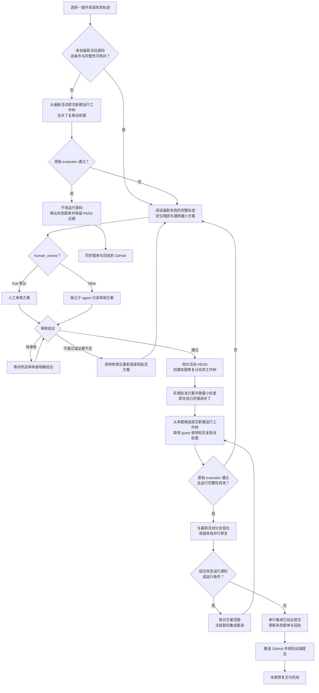

# OSWorld 单题修复工作流

状态：供用户审核的草案。审核本工作流不等于批准某一道题的修复方案；每项方案仍须在实施前取得所选审核方式的明确通过结论。

## 目标与入口

从失败题单选择一题，先核对失败证据是否对应最新活动源码。最新源码已通过的题目直接移出待修复清单；仍失败的题目，定位根因、审核方案、隔离修复、正式复跑，通过后才集成到活动分支并推送 GitHub。

执行前阅读仓库根目录 `README.md`、适用的 `AGENTS.md`、当前题目的开发记录和失败轨迹。本文件细化单题修复流程；旧日期文档中的模型、分数、分支与任务范围不能覆盖用户最新要求和当前 README。

当前项目入口如下，执行时重新核对，不固定历史提交 SHA：

| 项目 | 当前约定 |
| --- | --- |
| 活动目录与分支 | `/home/liuxv/liteagent`，`codex/api-split-liuxv`；“主活动源码”指这个开发分支，不指 Git 的 `main` |
| 运行源码 | `src/adapter_versions/v2_expanded/` |
| 单题运行入口 | `bin/run-osworld.py --orders <ORDER>` |
| 默认配置 | `configs/single-task-active-thinking.json` |
| 模型条件 | 华为云昇腾 Qwen3.5-9B thinking；机器配置由 `~/.config/liteagent/model.env` 提供 |
| 当前预算 | 每题 100 步、1800 秒；其余条件沿用当前默认配置 |
| 工作树与结果 | `/home/liuxv/liteagent-local-runs/` 下每次修复独占一个目录 |

本轮**活动失败题单**和**已修复题单**维护在本文末尾的“本轮修复台账”。初始范围来自用户指定的 thinking100 全量未通过题单，后续以本文的待修复集合选题；原题单保留为历史失败快照。按 Order 与 task ID 共同核对身份，不混入其他轮次的任务。当前代理一次处理一题；其他代理可在各自工作树处理其他题目。

### 审核选项

启动修复时记录 `human_review` 选项；这是本工作流的执行约定，不是现有运行器的命令行参数。可以在请求中写“按 repair_skill 修复第 N 题，human_review=false”。

| 选项 | 审核方式 | 通过后行为 |
| --- | --- | --- |
| `human_review=true`（默认） | 由人工审核根因和方案 | 等待人工明确通过后实施 |
| `human_review=false` | 开一个独立子 agent 审核根因和方案，代替人工审核 | 子 agent 明确通过后继续实施，无需再等待人工审核方案 |

用户明确关闭人工审核时，本 skill 要求使用子 agent 进行审核。该选项在本次修复及其失败重试循环中持续有效，直到用户修改；不因一次否决而自动切换审核方式，也不把“无人工审核”理解为跳过审核。每次在回执和题单条目中记录实际审核方式。

## 1. 先读失败轨迹，核对源码身份

打开单题日志，先读用户指令、运行元数据和完整事件链。至少追踪模型实际看到的工具说明/schema、请求与参数、服务响应、Adapter 返回、执行结果、verification、最终终止原因及原始 evaluator 结果。不要只凭日志摘要或最终错误文字推断根因。

记录启动时活动分支最新提交为 `base_commit`，并与失败运行的提交 SHA、源码摘要、配置快照和运行完整性核对。以下任一情况都应先做无补丁复跑：

- 失败运行来自旧提交，或无法证明它来自当前 `base_commit`。
- 缺少源码身份、运行前后完整性证据，或带有无法追溯的未提交改动。
- 模型、推理服务、thinking 模式或关键运行条件与当前约定不同。

无补丁复跑必须从 `base_commit` 新建独立、干净的运行工作树，使用当前约定条件，只跑当前题；不能先按旧轨迹修改源码再称为基线复跑。

- **复跑通过：**不做运行源码修复；记录“最新活动源码复跑通过，无新增补丁”，将本题从活动待修复集合移除，保留历史失败及本次 PASS 的证据链接。题单/回执按正常 Git 流程同步。
- **复跑失败：**以这次最新运行的完整轨迹作为诊断依据，进入第 2 步。
- **已有轨迹已确认来自当前源码与条件：**直接进入第 2 步，无需为了重复确认再跑一次。

通过以原始 OSWorld evaluator 的正式结果为准，同时核验结果对应当前题及源码、配置完整性。HTTP 200、进程退出码 0、模型声明完成、单元测试通过或手工查看输出，都不能替代题目 PASS。

## 2. 找到根因，提出通用最小方案

从最早偏离正确契约的环节向后追踪因果链，区分模型决策、工具 schema/生成约束、传输协议、Adapter 实现、执行环境、观察反馈和完成判定。基础设施错误也要保留原始响应；例如 HTTP 200 中的 grammar 错误不能归为正常模型回复或直接当成断流。

先说明证据证明了什么、仍有哪些不确定性，再提出作用于责任层的最小可行修复。说明为什么它能修正一类同源问题，如何保持其他合法行为，以及如何验证，而不是为当前题安排一套固定操作顺序。

修复必须满足：

- 不拆东墙补西墙：不靠吞错、伪造成功、放松正确性检查、删掉必要验证或全局放大重试/超时掩盖根因。
- 不定制 API 流或任务工作流：不按 Order、task ID、题目短语、文件名、golden 答案或固定坐标分支，不把单题答案或完整操作序列写进运行代码、schema、提示词。
- 不靠强制工具顺序、脚本接管模型决策或为该题新造宏操作来取得 PASS。必要的通用契约修复必须说明适用条件与边界。
- 修改发生在正确责任层；涉及公开契约时同步核对 schema、校验、dispatch/worker、返回与调用方。协议兼容转换不得悄悄取消参数本地校验。
- 不更换模型、降低题目难度、改变 evaluator、任务定义、参考数据或测试预算来规避失败；必要的条件变更必须单独说明并按所选方式审核。审核通过不扩大用户授权范围，也不允许干扰其他并行进程。

提交下面的审核材料，**尚未批准时只做阅读、诊断和必要的最小复现，不实施候选修复，也不改共享模型服务或运行条件**：

```text
题目：Order / task ID / 活动失败题单位置
源码与条件：base_commit、失败运行 commit/摘要、模型与配置身份
失败证据：日志路径、关键 step/事件、请求/响应或最小复现
根因：责任层、因果链、已确认事实与未确认假设
拟修复方案：拟改文件/契约、最小改动、为何具有普遍性
影响边界：需保留的合法行为、潜在副作用、为何不属于任务定制
验证：最小 focused check + 当前题原始 evaluator 复跑
审核方式：human_review=true / false
审核结论：待审核 / 通过的方案版本 / 不通过及建议
审核者与证据：人工回复引用，或子 agent ID 和完整审核记录
```

## 3. 按选项审核方案

- **待审核：**提交可审阅的材料；人工模式等待人工明确结论，子 agent 模式等待独立审核结果。不将沉默、未完成的子 agent 任务或对本 skill 的认可当作本题方案获批。
- **不通过：**保留审核建议，按建议重新调查或修订方案，再交同一审核方式复审；不执行被否决方案，也不通过换审核者来规避意见。
- **通过：**记录方案版本、批准内容及适用源码，才进入第 4 步。实施发现需要改变根因、扩大范围或更换策略时，返回第 2、3 步。

### `human_review=false` 的独立子 agent 审核

主 agent 负责诊断、提出方案和实施；审核必须由另一个子 agent 完成，不能由主 agent 自己宣布审核通过。使用子 agent 工具创建审核任务，不创建用户侧的新聊天。

给审核子 agent 提供本 skill、方案版本、基点提交、当前题目身份、原始失败日志与轨迹、相关源码位置和拟议改动。说明方案是待验证的假设，要求独立阅读原始证据，不预设通过结论。审核权限为只读；不得修改源码、台账或共享服务，不得启动完整 OSWorld 任务。

要求审核者逐项确认：根因是否有直接证据，方案是否作用于正确责任层，是否为通用且最小的改动，是否包含任务定制 API 流或工作流，是否破坏已有合法行为，以及验证与并行隔离是否充分。证据不足时指出缺项，不以经验猜测代替确认。

审核结果至少包含：

```text
reviewer_agent_id：审核子 agent ID
plan_version / base_commit：审核的确切方案与源码
verdict：通过 / 不通过 / 证据不足
evidence：独立核对的轨迹事件、源码位置和因果依据
findings：缺陷、影响范围或缺失证据；通过时也说明理由
required_changes：重新提交审核前必须解决的事项
```

仅“通过”允许进入实施；“不通过”或“证据不足”均返回第 2 步，按意见修订后复审。复审应回应上一轮意见，并保留历次结论；可以让同一审核子 agent 继续复审。审核子 agent 不可用或未返回明确结果时，保留“待子 agent 审核”状态并报告原因，不由主 agent 自审替代，也不默默切回人工模式。

子 agent 审核只替代本题方案的人工审核，不能替代真实 OSWorld evaluator 复跑、源码完整性检查或 GitHub 推送核验，也不能批准用户范围之外的操作。

## 4. 在本题独立工作树实施修复

批准后重新读取活动分支 HEAD。若它比审核依据更新，先检查新提交是否已消除故障或改变根因；需要时按第 1 步复跑。影响审核结论时更新方案并重审。

从此时确认的活动提交创建本题专属分支和工作树，例如 `codex/repair-<order>-<unique-id>`。不要借用另一个修复的工作树，也不要在主活动目录编写候选补丁。目录示例：

```text
/home/liuxv/liteagent-local-runs/repair-<order>-<unique-id>/
  repair/                本题可编辑的 Git 工作树
  run-001/source/        从无补丁或候选提交检出的干净运行工作树
  run-001/output/        本轮 runner 输出与原始轨迹
  run-002/...            下一轮，始终使用新目录
  review.md              审核方式、方案、审核者意见和逐轮证据
```

只实施已批准的最小修复，在自己的工作树完成必要的 focused check、改动 Python 文件的 Ruff、`git diff --check` 和 README 要求的 `bin/check.sh`。不扩建通用回归套件，不启动跨题或全量评测。

定向暂存本题文件，在**自己的修复分支**提交候选补丁，记为 `candidate_commit`。此处提交用于冻结复跑源码，不代表修复成功；候选失败时不得把它集成到活动分支。

## 5. 用自己的补丁源码复跑当前题

遵循 README：先提交候选，再从 `candidate_commit` 创建本题新的 detached 运行工作树。复跑的是自己带补丁的源码，不是主活动目录或别人的源码；运行中不编辑这个工作树、它的配置或运行器复制的源码快照。

使用自己的运行工作树中的 `bin/run-osworld.py`，显式指定本题 `--orders` 和仓库外的 `--result-dir`。先核对题目确实在配置中；若缺失，按现有任务定义补齐任务身份，保留模型、协议和预算条件，不添加答案、特殊策略或题目专用提示。

每轮保留提交 SHA、源码 seal、配置与摘要、实际模型/服务身份、完整启动命令和运行前后完整性。至少索引 `runner.log`、`results/results.json`、`lite_agent_events.jsonl`、`trajectory_manifest.json`、evaluator 产物，以及可用的 `model_transport/` 原始请求响应。不同服务上的同名 9B 不自动视为同一运行条件。

### 并行修复必须隔离共享资源

工作树只隔离源码；共享 guest、模型配置和主活动分支仍是共享状态：

- 同一 guest 一次只跑一题。复跑前确认占用及所有者，使用参与进程共同约定的**同一绝对路径锁**，持锁覆盖 guest 准备、整题执行、evaluator 和清理；等待期间可继续只读诊断。
- 当前 `run-osworld.py` 的内置锁位于 `ROOT.parent/liteagent-reproduction-jobs/v3-repair-vm.lock`，不同工作树可能得到不同锁文件，不能据此认定跨工作树互斥。可协调统一外层锁；未遵守该锁的既有进程仍需先确认占用，不能直接启动或抢占。
- 真正并行跑题需分配独立 guest、可写磁盘、端口及结果目录；可复用只读基盘。未获分配时排队，不停止或重置其他人的 guest、隧道或模型服务。
- 不改共享 `model.env`、全局服务参数，不清理其他工作树，不使用 `pkill`、`reset --hard`、强推或全局缓存清理来解决并行冲突。

#### 空闲资源轮询与排队

当用户要求资源空闲后自动继续或明确设置 15 分钟巡检时，应配置持续运行的 Codex automation/heartbeat；任务每 15 分钟只读检查一次公共资源，并在满足运行条件后按本 skill 当前阶段自动继续修复，无需再等用户发消息。监控需要安静运行，只有资源发生可行动变化、任务启动/完成/失败或需要用户操作时才通知。检查至少包括 `./bin/guest-status.sh`、共享锁 `/home/liuxv/liteagent-reproduction-jobs/v3-repair-vm.lock` 的持有状态，以及 `ps`/运行目录确认是否存在未遵守共享锁的 OSWorld 任务。必要时通过当前 Codex 工作流向其他责任人确认所有权，不停止或抢占其进程。

若当前会话没有可持续唤醒并接续工作的 automation/heartbeat 能力，不要用只读 cron 脚本声称已经实现“空闲后自动修复”；明确告知用户此能力不可用，并在会话可持续运行期间用不超过 15 分钟的有界等待后重查。若仅能安装周期性状态探测，应先确认探测输出与通知路径确实可用；探测本身不可获取锁、重置 guest 或启动修复。

- “可启动”要求共享 guest 健康且没有其他任务占用，并且共享锁可获得；缺一项即继续排队。运行启动前再次原子获取同一绝对路径锁，并让锁覆盖准备、执行、evaluator 和清理全程。不要先依据一次空闲快照准备/重置 guest，再在锁外启动。
- 多个排队修复按用户指定顺序或已记录的队列顺序逐个取得共享 guest；同一 guest 不并发。资源释放后重新检查审核结论、活动 HEAD、题目身份和运行配置，再决定继续基线复跑、候选复跑或其他当前阶段。
- 若没有可持续唤醒/定时执行机制，应说明限制并在当前会话可运行期间采用不超过 15 分钟的有界等待后重查；不得声称已建立后台任务。用户明确要求配置定时任务时，优先使用 Codex automation/heartbeat 能力，并将通知策略设为仅在资源状态变化、任务启动/完成/失败或需要用户操作时通知。
- 启动后将题目、责任人、锁路径、guest、开始时间和预期阶段写入本题 `review.md`/台账；退出前释放锁。每次检查记录时间、guest/锁/其他运行状态和决定（排队/启动）。

### 复跑结果分支

- **不通过：**保留本次失败，回到第 2 步阅读本次完整轨迹，再按所选方式审核根因和方案。不要回退到旧轨迹忽略新证据，也不要丢弃本题补丁去跑未修复的活动分支冒充验证。
- **没有新证据：**不反复重跑碰运气；说明待验证假设、阻塞条件或需要补充的审核意见，保留待修复状态。
- **通过：**将候选记为“本题验证通过，待集成”，进入第 6 步。

## 6. 集成到活动源码并推送 GitHub

先核对当前活动分支和 GitHub 上同名分支的最新提交。集成按共享分支的协调锁串行进行；只有短时间合并/更新分支需要持集成锁，不用它占住整轮模型推理。

- 活动分支仍在修复基点上且可快进时，合入已验证的本题提交。
- 活动分支已前进时，在本题专属的集成工作树上，以最新活动提交组合本题补丁。不能覆盖或撤掉其他已合入修复。
- 组合、冲突解决或适配改变了运行源码/运行条件时，先检查是否仍在批准方案范围，再冻结新的集成候选，按第 5 步重跑当前题；未通过则回到诊断和所选方式的审核。不能用旧基点上的 PASS 代表新组合也通过。
- 更新活动分支前再次确认其 HEAD 未被别人推进；有变化则重新组合验证。主活动工作区有他人的未提交改动时，保留现场，协调其所有者完成集成，不替别人 stash、提交或覆盖文件。

将验证通过的本题改动和回执集成到活动开发分支，正常推送其 GitHub 同名分支；不用 `--force`。远端前进或拒绝推送时重新核对差异，不盲目拉取合并后跳过必要验证。

成功验证后，必须同步维护本文末尾的“本轮修复台账”：从待修复表移除本题，并在已修复表追加题目身份、正式结果、源码与条件、证据和交付状态；更新分类及总数，保留全部历史尝试。候选尚未合入时标记“已验证，待集成”；GitHub 推送失败时标记“本地已集成，待推送”，不得报告完整交付。

无补丁复跑已通过的题目只需同步题单/回执，不制造源码修复提交。多个修复同时更新题单时串行合并本题条目，避免整份旧列表覆盖他人的结果。

每次接手先重新读取台账并标注本题认领者、个人工作树、`human_review` 选项和当前阶段（待复跑／诊断／待人工审核或待子 agent 审核／实施／复跑／待集成／待推送）；保留简短的逐次更新记录。新的正式失败若推翻已登记的 PASS，保留原 PASS 证据，把本题重新放回待修复表并写明失败运行。结果未完成、协议探针成功或静态检查通过均不能移入已修复表。更新台账时只编辑自己的条目和相应计数，不覆盖其他修复的状态。

最终报告：题目、原根因、审核方式与审核者、通过的策略版本、候选与最终活动提交、OSWorld 正式结果及证据、题单状态、GitHub 推送结果。单题 PASS 不改写历史批次分数，也不构成全量评测或基线 promotion。

## 流程图



## 本轮修复台账

核对时间（北京时间）：`2026-10-23T22:58:52+08:00`；核对时活动分支 HEAD：`8d5461b5555128c876d548a5e92fce1985e1740d`。

原始范围：[thinking100 未通过题单](/home/liuxv/liteagent1021/reports/20261022-thinking100-full189/wrong-tasks.md)，对应 [结构化题单](/home/liuxv/liteagent1021/reports/20261022-thinking100-full189/wrong-tasks.json)。原始全量 189 题中 108 题通过、81 题未通过；原始结果及题单保持历史事实，本文只维护后续修复队列。

**当前待修复 67 题；已确认正式 OSWorld 通过并移出队列 14 题。** 已通过题号：4、6、15、19、20、24、47、48、55、60、78、89、94、147。

本次核对原始 `results.json`、任务身份、单题轨迹 outcome、配置和 `final-integrity.json`；采用原失败之后、已完成且源码/配置完整性均通过的运行。15、47 的串行复跑发生在全量批次结束前，但晚于各自原失败，按单题时间核对。未把早于本轮失败的历史 PASS 用作销项证据。

“已修复”在本次导入中表示已有正式 PASS、从活动队列移出，包含无新增补丁的复跑通过；不声称每题都新增了修复。12 题均为 `passed / reward=1.0`，但不是都在当前 HEAD 或当前昇腾服务上验证。旧服务和 dirty 快照的条件在表中明示；它们按用户要求作为已有通过记录导入，不作为未来候选可跳过干净提交复跑的先例。

### 待修复题单（67 题）

分类沿用原始题单，便于追溯；它不是最新根因分类。表内已有后续失败则链接最新找到的结果，否则回到原失败日志按本文第 1 步核对和复跑。此处不认领任务、不启动运行。

| 原始状态 | 剩余数量 | 题号 |
| --- | ---: | --- |
| `failed` | 40 | 23、25、28、30、65、77、79、82、87、93、97、100、101、103、104、105、106、107、108、109、118、120、122、124、125、126、128、131、132、136、142、143、145、146、151、161、163、164、166、174 |
| `agent_deadline_exhausted` | 11 | 37、54、74、86、88、98、117、127、130、167、189 |
| `agent_failure` | 2 | 99、114 |
| `model_protocol_failure` | 6 | 110、113、115、141、155、172 |
| `model_transport_failure` | 7 | 13、27、72、76、102、119、183 |
| `environment_failure` | 1 | 59 |

| Order | task ID / 应用 | 当前证据与阶段 |
| ---: | --- | --- |
| 13 | `0326d92d-d218-48a8-9ca1-981cd6d064c7` / libreoffice_calc | 后续 `failed`；[结果](/home/liuxv/liteagent-local-runs/v3-thinking-serial-20261021T125321899279Z/results/results.json)；待核对源码／诊断 |
| 23 | `4de54231-e4b5-49e3-b2ba-61a0bec721c0` / libreoffice_calc | 后续 `agent_deadline_exhausted`；[结果](/home/liuxv/liteagent-local-runs/selected13-active-20261022T114201557379Z/run/results/results.json)；待核对源码／诊断 |
| 25 | `4172ea6e-6b77-4edb-a9cc-c0014bd1603b` / libreoffice_calc | 后续 `failed`；[结果](/home/liuxv/liteagent-local-runs/tasks25-28-30-48-65-qwen9b-20261023T141100Z/attempt-1/results/results.json)；待核对源码／诊断 |
| 27 | `3a7c8185-25c1-4941-bd7b-96e823c9f21f` / libreoffice_calc | 后续 `failed`；[结果](/home/liuxv/liteagent-local-runs/v3-thinking-serial-20261021T125321899279Z/results/results.json)；待核对源码／诊断 |
| 28 | `21ab7b40-77c2-4ae6-8321-e00d3a086c73` / libreoffice_calc | 后续 `failed`；[结果](/home/liuxv/liteagent-local-runs/tasks25-28-30-48-65-qwen9b-20261023T141100Z/attempt-1/results/results.json)；待核对源码／诊断 |
| 30 | `af23762e-2bfd-4a1d-aada-20fa8de9ce07` / libreoffice_impress | 后续 `failed`；[结果](/home/liuxv/liteagent-local-runs/tasks25-28-30-48-65-qwen9b-20261023T141100Z/attempt-1/results/results.json)；待核对源码／诊断 |
| 37 | `ac9bb6cb-1888-43ab-81e4-a98a547918cd` / libreoffice_impress | 原始 `agent_deadline_exhausted`；[失败日志](/home/liuxv/liteagent1021/runs/liteagent1021-thinking100-20261021T062953289949Z/results/workers/worker-01/raw/run-1/37-libreoffice_impress-ac9bb6cb-1888-43ab-81e4-a98a547918cd)；待最新源码复跑 |
| 54 | `a53f80cd-4a90-4490-8310-097b011433f6` / libreoffice_impress | 原始 `agent_deadline_exhausted`；[失败日志](/home/liuxv/liteagent1021/runs/liteagent1021-thinking100-20261021T062953289949Z/results/workers/worker-06/raw/run-1/54-libreoffice_impress-a53f80cd-4a90-4490-8310-097b011433f6)；待最新源码复跑 |
| 59 | `4ed5abd0-8b5d-47bd-839f-cacfa15ca37a` / libreoffice_impress | 原始 `environment_failure`；[失败日志](/home/liuxv/liteagent1021/runs/liteagent1021-thinking100-20261021T062953289949Z/results/workers/worker-05/raw/run-1/59-libreoffice_impress-4ed5abd0-8b5d-47bd-839f-cacfa15ca37a)；待最新源码复跑 |
| 65 | `0a0faba3-5580-44df-965d-f562a99b291c` / libreoffice_writer | 后续 `failed`；[结果](/home/liuxv/liteagent-local-runs/selected13-active-20261022T114201557379Z/run/results/results.json)；待核对源码／诊断 |
| 72 | `6a33f9b9-0a56-4844-9c3f-96ec3ffb3ba2` / libreoffice_writer | 原始 `model_transport_failure`；[失败日志](/home/liuxv/liteagent1021/runs/liteagent1021-thinking100-20261021T062953289949Z/results/workers/worker-06/raw/run-1/72-libreoffice_writer-6a33f9b9-0a56-4844-9c3f-96ec3ffb3ba2)；待最新源码复跑 |
| 74 | `6f81754e-285d-4ce0-b59e-af7edb02d108` / libreoffice_writer | 原始 `agent_deadline_exhausted`；[失败日志](/home/liuxv/liteagent1021/runs/liteagent1021-thinking100-20261021T062953289949Z/results/workers/worker-02/raw/run-1/74-libreoffice_writer-6f81754e-285d-4ce0-b59e-af7edb02d108)；待最新源码复跑 |
| 76 | `8472fece-c7dd-4241-8d65-9b3cd1a0b568` / libreoffice_writer | 后续 `failed`；[结果](/home/liuxv/liteagent-local-runs/v3-thinking-serial-20261021T125321899279Z/results/results.json)；待核对源码／诊断 |
| 77 | `88fe4b2d-3040-4c70-9a70-546a47764b48` / libreoffice_writer | 后续 `failed`；[结果](/home/liuxv/liteagent-local-runs/selected13-active-20261022T114201557379Z/run/results/results.json)；待核对源码／诊断 |
| 79 | `adf5e2c3-64c7-4644-b7b6-d2f0167927e7` / libreoffice_writer | 后续 `failed`；[结果](/home/liuxv/liteagent-local-runs/selected13-active-20261022T114201557379Z/run/results/results.json)；待核对源码／诊断 |
| 82 | `e246f6d8-78d7-44ac-b668-fcf47946cb50` / libreoffice_writer | 后续 `failed`；[结果](/home/liuxv/liteagent-local-runs/selected13-active-20261022T114201557379Z/run/results/results.json)；待核对源码／诊断 |
| 86 | `2c9fc0de-3ee7-45e1-a5df-c86206ad78b5` / multi_apps | 原始 `agent_deadline_exhausted`；[失败日志](/home/liuxv/liteagent1021/runs/liteagent1021-thinking100-20261021T062953289949Z/results/workers/worker-02/raw/run-1/86-multi_apps-2c9fc0de-3ee7-45e1-a5df-c86206ad78b5)；待最新源码复跑 |
| 87 | `2fe4b718-3bd7-46ec-bdce-b184f5653624` / multi_apps | 后续 `agent_deadline_exhausted`；[结果](/home/liuxv/liteagent-local-runs/selected13-active-20261022T114201557379Z/run/results/results.json)；待核对源码／诊断 |
| 88 | `3680a5ee-6870-426a-a997-eba929a0d25c` / multi_apps | 原始 `agent_deadline_exhausted`；[失败日志](/home/liuxv/liteagent1021/runs/liteagent1021-thinking100-20261021T062953289949Z/results/workers/worker-04/raw/run-1/88-multi_apps-3680a5ee-6870-426a-a997-eba929a0d25c)；待最新源码复跑 |
| 93 | `f7dfbef3-7697-431c-883a-db8583a4e4f9` / multi_apps | 候选 run-003 正式 failed/reward=0.9988200756924308；12份PDF齐全，3份文本换行残差，候选58b405c未集成；human_review=true；参考兼容条件b009269 run-reference-001 failed0，字体生效但字面通配符未转换；v4发现说明方案待人工审核，未集成；证据 `/home/liuxv/liteagent-local-runs/repair-93-20261023-current` |
| 97 | `eb303e01-261e-4972-8c07-c9b4e7a4922a` / multi_apps | 候选7f44136 run-003 failed/reward0，source/config true；恢复补丁生效；独立复核指出末页原有备注已匹配，正式失败为原始模板已含的Slide4正文尾空段与gold差异，原始/结果XML一致；未集成；证据 `/home/liuxv/liteagent-local-runs/repair-97-20261024-current` |
| 98 | `8e116af7-7db7-4e35-a68b-b0939c066c78` / multi_apps | 原始 `agent_deadline_exhausted`；[失败日志](/home/liuxv/liteagent1021/runs/liteagent1021-thinking100-20261021T062953289949Z/results/workers/worker-02/raw/run-1/98-multi_apps-8e116af7-7db7-4e35-a68b-b0939c066c78)；待最新源码复跑 |
| 99 | `337d318b-aa07-4f4f-b763-89d9a2dd013f` / multi_apps | 原始 `agent_failure`；[失败日志](/home/liuxv/liteagent1021/runs/liteagent1021-thinking100-20261021T062953289949Z/results/workers/worker-03/raw/run-1/99-multi_apps-337d318b-aa07-4f4f-b763-89d9a2dd013f)；待最新源码复跑 |
| 100 | `82e3c869-49f6-4305-a7ce-f3e64a0618e7` / multi_apps | 候选da4ed5a run005正式failed/reward0，source/config true；恢复补丁生效，但只复制1张、ZIP缺失即误报完成；无新方案获批，未集成；证据 `/home/liuxv/liteagent-local-runs/repair-100-20261024-current` |
| 101 | `185f29bd-5da0-40a6-b69c-ba7f4e0324ef` / multi_apps | 候选7afdebe run-002 failed/reward=0.0586，source/config true；fields结构修复生效，仅生成1/7份且内容错误，未集成；证据 `/home/liuxv/liteagent-local-runs/repair-101-20261024-current` |
| 102 | `869de13e-bef9-4b91-ba51-f6708c40b096` / multi_apps | 后续 `agent_failure`；[结果](/home/liuxv/liteagent-local-runs/transport-rerun-102-119-147-183-20261022/results/results.json)；待核对源码／诊断 |
| 103 | `3a93cae4-ad3e-403e-8c12-65303b271818` / multi_apps | 候选8159bef run-003 failed/reward0，source/config true；task_state恢复修正未触发，模型只打开文件便误报完成；效果分类后续方案未获批，候选未集成；证据 `/home/liuxv/liteagent-local-runs/repair-103-20261024-current` |
| 104 | `1f18aa87-af6f-41ef-9853-cdb8f32ebdea` / multi_apps | 候选a67d723 run-003 failed/reward0，source/config true；恢复说明促成打开及追加，输出内容/格式仍不符，未集成，待诊断；证据 `/home/liuxv/liteagent-local-runs/repair-104-20261024-current` |
| 105 | `26150609-0da3-4a7d-8868-0faf9c5f01bb` / multi_apps | 原始 `failed`；[失败日志](/home/liuxv/liteagent1021/runs/liteagent1021-thinking100-20261021T062953289949Z/results/workers/worker-03/raw/run-1/105-multi_apps-26150609-0da3-4a7d-8868-0faf9c5f01bb)；待最新源码复跑 |
| 106 | `9219480b-3aed-47fc-8bac-d2cffc5849f7` / multi_apps | 原始 `failed`；[失败日志](/home/liuxv/liteagent1021/runs/liteagent1021-thinking100-20261021T062953289949Z/results/workers/worker-04/raw/run-1/106-multi_apps-9219480b-3aed-47fc-8bac-d2cffc5849f7)；待最新源码复跑 |
| 107 | `881deb30-9549-4583-a841-8270c65f2a17` / multi_apps | 原始 `failed`；[失败日志](/home/liuxv/liteagent1021/runs/liteagent1021-thinking100-20261021T062953289949Z/results/workers/worker-05/raw/run-1/107-multi_apps-881deb30-9549-4583-a841-8270c65f2a17)；待最新源码复跑 |
| 108 | `7e287123-70ca-47b9-8521-47db09b69b14` / multi_apps | 原始 `failed`；[失败日志](/home/liuxv/liteagent1021/runs/liteagent1021-thinking100-20261021T062953289949Z/results/workers/worker-06/raw/run-1/108-multi_apps-7e287123-70ca-47b9-8521-47db09b69b14)；待最新源码复跑 |
| 109 | `5bc63fb9-276a-4439-a7c1-9dc76401737f` / multi_apps | 原始 `failed`；[失败日志](/home/liuxv/liteagent1021/runs/liteagent1021-thinking100-20261021T062953289949Z/results/workers/worker-01/raw/run-1/109-multi_apps-5bc63fb9-276a-4439-a7c1-9dc76401737f)；待最新源码复跑 |
| 110 | `716a6079-22da-47f1-ba73-c9d58f986a38` / multi_apps | 原始 `model_protocol_failure`；[失败日志](/home/liuxv/liteagent1021/runs/liteagent1021-thinking100-20261021T062953289949Z/results/workers/worker-02/raw/run-1/110-multi_apps-716a6079-22da-47f1-ba73-c9d58f986a38)；待最新源码复跑 |
| 113 | `81c425f5-78f3-4771-afd6-3d2973825947` / multi_apps | 原始 `model_protocol_failure`；[失败日志](/home/liuxv/liteagent1021/runs/liteagent1021-thinking100-20261021T062953289949Z/results/workers/worker-05/raw/run-1/113-multi_apps-81c425f5-78f3-4771-afd6-3d2973825947)；待最新源码复跑 |
| 114 | `bb83cab4-e5c7-42c7-a67b-e46068032b86` / multi_apps | 原始 `agent_failure`；[失败日志](/home/liuxv/liteagent1021/runs/liteagent1021-thinking100-20261021T062953289949Z/results/workers/worker-06/raw/run-1/114-multi_apps-bb83cab4-e5c7-42c7-a67b-e46068032b86)；待最新源码复跑 |
| 115 | `227d2f97-562b-4ccb-ae47-a5ec9e142fbb` / multi_apps | 后续 `failed`；[结果](/home/liuxv/liteagent-local-runs/task115-155-qwen9b-8d5461b/attempt-1/results/results.json)；待核对源码／诊断 |
| 117 | `8df7e444-8e06-4f93-8a1a-c5c974269d82` / multi_apps | 原始 `agent_deadline_exhausted`；[失败日志](/home/liuxv/liteagent1021/runs/liteagent1021-thinking100-20261021T062953289949Z/results/workers/worker-03/raw/run-1/117-multi_apps-8df7e444-8e06-4f93-8a1a-c5c974269d82)；待最新源码复跑 |
| 118 | `02ce9a50-7af2-47ed-8596-af0c230501f8` / multi_apps | 原始 `failed`；[失败日志](/home/liuxv/liteagent1021/runs/liteagent1021-thinking100-20261021T062953289949Z/results/workers/worker-04/raw/run-1/118-multi_apps-02ce9a50-7af2-47ed-8596-af0c230501f8)；待最新源码复跑 |
| 119 | `4c26e3f3-3a14-4d86-b44a-d3cedebbb487` / multi_apps | 后续 `failed`；[结果](/home/liuxv/liteagent-local-runs/transport-rerun-102-119-147-183-20261022/results/results.json)；待核对源码／诊断 |
| 120 | `09a37c51-e625-49f4-a514-20a773797a8a` / multi_apps | 原始 `failed`；[失败日志](/home/liuxv/liteagent1021/runs/liteagent1021-thinking100-20261021T062953289949Z/results/workers/worker-06/raw/run-1/120-multi_apps-09a37c51-e625-49f4-a514-20a773797a8a)；待最新源码复跑 |
| 122 | `415ef462-bed3-493a-ac36-ca8c6d23bf1b` / multi_apps | 原始 `failed`；[失败日志](/home/liuxv/liteagent1021/runs/liteagent1021-thinking100-20261021T062953289949Z/results/workers/worker-02/raw/run-1/122-multi_apps-415ef462-bed3-493a-ac36-ca8c6d23bf1b)；待最新源码复跑 |
| 124 | `ce2b64a2-ddc1-4f91-8c7d-a88be7121aac` / multi_apps | 原始 `failed`；[失败日志](/home/liuxv/liteagent1021/runs/liteagent1021-thinking100-20261021T062953289949Z/results/workers/worker-04/raw/run-1/124-multi_apps-ce2b64a2-ddc1-4f91-8c7d-a88be7121aac)；待最新源码复跑 |
| 125 | `778efd0a-153f-4842-9214-f05fc176b877` / multi_apps | 原始 `failed`；[失败日志](/home/liuxv/liteagent1021/runs/liteagent1021-thinking100-20261021T062953289949Z/results/workers/worker-05/raw/run-1/125-multi_apps-778efd0a-153f-4842-9214-f05fc176b877)；待最新源码复跑 |
| 126 | `47f7c0ce-a5fb-4100-a5e6-65cd0e7429e5` / multi_apps | 原始 `failed`；[失败日志](/home/liuxv/liteagent1021/runs/liteagent1021-thinking100-20261021T062953289949Z/results/workers/worker-06/raw/run-1/126-multi_apps-47f7c0ce-a5fb-4100-a5e6-65cd0e7429e5)；待最新源码复跑 |
| 127 | `c2751594-0cd5-4088-be1b-b5f2f9ec97c4` / multi_apps | 原始 `agent_deadline_exhausted`；[失败日志](/home/liuxv/liteagent1021/runs/liteagent1021-thinking100-20261021T062953289949Z/results/workers/worker-01/raw/run-1/127-multi_apps-c2751594-0cd5-4088-be1b-b5f2f9ec97c4)；待最新源码复跑 |
| 128 | `d68204bf-11c1-4b13-b48b-d303c73d4bf6` / multi_apps | 原始 `failed`；[失败日志](/home/liuxv/liteagent1021/runs/liteagent1021-thinking100-20261021T062953289949Z/results/workers/worker-02/raw/run-1/128-multi_apps-d68204bf-11c1-4b13-b48b-d303c73d4bf6)；待最新源码复跑 |
| 130 | `98e8e339-5f91-4ed2-b2b2-12647cb134f4` / multi_apps | 原始 `agent_deadline_exhausted`；[失败日志](/home/liuxv/liteagent1021/runs/liteagent1021-thinking100-20261021T062953289949Z/results/workers/worker-04/raw/run-1/130-multi_apps-98e8e339-5f91-4ed2-b2b2-12647cb134f4)；待最新源码复跑 |
| 131 | `5df7b33a-9f77-4101-823e-02f863e1c1ae` / multi_apps | 原始 `failed`；[失败日志](/home/liuxv/liteagent1021/runs/liteagent1021-thinking100-20261021T062953289949Z/results/workers/worker-05/raw/run-1/131-multi_apps-5df7b33a-9f77-4101-823e-02f863e1c1ae)；待最新源码复跑 |
| 132 | `aceb0368-56b8-4073-b70e-3dc9aee184e0` / multi_apps | 原始 `failed`；[失败日志](/home/liuxv/liteagent1021/runs/liteagent1021-thinking100-20261021T062953289949Z/results/workers/worker-06/raw/run-1/132-multi_apps-aceb0368-56b8-4073-b70e-3dc9aee184e0)；待最新源码复跑 |
| 136 | `28cc3b7e-b194-4bc9-8353-d04c0f4d56d2` / os | 原始 `failed`；[失败日志](/home/liuxv/liteagent1021/runs/liteagent1021-thinking100-20261021T062953289949Z/results/workers/worker-04/raw/run-1/136-os-28cc3b7e-b194-4bc9-8353-d04c0f4d56d2)；待最新源码复跑 |
| 141 | `13584542-872b-42d8-b299-866967b5c3ef` / os | 原始 `model_protocol_failure`；[失败日志](/home/liuxv/liteagent1021/runs/liteagent1021-thinking100-20261021T062953289949Z/results/workers/worker-03/raw/run-1/141-os-13584542-872b-42d8-b299-866967b5c3ef)；待最新源码复跑 |
| 142 | `23393935-50c7-4a86-aeea-2b78fd089c5c` / os | 原始 `failed`；[失败日志](/home/liuxv/liteagent1021/runs/liteagent1021-thinking100-20261021T062953289949Z/results/workers/worker-04/raw/run-1/142-os-23393935-50c7-4a86-aeea-2b78fd089c5c)；待最新源码复跑 |
| 143 | `5c1075ca-bb34-46a3-a7a0-029bd7463e79` / os | 原始 `failed`；[失败日志](/home/liuxv/liteagent1021/runs/liteagent1021-thinking100-20261021T062953289949Z/results/workers/worker-05/raw/run-1/143-os-5c1075ca-bb34-46a3-a7a0-029bd7463e79)；待最新源码复跑 |
| 145 | `37887e8c-da15-4192-923c-08fa390a176d` / os | 原始 `failed`；[失败日志](/home/liuxv/liteagent1021/runs/liteagent1021-thinking100-20261021T062953289949Z/results/workers/worker-01/raw/run-1/145-os-37887e8c-da15-4192-923c-08fa390a176d)；待最新源码复跑 |
| 146 | `4127319a-8b79-4410-b58a-7a151e15f3d7` / os | 原始 `failed`；[失败日志](/home/liuxv/liteagent1021/runs/liteagent1021-thinking100-20261021T062953289949Z/results/workers/worker-02/raw/run-1/146-os-4127319a-8b79-4410-b58a-7a151e15f3d7)；待最新源码复跑 |
| 151 | `7b1e1ff9-bb85-49be-b01d-d6424be18cd0` / thunderbird | 原始 `failed`；[失败日志](/home/liuxv/liteagent1021/runs/liteagent1021-thinking100-20261021T062953289949Z/results/workers/worker-01/raw/run-1/151-thunderbird-7b1e1ff9-bb85-49be-b01d-d6424be18cd0)；待最新源码复跑 |
| 155 | `dd84e895-72fd-4023-a336-97689ded257c` / thunderbird | 后续 `agent_deadline_exhausted`；[结果](/home/liuxv/liteagent-local-runs/task115-155-qwen9b-8d5461b/attempt-1/results/results.json)；待核对源码／诊断 |
| 161 | `59f21cfb-0120-4326-b255-a5b827b38967` / vlc | 原始 `failed`；[失败日志](/home/liuxv/liteagent1021/runs/liteagent1021-thinking100-20261021T062953289949Z/results/workers/worker-05/raw/run-1/161-vlc-59f21cfb-0120-4326-b255-a5b827b38967)；待最新源码复跑 |
| 163 | `8f080098-ddb1-424c-b438-4e96e5e4786e` / vlc | 原始 `failed`；[失败日志](/home/liuxv/liteagent1021/runs/liteagent1021-thinking100-20261021T062953289949Z/results/workers/worker-01/raw/run-1/163-vlc-8f080098-ddb1-424c-b438-4e96e5e4786e)；待最新源码复跑 |
| 164 | `fba2c100-79e8-42df-ae74-b592418d54f4` / vlc | 原始 `failed`；[失败日志](/home/liuxv/liteagent1021/runs/liteagent1021-thinking100-20261021T062953289949Z/results/workers/worker-02/raw/run-1/164-vlc-fba2c100-79e8-42df-ae74-b592418d54f4)；待最新源码复跑 |
| 166 | `aa4b5023-aef6-4ed9-bdc9-705f59ab9ad6` / vlc | 原始 `failed`；[失败日志](/home/liuxv/liteagent1021/runs/liteagent1021-thinking100-20261021T062953289949Z/results/workers/worker-04/raw/run-1/166-vlc-aa4b5023-aef6-4ed9-bdc9-705f59ab9ad6)；待最新源码复跑 |
| 167 | `386dbd0e-0241-4a0a-b6a2-6704fba26b1c` / vlc | 原始 `agent_deadline_exhausted`；[失败日志](/home/liuxv/liteagent1021/runs/liteagent1021-thinking100-20261021T062953289949Z/results/workers/worker-05/raw/run-1/167-vlc-386dbd0e-0241-4a0a-b6a2-6704fba26b1c)；待最新源码复跑 |
| 172 | `f3977615-2b45-4ac5-8bba-80c17dbe2a37` / vlc | 原始 `model_protocol_failure`；[失败日志](/home/liuxv/liteagent1021/runs/liteagent1021-thinking100-20261021T062953289949Z/results/workers/worker-04/raw/run-1/172-vlc-f3977615-2b45-4ac5-8bba-80c17dbe2a37)；待最新源码复跑 |
| 174 | `0ed39f63-6049-43d4-ba4d-5fa2fe04a951` / vs_code | 原始 `failed`；[失败日志](/home/liuxv/liteagent1021/runs/liteagent1021-thinking100-20261021T062953289949Z/results/workers/worker-06/raw/run-1/174-vs_code-0ed39f63-6049-43d4-ba4d-5fa2fe04a951)；待最新源码复跑 |
| 183 | `6ed0a554-cbee-4b44-84ea-fd6c042f4fe1` / vs_code | 后续 `model_protocol_failure`；[结果](/home/liuxv/liteagent-local-runs/active-thinking-serial-20261022T044210521731Z/results/results.json)；待核对源码／诊断 |
| 189 | `7aeae0e2-70ee-4705-821d-1bba5d5b2ddd` / vs_code | 原始 `agent_deadline_exhausted`；[失败日志](/home/liuxv/liteagent1021/runs/liteagent1021-thinking100-20261021T062953289949Z/results/workers/worker-03/raw/run-1/189-vs_code-7aeae0e2-70ee-4705-821d-1bba5d5b2ddd)；待最新源码复跑 |

### 已修复／已通过题单（14 题）

每条均有完整结束的正式运行及 `source_matches=true / config_matches=true`。提交列为运行配置记录的提交；标为 dirty 时必须同时以源码 seal 和配置快照追溯，不能声称该 SHA 独自包含全部运行代码。所有现有记录的审核过程与推送状态不在本次追认范围，后续新增修复按第 3、6 步记录。

| Order / task ID | 正式通过时间（北京时间） | 源码与运行条件 | 正式证据与处理 |
| --- | --- | --- | --- |
| 4 / `535364ea-05bd-46ea-9937-9f55c68507e8` | 2026-10-22 16:28:01 | `c94b9c0`；dirty 快照；旧 endpoint Qwen3.5-9B thinking；seal `81c71075e1ef` | `passed / 1.0`；[结果](/home/liuxv/liteagent-local-runs/final-completion-gate-20261022/results/results.json) · [轨迹](/home/liuxv/liteagent-local-runs/final-completion-gate-20261022/results/raw/run-1/04-libreoffice_calc-535364ea-05bd-46ea-9937-9f55c68507e8/trajectory_manifest.json) · [配置](/home/liuxv/liteagent-local-runs/final-completion-gate-20261022/config.json) · [完整性](/home/liuxv/liteagent-local-runs/final-completion-gate-20261022/final-integrity.json)；已有 PASS 导入，移出待修复 |
| 6 / `04d9aeaf-7bed-4024-bedb-e10e6f00eb7f` | 2026-10-23 19:36:44 | `bdf83aa`；干净提交；昇腾 Qwen3.5-9B thinking；seal `2d0bfc1025d7` | `passed / 1.0`；[结果](/home/liuxv/liteagent-local-runs/task6-ascend-qwen9b-bdf83aa/attempt-5/results/results.json) · [轨迹](/home/liuxv/liteagent-local-runs/task6-ascend-qwen9b-bdf83aa/attempt-5/results/raw/run-1/06-libreoffice_calc-04d9aeaf-7bed-4024-bedb-e10e6f00eb7f/trajectory_manifest.json) · [配置](/home/liuxv/liteagent-local-runs/task6-ascend-qwen9b-bdf83aa/attempt-5/config.json) · [完整性](/home/liuxv/liteagent-local-runs/task6-ascend-qwen9b-bdf83aa/attempt-5/final-integrity.json)；已有 PASS 导入，移出待修复 |
| 15 / `347ef137-7eeb-4c80-a3bb-0951f26a8aff` | 2026-10-21 22:05:26 | `da00373`；冻结 v3 快照；旧 endpoint Qwen3.5-9B thinking；seal `8ed6671fb292` | `passed / 1.0`；[结果](/home/liuxv/liteagent-local-runs/v3-thinking-serial-20261021T135832557856Z/results/results.json) · [轨迹](/home/liuxv/liteagent-local-runs/v3-thinking-serial-20261021T135832557856Z/results/raw/run-1/15-libreoffice_calc-347ef137-7eeb-4c80-a3bb-0951f26a8aff/trajectory_manifest.json) · [配置](/home/liuxv/liteagent-local-runs/v3-thinking-serial-20261021T135832557856Z/config.json) · [完整性](/home/liuxv/liteagent-local-runs/v3-thinking-serial-20261021T135832557856Z/final-integrity.json)；已有 PASS 导入，移出待修复 |
| 19 / `21df9241-f8d7-4509-b7f1-37e501a823f7` | 2026-10-22 19:10:34 | `6cbe388`；dirty 快照；旧 endpoint Qwen3.5-9B thinking；seal `e063c7633e51` | `passed / 1.0`；[结果](/home/liuxv/liteagent-local-runs/order019-cell-outcomes-20261022T105726521800Z/run/results/results.json) · [轨迹](/home/liuxv/liteagent-local-runs/order019-cell-outcomes-20261022T105726521800Z/run/results/raw/run-1/19-libreoffice_calc-21df9241-f8d7-4509-b7f1-37e501a823f7/trajectory_manifest.json) · [配置](/home/liuxv/liteagent-local-runs/order019-cell-outcomes-20261022T105726521800Z/run/config.json) · [完整性](/home/liuxv/liteagent-local-runs/order019-cell-outcomes-20261022T105726521800Z/run/final-integrity.json)；已有 PASS 导入，移出待修复 |
| 20 / `a9f325aa-8c05-4e4f-8341-9e4358565f4f` | 2026-10-22 19:18:28 | `6cbe388`；dirty 快照；旧 endpoint Qwen3.5-9B thinking；seal `e063c7633e51` | `passed / 1.0`；[结果](/home/liuxv/liteagent-local-runs/active-thinking-serial-20261022T105916593978Z/results/results.json) · [轨迹](/home/liuxv/liteagent-local-runs/active-thinking-serial-20261022T105916593978Z/results/raw/run-1/20-libreoffice_calc-a9f325aa-8c05-4e4f-8341-9e4358565f4f/trajectory_manifest.json) · [配置](/home/liuxv/liteagent-local-runs/active-thinking-serial-20261022T105916593978Z/config.json) · [完整性](/home/liuxv/liteagent-local-runs/active-thinking-serial-20261022T105916593978Z/final-integrity.json)；已有 PASS 导入，移出待修复 |
| 24 / `30e3e107-1cfb-46ee-a755-2cd080d7ba6a` | 2026-10-23 22:05:43 | `8d5461b`；干净提交；昇腾 Qwen3.5-9B thinking；当前核对 HEAD；seal `936c6188ad91` | `passed / 1.0`；[结果](/home/liuxv/liteagent-local-runs/task24-schema-fixed-qwen9b-20261023T134346Z/attempt-1/results/results.json) · [轨迹](/home/liuxv/liteagent-local-runs/task24-schema-fixed-qwen9b-20261023T134346Z/attempt-1/results/raw/run-1/24-libreoffice_calc-30e3e107-1cfb-46ee-a755-2cd080d7ba6a/trajectory_manifest.json) · [配置](/home/liuxv/liteagent-local-runs/task24-schema-fixed-qwen9b-20261023T134346Z/attempt-1/config.json) · [完整性](/home/liuxv/liteagent-local-runs/task24-schema-fixed-qwen9b-20261023T134346Z/attempt-1/final-integrity.json)；已有 PASS 导入，移出待修复 |
| 47 / `08aced46-45a2-48d7-993b-ed3fb5b32302` | 2026-10-21 21:26:20 | `da00373`；冻结 v3 快照；旧 endpoint Qwen3.5-9B thinking；seal `8ed6671fb292` | `passed / 1.0`；[结果](/home/liuxv/liteagent-local-runs/v3-thinking-serial-20261021T125321899279Z/results/results.json) · [轨迹](/home/liuxv/liteagent-local-runs/v3-thinking-serial-20261021T125321899279Z/results/raw/run-1/47-libreoffice_impress-08aced46-45a2-48d7-993b-ed3fb5b32302/trajectory_manifest.json) · [配置](/home/liuxv/liteagent-local-runs/v3-thinking-serial-20261021T125321899279Z/config.json) · [完整性](/home/liuxv/liteagent-local-runs/v3-thinking-serial-20261021T125321899279Z/final-integrity.json)；已有 PASS 导入，移出待修复 |
| 48 / `c82632a4-56b6-4db4-9dd1-3820ee3388e4` | 2026-10-22 21:12:06 | `7302df9`；dirty 快照；旧 endpoint Qwen3.5-9B thinking；seal `e063c7633e51` | `passed / 1.0`；[结果](/home/liuxv/liteagent-local-runs/selected13-active-20261022T114201557379Z/run/results/results.json) · [轨迹](/home/liuxv/liteagent-local-runs/selected13-active-20261022T114201557379Z/run/results/raw/run-1/48-libreoffice_impress-c82632a4-56b6-4db4-9dd1-3820ee3388e4/trajectory_manifest.json) · [配置](/home/liuxv/liteagent-local-runs/selected13-active-20261022T114201557379Z/run/config.json) · [完整性](/home/liuxv/liteagent-local-runs/selected13-active-20261022T114201557379Z/run/final-integrity.json)；已有 PASS 导入，移出待修复 |
| 55 / `7ae48c60-f143-4119-b659-15b8f485eb9a` | 2026-10-23 21:15:40 | `0489a9d`；干净提交；昇腾 Qwen3.5-9B thinking；seal `10d4a59ee2c6` | `passed / 1.0`；[结果](/home/liuxv/liteagent-local-runs/task55-60-qwen9b-uniqueitems-0489a9/attempt-1/results/results.json) · [轨迹](/home/liuxv/liteagent-local-runs/task55-60-qwen9b-uniqueitems-0489a9/attempt-1/results/raw/run-1/55-libreoffice_impress-7ae48c60-f143-4119-b659-15b8f485eb9a/trajectory_manifest.json) · [配置](/home/liuxv/liteagent-local-runs/task55-60-qwen9b-uniqueitems-0489a9/attempt-1/config.json) · [完整性](/home/liuxv/liteagent-local-runs/task55-60-qwen9b-uniqueitems-0489a9/attempt-1/final-integrity.json)；已有 PASS 导入，移出待修复 |
| 60 / `e4ef0baf-4b52-4590-a47e-d4d464cca2d7` | 2026-10-23 21:21:12 | `0489a9d`；干净提交；昇腾 Qwen3.5-9B thinking；seal `10d4a59ee2c6` | `passed / 1.0`；[结果](/home/liuxv/liteagent-local-runs/task55-60-qwen9b-uniqueitems-0489a9/attempt-1/results/results.json) · [轨迹](/home/liuxv/liteagent-local-runs/task55-60-qwen9b-uniqueitems-0489a9/attempt-1/results/raw/run-1/60-libreoffice_impress-e4ef0baf-4b52-4590-a47e-d4d464cca2d7/trajectory_manifest.json) · [配置](/home/liuxv/liteagent-local-runs/task55-60-qwen9b-uniqueitems-0489a9/attempt-1/config.json) · [完整性](/home/liuxv/liteagent-local-runs/task55-60-qwen9b-uniqueitems-0489a9/attempt-1/final-integrity.json)；已有 PASS 导入，移出待修复 |
| 78 / `936321ce-5236-426a-9a20-e0e3c5dc536f` | 2026-10-22 21:25:51 | `7302df9`；dirty 快照；旧 endpoint Qwen3.5-9B thinking；seal `e063c7633e51` | `passed / 1.0`；[结果](/home/liuxv/liteagent-local-runs/selected13-active-20261022T114201557379Z/run/results/results.json) · [轨迹](/home/liuxv/liteagent-local-runs/selected13-active-20261022T114201557379Z/run/results/raw/run-1/78-libreoffice_writer-936321ce-5236-426a-9a20-e0e3c5dc536f/trajectory_manifest.json) · [配置](/home/liuxv/liteagent-local-runs/selected13-active-20261022T114201557379Z/run/config.json) · [完整性](/home/liuxv/liteagent-local-runs/selected13-active-20261022T114201557379Z/run/final-integrity.json)；已有 PASS 导入，移出待修复 |
| 147 / `4d117223-a354-47fb-8b45-62ab1390a95f` | 2026-10-22 16:32:09 | `c94b9c0`；dirty 快照；旧 endpoint Qwen3.5-9B thinking；seal `81c71075e1ef` | `passed / 1.0`；[结果](/home/liuxv/liteagent-local-runs/final-completion-gate-20261022/results/results.json) · [轨迹](/home/liuxv/liteagent-local-runs/final-completion-gate-20261022/results/raw/run-1/147-os-4d117223-a354-47fb-8b45-62ab1390a95f/trajectory_manifest.json) · [配置](/home/liuxv/liteagent-local-runs/final-completion-gate-20261022/config.json) · [完整性](/home/liuxv/liteagent-local-runs/final-completion-gate-20261022/final-integrity.json)；已有 PASS 导入，移出待修复 |

| 89 / `937087b6-f668-4ba6-9110-60682ee33441` | 2026-10-23 23:52 | `a8abe65`；干净提交；昇腾 Qwen3.5-9B thinking；100 步/1800 秒 | `passed / 1.0`；[结果](/home/liuxv/liteagent-local-runs/repair-89-20261023-current/run-002/output/results/results.json) · [完整性](/home/liuxv/liteagent-local-runs/repair-89-20261023-current/run-002/output/final-integrity.json)；`human_review=false`，审核者 `/root/review_order89`，89-v2 通过；已集成并推送 `80c828a`，远端 SHA 已核验 |
| 94 / `f918266a-b3e0-4914-865d-4faa564f1aef` | 2026-10-24 00:56 | `8bb2ef1`；干净提交；昇腾 Qwen3.5-9B thinking；100 步/1800 秒 | `passed / 1.0`；[结果](/home/liuxv/liteagent-local-runs/repair-94-20261024-current/run-002/output/results/results.json) · [轨迹](/home/liuxv/liteagent-local-runs/repair-94-20261024-current/run-002/output/results/raw/run-1/94-multi_apps-f918266a-b3e0-4914-865d-4faa564f1aef/trajectory_manifest.json) · [完整性](/home/liuxv/liteagent-local-runs/repair-94-20261024-current/run-002/output/final-integrity.json)；无代码补丁，使用 HF 镜像获取相同原始输入；result/expected log SHA256 完全一致；从活动待修复表移出 |

第 48 题在 `8d5461b` 的昇腾批次中也已写入单题 `passed / reward=1.0`（[结果](/home/liuxv/liteagent-local-runs/tasks25-28-30-48-65-qwen9b-20261023T141100Z/attempt-1/results/results.json)），但核对时该批次仍为 `running`、尚无最终完整性记录；因此上表采用此前完整结束的正式 PASS，未把在跑批次标成全部完成。

### 更新记录

- 2026-10-23T22:58:52+08:00：由原始 81 题初始化；核实并移出 12 题，剩余 69 题。只整理证据和队列，未启动新复跑、实施修复或修改历史评分。
- 后续每轮更新：记录北京时间、Order、认领者、工作树、`human_review` 选项、审核者、方案版本与审核结论、候选/活动提交、正式运行证据及待修复/已修复数量；失败保留在队列，通过移动到上表，重新失败则保留旧 PASS 并重新入队。

- 2026-10-23：Order 89 由 /root 认领；human_review=false；工作目录 `/home/liuxv/liteagent-local-runs/repair-89-20261023-current`；当前阶段：候选实现完成，待正式复跑。当前服务无补丁基线 failed/reward 0；源码/配置完整性均 true，seal `936c6188ad91`；[结果](/home/liuxv/liteagent-local-runs/repair-89-20261023-current/run-001/output/results/results.json) · [完整轨迹](/home/liuxv/liteagent-local-runs/repair-89-20261023-current/run-001/output/results/raw/run-1/89-multi_apps-937087b6-f668-4ba6-9110-60682ee33441/lite_agent_events.jsonl) · [evaluator](/home/liuxv/liteagent-local-runs/repair-89-20261023-current/run-001/output/results/raw/run-1/89-multi_apps-937087b6-f668-4ba6-9110-60682ee33441/evaluator_artifacts/manifest.json). `/root/review_order89` 对 89-v1 先给证据不足，复审 89-v2 后明确通过；完整意见在工作目录 `review.md`。候选检查：13 focused MIME/player tests、Ruff、`bin/check.sh` 通过；相邻旧测试有 8 项与候选无关的既有失败，详见 review.md。其他 7 题顺序待处理。

- 2026-10-23T23:52+08:00：Order 89 候选/活动运行提交 `a8abe65b58d2597736ead986aaedcb5d2da7e7fd`，正式 PASS，源码/配置完整性 true；通用类别 MIME 展开修复已本地集成，GitHub 查询超时，待推送。队列剩余 68，已通过 13；第 93 题待基线。

- 2026-10-23T23:53+08:00：Order 93 由 /root 认领；human_review=false；工作目录 `/home/liuxv/liteagent-local-runs/repair-93-20261023-current`；base_commit `80c828aec101d180171a019f6f0ed27dd19800a8`；当前阶段：当前服务无补丁基线。

- 2026-10-24T00:12+08:00：Order 93 基线 run-001 为下载超时 environment_failure（未评测）；run-002 从相同原始资源镜像下载后正式 failed/reward 0，完整性 true；直接 wildcard argv 返回 rc0 空输出，模型误认为完成。独立审核 `/root/review_order89` 通过 93-v1；候选 `58b405c` 已提交，15 focused tests、Ruff、bin/check.sh 通过。run-003 候选运行生成 12 份 PDF，正式 `failed / reward=0.9988200756924308`，源码/配置完整性 true；离线用 pinned `compare_pdfs` 文本指标逐项复核，3 份 PDF 只有换行不同，逐项 0.992/0.990/0.990，其余 9 份为 1；均值精确复现正式 reward。早前“pHash”判断有误，已更正；候选未集成，Order 93 保留待修复。93-v2 审核结论为证据不足/不支持命令提示改动；93-v3 拟公开未接入的通用批转换能力，已交 `/root/review_order89` 审核。证据目录 `/home/liuxv/liteagent-local-runs/repair-93-20261023-current`。Order 89 推送与远端 SHA 已核验。

- 2026-10-24T00:48+08:00：Order 93 run-003 evaluator 未 PASS（reward `0.9988200756924308`），不集成候选。12 个 PDF 产物在归档中齐全；离线 pHash 与 evaluator 微分差异仍未解释，按 `/root/review_order89` 复核意见决定后续调查。队列仍为 68 待修复、13 正式通过。
- 2026-10-24T00:56+08:00：Order 94 当前源码基线 run-002 正式 PASS/reward1，source/config integrity true；run-001 仅因官方 HF 超时在模型前 environment_failure。使用相同原始资源的 HF 镜像重跑，无代码改动；result 与 expected log SHA256 均为 `936a6de07f8d181e921dd725984f254472ed23563e9dee5706d0ec94b489de8f`。从待修复表移出，计数 67 待修复、14 正式通过；`human_review=false`，基线通过无需方案审核。

- 2026-10-24T00:49+08:00：Order 94 由 /root 认领；human_review=false；工作目录 `/home/liuxv/liteagent-local-runs/repair-94-20261024-current`；base_commit `71f422f780fe6b8783573248a542a4839210d52b`；当前阶段：当前服务无补丁基线。

- 2026-10-24T00:57+08:00：Order 97 由 /root 认领；human_review=false；工作目录 `/home/liuxv/liteagent-local-runs/repair-97-20261024-current`；base_commit `fcf5023a5f80cc89978a9c4b8b0551ace32da195`；当前阶段：当前服务无补丁基线。

- 2026-10-24T01:34+08:00：Order 97 run-001 环境预取失败；run-002 镜像重跑后正式 `agent_deadline_exhausted`（1937.977 秒），源码/配置完整性 true，无 evaluator。模型读完 notes.docx，完成门多次指出仍有页面未修改；仅写入前三页后超时。潜在多页 setter 可能构成宏操作，未实施；`human_review=false`，方案诊断已交 `/root/review_order89` 审核。证据目录 `/home/liuxv/liteagent-local-runs/repair-97-20261024-current`。

- 2026-10-24T01:38+08:00：Order 100 由 /root 认领；human_review=false；工作目录 `/home/liuxv/liteagent-local-runs/repair-100-20261024-current`；base_commit `0c7069f0f2663c8302286c0d6455296b46051712`；当前阶段：当前服务无补丁基线。

- 2026-10-24T02:23+08:00：Order 97 `97-v1` 独立审核 `/root/review_order89` 结论为证据不足，不实施：单项 setter 成功且 worker 仅约50ms，未证明逐项调用开销导致超时；新增批量宏不能解释模型反复未完成声明和内容映射，继续保留待修复。
- 2026-10-24T02:23+08:00：Order 100 基线 run-002 正式 failed/reward0/agent_done，source/config integrity true；step48 明确 Task incomplete、仅复制1/6张且未建ZIP，完成门仍通过。`100-v1` 经 `/root/review_order89` 独立审核通过；仅修通用矛盾检测漏识别省略系词句式，候选 `a3ad8a3` 已提交，29 focused tests、Ruff、bin/check.sh通过。run-003 从干净候选工作树持统一guest锁运行，正式结果待定，未集成。`human_review=false`；证据 `/home/liuxv/liteagent-local-runs/repair-100-20261024-current`。
- 2026-10-24T02:47+08:00：Order 100 候选 run-003（实际源码为 `a3ad8a3`，不是后续收窄提交）正式 `agent_deadline_exhausted`，无 evaluator；source/config integrity true。Step18/19 完成声明明确说还需复制照片、压缩文件，门禁正确拒绝；仅创建空 presenter 目录，视觉导航/规划仍陷入循环。独立审核 `/root/review_order89` 确认100-v2策略仍获准，但没有解决主要导航根因，不重复运行未改变策略；Order100仍待诊断，`37b71b9` 未正式复跑、未集成。run003证据 `/home/liuxv/liteagent-local-runs/repair-100-20261024-current/run-003/output`。
- 2026-10-24T02:56+08:00：Order101由/root认领；human_review=false；base `a00cda52180a1b9f74280457539d4e98218233a4`；工作目录 `/home/liuxv/liteagent-local-runs/repair-101-20261024-current`，run001干净当前源码基线已取得统一guest锁。单题配置只补齐原冻结任务身份（source_order209），预算/模型沿用当前默认。103/104身份已只读核对、尚未运行。
- 2026-10-24T03:34+08:00：Order101当前源码基线run001正式 `agent_deadline_exhausted`，28步，source/config integrity true，无evaluator；多次将fields作为dict且混用label，被owner严格拒绝。`101-v1`独立审核`/root/review_order89`通过，在本题修复工作树实现通用多路参数结构摘要；基点`2c9a30d`相较审核基点仅台账变化。候选`7afdebe`，14 focused、Ruff、bin/check通过；相邻旧PDF表单7fail/10pass已在无补丁基点复现。实际diff独立复核通过，run002从干净候选树持统一guest锁正式复跑，未集成；证据目录`/home/liuxv/liteagent-local-runs/repair-101-20261024-current`。
- 2026-10-24T03:49+08:00：Order101候选run002正式 `failed / reward=0.0586 / agent_done`，source/config integrity true；step8正确使用fields数组和真实field_name生成首份PDF，契约修复生效。但首份评分全为Excellent（原完整Excel实际含Good/Satisfactory），step9只写1份便声称7份均完成，另6份evaluator404。候选`7afdebe`不集成；新失败交同一审核者继续诊断，Order101保留待修复。
- 2026-10-24T03:50+08:00：Order103由/root认领；human_review=false；base `eaea560`；工作目录`/home/liuxv/liteagent-local-runs/repair-103-20261024-current`；run001当前干净源码基线持统一guest锁运行；原任务身份source_order212，未改模型/预算。
- 2026-10-24T04:23+08:00：Order103基线run001正式failed/reward0/agent_done，43步，source/config true。早期成功只读课程表后反复无文档写入，后期GUI打开后D5写入及保存仍未满足evaluator；保留产物实际XLSX，不把PDF覆盖怀疑作为已确诊根因。`103-v1`独立审核及候选diff复核`/root/review_order89`通过；仅补Calc owner无文档错误的document.url恢复说明。候选`fc2a12e`，24focused/Ruff/bincheck通过；run002干净候选树持统一guest锁正式复跑，未集成；证据目录`/home/liuxv/liteagent-local-runs/repair-103-20261024-current`。
- 2026-10-24T04:59+08:00：Order103候选run002正式agent_deadline_exhausted，53步、1932.721秒，无evaluator；source/config均true。document.url提示最终被采用，但模型另改错误列、保存无selector陷入多文档歧义。新直接证据确认task_state拒绝后被旧GUI证据重新封闭工具面；103-v2独立审核及冻结diff复核通过，仅在proactive/review_ready复用既有pending helper恢复正常纠正面。候选8159bef；59 focused/outcomes、原事件20–25回放、Ruff/check通过，相邻旧测试5fail20pass与基线一致。run003干净候选树持统一guest锁正式复跑；未集成，仍待修复。

- 2026-10-24T05:08+08:00：Order103候选8159bef run003正式failed/reward0/agent_done，15步、509.144秒，source/config均true。step12写D5因NO_CALC失败，14只打开文件，15即谎称已写入并获门禁通过；本轮没有触发task_state恢复，候选不集成。独立审核者继续核对通用完成证据边界，未批准新改动。Order104准备按最新活动HEAD干净基线。
- 2026-10-24T05:10+08:00：Order103新失败独立复核：desktop.open_path仅打开文件却满足内容变更门，效果分类过宽；没有足够具体通用方案获批，候选不集成，保留待修复。Order104由/root认领，human_review=false，base904de6b，run001新干净工作树持统一guest锁当前源码基线；配置除原task身份外与活动默认完全一致，证据目录`/home/liuxv/liteagent-local-runs/repair-104-20261024-current`。

- 2026-10-24T05:42+08:00：Order104基线run001正式agent_deadline_exhausted，37步、1935.925秒，无evaluator；source/config均true。原请求与返回确认Answer及两个测试完整读取，spacing约束说明完整，早期冲突为模型误用；修正参数后NO_WRITER_DOCUMENT，模型到35才找到desktop.open_path、37追加两测试答案，随后模型请求耗尽episode。104-v1仅owner无文档恢复说明已技术预审通过，终态交同一审核者核验，尚未实施。GitHub已推送并核验到4341389，新增终态记录待下一次推送。
- 2026-10-24T05:45+08:00：Order104终态独立复核维持104-v1通过；候选9deeca8仅补Writer无文档错误恢复说明，明确read_file不打开editable、Writer选择器不自动打开，模型可选已有desktop.open_path/GUI。17 focused、Ruff/check通过，原搜索2项失败已基线复现；实际diff复核通过。run002新干净候选工作树持统一guest锁正式验证，未集成，仍待修复。
- 2026-10-24T06:44+08:00：Order104 run002正式deadline、69步、1934.185秒，source/config true；task_state拒绝后只剩完成工具重复循环。104-v2独立审核通过，仅复用8159bef两处恢复修正（不带Calc改动）于9deeca8，候选a67d723，25 focused/Ruff/diff通过；run003正式failed/reward0/agent_done，23步、1370.816秒，source/config true。owner恢复说明成功促使模型搜索并打开文档，随后追加1大段含额外标题/完整题型答案，未按原简短格式满足evaluator；候选不集成，仍待修复。另只读发现97/100原task_state拒绝后同样完成工具封闭的6条直接证据，已交同一审核者评估新假设。
- 2026-10-24T06:46+08:00：104最终独立诊断确认产物已保存，属于模型范围/格式错误，无通用实现方案获批，继续待修复。97-v2与100-v3新直接证据审核通过：分别4处/2处task_state拒绝后仅完成工具可用。97从活动baseb063ea3仅移植8159bef增量，候选7f44136，59 focused/outcome/Ruff/check通过；run003新干净候选统一锁正式验证。100后续仅37b71b9加同增量，按序待验证；不携带Calc或其他失败题补丁。

- 2026-10-23T23:07:00.225462+00:00：Order97候选7f44136 run003正式failed/reward0/agent_done，18步、777.205秒，source/config true；task_state恢复已生效，但仅写入6页即声称7页完成。候选不集成，终态交同一审核者，仍待修复。Order100-v3独立审核通过，仅37b71b9加8159bef四文件增量，候选da4ed5a，59 focused/outcome及Ruff/check通过；run005新干净工作树持统一guest锁正式运行，未集成。human_review=false；审核者/root/review_order89。

- 97终态审核更正：run003虽只调用6页setter，第7页原有备注已与gold一致，不能认定漏页；原始evaluator首次失败为Slide4 Shape4正文段落数11 vs10，附带结构变化仍待诊断。先前“6页写入即漏第7页”的解释撤回，正式failed结果不变。

- Order97独立终态结论：Slide4尾空段在step3初始inspect已存在，不能归因于备注写入；模型还重写已完成备注并压缩双空格，尚无Adapter转换错误直接证据。审核者/root/review_order89不批准新实现；需原始文件与受控往返对照，禁止按gold清理空白。保留待修复。

- 97原始XML独立对照：原始下载118598bytes与正式结果118909bytes，Slide4 Shape4均11段，尾空段XML相同；gold119034bytes为10段。首个evaluator失败来自模板/gold既有差异，并非备注写入/LO保存新增。不能据此证明移除差异即可PASS，也不授权按gold清理正文/改评估器。审核者/root/review_order89，无新方案获批。

- Order100-v3候选da4ed5a run005正式failed/reward0/agent_done，44步、1409.76秒，source/config integrity true。step18拒绝后19恢复工具，修复生效；41仅copy1张，42承认余项与ZIP缺失，43仅GUI双击，44无支持声称完成。原始evaluator ZIP不存在，unzip rc9。独立审核/root/review_order89：无新具体通用方案获批，pending，不集成。
- 本次指定八题结项核对：human_review=false，同一独立审核者/root/review_order89；89与94正式PASS且已交付；93/97/100/101/103/104仍待修复，所有失败候选未集成。完整逐轮索引：`/home/liuxv/liteagent-local-runs/selected-eight-repair-20261024-results.json`。无新获批假设，不重复碰运气复跑。

- 2026-10-24：Order93按用户新指令改为human_review=true；活动base 8bdeddc，与原基线src/bin/configs完全一致；认领者/root，独立材料目录`/home/liuxv/liteagent-local-runs/repair-93-20261024-human`。93-human-v1为待人工审核：通用命令结果语义提示最小移植 + 同输入同环境shell批转换/单文件转换受控诊断。未实施、未改共享运行条件；正式仍failed/reward0.9988200756924308、待修复。完整方案见该目录review.md。

- 2026-10-24：Order93用户明确批准93-human-v1。A候选e34f1d2在新独立分支codex/repair-93-20261024-human冻结，7focused/Ruff/diff/check通过；B受控3残差+1正常文档，同环境shell批转换与单文件隔离转换文本均完全一致且复现旧输出，排除批模式假设。未重复整题、未集成，仍failed。追加93-human-v2仅临时子进程字体可用性对照诊断待人工审批；未改全局字体/正式条件。证据与完整方案`/home/liuxv/liteagent-local-runs/repair-93-20261024-human/review.md`。

- 2026-10-24：Order93-human-v2经用户明确批准后完成：3残差+1正常原DOC，同LO及其余字体条件；仅诊断子进程屏蔽Open Sans时自然回退DejaVuSans，3残差原文本指标全部1.0，available组精确复现旧输出，正常对照均1.0。全局fontconfig摘要/字体清单/默认匹配前后不变。确认本组残差由字体可用性引起，但不把诊断配置用于正式评测、不按gold替换字体。Open-Sans.ttf时间戳2024年，官方亦要求额外字体包，尚无独立依据判当前字体环境错误。e34f1d2仍独立候选未集成；正式仍failed/0.9988200756924308。v2范围完成，后续环境兼容方案需另行人工审核；证据`/home/liuxv/liteagent-local-runs/repair-93-20261024-human/font-v2-comparison.json`。

- 2026-10-24：Order93按用户要求追查正确字体并下载。原DOC临时FODT样式确认3残差实际指定Open Sans。已从OSWorld文档官方字体包镜像获取82.3MB归档，SHA256与上游LFS元数据一致、全ZIP CRC通过；官方Open Sans3.003不同于已装1.10。临时进程分别加载官方static和patch版，fc-match确认实际3.003，转换文本均逐字符复现旧输出、残差分数不变，正常对照1.0。DejaVuSans2.37早已安装。补装/更新OpenSans不能解决本残差；未改全局字体/正式条件，仍待修复，未集成。来源、下载及结果`/home/liuxv/liteagent-local-runs/repair-93-20261024-human/font-sources/README.md`。

- 2026-10-24T12:28:34.817658+08:00：Order93用户最新明确要求按参考规范执行，human_review=true授权参考字体兼容条件；候选b009269（含通用命令提示及可选临时guest字体profile）从独立树冻结，18focused/Ruff/diff/check通过、真实guest安装/撤销smoke通过。配置单独记录vm.fontconfig，Open Sans不可用时核验自然回退DejaVuSans；默认字体历史评分不改。run-reference-001干净候选持统一锁正式验证中，100步/1800秒、原任务/原evaluator不变；候选未集成。证据`/home/liuxv/liteagent-local-runs/repair-93-20261024-human`。

- 2026-10-24：Order93参考兼容字体条件run-reference-001终态failed/reward0/agent_done，4步272.885秒，source/config true；fontprofile成功生效并撤销，但直接argv字面*.doc无转换，结果PDF归档45bytes。b009269未集成。新93-human-v4只拟将已有argv通配符/进程验证语义前移到command.run顶层发现说明，等待人工审核，未实施；证据与具体diff`/home/liuxv/liteagent-local-runs/repair-93-20261024-human/93-human-v4-review.md`。
