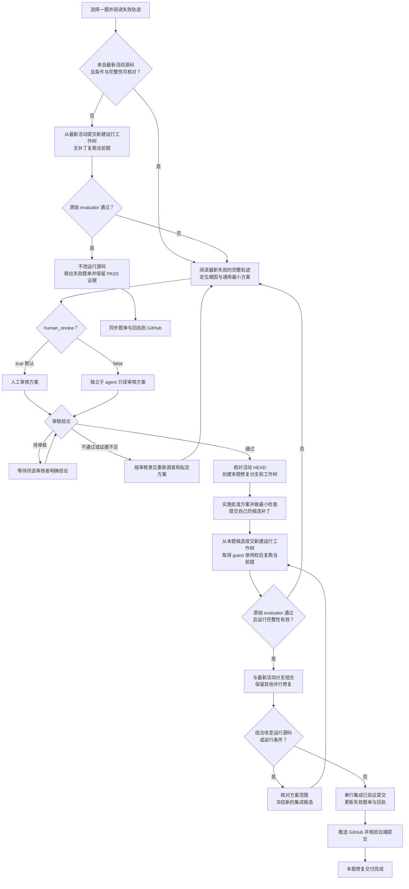

# OSWorld 单题修复工作流

状态：执行约定。`human_review=true` 时必须先把每题的结构化审核材料交给人工；人工明确批准某个方案版本后，才可实施该题。审核本工作流或开启审核不等于批准任一修复方案。

## 目标与入口

从失败题单选择一题，先核对失败证据是否对应最新活动源码。最新源码已通过的题目直接移出待修复清单；仍失败的题目，定位根因、审核方案、隔离修复、正式复跑，通过后才集成到活动分支并推送 GitHub。

执行前阅读仓库根目录 `README.md`、适用的 `AGENTS.md`、当前题目的开发记录和失败轨迹。本文件细化单题修复流程；旧日期文档中的模型、分数、分支与任务范围不能覆盖用户最新要求和当前 README。

当前项目入口如下，执行时重新核对，不固定历史提交 SHA：

| 项目 | 当前约定 |
| --- | --- |
| 活动目录与分支 | `/home/liuxv/liteagent`，`codex/v4`；2026-10-26 用户指定 v4 为主活动源码；修复基点取该分支启动时最新 HEAD，不指 Git 的 `main` |
| 运行源码 | `src/adapter_versions/v2_expanded/` |
| 单题运行入口 | `bin/run-osworld.py --orders <ORDER>` |
| 默认配置 | `configs/single-task-active-thinking.json` |
| 模型条件 | 华为云昇腾 Qwen3.5-9B thinking；机器配置由 `~/.config/liteagent/model.env` 提供 |
| 当前预算 | 每题 100 步、1800 秒；其余条件沿用当前默认配置 |
| 工作树与结果 | `/home/liuxv/liteagent-local-runs/` 下每次修复独占一个目录 |

本轮**活动失败题单**和**已修复题单**维护在本文末尾的“本轮修复台账”。范围以用户最新指定的批次和题号为准；旧批次台账保留为历史记录，不用于本轮销项。按 Order 与 task ID 共同核对身份，不混入其他轮次的任务。当前代理一次处理一题。

### 审核选项

启动修复时记录 `human_review` 选项；这是本工作流的执行约定，不是现有运行器的命令行参数。可以在请求中写“按 repair_skill 修复第 N 题，human_review=false”。

| 选项 | 审核方式 | 通过后行为 |
| --- | --- | --- |
| `human_review=true`（默认） | 由人工审核根因和方案 | 等待人工明确通过后实施 |
| `human_review=false` | 开一个独立子 agent 审核根因和方案，代替人工审核 | 子 agent 明确通过后继续实施，无需再等待人工审核方案 |

用户明确关闭人工审核时，本 skill 要求使用子 agent 进行审核。该选项在本次修复及其失败重试循环中持续有效，直到用户修改；不因一次否决而自动切换审核方式，也不把“无人工审核”理解为跳过审核。每次在回执和题单条目中记录实际审核方式。

### 人工审核材料格式

用户明确要求后续 repair 一律先用业务事实说清楚，再给证据和根因。每题先说明对象总数、哪些已有正确内容、哪些缺失、应该改哪些、实际改哪些、改对/漏改/多改/改错分别是什么。能比较时用简短表格；例如“共7页，1/2/3/6页缺备注，4/5/7页已有；实际全7页重写，缺失页补对但5/7页已有内容被改”。先用从1开始的人类页码，技术索引按需括注；不先堆 task ID、提交、工具名和抽象术语。下方字段用人话填写，技术身份和路径放证据中。

根因必须追到有直接证据的责任层：模型实际看到什么、如何选错、原始参数是否已错、工具是否改字、执行校验及完成检查为何放行。不能只用“模型犯错”“观察缺口”“完成检查问题”代替解释。优先只读回放实际请求和事件验证因果，区分事实和待核实推测；局部回放不能替代正式PASS。输入/参考已有差异单列说明，不能借此停止调查模型新引入的错误或直接跳题。方案说明怎样防止具体错误及适用边界，不保证局部修复能消除其他验收差异。本表达和诊断要求持续适用，不反复询问用户是否沿用。

`human_review=true` 时，直接在对话中提交可追踪的 review 记录，每道题一节。每节至少填写以下字段；题目描述可简述，失败轨迹必须对应本轮原始事件/结果，方案须标明版本并等待选择或批准。多个方案是供人工比较的备选项，不得在批准前实施。

```text
题目：Order / task ID / 应用
题目描述：一句话概括用户要求
正确轨迹描述：满足要求的关键状态变化与原始 evaluator 验收条件
失败轨迹描述：按事件/步骤顺序列出实际关键操作、结果与终态
卡在哪里：最早偏离正确契约的已证实位置；区分事实与假设
修复方案 1：责任层、最小通用改动、影响边界、验证方式
修复方案 2：...
修复方案 3：...
建议：可留空；若提出，说明证据与取舍
人工审核：待审核 / 通过（明确方案版本）/ 不通过 / 证据不足
审核意见：需解决的问题及批准边界
```

轨迹描述只引用日志证明的事实；若缺少 artifact 或运行源码身份，明确写“待核实”，不得补造正确轨迹、根因或方案效果。人工结论必须由人工消息明确给出，沉默不算批准。修改根因、方案边界或验证条件后须提升方案版本并重新审核。

人工审核材料默认直接在当前 Codex 对话中提交，不另建审核文档；后续题目也沿用此方式。按本 skill 一次处理一题：先在对话中提交当前题审核材料并取得明确结论，完成该题后再认领下一题。只有用户明确要求留存文件时，才将审核材料写入文档。

## 1. 先读失败轨迹，核对源码身份

打开单题日志，先读用户指令、运行元数据和完整事件链。至少追踪模型实际看到的工具说明/schema、请求与参数、服务响应、Adapter 返回、执行结果、verification、最终终止原因及原始 evaluator 结果。不要只凭日志摘要或最终错误文字推断根因。

记录启动时活动分支最新提交为 `base_commit`，并与失败运行的提交 SHA、源码摘要、配置快照和运行完整性核对。以下任一情况都应先做无补丁复跑：

- 失败运行来自旧提交，或无法证明它来自当前 `base_commit`。
- 缺少源码身份、运行前后完整性证据，或带有无法追溯的未提交改动。
- 模型、推理服务、thinking 模式或关键运行条件与当前约定不同。

无补丁复跑必须从 `base_commit` 新建独立、干净的运行工作树，使用当前约定条件，只跑当前题；不能先按旧轨迹修改源码再称为基线复跑。

- **复跑通过：**不做运行源码修复；记录“最新活动源码复跑通过，无新增补丁”，将本题从活动待修复集合移除，保留历史失败及本次 PASS 的证据链接。题单/回执按正常 Git 流程同步。
- **复跑失败：**以这次最新运行的完整轨迹作为诊断依据，进入第 2 步。
- **已有轨迹已确认来自当前源码与条件：**直接进入第 2 步，无需为了重复确认再跑一次。

提交 SHA 不同但仅文档变化时，应核对运行源码范围、seal、脚本、依赖和实际配置。能证明运行条件完全相同的已有正式失败可直接诊断，不为文档提交重复运行基线；保留等价性证据。

通过以原始 OSWorld evaluator 的正式结果为准，同时核验结果对应当前题及源码、配置完整性。HTTP 200、进程退出码 0、模型声明完成、单元测试通过或手工查看输出，都不能替代题目 PASS。

核对任务中的 evaluator options 时，必须阅读原函数实际读取和使用的选项，不能仅凭配置中的键名推断其生效。逐段 strip、空白归一化等只读诊断必须与原始逐字符差异并列记录，不得将归一化相等当作原 evaluator 相等；不修改 evaluator 或任务选项迁就产物。

若多媒体参考产物与题意存在时间、时长、尺寸等冲突，先保留原正式评分，并以只读元数据及源内容对齐诊断分别说明；抽样相似度只支持诊断，不作为逐帧真值。区分产物内容、用户指定应用实际执行、原evaluator覆盖范围；Adapter名称不能证明底层实际使用该应用。不得将参考首帧时间、尺寸或帧数硬编码到运行源码来换分；无通用修复依据时保留待修，直接对话审核下一步处理。

涉及保留已有内容的混合编辑指令，必须用实际完整任务文本核对保护范围，尤其检查否定句、并列动作和“不要仅做某种替代操作”的表达；不能因无关正文动作或否定动作而关闭已有内容保留、来源校验及完成检查。严格删除的验收须检查实际原生段数、剩余内容/格式及保存后产物，不以隐藏空段、去项目符号、选择格式范围或保存回执替代删除。

涉及保留已有内容的任务，分别比较原始输入、模型修改后产物和参考。将模型新引入的错误与输入中已存在的参考差异分开记录；尤其只改备注时，原正文的空段/段数差异不能归为备注写入副作用，也不能未经授权删除来适配参考。完成提示、原生保存及只读诊断均不能覆盖原始评分中的其他失败。

追查输入/参考一致性时，优先用上游内容哈希（如LFS SHA-256）核对本地文件，再核对题目配置和固定版本评分代码是否与上游一致；定位到原始XML/段落以及实际失败的比较条件。文件修改时间、修订号和保存应用只作为来源线索，不能据此断言作者执行了哪个编辑动作；没有作者轨迹时明确保留不确定性。逐页只读诊断与整题正式评分分开记录，不把局部通过或参考差异诊断用于销项。

## 2. 找到根因，提出通用最小方案

从最早偏离正确契约的环节向后追踪因果链，区分模型决策、工具 schema/生成约束、传输协议、Adapter 实现、执行环境、观察反馈和完成判定。基础设施错误也要保留原始响应；例如 HTTP 200 中的 grammar 错误不能归为正常模型回复或直接当成断流。

涉及多文件或跨应用读取，逐步对照 tools_search 返回的候选、下一次真实请求中的可调用工具、模型原始参数及执行器拒绝原因。读完一份文件不能证明其余来源或目标文档已读；搜索结果混入非读取候选也不能证明读取阶段完成。用原始事件回放核对阶段过滤是否误隐藏仍需读取的文件/API，并与“正确工具已提供但模型仍选错”的步骤分开说明。偶发OCR超时后同参数成功时，保留两次耗时及环境事实，未定位底层原因不得归结为持续环境故障或盲目放大超时。

阶段提示须区分已执行事实、模型内容判断、自检资格和用户目标验收；搜索结果中出现某工具不代表已进入该业务阶段。核对真实模型请求中的阶段、准确路径、当前截图和未完成事项是否一致，特别覆盖普通初始搜索、混合候选、错误恢复和上下文压缩；提示要求看图时不能仅核工具开关而忽略实际图片缺失。跨图结论需要可复用的模型观察依据，打开记录不等于已分类，模型自记结论不等于独立审核通过；没有记录时不得声称已丢失原本不存在的正确判断。候选提示误触发须保留原运行证据，修正后从新提交、新目录复跑，不热改已启动的源码或文案。

文字提取返回0字时，区分“提取程序成功退出”“返回结果未被上下文截断”和“来源内容已核实”；0字不能证明原文件空白、无交易或无需处理。诊断须核对替代读取能力是否在实际发现说明/请求中可见、模型是否知道空结果以及完成检查为何仍放行。拟新增空来源完成检查时，只针对任务内容范围内模型已选用的来源，不把所有发现文件都算必读，也不预设一文件一行；真实空白或无关来源须有可核对的排除依据，保留模型选OCR、视觉或其他合法读取方式的能力。

涉及财务收据转录，须将“来源金额是否正确”和“所填金额的加减是否自洽”分开验证；错误金额也可能生成内部自洽余额。核对原图与OCR原文，分别说明总额漏识别、模型忽略已读税额、转账视角歧义及重排未重算；不得用通用CashOut关键字把所有账户间转移判为费用，或把参考文件行序当成用户要求。新增逐行来源/金额契约属于新方案，按当前审核选项批准后才实施。
新增嵌套参数后，必须验证实际模型请求和发现结果中的必填字段、枚举、数值边界及报错恢复信息；仅检查字段名出现或owner schema合法不足以证明调用契约已公开。多应用通用包装不会自动带出下游schema；发现结果若删去完整signature，应保留可执行所需的有限嵌套约束。以真实拒绝事件回放确认错误字段、当前值、合法取值到达模型，而非只核本地校验器。
公开工具schema含正则时，验证本地JSON Schema的搜索匹配语义与服务端生成约束的整串匹配语义是否一致；只含\S的非空白断言可能把自由文本压成单字符。以同服务最小真实生成对照验证，不以假客户端或本地schema合法代替服务兼容；修正须保留非空白/长度等契约并覆盖多词、换行、首尾空白及纯空白。
逐行来源校验的验收须覆盖：原有记录保留、来源引用真实、总额/税额不重算或漏算、收支视角、重排后的余额及保存后原记录和新记录读回。不能只验证错误数字内部自洽，也不能把不完整观察当零金额。未知修改造成证据失效时，保留重新读取和修正映射的恢复路径；合法模型公式不得因检查只认数字常量而无故失效。来源清单和行序由模型选择，检查器不代替模型生成交易。


先说明证据证明了什么、仍有哪些不确定性，再提出作用于责任层的最小可行修复。说明为什么它能修正一类同源问题，如何保持其他合法行为，以及如何验证，而不是为当前题安排一套固定操作顺序。

修复必须满足：

- 不拆东墙补西墙：不靠吞错、伪造成功、放松正确性检查、删掉必要验证或全局放大重试/超时掩盖根因。
- 不定制 API 流或任务工作流：不按 Order、task ID、题目短语、文件名、golden 答案或固定坐标分支，不把单题答案或完整操作序列写进运行代码、schema、提示词。
- 不靠强制工具顺序、脚本接管模型决策或为该题新造宏操作来取得 PASS。必要的通用契约修复必须说明适用条件与边界。
- 修改发生在正确责任层；涉及公开契约时同步核对 schema、校验、dispatch/worker、返回与调用方。协议兼容转换不得悄悄取消参数本地校验。
- 不更换模型、降低题目难度、改变 evaluator、任务定义、参考数据或测试预算来规避失败；必要的条件变更必须单独说明并按所选方式审核。审核通过不扩大用户授权范围，也不允许干扰其他并行进程。

提交下面的审核材料，**尚未批准时只做阅读、诊断和必要的最小复现，不实施候选修复，也不改共享模型服务或运行条件**：

```text
题目：Order / task ID / 活动失败题单位置
源码与条件：base_commit、失败运行 commit/摘要、模型与配置身份
失败证据：日志路径、关键 step/事件、请求/响应或最小复现
根因：责任层、因果链、已确认事实与未确认假设
拟修复方案：拟改文件/契约、最小改动、为何具有普遍性
影响边界：需保留的合法行为、潜在副作用、为何不属于任务定制
验证：最小 focused check + 当前题原始 evaluator 复跑
审核方式：human_review=true / false
审核结论：待审核 / 通过的方案版本 / 不通过及建议
审核者与证据：人工回复引用，或子 agent ID 和完整审核记录
```

## 3. 按选项审核方案

- **待审核：**提交可审阅的材料；人工模式等待人工明确结论，子 agent 模式等待独立审核结果。不将沉默、未完成的子 agent 任务或对本 skill 的认可当作本题方案获批。
- **不通过：**保留审核建议，按建议重新调查或修订方案，再交同一审核方式复审；不执行被否决方案，也不通过换审核者来规避意见。
- **通过：**记录方案版本、批准内容及适用源码，才进入第 4 步。实施发现需要改变根因、扩大范围或更换策略时，返回第 2、3 步。

### `human_review=false` 的独立子 agent 审核

主 agent 负责诊断、提出方案和实施；审核必须由另一个子 agent 完成，不能由主 agent 自己宣布审核通过。使用子 agent 工具创建审核任务，不创建用户侧的新聊天。

给审核子 agent 提供本 skill、方案版本、基点提交、当前题目身份、原始失败日志与轨迹、相关源码位置和拟议改动。说明方案是待验证的假设，要求独立阅读原始证据，不预设通过结论。审核权限为只读；不得修改源码、台账或共享服务，不得启动完整 OSWorld 任务。

要求审核者逐项确认：根因是否有直接证据，方案是否作用于正确责任层，是否为通用且最小的改动，是否包含任务定制 API 流或工作流，是否破坏已有合法行为，以及验证与并行隔离是否充分。证据不足时指出缺项，不以经验猜测代替确认。

审核结果至少包含：

```text
reviewer_agent_id：审核子 agent ID
plan_version / base_commit：审核的确切方案与源码
verdict：通过 / 不通过 / 证据不足
evidence：独立核对的轨迹事件、源码位置和因果依据
findings：缺陷、影响范围或缺失证据；通过时也说明理由
required_changes：重新提交审核前必须解决的事项
```

仅“通过”允许进入实施；“不通过”或“证据不足”均返回第 2 步，按意见修订后复审。复审应回应上一轮意见，并保留历次结论；可以让同一审核子 agent 继续复审。审核子 agent 不可用或未返回明确结果时，保留“待子 agent 审核”状态并报告原因，不由主 agent 自审替代，也不默默切回人工模式。

子 agent 审核只替代本题方案的人工审核，不能替代真实 OSWorld evaluator 复跑、源码完整性检查或 GitHub 推送核验，也不能批准用户范围之外的操作。

## 4. 在本题独立工作树实施修复

批准后重新读取活动分支 HEAD。若它比审核依据更新，先检查新提交是否已消除故障或改变根因；需要时按第 1 步复跑。影响审核结论时更新方案并重审。

从此时确认的活动提交创建本题专属分支和工作树，例如 `codex/repair-<order>-<unique-id>`。不要借用另一个修复的工作树，也不要在主活动目录编写候选补丁。目录示例：

```text
/home/liuxv/liteagent-local-runs/repair-<order>-<unique-id>/
  repair/                本题可编辑的 Git 工作树
  run-001/source/        从无补丁或候选提交检出的干净运行工作树
  run-001/output/        本轮 runner 输出与原始轨迹
  run-002/...            下一轮，始终使用新目录
  # 人工审核内容留在对话；本文件台账只索引提交、状态与运行证据
```

只实施已批准的最小修复，在自己的工作树完成必要的 focused check、改动 Python 文件的 Ruff、`git diff --check` 和 README 要求的 `bin/check.sh`。不扩建通用回归套件，不启动跨题或全量评测。

定向暂存本题文件，在**自己的修复分支**提交候选补丁，记为 `candidate_commit`。此处提交用于冻结复跑源码，不代表修复成功；候选失败时不得把它集成到活动分支。

## 5. 用自己的补丁源码复跑当前题

遵循 README：先提交候选，再从 `candidate_commit` 创建本题新的 detached 运行工作树。复跑的是自己带补丁的源码，不是主活动目录或别人的源码；运行中不编辑这个工作树、它的配置或运行器复制的源码快照。

使用自己的运行工作树中的 `bin/run-osworld.py`，显式指定本题 `--orders` 和仓库外的 `--result-dir`。先核对题目确实在配置中；若缺失，按现有任务定义补齐任务身份，保留模型、协议和预算条件，不添加答案、特殊策略或题目专用提示。

按 README 使用 `HF_ENDPOINT=https://hf-mirror.com`。若原下载域名连接超时，应先检查下载链路，不能归为模型失败。`--result-dir` 必须是尚不存在的新路径，只提前创建它的父目录。当前运行器创建独立任务 guest 并在其中部署 Adapter；空闲共享 guest 的 Adapter 端口未监听，不能单独据此判定复跑环境不可用。以实际任务 guest 的准备、部署和调用结果判断。

每轮保留提交 SHA、源码 seal、配置与摘要、实际模型/服务身份、完整启动命令和运行前后完整性。至少索引 `runner.log`、`results/results.json`、`lite_agent_events.jsonl`、`trajectory_manifest.json`、evaluator 产物，以及可用的 `model_transport/` 原始请求响应。不同服务上的同名 9B 不自动视为同一运行条件。

### 并行修复必须隔离共享资源

每个对话从最新活动提交建立自己的修复/运行工作树，直接调用该工作树的 `bin/run-osworld.py`。默认不同题目可同时复跑，不要求其他对话结束：

- 新入口为每题创建独立 guest、匿名可写盘、动态端口、源码/OSWorld/cache 快照和结果目录，只共享只读基盘。保留 provider 启动阶段的公共端口分配锁，不把它扩展成整题锁。
- 跨工作树统一使用本账号 `~/.local/state/liteagent/repair-resources/`，默认 5 个并发运行名额；`python bin/repair-resources.py status` 查看题目、owner、名额和结果目录。可用 `configure --slots N` 调整到 1–12：普通任务运行时允许在线扩容，缩容需空闲，独占运行期间禁止调整。任务满额自动等待，诊断与源码修改不占运行名额。
- 同一 task_id 跨对话互斥，避免重复修复。一次传多个 `--orders` 时占一个运行名额、依次执行，所有传入题目在整批期间保持认领；不同对话需要并行时分别启动各自题目。
- 新入口在统一兼容锁 `/home/liuxv/liteagent-reproduction-jobs/v3-repair-vm.lock` 上持共享锁，独立 guest 可重叠；确需独占修复资源时用 `--exclusive`，取得兼容排他锁及全部名额。**不要在新入口外再套整题公共排他锁。**旧排他持有者正常退出前新入口仍会等待，不强制迁移运行中的任务。
- 旧工作树/旧排队控制器不会自动升级，下一轮需从包含新入口的最新提交建运行树。已冻结候选需先在自己的集成树组合最新活动源码、按原审批边界检查后重新冻结；不能原地修改正在运行的源码快照或临时撤掉旧锁冒充新入口。其他账号及直接调用底层脚本的运行不自动计入本账号池，仍需核对资源所有权与隔离。
- 模型服务支持并发时，非零请求数不等于资源不可用；核对 guest/端口/写盘隔离、重复题目、模型排队及服务健康，不新增“所有其他 runner 必须退出”的全局限制。确需独占模型以保证条件时明确依据；不能把其他账号独立 guest 或不同题目误判为同 guest 占用。
- 取消时只停止本轮控制器，由入口终止自己的进程组、按精确 `openapa.run_owner` label 清理自己的容器并释放名额。不要改共享 `model.env`、全局服务参数，不清理其他工作树，不使用 `pkill`、`reset --hard`、强推或全局缓存清理。
- Git 集成仍短时串行；不能为整轮模型推理持有集成锁。机制、证据及强杀边界见 `docs/parallel-repair-20261028.md`。

#### 空闲资源轮询与排队

新入口已启动并等待名额/同题锁时会自行重查，无需再启动重复排队控制器。当用户要求在未启动阶段资源空闲后自动继续、或明确设置 15 分钟巡检时，应配置持续运行的 Codex automation/heartbeat；每 15 分钟只读检查资源，并在满足条件后按本 skill 当前阶段继续，无需再等用户发消息。仅在资源发生可行动变化、任务启动/完成/失败或需要用户操作时通知。

- 独立 guest 模式检查 `python bin/repair-resources.py status`、兼容锁持有状态、Docker/KVM/基盘及模型健康，并用 `ps`/运行目录核对未纳入池的历史进程与所有权；不以常驻共享 guest 是否空闲作为启动前提。最终由入口原子分配名额和同题锁；状态快照不代表已获资源。
- 确实复用同一共享 guest 时，要求该 guest 健康且无其他任务占用，使用同一绝对路径排他锁覆盖准备、执行、evaluator 和清理；不得依据一次空闲快照在锁外重置 guest。没有独立资源的任务继续排队，不停止他人进程。
- 同一对话按用户指定/已记录的题目顺序继续，不因具备跨对话并行能力而自行扩展任务范围。启动前重新核对审核结论、活动 HEAD、题目身份和配置，再继续基线、候选复跑或其他当前阶段。
- 若没有可持续唤醒机制，明确说明限制；可在当前会话内有界等待并重查，每次工具阻塞不超过 60 秒。不得用只读 cron 探测声称已实现“空闲后自动修复”。探测本身不重置 guest、不启动修复；用户要求定时任务时优先使用 Codex automation/heartbeat。
- 启动后在对话及本文件台账索引题目、责任人、owner、名额/锁、guest、开始时间和预期阶段，链接 `resource-lease.json`、`run-status.json` 及运行证据。每次检查记录时间、资源/其他运行状态和决定。人工模式不另建 `review.md`。

### 复跑结果分支

- **不通过：**保留本次失败，回到第 2 步阅读本次完整轨迹，再按所选方式审核根因和方案。不要回退到旧轨迹忽略新证据，也不要丢弃本题补丁去跑未修复的活动分支冒充验证。
- **没有新证据：**不反复重跑碰运气；说明待验证假设、阻塞条件或需要补充的审核意见，保留待修复状态。
- **通过：**将候选记为“本题验证通过，待集成”，进入第 6 步。

## 6. 集成到活动源码并推送 GitHub

先核对当前活动分支和 GitHub 上同名分支的最新提交。集成按共享分支的协调锁串行进行；只有短时间合并/更新分支需要持集成锁，不用它占住整轮模型推理。

- 活动分支仍在修复基点上且可快进时，合入已验证的本题提交。
- 活动分支已前进时，在本题专属的集成工作树上，以最新活动提交组合本题补丁。不能覆盖或撤掉其他已合入修复。
- 组合、冲突解决或适配改变了运行源码/运行条件时，先检查是否仍在批准方案范围，再冻结新的集成候选，按第 5 步重跑当前题；未通过则回到诊断和所选方式的审核。不能用旧基点上的 PASS 代表新组合也通过。
- 更新活动分支前再次确认其 HEAD 未被别人推进；有变化则重新组合验证。主活动工作区有他人的未提交改动时，保留现场，协调其所有者完成集成，不替别人 stash、提交或覆盖文件。

将验证通过的本题改动和回执集成到活动开发分支，正常推送其 GitHub 同名分支；不用 `--force`。远端前进或拒绝推送时重新核对差异，不盲目拉取合并后跳过必要验证。

成功验证后，必须同步维护本文末尾的“本轮修复台账”：从待修复表移除本题，并在已修复表追加题目身份、正式结果、源码与条件、证据和交付状态；更新分类及总数，保留全部历史尝试。候选尚未合入时标记“已验证，待集成”；GitHub 推送失败时标记“本地已集成，待推送”，不得报告完整交付。

无补丁复跑已通过的题目只需同步题单/回执，不制造源码修复提交。多个修复同时更新题单时串行合并本题条目，避免整份旧列表覆盖他人的结果。

每次接手先重新读取台账并标注本题认领者、个人工作树、`human_review` 选项和当前阶段（待复跑／诊断／待人工审核或待子 agent 审核／实施／复跑／待集成／待推送）；保留简短的逐次更新记录。新的正式失败若推翻已登记的 PASS，保留原 PASS 证据，把本题重新放回待修复表并写明失败运行。结果未完成、协议探针成功或静态检查通过均不能移入已修复表。更新台账时只编辑自己的条目和相应计数，不覆盖其他修复的状态。

最终报告：题目、原根因、审核方式与审核者、通过的策略版本、候选与最终活动提交、OSWorld 正式结果及证据、题单状态、GitHub 推送结果。单题 PASS 不改写历史批次分数，也不构成全量评测或基线 promotion。

## 流程图



## 本轮修复台账

### Docker 修复后指定队列（2026-10-30，8题，human_review=false）

本聊天按用户指定顺序串行修复：96、104、113、115、117、127、130、132。以 [最新错题单](/home/liuxv/liteagent/reports/20261030-dockerfix-full189/wrong-tasks.md) 的 Order + task ID 为准，独立子 agent 只读审核方案，不人工审核，不并行修题。当前原条件 3/8 正式通过（96、115、130），117 经用户补充提示通过，127 经用户指定参考图和专用提示通过，3/8 待修（104、113、132）；不同条件分开记录，历史批次分数不变。

| 待修题号 | 任务 ID | 责任人 / 工作树 / 当前阶段 |
| --- | --- | --- |
| 104 | 1f18aa87-af6f-41ef-9853-cdb8f32ebdea | 本聊天/root；用户批准v5提示修改，human_review=false；run006因隐藏reader取消/unscored，v6恢复持续读取后run007仍deadline/null、44事件1944.017秒、三完整性true；Answer原6段/字节未变，试题2被追加2段错误内容。/root/review96终态独立复核未修好；候选3d64fd9隔离不集成，当前无新获批复跑方案，保持待修 |
| 113 | 81c425f5-78f3-4771-afd6-3d2973825947 | 本聊天/root；`repair-113-20261030-agent`；acb2e15无补丁run001正式deadline/null、36事件1932.696秒、三完整性true、原evaluator未运行；独立审核/root/review96无新通用获批方案，不盲跑，保持待修 |
| 132 | aceb0368-56b8-4073-b70e-3dc9aee184e0 | 本聊天/root；`repair-132-20261030-agent`；原基线run001 deadline/null；v1run002 deadline/null35事件1926.525秒；v2a26fb3c run003 deadline/null17事件1961.313秒，三完整性true。读取工具/大小写说明真实可见，但模型未读参考未写评分，候选隔离，终态独立复核无新通用最小方案，不盲跑，human_review=false |

- 2026-10-30 北京时间10:04，本聊天启动96 run-001；[状态](/home/liuxv/liteagent-local-runs/repair-96-20261030-agent/run-001/output/run-status.json)、[租约](/home/liuxv/liteagent-local-runs/repair-96-20261030-agent/run-001/output/resource-lease.json)、[完整日志](/home/liuxv/liteagent-local-runs/repair-96-20261030-agent/run-001/output/runner.log)。实际owner/名额以租约为准；其他账号独立guest保留，不干扰。

已修复：96 / 00fa164e-2612-4439-992e-157d019a8436，96-agent-v1，human_review=false，独立审核 `/root/review96` 方案/实际diff通过；候选 `5d551ab5e5d333b4db43861935ace458ae1d981b`，seal `605736d636ac6fe673721eeef27b7919bd30a6f63e597e66993b31beba9b7148`；run-001 passed/reward1.0/agent_done，9步715.411秒，source/config/OSWorld完整性均true，原9B thinking/100步1800秒/原evaluator，当前默认串行条件。原31段正文保留，表格紧接5.2 Main Results、2×12内容与参考逐格一致；[结果](/home/liuxv/liteagent-local-runs/repair-96-20261030-agent/run-001/output/results/results.json)、[完整性](/home/liuxv/liteagent-local-runs/repair-96-20261030-agent/run-001/output/final-integrity.json)、[产物核对](/home/liuxv/liteagent-local-runs/repair-96-20261030-agent/run-001/artifact-validation.json)。已集成 `5d551ab` 并交付GitHub，远端 `1d577de31059507d4a0d11b22febb5665222dd73` 已读回核验；常规Git连接超时后，Git Data API上传对象SHA逐项一致、force=false快进。共同故障证据：[原始只读回放](/home/liuxv/liteagent-local-runs/repair-96-20261030-agent/original-replay.json)、[96方案](/home/liuxv/liteagent-local-runs/repair-96-20261030-agent/plan-v1.json)。新基点与全量 `c8349c4` 仅 README/reports 文档差异，运行源码/bin/configs/依赖未变；正式验证按当前默认串行条件保留原模型/预算/evaluator。


- 104 run-001新失败：[产物/原参/真实保存核对](/home/liuxv/liteagent-local-runs/repair-104-20261030-agent/run-001/artifact-validation.json)、[方案](/home/liuxv/liteagent-local-runs/repair-104-20261030-agent/plan-v1.json)。模型另有答案内容和格式错误，选择器与回执修复不承诺解决这些差异；保留原正式0分。

- 2026-10-30 04:57 UTC：104 run005原evaluator未加载、正式deadline/null；最后保存及完整读回101字表明目标正确但答案/模板错误，无完成申请。终态独立复核无新获批通用方案，保留全部失败、候选不集成，按用户顺序继续113，不将104销项。证据 [run005诊断](/home/liuxv/liteagent-local-runs/repair-104-20261030-agent/run-005/artifact-validation.json)、[子agent复核](/home/liuxv/liteagent-local-runs/repair-104-20261030-agent/run-005/terminal-review.json)。

- 2026-10-30 04:59 UTC：113 run001从acb2e15干净detached无补丁启动；owner `lite-repair-14aaeb60a40047b1bfef091d2e44cc54`，slot2/5、shared兼容锁、独立guest/写盘/端口，source seal594ef2d169ef33f61640dcb63ae8a1be5417fb60119326941ea8a0ced3df4ce0；原9B thinking/100步1800秒/原evaluator。证据 `/home/liuxv/liteagent-local-runs/repair-113-20261030-agent/run-001/output/{resource-lease.json,run-status.json}`，其他账号及Order27资源不触碰。

- 2026-10-30 05:33 UTC：113正式deadline/null、无成功数据写入。后期源矩阵前8行截断已有明确补读说明，模型仍误称全8行；空anchor/不齐矩阵/整数rows传矩阵由模型原参引入并正确拒绝，无propose_done。独立终态复核无新通用最小方案，保留待修，不盲跑；证据 `/home/liuxv/liteagent-local-runs/repair-113-20261030-agent/run-001/{diagnosis.json,terminal-review.json,output/results/results.json}`。按序115从最新0d3b9bd新detached源码无补丁复跑，不带104失败候选。

- 115 run001 owner `lite-repair-63c57d17957d493099985eef04200342`、slot2/5、shared兼容锁、独立guest/写盘/端口，source seal594ef2d169ef33f61640dcb63ae8a1be5417fb60119326941ea8a0ced3df4ce0；原模型预算任务/evaluator。证据 `/home/liuxv/liteagent-local-runs/repair-115-20261030-agent/run-001/output/{resource-lease.json,run-status.json}`。

- 115-agent-v1：原image.insert_at_cursor仅GraphicURL赋值+计数，DOCX4740bytes无image媒体关系、a:blip空；原评分0。通用GraphicProvider预解码、拒绝空/失败图后不改文档、赋已加载Graphic，回执loaded/type并移除计数足够完成承诺；独立审核/root/review96通过。10新测试过、67相邻过/2旧失败基线复现、Ruff/diff/bincheck过；自有guest原生probe PNG与SVG成功嵌入媒体/关系，XCF及损坏PNG拒绝counts0→0。SVG当前nativegetType1/嵌入PNG，不声称矢量结构保留。证据本题plan-v1.json、review-v1.json、candidate-checks.json、native-probe/result.json；probe owner d621ae901f2849b1a6d9c09664e46c4f已清理。待实际diff审核后冻结正式候选。

- 2026-10-30 05:54 UTC：115候选6c39c8a4e62a53c990f2ac5b19c9d5ab273c303a从新run002/source干净detached正式复跑；同字节原config，原9B thinking/100步1800秒/原evaluator。真实XCF探针身份与SHA已补native-probe/input-identity.json，actualdiff独立审核通过；owner/slot/guest以run002/output/{resource-lease.json,run-status.json}为准，未集成。

- 115 run002正式passed/reward1.0/agent_done；model13自行GIMP导出、30create、31插入decodedPNG、32完成。两DOCX均1图1152×648RGBA、原生像素SHA9e822df044ccc516f85e15e3fb4a4c69326094004fd4670d1d934867582c20d1；完整性全true。原生探针验证非法图拒绝，但本轮模型未触发它，不宣称单因素因果。活动f1fff78比base新增Impress命名色description，因此独立integration组合694dcb6须正式复跑后才集成，不拿旧PASS代替；结果/产物证据本题run002/output/results/results.json及artifact-validation.json。

- 115组合694dcb6同一子agent审核通过，无需新方案；10focused/Ruff/diff/check过。新run003/source干净detached同字节原config正式复跑，预算模型/evaluator不变；当前owner/名额以run003/output/resource-lease.json为准，尚未集成。

已修复：115 / 227d2f97-562b-4ccb-ae47-a5ec9e142fbb；115-agent-v1、human_review=false、独立审核/root/review96方案/实际diff/组合通过。原错误是GraphicURL空图也计数成功；通用预解码拒绝非法图、不自动转换、插入已加载Graphic并反馈解码证据。原候选6c39c8a run002正式PASS1.0/32步1350.933秒；最新组合694dcb69fa1254fa5e231eb581e4f9b5800b8e2c run003正式PASS1.0/agent_done/20步1146.076秒，三完整性true、原9B thinking/100步1800秒/evaluator；seal75fcc013dd020f696a1e75253226ea9e8fafe58e9bd5b94a1e28af0fa0eb1711。原/参考均恰1图1152×648RGBA，像素SHA9e822df044ccc516f85e15e3fb4a4c69326094004fd4670d1d934867582c20d1一致。已快进本地活动并交付GitHub，远端fcff0bc18bf5fc10c8ba650be9cfe42bfdb3c6d7已读回核验；[结果](/home/liuxv/liteagent-local-runs/repair-115-20261030-agent/run-003/output/results/results.json)、[完整性](/home/liuxv/liteagent-local-runs/repair-115-20261030-agent/run-003/output/final-integrity.json)、[产物](/home/liuxv/liteagent-local-runs/repair-115-20261030-agent/run-003/artifact-validation.json)。原run001失败保留，不改历史全量分数；117按序下一题。

- 2026-10-30 06:43 UTC：115组合PASS已交付GitHub，远端fcff0bc读回；117从该最新源码干净detached无补丁启动，同原模型预算任务/evaluator、默认单题串行。owner/slot/guest以本题run001/output/{resource-lease.json,run-status.json}为准。2/8正式通过已交付，104/113待修无获批新方案，117运行、127/130/132未启动。

- 117完整终态独立审核/root/review96无新通用最小方案；ZIP固定成员名评分与题意未指定PDF名的差异单列，不能硬编码参考命名。原正式0保留，DOCX字节保持且原PDF子比较通过不销项。证据本题run001/{artifact-validation.json,pdf-subcomparison.json,terminal-review.json}。按序127最新干净无补丁复跑。

- 127 run001已从bd0f9e3新detached无补丁启动，原task/sourceorder253、原9B thinking/100步1800秒/evaluator；owner lite-repair-578b6e47ab2d414288e0507fe937ecf1，slots[2]/5、shared兼容锁及独立guest，seal75fcc013dd020f696a1e75253226ea9e8fafe58e9bd5b94a1e28af0fa0eb1711。原始崩溃已由96通用修复消除，但必须本题原evaluator验证；当前状态本题run001/output/{resource-lease.json,run-status.json}。

- 127 run001早期35k重复reasoning达到length无tool，不归网络；后期真实4/6/13/14/16附件查询均漏已有save，推翻只适用早期前缀的“未搜索附件”预审范围。127-agent-v1只为attachments.save添attachment/attachments/save/download四通用词，独立审核批准；原前缀恢复真实工具，排名2/1/1/3/1、events不变；9focused/Ruff/diff/check过，候选尚未冻结。证据plan-v1.json、review-v1.json、candidate-replay.json、run001/diagnosis.json。

- 127实际diff同一审核通过，真实instruction/top6前缀附件路由排名3/2/1/5/1、actualtools全可调用、events不变；此前不带instruction排名2/1/1/3/1仅中性检索，不冒称真实排名。候选12f1baaa3a43740f83f4ea27f7d69d0686010a2f，新run002/source干净detached原config正式127复跑，owner/slot/guest见run002/output/resource-lease.json，尚未集成/推送。

- 127 run002真实save提取设置均成功但原评分0。原始profile唯一Notes邮件附件SHA4c9a185b与保存/提取来源同，XML首图印章，背景文件与该图字节同；参考山景不在三图。上游镜像HEAD所示commit1e112283、tar LFS SHA002ad7e00d2ce361ca770f5c246c03850018ec4e94e5e9c4e12198b66e81b99c及GoldSHA1b19ee9db539d8eeabe3deab4e7579aeba472afad1dbd9538fd110830ab9ca0c均匹配本地，直连HF超时留证。独立终态审核无新通用缺陷，不改evaluator/first顺序/Gold，不集成失败候选；证据run002/{artifact-validation.json,terminal-review.json,mirror-identity.json}。按序130最新无补丁复跑，不带127补丁。

- 130 run001从最新12df49c干净detached无补丁正式启动；owner lite-repair-58c71a5bef014d97875ded763e1eded1、slot[2]/5、shared兼容锁/独立guest，source seal75fcc013dd020f696a1e75253226ea9e8fafe58e9bd5b94a1e28af0fa0eb1711；原9B thinking/100步1800秒/task/evaluator。运行证据本题run001/output/{resource-lease.json,run-status.json}。

已修复：130 / 98e8e339-5f91-4ed2-b2b2-12647cb134f4，最新活动源码12df49c无新增补丁run001正式passed/reward1.0/agent_done，19步580.916秒、三完整性true；原9B thinking/100步1800秒/evaluator。五TXT顺序直接拼接2249字符与实际逐字一致，所有非空runs10pt；原参考段落文本精确不同但原evaluator通过，如实记录，不宣称字节完全相同。human_review=false，沿用96已审核通用崩溃修复，不制造新补丁；[结果](/home/liuxv/liteagent-local-runs/repair-130-20261030-agent/run-001/output/results/results.json)、[完整性](/home/liuxv/liteagent-local-runs/repair-130-20261030-agent/run-001/output/final-integrity.json)、[产物](/home/liuxv/liteagent-local-runs/repair-130-20261030-agent/run-001/artifact-validation.json)。回执已交付GitHub，远端60c6df7e84e8b5356cfec893426b81c64fe15171读回核验；132按序运行，原全量分数不变。

- 132 run001于08:34:52 UTC取得slot[2]/5、shared兼容锁，owner lite-repair-ef26f8c2ecc147e3a2a6c8a909423998；独立guest/写盘/动态端口，b8c7434与随后60c6df7仅台账差异，运行seal75fcc013dd020f696a1e75253226ea9e8fafe58e9bd5b94a1e28af0fa0eb1711；原9B thinking/100步1800秒/原任务和evaluator。租约/状态/日志见本题run001/output，human_review=false，无新增候选。

- 132-agent-v1独立/root/review96修正稿与实际diff均通过：第7失败读executed=false不计，第8成功读成绩表后，后续mixedcatalog将尚未读取DOCX的reader全局隐藏；17模型reasoning想read而原参选去重、保存参考少6答案（工具缺陷与模型误选分开）。仅删tool_surface10行blanketfilter、新增27行跨来源回归，51focused/Ruff/diff/bincheck过，16实际前缀reader恢复/events不变；隔离候选10a3fd5d446e2e44d414e22a99fd9acad8f9f678，未集成。基线继续自然运行，若无补丁正式PASS则不集成候选；否则终态复核后再决定正式复跑。证据本题plan-v1.json、review-v1.json、review-diff.json、candidate-checks.json、run001/source-mutation-diagnosis.json。

- 132 run001自然终态agent_deadline_exhausted/rewardnull、46事件1918.113秒，source/config/OSWorld完整性true、原evaluator未运行，无完成申请。全部来源最终读过但参考已在17被模型去重保存少6答案；44长推理length无call、重试maxchars超限正确拒绝、45重读损坏参考、46仅GUI点未输入，9人成绩仍空。原输入与Gold评分一致，非参考冲突。自有guest为空/lease释放，候选仍隔离；完整终态独立/root/review96复核中，证据本题run001/{diagnosis.json,artifact-validation.json,source-mutation-diagnosis.json,output/results/results.json}。

- 132终态独立复核维持132-agent-v1通过；09:13:14 UTC新run-002/source干净detached10a3fd5正式启动，owner lite-repair-01ae7202924a4ecca7b3adfe033e8718、slot[1]/5、shared兼容锁、独立guest/写盘/端口，seal745dde74cd79c09d238beab48409e635791429087fae7730fead9e034b6ed597；原config字节SHA1add28f2f756913893b147b9c507c5a82ea8c5c5f8a35ce248cfe84dc381d264、9B thinking/100步1800秒/任务/evaluator不变、新原始输入。最新89ddbdc对candidatebase仅台账差异，未集成；证据本题run002/{prep.json,output/resource-lease.json,output/run-status.json}。

- 132 run002正式终态：agent_deadline_exhausted/rewardnull、35事件1926.525秒，source/config/OSWorld完整性true、原evaluator未运行、无propose_done；候选中读完成绩表和10份答卷，真实下一请求保留Writer document.read_file并成功读答卷，reference/grades在09:42:49只读快照均与原始一致；随后模型搜索`*key*/*answer*`大小写模式只返回10份answer_sheet，未找到ReferenceAnswers，长推理length后仅重读grades/search write tool，未写成绩保存。候选10a3fd5不集成，132仍待修。证据 [run002诊断](/home/liuxv/liteagent-local-runs/repair-132-20261030-agent/run-002/diagnosis.json)、[工具面证据](/home/liuxv/liteagent-local-runs/repair-132-20261030-agent/run-002/formal-surface-evidence.json)、[结果](/home/liuxv/liteagent-local-runs/repair-132-20261030-agent/run-002/output/results/results.json)、[完整性](/home/liuxv/liteagent-local-runs/repair-132-20261030-agent/run-002/output/final-integrity.json)。

- 132 run002终态独立复核批准132-agent-v2：filesystem.find实际fnmatchcase而真实公开描述未说大小写，小写*answer*漏ReferenceAnswers；只补os_adapter/tool_manifest动作/name_patterns说明前部case-sensitive与未知名可选*，不改搜索语义/参数/顺序，保留v1。另确认31底层完整而33压缩丢路径，重复搜索部分是恢复观察，不能全归模型忽略；不扩大压缩修复。repair-v2从最新ac2dea18组合v1，79focused过/1旧fail干净基线复现，Ruff/diff/bincheck过，5真实前缀包装/搜索摘要关键说明可见且events不变；实际diff独立审核中，候选未正式冻结。证据plan-v2.json、review-v2.json、candidate-v2-checks.json、candidate-v2-surface-replay.json。

- 132-agent-v2实际diff独立审核通过，候选a26fb3c21523bb3690e7faf4efad272bb5f11234冻结；新run-003/source干净detached正式原条件启动。owner lite-repair-c4336fe0593c439998fe40ce98b1dd47、slot[1]/5、shared锁、独立guest/写盘/端口，seal8e866e6ac4a976d1e7e49b960318913b3be4b0191387eb48441bc65a3da03360；原config字节SHA1add28f2f756913893b147b9c507c5a82ea8c5c5f8a35ce248cfe84dc381d264/9B thinking/100步1800秒/任务/evaluator不变，新原始输入。证据review-v2-diff.json、run003/{prep.json,output/resource-lease.json,output/run-status.json}；未集成，结果待定。

- 132-agent-v2/a26fb3c run003正式deadline/rewardnull，17事件1961.313秒，三完整性true，无evaluator/完成申请/写入保存。真实request5后case-sensitive/use*说明可见，7-16读10学生，仍未读参考；response17推理27168字length无call、重试17inspect、nextstream26070字后deadline。10:19:41只读快照reference/grades均与输入原字节同，无后续mutation；不把快照当最终evaluator产物。owner c4336fe0593c439998fe40ce98b1dd47容器为空/租约释放，其他题资源未碰。候选不集成，终态独立复核中；3/8正式通过5待修。证据 [最新诊断](/home/liuxv/liteagent-local-runs/repair-132-20261030-agent/run-003/diagnosis.json)、[完整结果](/home/liuxv/liteagent-local-runs/repair-132-20261030-agent/run-003/output/results/results.json)、[批次回执](/home/liuxv/liteagent-local-runs/repair-132-20261030-agent/batch-result.json)。

- 本队列本轮终态：独立/root/review96复核132run003无新通用最小方案，不run004、不集成失败候选。模型误称仅9题/Q6缺失，但真实上下文10学生全文及10处酒店题完整，无reader截断或参数改写；无done不能说completion放行。最终 **3/8正式PASS：96、115、130；5/8待修：104、113、117、127、132**。全部末次source/config/OSWorld完整性true；104/127/132失败候选保留隔离，无预算/模型/evaluator/题目/答案改动，历史189分数不变。人工审核关闭持续，全部方案由/root/review96独立审核；[132终态复核](/home/liuxv/liteagent-local-runs/repair-132-20261030-agent/run-003/terminal-review.json)、[8题汇总](/home/liuxv/liteagent-local-runs/repair-132-20261030-agent/batch-result.json)。

- 用户后续明确授权117“这一题单独做提示，跟参考文件名一样”，覆盖本题禁止单题提示/修改题目文字的默认约束。117-user-prompt-v1独立/root/review96方案和实际diff/metadata通过，候选0c75e7ec3b0e851e0e8936ebeec4804931773038只在117 instruction末尾追加PDF与DOCX同basename改.pdf，其他JSON/原evaluator/输入/Gold/模型预算不变，无运行源码修改；新结果明确user-clarified/task_instruction_modified=true/original_benchmark_eligible=false，不回填原189/原题0分。新独立run002已启动，owner lite-repair-b20db91ae77e442eaecf8ba8aa9ec69f、slot[1]/5/shared锁/新guest，运行seal75fcc013dd020f696a1e75253226ea9e8fafe58e9bd5b94a1e28af0fa0eb1711、OSWorld摘要2556e56a456cfa4189d36d33890957fe8fa65eb46b339bf018feab2f5f66b639。证据 [方案](/home/liuxv/liteagent-local-runs/repair-117-20261030-prompt/plan-v1.json)、review-v1.json、review-diff.json、candidate-checks.json、run002/output/{resource-lease.json,run-status.json}；原条件3/8PASS5待修不变，补充提示结果待定。

已修复（用户补充提示条件，非原题成绩）：117 / 8df7e444-8e06-4f93-8a1a-c5c974269d82。用户明确授权单题提示“跟参考文件名一样”；117-user-prompt-v1由/root/review96方案/实际diff/metadata独立审核通过，只追加“PDF与原DOCX同basename，扩展名.pdf”。正式候选0c75e7ec3b0e851e0e8936ebeec4804931773038，新guest run002 **passed/reward1.0/agent_done，10事件490.232秒**，source/config/OSWorld完整性true，原9B thinking/100步1800秒/原evaluator。ZIP恰原DOCX和同名PDF，成员名与Gold全同，DOCX原字节保留，PDF20页、原内容比较0.996931935≥.95；新提示实际首请求可见。仅题目instruction修改，原评测代码/参考数据/输入/runtime不变；user-clarified、task_instruction_modified=true、original_benchmark_eligible=false；原无提示0分和139/189历史保持。活动比候选仅其他聊天台账前进，任务/运行/条件无差异，已于fd41cfd193e3bd7cffdb0c96a9fac4b704d3a29e快进集成；GitHub已交付，远端fb752c8a02804a2f0e10ec20c1492aacbfd7e97c读回核验（force=false），交付回执run002/api-delivery.json。证据 [新正式结果](/home/liuxv/liteagent-local-runs/repair-117-20261030-prompt/run-002/output/results/results.json)、[产物核对](/home/liuxv/liteagent-local-runs/repair-117-20261030-prompt/run-002/artifact-validation.json)、[集成](/home/liuxv/liteagent-local-runs/repair-117-20261030-prompt/run-002/integration.json)。当前本队列完成4/8（含1补充提示），4/8待修；不并入原条件3PASS。

- 用户后续明确授权127“下载参考图片并用专用提示修改，把这题跑过”。127-user-reference-v1方案及实际diff/metadata由/root/review96独立审核通过；候选0d402fbe4ceb76abc3572f5c0254bd3c8c143634仅127 instruction追加明确替代附件首图要求，以及原download.files新增GoldURL到Desktop/reference-background.png。真实下载SHA1b19ee9db539d8eeabe3deab4e7579aeba472afad1dbd9538fd110830ab9ca0c与原Gold同；原邮件setup/评分代码/Gold/runtime/modelbudget不改。新条件user-reference-assisted，reference_image_exposed/input_modified/task_instruction_modified/user_authorized=true，original_benchmark_eligible=false；原0与原189成绩保留。新run003/source干净detached，owner lite-repair-77c4602c1adb4c2ab5e0d3402b850a4d、slot[2]/5/shared兼容锁/独立guest，seal75fcc013dd020f696a1e75253226ea9e8fafe58e9bd5b94a1e28af0fa0eb1711、OSWorld摘要c2e64cd8cc8ac705233a36311c3e814546d0ac8f2c34594dc8226ebcd78c9dbf，结果待定未集成。证据 [方案](/home/liuxv/liteagent-local-runs/repair-127-20261030-reference-prompt/plan-v1.json)、download-identity.json、review-diff.json、run003/output/{resource-lease.json,run-status.json}。

- 127-user-reference-v1 run003模型先读override打开reference又明确“not reference”回附件目标，存在原指令与覆盖句持续混淆；独立/root/review96批准v2全文替换为单一参考壁纸目标，并按核实自有PID2479120 SIGTERM中止v1，exit143/无正式评分、三完整性true、owner容器空/lease释放，全部轨迹保留。v2实际diff/metadata审核通过，候选30b256434fcefb4a184857fce25aa003dd586e99，新run004干净detached原模型预算/原evaluator，owner lite-repair-1e03ed342dc24a8ea023fe5e37153724、slot[1]/5/shared锁/独立guest，OSWorld摘要5fb8d864b949796a212cacf4f86dd6888fbf0d2349aac32db64cebba5f82892b，reference-assisted/非原benchmark，结果待定。证据plan-v2.json、review-v2-diff.json、run003/cleanup-verification.json、run004/output/{resource-lease.json,run-status.json}。

已完成（用户指定参考图与专用提示，非原题成绩）：127 / c2751594-0cd5-4088-be1b-b5f2f9ec97c4，127-user-reference-v2，human_review=false，/root/review96方案和实际diff/metadata审核通过。参考山景图真实下载并核SHA1b19ee9db539d8eeabe3deab4e7579aeba472afad1dbd9538fd110830ab9ca0c；仅本题新增下载输入并全文替换为单一设背景目标，不改runtime/原evaluator/Gold/原模型预算。新候选30b256434fcefb4a184857fce25aa003dd586e99 freshguest run004 **passed/reward1.0/agent_done，3事件307.678秒**，三完整性true；真实提示可见，模型1搜wallpaper/2设Desktop参考图并原生GNOME读回验证/3完成；原评测取回实际壁纸与Gold及已下载图逐字节一致1496×626。新条件user-reference-assisted，reference_image_exposed/input_modified/task_instruction_modified/user_authorized=true、original_benchmark_eligible=false，原题0和139/189历史保持；v1取消证据保留。最新活动仅台账前进，正式PASS的全部任务JSON/runtime/evaluator完全相同，已合入290b7afbaeeeea3cc70d7d37125ebbda654eb01d，GitHub已交付并读回fc6fc255edac01db8a1775fa5c12c3bf842e0ea4（force=false），回执run004/api-delivery.json。自有guest已清理。证据 [正式结果](/home/liuxv/liteagent-local-runs/repair-127-20261030-reference-prompt/run-004/output/results/results.json)、[产物核对](/home/liuxv/liteagent-local-runs/repair-127-20261030-reference-prompt/run-004/artifact-validation.json)、[集成](/home/liuxv/liteagent-local-runs/repair-127-20261030-reference-prompt/run-004/integration.json)。当前本队列完成5/8（原条件3+用户修改条件2），待修104/113/132，不合并为原条件5PASS。

- 2026-10-30 12:51 UTC：用户批准104-v5后按当前活动2ffeaee实施两文件通用提示补丁，/root/review96方案及实际diff通过；51focused、Ruff/diff/bincheck、真实_messages/恢复提示/工具schema及catalog传播通过。最小模型对照两组均未证明稳定修复，不作为PASS。候选856cdf380bfe0baa6f73d27b66f18f37aeaef1df，从新run006/source干净detached同原config正式复跑，原9B thinking/100步1800秒/原任务/evaluator；未带入v1-v4失败补丁。owner4c89e7ceac444399a190ae62313da82e、slot2/5、shared兼容锁、独立guest，seal58011ee763d386f39e5a804cc5bf2c57f76d1a9b95a15035e000e6314e6cac7b；证据 `/home/liuxv/liteagent-local-runs/repair-104-20261030-agent/{review-v5.json,v5-checks.json,v5-validation/comparison-summary.json,run-006/output/resource-lease.json}`。阶段复跑，未集成。

- 2026-10-30T13:09:44.429328+00:00：104-v6从当前活动a49bbd0组合v5与通用持续读取修复，未复制v1/v4；独立审核/root/review96方案及实际diff通过，39focused/Ruff/diff/bincheck、真实prefix15/17/23/26 reader false→true且state不变。run006经独立审核取消/unscored，exit143、29events，目标29快照同原SHA、三完整性true、自有容器/lease释放，非正式0分/PASS。新候选3d64fd990ff0e9c4f4fb82151a4e3cf8edd0c08f从run007/source干净detached同原config正式复跑；owner `lite-repair-e4096cab4dfa4832afd971319d4c3582`、slot[1]/5、shared兼容锁、独立guest；证据本题run007/output/{resource-lease.json,run-status.json}及review-v6.json，尚未集成。

- 2026-10-30 13:43 UTC：104-v5通用提示已按用户批准实施，v6补读取能力经独立审核后正式run007自然deadline/rewardnull、44events1944.017秒，三完整性true、0propose_done、原evaluator未加载。真实request31含新提示和追加说明，但模型逐项b,a,a,a,d仍汇总baadd；31/43省略目标selector，原生回执均写入当前Grammer test2。32/36完整55字Answer空模板已见仍未纠正；43扩写填空/句子纠错并改错其他答案。最终只读after44文件：Answer原6段字节SHA未变，试题2原55段保留+2错误新增段变57，试题1/3字节未变；v6读取/续读成功只算局部能力恢复。/root/review96终态独立复核未修好104、不集成、不盲跑；候选3d64fd990ff0e9c4f4fb82151a4e3cf8edd0c08f保持隔离。自有controller/两观察器退出、精确owner容器清空、lease释放；其他65run011未触碰。证据 `/home/liuxv/liteagent-local-runs/repair-104-20261030-agent/run-007/{artifact-validation.json,terminal-review.json,cleanup-verification.json,output/results/results.json}`。本队列计数不变，104仍待修。

### Dockerfix 最新指定队列（2026-10-30，12题，human_review=false）

用户指定顺序：5、8、11、12、27、28、63、65、77、87、88、93。按题号串行处理；独立子 agent 只读审核方案，替代人工审核。原始失败身份及证据以 `reports/20261030-dockerfix-full189/wrong-tasks.md` 为准，不以旧批次 PASS 销项。当前正式通过 8/12，待处理 4/12。

| Order | task ID | 状态与认领 |
| --- | --- | --- |
| 65 | `0a0faba3-5580-44df-965d-f562a99b291c` | 保留待修；V10候选69d647e原条件run011为deadline/null，21events/1863.887秒，evaluator未调用；三完整性true、资源已清理。同一独立审核/root/review_order65终审无新获批通用最小方案，禁止猜测性改动/同源码盲跑；全部65候选隔离未集成。六段正文重复、四段无Tab、多余LEFT25.4；策略/布局/完整词数已到模型。证据run-011-diagnosis.json及run-011/terminal-agent-review.json；human_review=false |
| 87 | `2fe4b718-3bd7-46ec-bdce-b184f5653624` | 保留待修；最新7575aa5无补丁run001正式failed/reward0.8438601849044155/agent_done，6步361.342秒，三完整性true/资源清理。源3秒起75帧4990ms，参考3帧300ms/640×386且上游LFS一致；原评分仅首帧SSIM。导出实际FFmpeg、无GIMP处理，业务缺口与参考冲突分列。同一独立/root/review_order87终审无新合规通用最小方案、不盲跑不改数据，允许串行88；无候选补丁。证据run-001/{diagnosis.json,terminal-agent-review.json}；human_review=false |
| 88 | `3680a5ee-6870-426a-a997-eba929a0d25c` | 本对话 /root；最新1ff16fc干净无补丁run001正式基线运行，source seal75fcc013，原9Bthinking/100步1800秒/任务evaluator；owner lite-repair-62fe83ac4da743fc8d72e9f4061468bf、slot[2]/5/shared兼容，独立guest/盘/端口。旧轨迹CSV内容与终端启动分别核验；目录 /home/liuxv/liteagent-local-runs/repair-88-20261030-nohuman/run-001/output；human_review=false |
| 93 | `f7dfbef3-7697-431c-883a-db8583a4e4f9` | 待处理；human_review=false |

历史诊断（截至run001；后续run002已正式PASS并交付，见下方已修复表）：第5题原始第3步将公式表达式以普通字符串写入已有公式单元格，第5/11步回读为 string、无公式，第12步完成门仍通过。失败运行 `c8349c4` 与基点间仅文档/报告变化，运行源码等价；正式失败有效，无需重复基线。v1经独立审核通过，在Calc写入前原子拒绝该歧义并保留显式公式/字符串路径。候选`8cebae8` run001运行完整性通过；第3步拒绝、第4步显式公式成功，显示及保存后读回正确，但原始evaluator因评分CSV缺失返回0；相同缺文件现象见原full189，未知转换失败原因。独立终态审核确认没有直接证据支持转换器通用修复；不重复盲测，候选不集成，Order5待修。

2026-10-30：第8题原始第5步向Sheet2的A2:F2写六个公式，第6步重写B2，第7步给A2:A7尝试横向矩阵被正确拒绝，第8步改为纵向月标签，第9步纵向值写入B2:B7；最终Sheet2有6列和7行，预期仅2列，C2:F2多余公式保留，原始evaluator 0。用户要求“Month/Total”两列表格；模型混淆月合计与单人跨月合计，直到发现超宽结果才改向。运行源码已有 `monthly_column_totals_plan/mutations/readback` 及指令/完整源表解析，但针对性门禁位于旧 `_completion_gate`；strict generic路径只做操作类别检查，没有接入该合同，故观察结果虽为A1:F7仍放行。拟Order8-v1：将既有月汇总完整状态合同接入strict generic完成判定，核对全部观察月份、确切两列内容/公式及目标范围，阻止多余尾列完成；不选择模型参数、不改用户/任务数据。待独立审核。


已修复：

| Order / task ID | 正式结果、审核及源码 | 证据与交付 |
| --- | --- | --- |
| 5 / `4f07fbe9-70de-4927-a4d5-bb28bc12c52c` | run002 passed/reward1.0/agent_done，7步251.753秒；Order5-v1，human_review=false，独立审核 `/root/review_order5`；候选 `2142feb040f3c900779f0e1834d93fdf9c781393`，seal `ef1d25def061138d1f5215b463fd17f01c91edac5f4b2eebab784642c36318cd`，原Qwen3.5-9B thinking/100步1800秒/原evaluator；source/config/OSWorld完整性均true | [正式结果](/home/liuxv/liteagent-local-runs/repair-5-20261030-nohuman/run-002/output/results/results.json)、[完整性](/home/liuxv/liteagent-local-runs/repair-5-20261030-nohuman/run-002/output/final-integrity.json)、[产物核对](/home/liuxv/liteagent-local-runs/repair-5-20261030-nohuman/run-002/final-artifact-validation.json)。值/公式只改D1，B1/C1内容和C1两位小数格式保留，CSV与参考字节相同；原生保存有字体/边框/对齐XML序列化差异，不声称样式对象逐字节保留。已快进集成并交付GitHub，远端 `47df89c56794d4eda052adfdf1d8d5a90deea1de` 已独立读回，包含正式PASS候选 |
| 8 / `26a8440e-c166-4c50-aef4-bfb77314b46b` | run003 passed/reward1.0/agent_done，24步869.347秒；Order8-v8，human_review=false，独立审核 `/root/review_order8`；候选 `85ddc83877546552ad36634a3af6e1f42210be5e`，seal `594ef2d169ef33f61640dcb63ae8a1be5417fb60119326941ea8a0ced3df4ce0`，原Qwen3.5-9B thinking/100步1800秒/evaluator，三完整性true | [正式结果](/home/liuxv/liteagent-local-runs/repair-8-20261030-v7/run-003/output/results/results.json)、[完整性](/home/liuxv/liteagent-local-runs/repair-8-20261030-v7/run-003/output/final-integrity.json)、[产物核对](/home/liuxv/liteagent-local-runs/repair-8-20261030-v7/run-003/final-artifact-validation.json)；源表77格内容保留，新Sheet2恰7行2列、Jan–Jun总数正确，无多余非空单元格。已快进集成并交付GitHub，远端 `33c935eeb561939ab3c5ea317eae249049568aef` 经Git Data API非强制更新后独立读回、原始对象SHA逐项一致 |
| 11 / `8b1ce5f2-59d2-4dcc-b0b0-666a714b9a14` | 最新活动源码无补丁run001 passed/reward1.0/agent_done，8步360.231秒；base `33c935eeb561939ab3c5ea317eae249049568aef`，seal `594ef2d169ef33f61640dcb63ae8a1be5417fb60119326941ea8a0ced3df4ce0`，原9B thinking/100步1800秒/evaluator，三完整性true；human_review=false，无新增11补丁 | [正式结果](/home/liuxv/liteagent-local-runs/repair-11-20261030-nohuman/run-001/output/results/results.json)、[完整性](/home/liuxv/liteagent-local-runs/repair-11-20261030-nohuman/run-001/output/final-integrity.json)、[产物核对](/home/liuxv/liteagent-local-runs/repair-11-20261030-nohuman/run-001/final-artifact-validation.json)。44个周末全部红色，C33已补齐，0多涂、日期内容不变；源码及台账已在活动/远端，独立读回 `9bcf39b21dd69ea9884e5ff59e81310dcf2b1127` |
| 12 / `a01fbce3-2793-461f-ab86-43680ccbae25` | 最新活动源码无补丁run001 passed/reward1.0/agent_done，6步227.349秒；base `9bcf39b21dd69ea9884e5ff59e81310dcf2b1127`，seal `594ef2d169ef33f61640dcb63ae8a1be5417fb60119326941ea8a0ced3df4ce0`，原9B thinking/100步1800秒/evaluator，三完整性true；human_review=false，无新增12补丁 | [正式结果](/home/liuxv/liteagent-local-runs/repair-12-20261030-nohuman/run-001/output/results/results.json)、[完整性](/home/liuxv/liteagent-local-runs/repair-12-20261030-nohuman/run-001/output/final-integrity.json)、[产物核对](/home/liuxv/liteagent-local-runs/repair-12-20261030-nohuman/run-001/final-artifact-validation.json)。38个数值/公式保持，原一位小数精度保留，逗号显示CSV与参考字节相同；源码及台账已在活动/远端，独立读回 `acb2e15076f03c67771dc417761be6e0b0a8c176` |
| 27 / `3a7c8185-25c1-4941-bd7b-96e823c9f21f` | 最新活动源码无补丁run001 passed/reward1.0/agent_done，23步1403.045秒；base `acb2e15076f03c67771dc417761be6e0b0a8c176`，seal `594ef2d169ef33f61640dcb63ae8a1be5417fb60119326941ea8a0ced3df4ce0`，原9B thinking/100步1800秒/evaluator，三完整性true；human_review=false，无新增27补丁 | [正式结果](/home/liuxv/liteagent-local-runs/repair-27-20261030-nohuman/run-001/output/results/results.json)、[完整性](/home/liuxv/liteagent-local-runs/repair-27-20261030-nohuman/run-001/output/final-integrity.json)、[产物核对](/home/liuxv/liteagent-local-runs/repair-27-20261030-nohuman/run-001/final-artifact-validation.json)。35记录排序后整表与参考相同，Retail Price保留，单折线单Quantity系列，X=A2:A36、Y=E2:E36；源码及台账已在活动/远端，独立读回 `34a51ba660fa3752b223c279f4386477d009a721` |
| 28 / `21ab7b40-77c2-4ae6-8321-e00d3a086c73` | 最新活动源码无补丁run001 passed/reward1.0/agent_done，33步1021.451秒；base `34a51ba660fa3752b223c279f4386477d009a721`，seal `594ef2d169ef33f61640dcb63ae8a1be5417fb60119326941ea8a0ced3df4ce0`，原9B thinking/100步1800秒/evaluator，三完整性true；human_review=false，无新增28补丁 | [正式结果](/home/liuxv/liteagent-local-runs/repair-28-20261030-nohuman/run-001/output/results/results.json)、[完整性](/home/liuxv/liteagent-local-runs/repair-28-20261030-nohuman/run-001/output/final-integrity.json)、[产物核对](/home/liuxv/liteagent-local-runs/repair-28-20261030-nohuman/run-001/final-artifact-validation.json)。24行=A/B、数字格式两位小数、仅C20最大14.724字体绿色；原输入4浮点尾数规范化约1e-15，非模型编辑；源码及台账已在活动/远端，独立读回 `14e327cba02c2c92ed84412982a2e1901f84d457` |

| 63 / `04578141-1d42-4146-b9cf-6fab4ce5fd74` | Order63-v1，human_review=false，方案及实际diff独立审核 `/root/review_order63` 通过；候选89d9b09d4e9ea27ac208a56120ca9806c4b429c0，seal dd58c2f8bffac06754902e5eb6d21f464e6a005fb1967d4ddbb7438526f82df5；run002正式passed/reward1.0/agent_done，8步388.167秒，三完整性true，原9B thinking/100步1800秒/evaluator | [正式结果](/home/liuxv/liteagent-local-runs/repair-63-20261030-nohuman/run-002/output/results/results.json)、[完整性](/home/liuxv/liteagent-local-runs/repair-63-20261030-nohuman/run-002/output/final-integrity.json)、[产物核对](/home/liuxv/liteagent-local-runs/repair-63-20261030-nohuman/run-002/final-artifact-validation.json)。三个文本框顺序正确，实际原参yellow/red/green，保存后原生颜色FFFF00/FF0000/00A933；仅补共享字体颜色语义说明，显式RGB/整数和worker不变。候选已快进集成，GitHub远端b3ce994经非强制API更新并独立读回，原始对象SHA逐项匹配 |
| 77 / `88fe4b2d-3040-4c70-9a70-546a47764b48` | 最新活动源码无补丁run001 passed/reward1.0/agent_done，6步239.313秒；base6319054，seal75fcc013dd020f696a1e75253226ea9e8fafe58e9bd5b94a1e28af0fa0eb1711，原9Bthinking/100步1800秒/任务/evaluator，三完整性true；human_review=false，无新增77补丁 | [正式结果](/home/liuxv/liteagent-local-runs/repair-77-20261030-nohuman/run-001/output/results/results.json)、[完整性](/home/liuxv/liteagent-local-runs/repair-77-20261030-nohuman/run-001/output/final-integrity.json)、[产物核对](/home/liuxv/liteagent-local-runs/repair-77-20261030-nohuman/run-001/final-artifact-validation.json)。首段577字符完整分7句、6新增空段、原其余27正文段逐字保持；全40正文段与两份原参考相同。原生保存另去掉表格18单元格行尾空格，字词/换行保持，不称表格逐字保持；原评分只比正文。自有资源清理；源码及台账已交付GitHub，远端ca1a272经非强制Git Data API逐对象SHA核验后独立读回 |

- 2026-10-30 03:59 UTC：用户追问Order5为何停止；已说明原歧义公式写成文字、候选公式修正及后续CSV缺失阻塞，恢复优先处理5。独立审核 `/root/review_order5` 重申允许对2142feb一次正式定向复跑；新run002源码已冻结准备，原任务/evaluator/预算不变，只读观察文件状态，不以诊断代替正式PASS。本聊天Order8旧候选run002仍运行，待终态/清理后串行启动5；8的v8改动保留，不集成未验证补丁。

- 2026-10-30 04:03 UTC：Order8旧冻结候选run002已到agent_deadline_exhausted/reward=null、原evaluator未调用，不计正式0/PASS；完整性全true，精确owner容器空且lease释放。随后串行启动Order5 run002，从2142feb新detached/干净源码与原条件复测，HF_ENDPOINT=https://hf-mirror.com；实际owner/slot/开始时间见 `/home/liuxv/liteagent-local-runs/repair-5-20261030-nohuman/run-002/output/resource-lease.json`。只读旁路归档CSV存在/时间及失败画面，不执行转换/保存，不改evaluator。human_review=false，未集成，0/12正式通过不变。

- 2026-10-30 04:12 UTC：Order5 run002正式PASS，原CSV已成功取回。第3步模型直接选择cells.set_formulas，4完成申请被保存/结构读回检查拒绝，5保存、6inspect、7完成；本次未触发v1歧义防护，不将CSV恢复归因于该补丁。run001与focused覆盖拒绝/恢复；两次隔离转换成功及本次原评测成功仍不能解释历史CSV缺失根因，不修改evaluator/options、不额外放大等待。owner2df8511abd6b4cc98830611a49d83d6e容器空、observer退出，原始失败保留；本地活动已快进至2142feb，运行范围与正式PASS相同。仅更新本队列台账，不提交其他对话未提交修改；1/12通过11/12待修。

- 2026-10-30 04:19 UTC：Order5已交付GitHub并独立读回8db9f7c；恢复Order8。v8方案/实际diff及当前HEAD组合经同一独立审核通过，候选85ddc83冻结、46focused/Ruff/diff/check通过。run003从新detached源码、原run002输入配置字节不变（SHA8a0688cf76f3cb6a02d3db683dbb8761b7528217ab5dd175d1d5285c75cb2843），HF镜像、原9B thinking/100步1800秒/evaluator启动；owner/名额/guest见该run003/output/resource-lease.json和run-status.json。未热改旧run002；1/12通过、11/12待修，11未启动。

- 2026-10-30 04:36 UTC：Order8 v8候选run003正式PASS/reward1.0/agent_done，24步869.347秒，三完整性true。step12门禁准确拒绝月份标签，13形状错误写入前拒绝，15/17修正为Jan–Jun；19/22缺最终保存/读回仍拒绝，20保存、21inspect、23全范围读回、24完成通过。源表77格内容保留，目标恰7×2无多余非空格，原evaluator已后置调用；owner4571763f88f947bf88a0a043641f17d1容器空且lease释放。候选已快进集成，待推送；2/12通过10/12待修，下一题11尚未启动。

- 2026-10-30 04:38 UTC：Order8交付完成，普通Git因连接慢失败后用Git Data API上传原始对象并逐项核SHA，force=false更新codex/v4，独立读回33c935e，运行范围仍为正式PASS候选85ddc83。随后按顺序启动Order11当前源码干净无补丁基线run001，source33c935e，新config仅补原11身份，原模型/预算/evaluator不变；实际owner/slot/开始时间见本题run001/output/resource-lease.json、状态run-status.json。2/12交付、10待修，12未启动。

- 2026-10-30 04:45 UTC：Order11最新活动源码无补丁run001正式PASS，三完整性true，自有owner容器空/lease释放。完整读取A1:F33后标红44个周末格，包含原full189部分读取B2:F32漏掉的C33（2022-07-31周日），其余数据不变且0多涂。原评分函数只读比较旧产物与gold背景色仅差C33，直接填色/条件格式不是失败差异；原始诊断见本题original-readonly-diagnosis.json。无新增11补丁，不把本次成功归因到未触发的Order5/8保护；3/12通过9/12待修，下一题12尚未启动。

- 2026-10-30 04:47 UTC：Order11原始结果/题单已正常推送并独立读回9bcf39b，3/12交付。按顺序启动Order12当前HEAD9bcf39b干净无补丁基线run001，配置仅补身份source_order88，其余原9B thinking/100步1800秒/evaluator不变；owner/slot/guest/开始时间见本题run001/output/resource-lease.json与run-status.json。旁路只读保存工作簿及转换后CSV状态，不执行guest转换/保存或修改evaluator。9题待修，27未启动。

- 2026-10-30 04:51 UTC：Order12当前源码无补丁run001正式PASS，三完整性true，原evaluator已后置调用；38个数值/公式不变，原一位小数及逗号显示正确，CSV与参考字节相同。原full189同题CSV连续404，当前原条件已可取回，但历史缺失根因仍未证实，不把恢复归因到Order5/8补丁；未改evaluator/等待条件。ownerbf2747c9fc834b83ac39901e64917fd4容器空、lease与只读observer退出。4/12通过、8待修，下一题27未启动。

- 2026-10-30 04:53 UTC：Order12台账正常推送，独立读回acb2e15，4/12交付。按顺序启动Order27当前HEADacb2e15干净无补丁基线run001，配置仅补source_order106身份，原模型/预算/evaluator不变；本题run001/output/resource-lease.json及run-status.json索引owner/slot/guest/开始时间。8题待修，28未启动。

- 2026-10-30 05:17 UTC：Order27当前源码无补丁run001正式PASS，三完整性true。首响应677.566秒耗尽8192输出且无调用，现有协议重试恢复；初次选对E数量列但row_headers=false，模型第6步replace=true自行纠正；门禁要求保存/表头/排序键读回，22整表读回后23完成。原full189排序数据已正确但选F折扣列并把日期作为数值系列；当前单折线准确绑定X日期A2:A36、Y数量E2:E36，无新增27补丁，不宣称首响应长生成已修复。自有owner容器空、lease释放；5/12通过7待修，28未启动。

- 2026-10-30 05:19 UTC：Order27正式结果台账正常推送并独立读回34a51ba，5/12交付；启动Order28当前源码干净无补丁基线run001，配置仅补source_order107身份，原9B thinking/100步1800秒/原evaluator不变。owner/slot/guest/开始时间见本题run001/output/resource-lease.json、run-status.json；7题待修，63未启动。

- 2026-10-30 05:39 UTC：Order28最新源码无补丁run001正式PASS，三完整性true。24行周期利率=A/B，避免原full189额外乘100；最大C20=14.724，唯一绿色字体，结果为数值公式/显式两位小数格式。反复颜色/格式读回后补最终保存并完成，33步1021.451秒；输入4数字被原生保存规范化尾数约1e-15，模型无源格编辑，不声称字节保留。运行期间活动仅文档前进至f0494c3，src/bin/configs/依赖范围与PASS基点完全一致。自有owner容器空、lease和只读observer退出；6/12通过6待修，63未启动。

- 2026-10-30 05:40 UTC：Order28结果及台账已正常推送并读回14e327c，6/12交付。启动Order63当前源码无补丁基线run001，配置仅补source_order154身份，原模型/预算/evaluator不变；实际owner/slot/guest和启动时间见本题run001/output资源/状态文件；6题待修，65未启动。

- 2026-10-30 05:56 UTC：Order63-v1方案及实际diff经独立审核 /root/review_order63 通过，仅共享字体颜色说明，无RGB/worker/流程修改；12focused/Ruff/diff/check通过，原有shape_flat断言失败在基点已独立复现。候选89d9b09冻结，新run002从独立detached源码及原run001配置启动，真实Qwen生成schema描述透传已局部验证，正式结果待出；owner/slot/guest见本题run002/output资源/状态文件。6/12正式通过不变，65未启动。

- 2026-10-30 06:05 UTC：Order63-v1 run002正式PASS，真实请求描述透传、命名参数和保存后原生颜色均已验证，三完整性true，自有owner容器空/lease释放。候选89d9b09已快进集成，待GitHub推送；7/12通过5待修，65尚未启动。

- 2026-10-30 06:06 UTC：Order63已交付GitHub并独立读回b3ce994，7/12交付。按序启动Order65当前源码干净无补丁run001，新config仅补source_order156身份，原模型/预算/任务/evaluator不变；owner/slot/guest见本题run001/output资源/状态文件。77未启动。

- 2026-10-30 06:55 UTC：Order65当前基线run001 deadline/null（34事件1863.412秒），evaluator未加载，3完整性true。独立审核/root/review_order65批准Order65-v1及修正后实际diff：仅扩展流式单段多句完全重复保护，沿用原异常/重试，不宣称修复后续文字语义。原流回放1494/8192chunks中断并保留精确前缀，114focused通过。候选cc62b73从fcff0bc冻结，新run002/source独立detached，原config逐字副本/9Bthinking/100步1800秒/任务/evaluator不变；owner/slot/guest见本题run002/output资源/状态。只读磁盘观察器不改guest；7/12正式通过、65待结果、77未启动。

- 2026-10-30 07:28 UTC：Order65-v1候选cc62b73 run002正式deadline/null，63事件1859.451秒，原evaluator未加载、三完整性true、自有资源及只读observer退出。lastsaved after63保留12段10非空/全部词序，仅2段真Tab/无字面\t，8段缺Tab；第1RIGHT100mm、其余9段RIGHT80mm而body165.1，10段均已设RIGHT。原参NOOP首次报success，重复同字替换持续耗预算；v1本轮未触发，不据此宣称改善。完整原始证据run002-diagnosis.json、output/results/results.json。候选不集成；Order65-v2（真实匹配无变化拒绝＋加强已有tab坐标解释）交同一独立审核，尚未实施，7/12通过不变。

- 2026-10-30 07:43 UTC：Order65-v2及实际diff经同一独立审核/root/review_order65通过；真实匹配全部与replacement相同则写入前NO_TEXT_CHANGE，无赋值/保存，保留无匹配、首个/全部、大小写实际变化/混合、删除/CR等。制表位说明只加强已有语义，不选位置/参数。两相邻夹具同步只读预检，逆序写入及原生bulk断言保留；79focused通过，3旧oneOf结构失败在clean cc62同样复现（65pass/同3fail），Ruff/diff/check通过，直连/转发说明透传有效。候选6104e78（含v1，合并07bbef4仅台账）冻结，新run003/source干净detached/原run001配置逐字副本启动，原模型/100步1800秒/任务/evaluator不变；owner/slot/guest见本题run003/output资源/状态，独立只读/file观察不执行/保存guest。未集成，7/12通过，77未启动。

- 2026-10-30 07:53 UTC：Order65-v2候选run003观察到step4原始模型选择paragraph.split拆首句，原生12→13段/10→11非空；step6只给左部尾插真实Tab、step9错误索引再split失败，未恢复同段布局。为诊断新错误，主代理SIGINT精确自有controller2317005主动取消，exit130，10events，无正式reward/evaluator产物，明确不称评分0/PASS；三完整性true、精确owner容器空/lease释放，自己的只读observer精确停止。证据run-003-cancellation-diagnosis.json。候选不集成；Order65-v3拟模型侧硬拆段工具名明确化＋回执区分字符保留/段落边界变化，交同一独立审核，尚未实施；7/12正式通过不变。

- 2026-10-30 08:13 UTC：Order65-v3最终实际diff独立审核/root/review_order65通过；首次复审发现atomic名字截断、转发2000字符预算漏新信号，已按批准边界修正并重新审核。61focused通过，2旧oneOf失败在clean6104e78同样复现；Ruff/diff/check通过。候选c8f9cc2从含最新活动50e69bd的7f6bbdd冻结，run004/source干净detached、原run001配置逐字副本、原9Bthinking/100步1800秒/原任务及evaluator正式启动。owner/slot/guest/开始时间见run004/output/resource-lease.json和run-status.json；只读/file观察器不执行guest动作。7/12正式通过不变，65待结果，77未启动。


- 2026-10-30 08:53 UTC：Order65-v3候选run004正式deadline/null，64events/1862.544秒，原evaluator前后未加载，三完整性true，自有owner000f2a2b36ac4579abd6f06584aba1b0容器空/lease释放/observer退出。保存after064正文12段10非空，0真Tab/11字面\t；逐段移除新增字面转义后等于输入；9段RIGHT165.1mm、漏原第6非空段格式，重复前缀原参首匹配再次改第4段、末段将字面转义加整句末尾。step4真实reasoning18句/1503字符周期×3触发v1保护并重试；不能声称整题修好。独立审核/root/review_order65批准限定Order65-v4：现有text.find_replace增加互斥typed text/tab替换数组，保留字符串路径和模型所有目标/字面选择，不隐式解码；不解决重复锚点/漏段/末尾插入。已在本题独立树实施，138focused通过、3旧oneOf在基点已证，Ruff/diff/check通过，待实际diff复审/有限只读生成探针后冻结新run005。活动ddf2fdd相对审核b8仅文档，运行源码等价。7/12正式通过不变，77未启动。


- 2026-10-30 08:59 UTC：Order65-v4实际diff独立审核/root/review_order65通过；真实公共Qwen请求两替换分支共同必填字段完整，原step5只读探针选择inspect，不称行为改善；合成atomic只读探针生成合法text/tab数组并canonical恢复保真，未执行动作。首次探针stop误传列表的诊断脚本错误已单独归档v4-probe-invalid-stop，不影响正式任务。138focused通过/3旧失败，Ruff/diff/check通过；合并活动335a16c仅文档后冻结候选7a02e32（seal25df50417a3d3eae4a6ac385f4013d20655d073f2a31553e7271f83fe3960b97）。run005从新detached/原run001配置逐字副本正式启动，原9Bthinking/100步1800秒/任务/evaluator不变。owner ff9ca13c55064904bcc65a305db575d8，slot1，08:58:35UTC；资源/状态见run005/output，旁路观察只读/file。不集成未验证候选，7/12正式通过，77未启动。


- 2026-10-30 09:08 UTC：Order65-v4 run005实际请求已包含typed选项，模型step9/12仍选legacy字符串并写入字面\t，step15重复被拒；短锚点前还8次inspect。主代理SIGINT精确自有controller2355420主动取消，exit130/17events，无正式reward/evaluator产物，不称评分0/PASS；三完整性true，自有owner ff9ca13c55064904bcc65a305db575d8容器空/lease释放/observer退出。after015磁盘快照12段10非空/0真Tab/2字面转义。候选7a02e32不集成；v5拟仅收紧所有strict模型侧替换表示为必填segments，Adapter及非strict两表示兼容保持，不按任务提示选策略，不混入定位/完成门/循环读取修复；交同一独立审核，未实施。7/12正式通过不变，77未启动。


- 2026-10-30 09:26 UTC：Order65-v5含多route补充方案及实际diff独立审核/root/review_order65通过；strict直接/搜索/签名/单route/atomic/多route均仅segments，按当前明确route校验冻结strict params快照，收窄/移除/非法pair不扩权，owner/non-strict两表示兼容。64focused通过；71协议/route通过与clean run005同2项retired repair-confirm旧失败，旧recovery_surface导入失败亦基点复现；Ruff/diff/check通过。atomic及flat多route两真实9B只读探针生成合法typed Tab，未执行文档操作。候选be6ea7f从含最新活动dc27ac9仅台账的组合冻结，seal65a5156328e29342666ee520ed19534b535b03878ff04aa5313329fa9dbed02d；run006新detached/原run001配置逐字副本/原9Bthinking/100步1800秒/原任务与evaluator正式启动。owner392398ac36b54e76885d4407d5005e74，slot2，09:25:22UTC，状态/资源见run006/output；只读/file观察器不执行guest动作。7/12正式通过不变，77未启动。


- 2026-10-30 09:55 UTC：Order65-v5 run006原evaluator正式failed/reward0/agent_done，40events/1659.255秒，evaluator后加载、三完整性true；自有owner392398ac36b54e76885d4407d5005e74容器空/lease释放/observer退出。正式产物12段10非空、13真Tab/0字面转义，去新增Tab后原字符逐段保留；前5段首Tab前3个空白分隔token，后5为6/4/4/6/5，第4段3个Tab、第6段2个；全部RIGHT约100mm，而原生body_width165.1。step38完成因无最终读回拒绝，39全读回后40仍错误声明first3并被接受；原评测在第6段词数失败，不称表示修复等于整题PASS。独立只读诊断确认原参直接决定错词界/全局首匹配/100mm，matcher未违规；拟v6仅加显式document/paragraph scope（strict明确选择，owner默认document兼容）、通用Tab分段空白token counts（不冒称原生语言学词数/不选固定第三词）、条件化加强右边缘说明，不加任务短语/宏/完成门，待同一独立审核。7/12正式通过不变，77未启动。


- 2026-10-30 10:19 UTC：Order65-v6限定方案独立审核/root/review_order65通过，已在个人repair树实施通用显式scope及counts/坐标说明；owner默认document、strict必选、原生筛选/跨界拒绝在写前、全局路径兼容、编辑前raw索引及unknown诚实报告。native-v6-002原生合成探针通过（首次LF夹具失败已归档），实际9B atomic/混合包装各一次生成合法paragraph scope+segments且无工具执行；新34scope/context测试通过，112focused过/1旧oneOf、94邻近过/5旧失败均基点复现。Ruff/diff/bin-check过，当前稳定diff待同一审核者复审，尚未冻结/正式复跑/集成。7/12通过不变、77未启动。证据个人目录v6-checks.json。

- 2026-10-30 10:21 UTC：Order65-v6稳定实际diff独立审核/root/review_order65通过（审阅SHA9c2ab624，独立138过/1基点旧失败，scope/context34过）；合并纯文档2486f68后冻结6c3dce211212cf9c0c06ab2276f5f675d5a101be。run007新detached干净源码、原run001逐字config，source seal448be229、OSWorld85c94bc3；原9Bthinking/100步1800秒/原题及evaluator，独立guest/写盘/端口，owner lite-repair-f3b662ed69274530a6595eb27c2315de slot2/5、兼容shared锁。只读/file归档不执行guest动作；132他题独立运行不干扰。结果待定、7/12通过不变，77未启动。审核/检查证据个人目录v6-agent-review.json、v6-checks.json及run007/prep.json。

- 2026-10-30 10:44 UTC：Order65-v6 run007原evaluator正式failed/reward0/agent_done，10events/1078.634秒（含慢初始化；已有部署重试恢复，未改环境），evaluator后加载，三完整性true、自有owner f3b662ed69274530a6595eb27c2315de容器空/lease释放/观察器退出。12段10非空保留，仅首段有1真Tab与RIGHT165.1；模型第5步短find却填完整后缀，原参/执行一致，首段60→106字，其余11段逐字不变。第6/7实际请求能看到重复全文；8仅paragraph0完成被最终读回拒、9只读paragraph0、10同样完成接受；原评分在第二非空段无Tab/首段词数7失败。不能将明确scope/正确坐标当整题修好，也不把模型决策称传输缺陷。v7反馈scope/替换语义假设已交同一独立审核，未实施；7/12通过不变，77未启动。

- 2026-10-30 10:55 UTC：Order65-v7限定方案同一独立审核/root/review_order65通过，个人repair树实施7文件（含新测试）；仅明确find替换边界、所选与全正文Tab事实统计、原生返回索引scope及压缩保留，不能当全文/格式完整可见或完成判定。34新测试覆盖12/80段与局部/空页/空段/direct/forward/normal/recovery，164focused过/1基点旧oneOf；run007真实整篇/单段context_hint显式scope-overlay只读回放18过，不冒称历史字段/正式PASS。Ruff/diff/check过，稳定diff待同一复审、尚未冻结/复跑/集成；7/12通过不变，77未启动。证据个人目录v7-checks.json、v7-run007-readonly-replay.json。

- 2026-10-30 10:59 UTC：Order65-v7稳定实际diff独立审核/root/review_order65通过（审阅SHAa7cbb084，独立172过/1基点旧oneOf，80索引2000/5000预算独立检查过）；合并最新活动后冻结cbfb159998856cf7da9a08c5c43f49913a38dd4f。新活动除文档外含他聊fd41cfd按用户要求追加Order117 PDF同basename题意，不回退该提交；已逐字核对Order65原题与全部evaluator无变化，整体OSWorld seal因此2556e56a（旧85c94bc3），不声称仅文档。run008新detached干净、原config逐字不变、原9Bthinking100步1800秒及65原评测；source seal339f7156，owner lite-repair-917ea2e1d1144a9c99e5e42326ba0f1f slot1/5，独立guest/写盘/端口与兼容shared。只读/file观察器，阶段正式复跑、结果待定，7/12通过不变、77未启动。证据v7-agent-review.json及run008/prep.json、output/resource-lease.json。

- 2026-10-30 11:16 UTC：Order65-v7 run008正式failed/reward0/agent_done，28events/847.836秒，原evaluator后加载，三完整性true、自有owner917ea2e1d1144a9c99e5e42326ba0f1f容器空/lease释放。前两段3词正确，余已改7段4/6/10/6/12/4/6词，末段无Tab；10段RIGHT165.1，原12段/词序保留。step12重复改p1被原guard拒、后续多次默认只读p0；28错称10段indices0-8全部完成并接受。独立审核确认V7 scope保留，12段inspect及9段format的counts原有但实际压缩丢失；错误replacement-only counts持续可见，故不能把全错归因反馈缺失。V8仅新增通用紧凑indexed counts投影以保留该原生观察，待同一独立审核、未实施；不选固定词界/坐标/目标、不改完成门。65及28个evaluator与旧run逐字相同，117他聊题意变化单列。7/12通过不变、77未启动。

- 2026-10-30 11:36 UTC：Order65-v8限定投影方案同一审核/root/review_order65通过后实施4文件（2修改/2新增）；完整native counts在details采样前形成indexed表，仅整行前缀、重复压缩准确更新visible/omitted，不从预览重算或非法补0，selected/returned范围明确，无目标数/合格/完成判断。交审前发现表挤掉5000预算原文，已修为该Writer context优先保留身份/正文；未改旧测试。44新测试过、110范围保留过，206综合过/1基点旧oneOf、后加2正文保留回归单独过；真实run008多事件36组只读overlay投影过，5000原文424/425/410字保持、2000如实局部/截断。Ruff/diff/check过，稳定实际diff待同一审核、未冻结/复跑/集成；7/12通过不变，77未启动。证据v8-checks.json、v8-run008-readonly-replay.json及v8-body-comparison-*.jsonl。

- 2026-10-30 11:48 UTC：Order65-v8首次实际diff被同一独立审核否决：无table也追加说明使2旧正文用例回归、分页next丢失、80×25分段宽表挤掉身份/scope/正文。已在原批准边界修正条件文案、先保留身份/范围/分页、table至多1/3预算及紧预算减少正文预览行；125定向通过含3旧回归与6宽表/多层转发，真实run00836组只读overlay回放通过，Ruff/diff/check通过。稳定diff交同一审核者复审，尚未冻结/run009/集成。另已检查他聊290b7af仅Order127专用题意/参考输入，保留该授权修改，65 task及全部29个evaluator文件逐字未变，整个OSWorld seal会变化。7/12交付不变，77未启动。


- 2026-10-30 11:51 UTC：Order65-v8修正实际diff同一独立审核/root/review_order65明确通过（内容3f2b9b13；独立222过/1旧失败，相邻118过/35旧失败，集合与冻结基点相同）。合并最新活动a965bba后冻结2adcc206ab2ff5aef879526905ddb5973ab598c5，干净run009/source、原run001逐字config/9Bthinking100步1800秒/65原题及evaluator。source seal fac4839a，整体OSWorld seal5fb8d864（保留他聊Order127任务改动，65及全部evaluator不变）；owner lite-repair-5855d401e43c4614b20d890e61d482bd，slot1/5，11:50:39UTC，独立guest/写盘/端口与兼容shared锁。只读/file观察器不执行guest动作。7/12交付不变，77未启动；候选未集成。证据个人目录v8-agent-review.json、v8-checks.json、v8-activity-compatibility.json及run009/prep.json、output资源/状态。


- 2026-10-30 12:16 UTC：Order65 run009正式failed0/agent_done，23events/1373.18秒，原evaluator仅agent结束后加载，三完整性true，owner5855d401容器空/lease释放/controller及observer退出。12原始段10非空、词序保留，全10均真Tab/RIGHT165.1，raw0/1/7/8/9前三词正确，2–6复制全句后加Tab，counts6/6/10/6/12且后段0。step9–13模型称afterfirst3但原参已错，工具未改字；step22完整12行counts进入实际final请求，23仍称2+columns已满足，故不归因V8缺观察。V9通用空分段事实汇总与Tab/格式语义澄清待同一独立审核，未实施/未重跑；不选第三词、不改完成门/原题/评分。7/12交付不变、77未启动；未集成65候选。证据本题run-009-diagnosis.json及run009/formal-result-summary.json、final-readback-actually-visible.json、cleanup-verification.json。台账f6b4ff2已正常推送且GitHub API独立读回确认。


- 2026-10-30 12:27 UTC：Order65-v9限定方案同一独立审核/root/review_order65通过后实施8文件，纯native可用行空Tab分段事实汇总及replacement-only反馈、制表位不移动字符/不选词界说明；无参数/worker/完成门/任务/evaluator改动，不拒合法末尾Tab。142focused过含24新用例，相邻117过/27旧失败集合不变；run009实际事件1/7/22通过36组显式overlay只读回放，12/10/12计数行均留，final12可用/10Tab/5含零token分段/5均非零；5000正文427字，2000正文60字且partial，身份/scope/分页保留。strict description override及既有signature同步，实际direct/forward说明可见；Ruff8文件/diff/bin-check过。稳定diff待同一独立复审，未冻结run010/未集成。证据个人目录v9-checks.json、v9-run009-readonly-replay.json、v9-description-surface.json。7/12交付不变，77未启动。


- 2026-10-30 12:40 UTC：Order65-v9首次实际diff因完整80-index scope+摘要再挤掉正文被同一审核否决，按原边界为正文预留256并缩短重复元数据，新真实native80×25分段/full scope反例6过，148focused过、相邻117过/27旧失败不变、36组run009显式overlay回放12/10/12行全留；未改旧测试，Ruff8文件/diff/bin-check过。修正实际diff明确通过（335d995f；独立252过/1旧失败、相邻118过/35旧失败集合相同；完整scope2000 direct/forward正文124保留）。合并最新活动3c6017b仅台账后冻结cd2f5b02440b51c6f8a3b3ab8634554c5b389d58，run010干净detached、原run001逐字config/9Bthinking100步1800秒/65原题与原evaluator。source seal c2aefdd8，OSWorld seal5fb8d864与run009一致；owner lite-repair-4e6eade0433c4f53b1b6351a9193e6c5 slot1/5，12:39:56UTC，独立guest/盘/端口及兼容shared锁，只读/file观察器不执行guest动作。7/12交付不变，77未启动；65未集成。证据个人目录v9-agent-review.json、v9-checks.json及run010/prep.json、output资源/状态。台账3c6017b已推送并独立API读回。


- 2026-10-30 13:06 UTC：Order65 run010正式failed0/agent_done，24events1285.1秒，evaluator仅agent结束后加载，三完整性true，自有owner4e6eade0容器空/lease释放/controller及observer退出。12段10非空，firstTab词数3/3/4/3/3/3/3/3/3/4；raw0/1/4/5/6短find+整句replacement复制后半句（工具逐字执行），全部RIGHT173而native布局165.1；原生page_layouts在context_hint有值，实际首次format前请求已省略，whole段替换工具实际可用。final12行counts及tabbed10/all_nonzero10汇总到模型，模型把全非空分段当验收，不能称V9已修好。V10拟模型显式preserve_non_whitespace/allow_text_change通用策略及已有紧凑原生布局预算保留，待同一审核者批准，未实施/未run011；不固定词数/位置、不改完成门/原题/evaluator。7/12交付不变、77未启动。证据run-010-diagnosis.json、run010/formal-result-summary.json、final-readback-actually-visible.json、layout-visibility-evidence.json、cleanup-verification.json。


- 2026-10-30 13:21 UTC：Order65-v10限定A显式文字保留+B原生布局投影同一独立审核通过后实施15文件（含3新及2必要strict旧fixture显式policy）。owner缺省allow、strict由模型选policy，preserve剔除str.isspace后按实际所有matches逐字符比较并在任何赋值前整次拒绝；不验证词数/词界、不自动纠正。布局只复制native完整style/尺寸，≤500字符整条前缀及遗漏，未扣indents/columns，多style不猜active；2k范围索引预览明确truncated，保留scope数值/正文/计数/summary/续读，5000完整。114policy+96layout过、285综合过/9基点旧失败，117相邻过/27旧失败集合不变；Ruff/diff/check过。native-v10真实UNO6探针通过且自有guest/lease清理；真实9B atomic/多route各生成合法显式preserve+typedTab（均未执行）。真实run01036组只读布局overlay回放通过，5000保留165.1；显式policyoverlay拒绝原5次复制，但2次first4仍合法，不能称整题修好。稳定diff待同一复审，未冻结run011/未集成。证据v10-checks.json、v10-run010-readonly-replay.json、v10-run010-policy-readonly-replay.json、native-v10/native-result.json及cleanup。7/12交付不变，77未启动。


- 2026-10-30 13:24 UTC：Order65-v10实际diff独立审核/root/review_order65通过（内容fb85b784；304过/1基点旧失败，相邻118过/35基点旧失败集合相同，native归档18Writer文件与当前候选相同）。合并最新活动d36fcaf仅台账后冻结69d647efe8b751da0f4f6365685d3c4110db2e5c，新run011/source干净detached，原run001逐字config/原9Bthinking100步1800秒/原65任务及evaluator。source seal8fc34fc1，OSWorld5fb8d864与run010同；owner lite-repair-a527c643dc0745a5abc28b678183956e，slot2/5，13:24:20UTC，独立guest/盘/端口及兼容shared锁；另104他聊独立运行不干扰。只读/file观察器不执行guest动作，正式结果待定。7/12交付不变，77未启动；65未集成。证据v10-agent-review.json、v10-checks.json、run011/prep.json及output资源/状态。


- 2026-10-30 13:57 UTC：Order65 V10候选69d647e正式run011为agent_deadline_exhausted/reward=null，21事件1863.887秒，evaluator_loaded_after_agent=false；不是0分或PASS。首次编辑前8192输出预算全用于32135字符思考后length，既有恢复返回观察；原始数组字符串调用被本地校验拒绝。12原始段/10非空保留，raw0–5六段短find+后半句导致正文重复，成功替换全部选择allow_text_change，preserve从未选择；首次格式25.4/190.5在布局165.1及坐标说明可见时已由模型原参选错，后改RIGHT165.1但保留额外LEFT25.4。最终首Tab前词数[3,3,4,4,3,4,12,4,6,5]、raw3两个Tab、raw6–9无Tab；无propose_done，不能称完成门放行。本轮NO_TEXT_CHANGE零写入拒绝生效。source/config/OSWorld完整性全true，runner/observer退出、owner a527c643dc0745a5abc28b678183956e容器空且lease释放。主机诊断v2仅修正无DONE的终态取证与布局字段/进程检查，不改运行源码。同一独立审核/root/review_order65复核终态及是否有新通用最小方案，禁止同源码盲跑或脚本代选答案；7/12交付不变，77未启动。证据本题run-011-diagnosis.json、run-011/{formal-result-summary.json,layout-at-actual-format-call.json,first-edit-actual-call.json,cleanup-verification.json}。


- 2026-10-30 14:02 UTC：Order65 run011同一独立终审/root/review_order65确认无新获批通用最小修复，保留待修、全部65候选不集成；策略/布局/计数已在错误决策前可见，不能继续归因信息缺失或放宽契约/代选答案。允许按skill无新证据分支串行继续77；77从最新活动已提交源码独立无补丁基线开始，不携带65失败补丁链。7/12已交付、65及77/87/88/93五题待修，human_review=false持续。终审证据本题run-011/terminal-agent-review.json。


- 2026-10-30 14:03 UTC：Order77最新活动已提交6319054与原full189有21个运行/测试/config文件差异，先建干净detached run001/source无补丁基线。原默认config仅tasks改为77身份，SHA3c2ecceb6910b98c1d4143553c980504dec0c035f9d85ccdee69dd8357870959；原9Bthinking/100步1800秒/任务/evaluator不变。14:02:33UTC启动，controller2648301、owner d71557278b39487f880a8378174b67b3、slot2/5/shared兼容锁，独立guest/写盘/端口；source seal75fcc013dd020f696a1e75253226ea9e8fafe58e9bd5b94a1e28af0fa0eb1711、OSWorld5fb8d864。只读/file旁路归档，不执行guest编辑。证据本题run001/{prep.json,output/resource-lease.json,output/run-status.json}；65候选仍隔离待修，7/12交付、5待修。


- 2026-10-30 14:10 UTC：Order77最新6319054干净无补丁run001正式PASS/reward1.0/agent_done，6步239.313秒，source/config/OSWorld完整性全true、原evaluator后置调用。模型自选六个包含句后空格的边界，未再以末句标点拆出额外空段；28→40正文段，原577字符按顺序保持、其余27正文段逐字不变，与Gold1/3全正文相同。原生split/save另外移除18表格单元格行尾U+0020，字词/换行保留，加载还是保存导致未隔离；原evaluator忽略表格且strip_whitespace键实际未读取，此局限单列，不改评分。自有runner/observer退出、owner d71557278b39487f880a8378174b67b3容器空/lease释放。无新增77补丁、不归因于未集成65候选；活动与PASS仅台账差异。当前8/12通过、65/87/88/93四题待修，下一87未启动；证据本题run-001/{formal-result-summary.json,final-artifact-validation.json,cleanup-verification.json}。


- 2026-10-30 14:11 UTC：Order77完整交付：普通Git两次连接失败后，Git Data API按原始blob/tree/commit创建并逐项匹配SHA，force=false快进codex/v4至ca1a272e4b208d2187bc93d63e9e82d8cc6d8ce9，再独立API读回同值；未改写提交/未强推。当前8/12交付；按序认领87，旧批次参考GIF时长/帧数/尺寸冲突保留历史但不直接沿用旧PASS或跳过结论，新轮先最新源码基线、原评测/任务不变。证据77 run-001/api-delivery.json及final-artifact-validation.json。


- 2026-10-30 14:13 UTC：Order87从最新7575aa5干净detached源码无补丁基线启动，原默认config仅替换tasks身份，SHA8a56d89d47bcad6707a5e2da4870f3b5d65971cd7c2518dd6ec98df2e44c161a。source seal75fcc013、OSWorld5fb8d864、原模型/100步1800秒及任务/evaluator不变；owner lite-repair-4cab27803cce4bd4bb91473c2279a457、controller2655096、slot[2]/5，独立guest/写盘/端口、shared兼容。此前87参考冲突和未使用GIMP保留历史，不据此跳过本轮取证或改起始时刻/尺寸换分。证据本题run-001/{prep.json,output/resource-lease.json,output/run-status.json}；8/12交付，65待修、88未启动。


- 2026-10-30 14:20 UTC：Order87本轮基线正式failed/reward0.8438601849044155/agent_done，6步361.342秒，原evaluator后置调用、三完整性true；自有owner4cab27803cce4bd4bb91473c2279a457容器空、controller退出/lease释放。step5原参start3/duration5/fps15，实际输出640×360/75帧4990ms，首帧与源3秒SSIM0.997246；原评分首帧灰度SSIM只读复算同分。参考640×386/3帧300ms，源及gold均匹配上游LFS SHA，0.1秒灰度抽样参考三帧最接近6.0/7.7/9.4秒，仅诊断不当逐帧真值。实际底层FFmpeg，setup启动GIMP不代表用GIMP处理；未完成题意应用要求，不把参考冲突当全题正确。未改题意/评分/参考/时长/尺寸，无新增补丁，独立/root/review_order87复核是否存在合规通用最小修复；8/12交付不变，88尚未启动。证据本题run-001/{diagnosis.json,upstream-content-verification.json,reference-frame-alignment-diagnostic.json,cleanup-verification.json}。


- 2026-10-30 14:21 UTC：Order87同一独立终审/root/review_order87核对正式产物、原评分逐字复算、上游SHA及实际FFmpeg回执，确认无新获批、可作用于原评分失败的通用最小方案；保留87待修，不集成/不改任务评分参考/不改起点尺寸/不盲跑。应用处理缺口与原评分首帧差异分别保留，不能称题意全部满足。按skill无新证据分支继续88，最新活动干净无补丁基线准备；当前8/12交付、65/87/88/93待修。终审证据87 run-001/terminal-agent-review.json。


- 2026-10-30 14:23 UTC：Order88从最新1ff16fc干净detached源码无补丁run001基线启动；原默认config仅tasks换88身份，SHA312d78d8987d090bd33ca404f07f54a0f4aa86264db4fc7d9ba8e0391e4af037，原模型100步1800秒/任务/evaluator不变。owner lite-repair-62fe83ac4da743fc8d72e9f4061468bf、controller2662933、slot[2]/5/shared兼容，独立guest/写盘/端口；source seal75fcc013、OSWorld5fb8d864。原full189模型多次错误脚本/安装依赖后经CSV转换完成合并，step31启动Calc未选terminal=true而超时，回执已明确提示terminal开关；之后GUI导入及完成，需区分CSV与实际终端启动两项，不预设新方案。8/12交付、65/87保留待修，93未启动。证据本题run-001/{prep.json,output/resource-lease.json,output/run-status.json}。


### v4 指定队列（2026-10-28，14题，串行修复）

用户指定顺序：103、117、118、120、125、126、128、131、136、151、155、161、163、164。本队列最初 human_review=true；用户曾要求并行，后澄清“对话串行修，不开子智能体，我自己开多对话”。103完成后用户要求继续下一题。117曾按用户指令关闭人工审核；用户在2026-10-29重新要求继续修复并开启人工审核，因此从118起恢复 human_review=true：本对话串行诊断/实施，方案须由用户明确批准后才实施；不开子agent并行修题。原始身份与失败证据以 reports/20261026-v4-full189/wrong-tasks.json 为准；旧批次结果不用于销项。当前通过 4/14、待处理 10/14。


当前待修复：120、125、126、131、136、151、155、161、163、164。

| 已通过题目 | 正式结果与源码 | 证据与交付 |
| --- | --- | --- |
| 103 / 3a93cae4-ad3e-403e-8c12-65303b271818 | run-005 passed / reward=1.0 / agent_done，17步908.625秒；103-human-v2方案1，人工用户批准；候选7725cd02c1dfee6526d15b2784c9cc58acf85a03（与ca9320f运行源码相同），昇腾Qwen3.5-9B thinking、100步1800秒、原evaluator，seal 0463d198840ac41e8cea7256bfdf14bb5c6b0c622d235755b4d36ccc73aefd97 | [结果](/home/liuxv/liteagent-local-runs/repair-103-20261028-human/run-005/output/results/results.json)、[完整性](/home/liuxv/liteagent-local-runs/repair-103-20261028-human/run-005/output/final-integrity.json)、[产物核对](/home/liuxv/liteagent-local-runs/repair-103-20261028-human/run-005/artifact-validation.json)；仅D5新增Lec 2，原7条保留；已集成，GitHub codex/v4远端7c5e5b5包含103提交8bd9e28，已核验交付 |
| 117 / 8df7e444-8e06-4f93-8a1a-c5c974269d82 | run-005 passed / reward=1.0 / agent_done，16步583.62秒；117-agent-v6，human_review=false，独立审核/root/review117方案和实际diff通过；候选05c100d1e0d24683f8e772552b5962cbdef97dfa，seal 13c5014b6186aed0e66f32dcc29b1396348299336ef0a51f8ba9c994eb3814b2，原模型100步1800秒及原evaluator | [结果](/home/liuxv/liteagent-local-runs/repair-117-20261028-human/run-005/output/results/results.json)、[完整性](/home/liuxv/liteagent-local-runs/repair-117-20261028-human/run-005/output/final-integrity.json)、[产物核对](/home/liuxv/liteagent-local-runs/repair-117-20261028-human/run-005/artifact-validation.json)；ZIP恰含原DOCX及正确20页论文PDF，原DOCX字节保持；已集成，GitHub codex/v4远端4e21ffd包含正式候选05c100d，已核验交付 |
| 118 / 02ce9a50-7af2-47ed-8596-af0c230501f8 | run-004 passed / reward=1.0 / agent_done，8步510.397秒；118-human-v1，human_review=true，用户明确批准；候选14fbf1a630b5dadeb4d9cf39c267fd90ccd22f9a，seal a442710f805fc52b68e0880d1a22d1c0c42a07225f36a5892325daa33e71aa86；原Qwen3.5-9B thinking、100步1800秒及原evaluator | [结果](/home/liuxv/liteagent-local-runs/repair-118-20261029-human/run-004/output/results/results.json)、[完整性](/home/liuxv/liteagent-local-runs/repair-118-20261029-human/run-004/output/final-integrity.json)、[产物](/home/liuxv/liteagent-local-runs/repair-118-20261029-human/run-004/artifact-validation.json)；截图显示模型选定命令、目录输出及退出状态0；已集成并推送，远端46d9c68已读回核验 |
| 128 / d68204bf-11c1-4b13-b48b-d303c73d4bf6 | run-004 passed / reward=1.0 / agent_done，13步2461.401秒（含环境准备）；128-human-v1方案1，人工用户“方案1”批准；候选f82339c2983a3d6d501afa613535c5d5a0c4f020，seal a9176d7521bde74ae42fea838bea46393ae7637ed9e6ba421c0d01c124650eb5；原9B thinking/100步1800秒/原evaluator | [结果](/home/liuxv/liteagent-local-runs/repair-128-20261029-human/run-004/output/results/results.json)、[完整性](/home/liuxv/liteagent-local-runs/repair-128-20261029-human/run-004/output/final-integrity.json)、[产物核对](/home/liuxv/liteagent-local-runs/repair-128-20261029-human/run-004/artifact-validation.json)；结果与原参考字节相同；两者均有覆盖2列/右侧2列黑边的验收局限，不宣称无损；已集成并推送，远端5541bb3已核验 |

- 2026-10-28 14:55 UTC，Order103 run-005正式PASS/reward1.0，source/config/OSWorld完整性均true。第13步模型自行在D5写Lec 2 (12:00-14:00)，14完成被保存证据检查拒绝，16保存、17完成通过；产物相对原输入只有D5一格值变化，原7条课程全保留，与第一原始参考全表相同。候选7725cd0已验证待集成，自有guest/名额清理释放；此前失败保留、不改历史批次分数。本轮103移出待修，1通过/13待修；其余题不由本对话自动认领。

- 2026-10-28 北京时间18:30，Order103 / 3a93cae4-ad3e-403e-8c12-65303b271818 / multi_apps 由本聊天 /root 认领，独立目录 /home/liuxv/liteagent-local-runs/repair-103-20261028-human，基点 e25f9186528a23849f1bb766e6fa8c0f9d42dd8e，human_review=true。无补丁 run-001 最初在公共锁排队；排队进程退出143且未启动正式运行，原因尚未确定，原状态留存 prior-queue-status.json。核验运行器会创建独立 guest、可写盘、唯一端口和结果目录后，北京时间18:47改用本题独立生命周期锁启动当前源码基线；其他任务不受干扰。配置只补原题身份 source_order212；其余沿用默认模型、100步/1800秒及原始 evaluator。旧候选失败且未集成。旧入口 run-001 现已终态 agent_deadline_exhausted/reward=null，55事件、无 evaluator 评分；source/config integrity true。因活动源码的运行入口已更新，从干净提交 40ae5f8529cd270bbd07892077dc34d69ab0da94 启动 run-002 当前源码无补丁基线；正式终态 agent_deadline_exhausted/reward=null，31事件、无 evaluator 评分，source/config/OSWorld integrity 全 true，资源名额及本题 guest 已释放。原课表未成功写入；8步错误选 C5:C6（含已有周二教程），NO_CALC_DOCUMENT 拦截；5步 open excel file 搜索曾提供 os.desktop.open_path，但模型选临时 read_file，27步 Calc-open 搜索未返回 open_path。此后活动 HEAD 1154d46 相对 run-002 基点仅 repair_skill.md 文档变动，运行源码、脚本及任务配置等价；本题 owner 容器已清空、资源名额释放。用户已在本对话明确回复“方案1修复”，批准 103-human-v1 方案1；候选在独立 codex/repair-103-20261028-human-v1 分支提交 0f23f8a36966f6bb4185e951af70871c4953f6f1，仅通用打开文件检索/契约、临时只读预览反馈与A1地址对齐、无Calc文档恢复提示，未硬编码题目/文件/答案。39项定向检查、Ruff、diff check、bin/check.sh通过，邻近测试12项既有失败在无补丁基线同样复现。run-003 从该候选干净detached源码、同字节原配置及原evaluator条件正式启动，结果待定；候选未集成、未推送。

- 2026-10-28 北京时间20:50，Order103 候选0f23f8a的run-003正式failed/reward0/agent_done，19步680.073秒；source/config/OSWorld完整性均true，本题资源名额已释放。模型先因NO_CALC_DOCUMENT失败，随后按提示打开文件，在D5写入并保存“Lec 1 (12:00-14:00)”；原有7条课程保留。原始sheet_data评估的三个参考仅D5不同，分别为“Lec 2 (12:00-14:00)”、“Lecture 2 (12:00-14:00)”和“Lecture”，均不接受模型自行复用已有的Lec 1编号。错误文字已见于模型原始range.write参数，非Adapter转换或保存失真。103-human-v1候选保留独立分支，不集成、不推送；新103-human-v2方案待本对话人工审核，103继续待修。证据 /home/liuxv/liteagent-local-runs/repair-103-20261028-human/run-003/output。

- Order103：用户明确回复“方案1”，批准103-human-v2方案1；human_review=true、审核者为本对话用户。最新活动88a5c8e相对既有基点仅文档变化，运行源码/脚本/配置等价。在本题repair-v2独立树组合已批准v1与新命名契约：未指定编号/标题的新条目不默认复制已有编号，可用用户通称或明确观察到的续号；保留用户明确要求同条目重复出现。候选ca9320f3965720e1b2af78a2446d0e08d57e17d9；21 focused、Ruff、diff check、bin/check.sh及实际tools_search描述透传核验通过。run-004从干净detached候选启动原条件103正式复跑，输入配置SHA256 4262961ec78a1d2540b01e17b88cb394bec9a96cf485d10b0ec3a7cd5d18206a，与run-003字节一致；结果 /home/liuxv/liteagent-local-runs/repair-103-20261028-human/run-004/output（resource-lease.json、run-status.json索引owner/名额）。阶段复跑，未集成、未推送。

- 2026-10-28 14:12 UTC，Order103 run-004终态environment_failure/reward=null，810.155秒、无模型事件/无evaluator；原生VM readiness两次300秒均超时。第二次guest的QEMU只读屏幕可见Ubuntu桌面，但host localhost:5014/screenshot连接被重置、容器内guest 20.20.20.21:5000明确Connection refused；只读诊断不修改guest/源码/配置。启动截图boot.png、boot-monitor.txt、原始exception.txt及final-integrity.json保留；source/config/OSWorld完整性均true，自有owner容器清空、名额释放。ca9320f命名契约尚未得到正式模型运行验证，不能算PASS，未集成/未推送；103继续待修，当前阻塞环境就绪。无新增环境恢复证据，不盲目重复正式运行。

- 2026-10-28 14:36 UTC，用户要求继续103；最新活动58dccc5相对v2基点仅文档变化，运行源码/脚本/配置未变。先在environment-005自有诊断guest核对截图API就绪与启动进程，owner repair103-env005-20261028、同题锁/资源池名额/兼容共享锁，lease.json索引资源；此为环境局部诊断，不作为正式题目PASS。原v2方案继续有效，候选ca9320f不变，不开子agent、不扩展题目。

- 2026-10-28 14:39 UTC，environment-005同基盘/生产provider诊断约65秒后截图接口HTTP200，未改guest服务，诊断guest/名额已清理；获得新的环境恢复证据。自己的repair-v2合并当前58dccc5仅文档更新，冻结候选7725cd02c1dfee6526d15b2784c9cc58acf85a03，src/bin/configs相对ca9320f逐字相同。run-005从干净detached源码、同字节输入配置启动103原模型/预算/evaluator正式复跑；输出 /home/liuxv/liteagent-local-runs/repair-103-20261028-human/run-005/output，resource-lease.json及run-status.json索引owner/名额/开始时间。阶段复跑、human_review=true、103-human-v2方案1，未集成未推送。

- 2026-10-28 15:57 UTC，用户明确要求“继续下一题”，本聊天/root按原顺序重新认领Order117 / 8df7e444-8e06-4f93-8a1a-c5c974269d82 / multi_apps；human_review=true、不开子agent、串行处理。题目要求按桌面reminder.docx整理/home/user中的论文以供提交。独立目录 /home/liuxv/liteagent-local-runs/repair-117-20261028-human；旧run-001/002证据保留，当前活动运行源码已变，故run-003从最新7c5e5b5干净detached工作树无补丁复跑。配置仅补原题身份source_order234，其余原模型100步1800秒及原evaluator不变；owner lite-repair-4729224e46904accbbb11033042bf609、资源池slot2及兼容共享锁，output/resource-lease.json、run-status.json索引运行。阶段当前源码基线，尚无117修复方案获批或候选实施。

- Order117 run-003正式failed/reward0/stalled_no_progress，28步760.824秒，source/config/OSWorld完整性全true；第9步正确export_file_pdf原论文但PDF_NORMALIZATION_FAILED（page5缺1），12步模型传document.path，Writer只识别url/title却忽略未知字段，实际导出reminder.docx到论文PDF路径（20507bytes/1页）；20次ZIP检索且从未调用归档，结果ZIP取回404。搜索结果已有mode=create/extract枚举，但archive.create_extract缺动作说明；模型推理反复误认仅解压，真实通用包装仅公开允许路由、payload无下游约束。diagnosis-004在自有guest按原输入只做原生CLI转PDF（LibreOffice7.3.7.2，20页），第一处同类缺口为人类第6页Appendix3：提取器补出的空格坐标446.947、实际BT起点451.2，单一布局span≠单一PDF文字操作；另有斜体Tm而当前匹配仅支持Td。局部诊断不替代PASS，未改源码；自有guest/名额均清理。证据run-003/diagnosis/root-cause.json、request-contracts.json、diagnosis-004/normalization-match.json、layout-detail.json、native.pdf。117-human-v1在本对话待人工：方案1修PDF真实文字操作匹配及保留严格读回、Writer未知选择器拒绝与公开url/title、ZIP通用创建/解压动作说明；方案2先仅PDF匹配，余项保持待修。均未实施，人工审核true、不启子agent、不原样重跑。

- Order117审核方式更新：用户明确“不开子agent是让你不开子agent并行修题，可以让子agent审核”，human_review=false持续有效。独立只读审核者/root/review117核对原始事件、真实请求、原生PDF和源码后通过117-agent-v2；主agent随后发现373目标中levels.行的末尾原生空格被布局归入下一行Appendix3，新117-agent-v3将按真实trace内字符编码位置插入，保留其后字形/位移及全部严格验证；同一审核者复核中，未实施。当前基点6dd217f相对run-003的7c5e5b5运行源码/脚本/配置无差异；串行仅处理117。

- 2026-10-28T16:51 UTC，Order117方案及实际diff经同一审核者/root/review117通过117-agent-v5；v3因缺位移补偿证据不足，v4局部严格读回拒绝两行合并，v5改用原生字体宽度前置补偿，未删目标或放松验证。候选e6f913d28651d0d18256f5b359f63bcae2dfaed9在本题repair独立树提交：真实trace字符/编码边界匹配Td/Tm、字体/流歧义拒绝、保留373目标及严格读回；Writer只接受url/title并在wrapper/atomic公开；ZIP补通用创建/解压说明。36focused、Ruff、diff/check通过；旧archive_mode_schema的5项oneOf假定失败在无补丁基线同样复现，未改旧测试。focused-v4/native-validation-final.json核验20页、58551原字形及位置不变，仅373个目标空格。run-004从干净detached候选、与run-003逐字相同配置（SHA256 0b45bac8f231983fe7d43f17eae7a6a916d8f15b31c602ed252554ae48bc04f6）启动原条件117正式复跑；output/resource-lease.json、run-status.json索引owner/名额/guest/时间。human_review=false，仍串行仅117，结果待定，未集成未推送。

- Order117 run-004正式failed/reward0/stalled_no_progress，43步1025.028秒，source/config/OSWorld完整性全true，owner已退出并释放名额。step9正确原论文导出PDF且373目标均补齐；step10及真实request12/13的工具定义中完整新ZIP说明可见，不能归因为说明没到模型，但模型仍将create_extract误作仅解压。step22误用gzip的compress_file输出.zip被原格式校验拒绝，35重试被RepeatedActionBlocked；没有成功归档，ZIP取回404。证据run-004/diagnosis/root-cause.json及原始事件/请求；e6f913d失败候选不集成。117-agent-v6经同一审核者/root/review117批准：新增通用archive.create_zip/extract_zip单操作，旧动作兼容，输入/输出由模型指定，保留原创建/解压安全与自动验证，并同步发现/反馈。实施在本题repair树；初版搜索泛排除archive误伤普通复制/建目录，按审核意见收窄为明确归档操作意图并覆盖unzip及extract files from archive。46focused通过，实际diff最终复核中，未冻结下一候选、未集成。

- Order117-agent-v6实际diff同一审核者/root/review117最终通过，独立运行57项ZIP/Writer/PDF定向测试通过；Ruff、diff/check通过。新修复提交a1d2dd4，在自有树组合活动f1d8b21（仅文档更新），冻结候选05c100d1e0d24683f8e772552b5962cbdef97dfa，组合前后运行源码/脚本/配置相同。run-005从新干净detached候选、同字节原配置启动117正式复跑，预算/模型/原evaluator不变；run-005/prep.json、output/resource-lease.json、run-status.json保留身份/owner/名额/命令，human_review=false。阶段复跑，结果待定，未集成未推送；只处理117。

- 2026-10-28 北京时间19:23用户澄清后，本对话已中止 /root/repair117、/root/repair118、/root/repair120 子 agent；118 自有 run-002 控制器已精确 SIGTERM，进程和该 owner 容器清空，120 run-002 先前已中断，117 run-002 已退出。各自 run-001/run-002 证据保留，不作为本轮销项；没有候选补丁。后续13题本对话不自动认领，其他用户自建对话互不干扰。

- Order103交付：持v4-integration.lock快进活动codex/v4至7725cd0；活动源码seal重算与正式PASS相同，src/bin/configs无组合差异。本地已集成，GitHub HTTPS连接暂超时，待正常推送及远端SHA核验。 2026-10-28 16:00 UTC复核：GitHub REST远端为7c5e5b5，祖先链包含103台账/集成提交8bd9e28；后续共享分支正常推送已交付103，delivery.json已同步。原PASS仍对应7725cd0条件，不将后续38组合源码冒称103重新验证。

- Order117 run-005正式PASS/reward1.0/agent_done，16步583.62秒，source/config/OSWorld完整性全true，资源名额及guest已释放。step14以同basename导出正确原论文，373目标全补齐；step15模型自主选择create_zip并提供两个正确文件，16完成。原ZIP两成员、原DOCX字节与输入/参考一致，20页PDF文本相似度约0.99693、CRC通过；错误提醒PDF未打包。候选05c100d已验证待集成，human_review=false、独立审核/root/review117。117从待修移出，2通过/12待修，先前失败证据全部保留；本对话未自动认领118。

- Order117交付：持v4-integration.lock合入已验证候选；活动源码/脚本/配置与run-005候选05c100d逐字相同，集成只组合文档，无新增运行条件。集成提交aa6eebabd95c5012c51bb6b0913e77f79f90f452；本地已集成，待正常推送及远端核验。

- Order117交付完成：常规Git HTTPS多次连接超时后，按独立审核/root/review117批准的117-delivery-v1，经Git Data API上传本地完全相同的blob/tree/commit，逐项SHA全部一致；持短v4-integration.lock重新核对本地HEAD、远端及祖先关系，以force=false快进同名codex/v4分支。远端已读回4e21ffd6e4fda2396908de648939cf48f5034931，包含正式PASS候选05c100d及集成aa6eebab；运行源码/脚本/配置与PASS逐字相同。原模型/预算/evaluator、全部历史失败不变，human_review=false；仅子agent独立审核，无并行修题。证据run-005/api-delivery.json、integration.json、delivery.json；本对话尚未认领118。

- 2026-10-29：Order118 / 02ce9a50-7af2-47ed-8596-af0c230501f8 由本对话/root按原队列认领，human_review=true，串行修题，不开子agent。base `01797a5220a7cf54e18792b0de3c19ee4f694b54`；独立目录 `/home/liuxv/liteagent-local-runs/repair-118-20261029-human`。原始full189轨迹来自旧运行源码，故 run-003 从最新干净提交无补丁复跑；配置沿用 `/home/liuxv/liteagent-local-runs/repair-118-20261028-human/run-002/config-input.json`，仅执行Order118、Qwen3.5-9B thinking、100步/1800秒、原evaluator。run-003正式failed/reward0/agent_done，7步557.92秒，source/config/OSWorld完整性均true；独立guest/slot清理释放。step5模型选`terminal.launch`执行`bash -c 'ls /home/user'`，回执真实`returncode=0`且独立PNG摘要可确认目录列表和退出标记，但通用启动包装没有把所运行命令显示在PNG里；step6以模型选定的窗口标题子串捕获并保存PNG成功；图片文件真实存在、786x533、27344 bytes，原evaluator三个OCR期望`ls`/`1s`/`1s`均未识别。step7完成门接受成功的terminal.launch与window.capture文件回执并放行；Adapter验证PNG存在，不验证其文字语义。step4的真实检索结果已含`terminal.show_output`“leave the command ... visible”说明，但step5模型仍选terminal.launch；因此最早可修责任点是所选通用terminal-launch包装没有像terminal.show_output一样显示所执行命令，模型工具选择解释为背景事实，不把完成门或evaluator归责。证据`run-003/output/{results/results.json,final-integrity.json,run-status.json,source-seal.json}`、完整原始事件/请求及evaluator manifest；生成图SHA `b7d4f068832301bdb3eeae960a03d51d4265af90a7b488197f07146cbd670ec7`。当前仅提出待人工审核方案118-human-v1：最小改动OS通用`terminal=true`启动包装，在执行原argv之前以shell-safe方式回显原始模型选择argv，继续执行完全相同argv、可见stdout/stderr及真实退出状态；覆盖`command.run(terminal=true)`及兼容`terminal.launch`路径。新增跨参数/引号空格及shell script argv、stdout/stderr、成功/非零状态和现有窗口启动行为测试；验证实际PNG含模型选择命令和输出；保留`terminal.show_output`、后台/GUI启动、不截取终端的行为。无新动作、强制顺序、任务答案、文件路径或OCR金丝雀；命令回显是该终端命令执行方式的一般可见性改进，可能使较长命令占据输出区域，需测试保留尾部结果。本方案不承诺仅命令回显解决其他潜在评分差异，须按原任务/evaluator候选正式复跑。方案待人工明确批准；未修改运行源码/共享服务，未集成。

- Order118：用户明确“批准 118-human-v1”，human_review=true。独立repair树冻结14fbf1a，仅OS通用终端启动包装增加安全命令回显，原argv、stdout/stderr、退出状态及窗口行为保留；新6项原生shell测试、Ruff、diff/check通过。相邻测试候选和无补丁基线均26fail/112pass/4deselected；21项缺config、2项缺旧方法、3项既有上下文断言，不改旧测试。run-004新干净detached候选，输入配置与run-003字节相同；独立owner lite-repair-def2ca0209e148229f4e2742ec85a514/slot1/兼容shared，2026-10-29北京时间11:44启动；正式PASS1.0/agent_done/8步510.397秒，source/config/OSWorld完整性全true，guest/名额已释放。step6模型自选terminal.launch且原始argv=[bash,-c,ls /home/user]，step7自选标题与Desktop/ls.png路径截图，8完成；实际PNG786x533/30504bytes/SHA926c0bcf6aef33d77f09ca51694ea6124a1defc12e0a5b8933091e4d15916eb8，显示shell-safe原命令、目录列表及退出状态0，原OCR识别1s通过；provider与实际参数一致。历史run-003及更早失败全部保留。本队列3/14通过、11待修；未启动120。

- Order118交付：持短v4-integration.lock集成正式PASS候选，src/bin/configs/依赖与run-004逐字相同；集成提交82e5b90d40bc07097cfec6f7fc84c8c89bbc3601。本地已集成，待推送与远端核验。

- Order118交付完成：普通非强制Git push已成功，独立git ls-remote读回codex/v4为46d9c689b71ac3210e68df7172864c12c8876377，包含正式候选14fbf1a及集成82e5b90；src/bin/configs与正式PASS逐字相同。人工审核true持续；本队列3/14通过、11待修，未启动120。最终交付回执见 `/home/liuxv/liteagent-local-runs/repair-118-20261029-human/run-004/delivery.json`。

- 2026-10-29北京时间12:02，用户继续下一题，本对话/root按序认领Order120 / 09a37c51-e625-49f4-a514-20a773797a8a，human_review=true、串行修题、无子agent并行。任务为1张人物图去掉原风景背景、保留人物、纯白背景并保存Desktop/pic.jpg；须先读桌面要求文档。个人目录 `/home/liuxv/liteagent-local-runs/repair-120-20261029-human`，base066e3072f47ee62ca1993f5e094ae880bb1791fa。原full189 failed0.7039175491324096/stalled53步，运行源码已不同；旧run-001环境失败及run-002中断证据保留。因此run-003从最新干净detached源码无补丁复跑，配置与当前默认除补原task身份source_order239外完全相同：原Qwen3.5-9B thinking/8192/100步1800秒/原任务和evaluator。owner lite-repair-602669c5448e4813ab54c5e96db81abb、slot2、独立guest/写盘/端口、兼容shared；seal a442710f805fc52b68e0880d1a22d1c0c42a07225f36a5892325daa33e71aa86，OSWorld seal85c94bc3188259180bbb347d759d69a138c11bcce17f2db038be2ca28d9ca63c。运行证据run-003/output/{resource-lease.json,run-status.json,source-seal.json}；当前基线运行，结果待定。方案须在对话按skill格式经人工明确批准后才实施，无候选源码修改；3/14通过、11待修。

- 2026-10-29北京时间12:20，Order120最新无补丁run-003正式failed/reward0.0/stalled_no_progress，23步508.308秒，source/config/OSWorld完整性均true；第7步成功读取要求文档，图片编辑搜索只返回Impress/壁纸等路由，19次搜索、无图片编辑，Desktop/pic.jpg不存在。用户在本聊天明确“批准方案1”，批准120-human-v1；仅通用图片背景/透明度查询的既有GIMP查看/导出与打开图片路由相关性、能力边界及相同查询/相同候选反馈，模型自选GUI恢复；无自动抠图API、题目流程/坐标/答案。从当前base9676185独立分支codex/repair-120-20261029-human-v1实施，候选59e077629812a84ccb97fb5ca5168584bf72993f；30focused/Ruff/diff/check.sh通过。run-004从干净detached候选、同字节基线输入配置正式复跑，owner lite-repair-d67b48d511db4bb7950a2d73cdf738d4、slot1/5、独立guest/写盘/端口、兼容shared，seal5b23e6b8698b838e5cc3338677989fc619c5ef20ea0dd82e1d9293f417f11e32，原模型/100步1800秒/任务/evaluator不变；运行中、尚未集成或销项。证据`/home/liuxv/liteagent-local-runs/repair-120-20261029-human/run-004/output/`（resource-lease.json/run-status.json/source-seal.json）。human_review=true持续；125未启动。

- 2026-10-29北京时间12:35，120-human-v1首轮候选run-004使用59e077629812a84ccb97fb5ca5168584bf72993f；实际请求确认search_guidance因事件摘要预算被丢弃，故无正式评分并仅停止本轮自有运行，完整性三项true，保留中断原始事件，不销项。扩充候选反馈在事件摘要优先保留search_guidance，重复查询从最近同query/同路由的成功搜索中匹配，允许其间有GUI尝试；不把不同query假称相同。新增模型消息投影/GUI间隔回归。修订候选fd9820e1e36a728080f5291037c8d5a5fda147e0，34 focused通过；`test_context_projection.py`基线与候选均24 fail/79 pass、失败集合完全一致；Ruff、diff及bin/check.sh通过。run-005从该候选新detached源码及原配置正式复跑中，source seal dad3e0d751f17a803d4feed8854e599600d8179c704a67b60a893d3d47874b8a，owner lite-repair-4c2d4300648e42bb8f1ea2df8fa42d2b，slot1/5、独立guest，原条件/evaluator未变；目前仍运行，未集成/销项。

- 2026-10-29北京时间13:00，Order120候选fd9820e正式run-005 failed/reward0.0/stalled_no_progress，47步1264.174秒，source/config/OSWorld完整性true；原evaluator仅有expected，Desktop/pic.jpg仍不存在。原search_guidance已进入step15等实际模型请求；第9/11/19/21/25步说明既有GIMP API无前景分割、alpha-mask需要外部mask，重复同查询/同候选step46明确报告无新能力；模型仍在GUI定位时误点Help dock（模型截图坐标17,483映射实际pyautogui.click(26,725)），step20后该点击被repeated GUI policy拦截；桌面实际显示Ubuntu Desktop Guide，非GIMP。step34 image.apply_alpha_mask请求缺mask_path，被schema拒绝，未执行。候选未集成，题仍待修；按human_review=true提交120-human-v2新方案待用户审核，方案1通过不自动批准新责任层改动；run-003失败、run-004中断、run-005失败均保留；3/14已通过、11/14待处理；125未启动。run-005证据`/home/liuxv/liteagent-local-runs/repair-120-20261029-human/run-005/output/`。

- 2026-10-29北京时间13:25，用户明确批准Order120-human-v2。候选1081f66aa19b0040f84b3dbb47fbf9f66af1ec60在GUI动作执行后通过X11 xprop只读采集有界前台窗口标题/WM_CLASS，经模型侧白名单和任务身份过滤后反馈；失败时不影响已送达GUI输入；direct GUI及Holo路径共享该结果，系统提示区分输入送达与目标状态并核窗口/截图后再规划。覆盖边界不绑定app/坐标/题目，无抠图/答案。56项GUI/Holo focused通过，Ruff/diff/check.sh通过。run-006从全新detached候选源码、基线同字节配置、原Qwen3.5-9B thinking/100步1800秒/原任务及evaluator启动；seal f1fe20075dfcebc6507fef5758bd7e87e9c3465f51007ea9aa63f60c80af1257，owner lite-repair-c022f47322e74ae9b8537d1bba144f8b，slot1/5、独立guest/写盘/端口、兼容shared。run-006正式评测进行中；未通过前不集成/销项，125未启动。证据`/home/liuxv/liteagent-local-runs/repair-120-20261029-human/run-006/output/`。

### v4 指定队列（2026-10-28，19题；2026-10-29恢复人工审核）

- Order65已批准候选`3554808d21b46add517c4178611665b04d322664`冻结，2运行文件+2定向测试文件；77pass/3既有fail（无补丁65pass/同3fail），隔离74pass；邻近错误语言文件9pass/8旧fail在基线同样复现。Ruff/diff/bin-check通过；有效9B探针仅返回合法重新inspect，无立即修正、无桌面/Writer执行，不宣称局部成功。原配置SHA ae828148a31322e6e1df157c7ff9cac52e3339c483c82ee63861cd79c3d4f6ef逐字一致，run-002从新干净detached候选启动原模型100步1800秒/原任务/evaluator，07:29:52 UTC获得pool slot1，同题锁及兼容shared，owner lite-repair-89f48c719ecf40799e70e37f19a8c230，源码seal95ea4d9bb69bdb740b3bfb7e2f6ed4b0963bfcc89dec52a2fb842345a521f934。实际Writer原生契约/任务表现由本次正式执行验证；另有只读/file观察器，不修改guest状态。证据本题candidate-checks.json、service-probe-002/result.json、run-002/output/{resource-lease.json,run-status.json,source-seal.json}；候选未集成/推送，结果待定，human_review=true，82未启动。

- Order65候选`3554808d21b46add517c4178611665b04d322664`的run-002正式终态agent_deadline_exhausted/reward=null，47事件、2124.673秒，source/config/OSWorld完整性均true；原evaluator未运行。用户批准PLAN65-human-contract-v1后的NO_TEXT_CHANGE guard在真实Writer run step26/29/31/34/42返回executed=false、无保存；step35出现纠正锚点并成功编辑。仍在大量重复inspect，step37/44输入双重转义把两段空格写成字面\\t；step40试图纠正时TEXT_NOT_FOUND；step43把前三段右stop从边缘165.1改到中点82.55；step47重试经重复保护拦截后模型请求deadline。最后只读saved-file快照非评估终态，10非空中4正确真实Tab、2字面\\t、4无Tab；3段stop错在82.55，1段stop165.1但分隔符错误，1段有Tab无stop；第7–10段和2个空段逐字保留；第5段以真实Tab替换原空格，第4/6段以字面\t替换原空格，前三个真实Tab段另保留原空格；这些逐字符差异与原文并列记录。原评分函数对该快照离线为0，非正式评分。候选实现部分行为但整题未PASS/未集成；证据`run-002-diagnosis.json`、run-002/output完整事件/transport、`run-002/saved-file-observations/`。当前提交PLAN65-human-contract-v2待人工审核：新增向后兼容的结构化替换片段，以明确tab token免除反斜杠多层转义但保持模型选定匹配和内容；并澄清右对齐run需使用观察到的段落正文右边缘，82.55中点只是居中而非右边缘。保留v1无变化拒绝；不自动修复既有文字/解码模型错误、不选目标、不新增题目宏。建议两项一并批准，须用合成/实际请求验证准确wire值及纠错反馈、合法字面反斜杠兼容和stop位置边界，并从新冻结提交以原配置正式复跑。新方案待人工明确批准；82未启动，2/19已交付、17待修。

- 2026-10-29：Order65当前无补丁run-001终态agent_deadline_exhausted/reward=null，36events、2010.79秒（含准备收尾），source/config/OSWorld完整性均true；无propose_done、原evaluator未运行，不记正式0分。第7/30/31步分别插入真实Tab；第6/12/35步原始模型参数为同字替换，owner按命中成功并保存，但无文本变化；14/16/20/22/24重复保护拒绝，早期具体错误已送入下一模型请求，后期压缩部分省略。第9/10步及33步均额外设置LEFT15+RIGHT165.1；第36步原始参数插入字面反斜杠t。06:25:58只读保存观察（非evaluator终态）确认仍12段/10非空，前三段真实Tab正确、其余7段缺；第4段多字面反斜杠t，全部10段多非零LEFT制表位；去掉新增分隔符后原文逐字符保留、2空段保留。原check_tabstops函数对观察副本离线诊断0，明确不覆盖正式reward=null；参考第3非空段仅2词错误保留，不跟随该错误。精确owner guest已清理、统一池lease释放、只读观察器退出。完整诊断`/home/liuxv/liteagent-local-runs/repair-65-20261029-human/run-001-diagnosis.json`及run-001/output；本轮源码无候选修改。待对话人工审核PLAN65-human-contract-v1：Writer真实匹配全部等于replacement时在写入前明确NO_TEXT_CHANGE而非保存/成功修改，保留大小写归一化等真实改字和未命中语义；公开说明强调首Tab前文本用段落对齐、不需额外LEFT，以及实际U+0009与字面转义，绝不自动二次解码或选取文本/制表位。验证含真实原请求/回执投影、定向原生与合法边界、原条件冻结候选正式复跑；尚待用户批准，未实施/集成/推送，2/19已交付、17待修，82未启动。后期上下文压缩是独立观察，本方案不声称已解决所有重复推理或评分差异。

- Order65人工基线run001已获统一pool slot2与同题锁，owner lite-repair-d6e72397f5fb4d778330d1655a1894ff，05:52:39 UTC启动，兼容锁shared；候选无新增补丁，source6697af8/seal93b309d47793027f3c58b2cb904d397819a458b91071192a99983e29e62d2c90，OSWorld seal85c94bc3188259180bbb347d759d69a138c11bcce17f2db038be2ca28d9ca63c。当前独立guest启动中，未动他题120 guest/模型服务；旁路仅通过/file保存磁盘观察，防deadline无评分时缺少保存证据，不调用UNO/保存或干预模型，快照不冒称evaluator终态。资源/状态证据本题run-001/output/{resource-lease.json,run-status.json}。

- 2026-10-29：用户“继续下一题，开启人工审核”，Order65 / 0a0faba3-5580-44df-965d-f562a99b291c由本聊天/root按顺序认领，human_review=true，不开子agent。独立目录 `/home/liuxv/liteagent-local-runs/repair-65-20261029-human`，基点6697af8；旧正式7c5e5b5与当前Writer owner/schema、反馈/catalog等23文件变化，旧未提交说明候选和唯一probe失败保留、不移植。run-001从最新干净detached源码无新增补丁复跑，配置仅补原65身份，沿用原Qwen3.5-9B thinking/100步1800秒/evaluator及独立guest/统一池。阶段：当前源码基线；新方案须对话人工明确批准后实施。输入12段/10非空、参考第三非空段两词错误单列，结果仍按用户及原evaluator要求三词；尚无新候选，17题待修/2已交付，82未启动。身份/配置差异见本题claim.json。

当前审核：`human_review=true`（用户2026-10-29开启，后续保持人工审核）。正式通过 **3/19：30、38、82**；待修复 **16/19：65、99、101、104、105、106、109、113、114、115、122、127、132、145、172、189**。30、38、82均已集成并推送GitHub，3/19交付完成。65按用户要求跳过但不销项。以下历次记录保留当时状态，不覆盖本段当前计数。

| 本轮已通过 | 正式结果与方案 | 交付及证据 |
| --- | --- | --- |
| 30 / af23762e-2bfd-4a1d-aada-20fa8de9ce07 | run-003 passed / reward1.0 / agent_done，6步502.823秒；人工批准PLAN30-human-native-v2，候选12db804，原模型/100步1800秒/evaluator，三完整性true | [产物核验](/home/liuxv/liteagent-local-runs/repair-30-20261029-human/run-003/artifact-validation.json)；13页、摘要11标题、原12页读回保留；集成27a2b56，远端bb4de91已核验包含此补丁 |
| 38 / a669ef01-ded5-4099-9ea9-25e99b569840 | 已有正式PASS与交付保持；详见本节Order38历史记录 | 已交付，不在待修集合 |
| 82 / e246f6d8-78d7-44ac-b668-fcf47946cb50 | run-002 passed / reward1.0 / agent_done，26步1130.52秒；人工批准PLAN82-human-progress-v1方案1，候选/活动运行提交2270f08，原模型/100步1800秒/evaluator、三项完整性true | [正式结果](/home/liuxv/liteagent-local-runs/repair-82-20261029-human/run-002/output/results/results.json)、[最终产物核对](/home/liuxv/liteagent-local-runs/repair-82-20261029-human/run-002/final-artifact-validation.json)；21/21处、83/83斜体字符14pt，40段正文及2598非斜体字符所查格式保留；已集成并经GitHub Git API非强制更新，远端e2ef78e读回核验 |

- Order30交付完成：普通非强制git push成功，独立git ls-remote读回codex/v4为bb4de914b79beabcfe5e7bfc7c2b44c131cecd2d，包含集成27a2b56及PASS台账；src/bin/configs/依赖与正式候选12db804逐字相同。已交付2/19（30、38），17待修，human_review=true持续，65未启动。回执本题run-003/delivery.json；早期诊断脚本失败、旧崩溃和所有正式失败原样保留，单次本题PASS不改全量历史分数。

- Order30 run-003正式PASS：候选12db804，seal93b309d47793027f3c58b2cb904d397819a458b91071192a99983e29e62d2c90，6步502.823秒；step1读12页、2模型自选全部12页原生摘要、3保存、4/5读回第13页、6完成门通过，全部动作无error。原evaluator默认compare_pptx_files返回1，正式artifact13页/SHA d71d459fe4835796d440700ce0cd41d4e31ee342d975e4aa47b0baf5f3d88341，11标题逐字一致，原页order/page_summary保留，ZIP完整。source/config/OSWorld完整性全true，自有guest/slot释放；评分后录屏停止失败不改原PASS。此前选择None及所有失败证据保持；本轮未复现崩溃，不据单次PASS宣称旧Signal6根因已定位。持v4-integration.lock组合活动2468295，集成27a2b56；src/bin/configs/依赖与PASS候选逐字相同，仅文档组合，无需冒称新源码重评。human_review=true，已本地集成待推送；未启动65。证据本题run-003/{artifact-validation.json,integration.json,output/results/results.json,output/final-integrity.json}。

- 2026-10-29：Order30人工批准native-v2冻结候选12db804，基点926915a，保留已批准GUI边界、补原生摘要且不恢复旧视图/当前页。71定向/Ruff/check/diff通过，真实9B thinking工具probe和基线工具发现→实际schema→拒绝恢复回放通过。自有guest真实服务对原文件执行摘要status ok，准确选12页、新增13页、正文匹配11标题、原页page summary/order核验true、saved/view_restored均false；后置导出/hash脚本因缺Python导入路径失败，磁盘hash和导出未核实，不能冒称全套live检查通过。合成夹具顺序建文稿时出现选页getSelection None，原生命令前已失败，保留原错误且不放宽校验；无Signal6证据。所有验证guest按精确owner释放。接下来run003从候选干净detached源码/同字节run002配置，原模型100步1800秒及原evaluator正式复跑，阶段启动；未集成/销项，人工true持续。证据本题native-v2-candidate-checks.json、native-v2-original-validation/{result.json,action-evidence.json}及native-v2-validation-00[3-5]失败原记录。

- 2026-10-29：用户明确“审批通过”，批准 PLAN30-human-native-v2，human_review=true。基点926915a，独立分支codex/repair-30-20261029-human-native-v2、工作树本题repair-native-v2；保留此前批准的GUI边界补丁，新增通用显式来源原生摘要，去掉旧实现创建后的自动视图/当前页恢复，实际正文/原页核验和不自动保存保持。视图恢复导致崩溃仍是未证实假设，不承诺本改动能消除崩溃；须定向/原生/真实工具验证及原条件正式复跑。当前实施，尚未冻结/集成/销项；未启动后续题。批准和基点差异证据本题native-v2-approval.json。

- 2026-10-29：Order30按用户“有修复方案吗，现在跟标准答案差多少？”补做既有文件只读比较，无guest/模型/正式复跑。直接调用run002冻结的原始compare_pptx_files、默认检查不放宽：正式产物仍12页且与输入字节相同，参考13页；原12页所有shape文字逐字相同，但输入与参考已有背景RGB表示差异（输入无可解析RGB、参考master白色），不是本轮编辑损坏。普通视图诊断副本13页，逐页11/13符合，6/7页分别3vs1、24vs1文字run数导致原比较失败，第13页符合；旧排序流程诊断副本整份原函数返回1，逐页13/13符合。此结论不归一化XML，不替代正式模型运行PASS，更不证明旧Signal6已修。证据 `/home/liuxv/liteagent-local-runs/repair-30-20261029-human/reference-comparison/{comparison.json,summary.json,compare_readonly.py}`；根因未明/人工审核true及待修状态不变。

- 2026-10-29：Order30 用户明确“批准诊断”，仅授权 PLAN30-human-native-diagnosis-v1；两组各执行一次原生摘要，合计2次额度用完。普通中央ImpressView（左侧SlideSorter）直接SummaryPage与旧227bfcb切中央Sorter/选全部12页/摘要/恢复普通视图流程，均从原始12页生成第13页，正文与11个非空原生标题逐字一致；原页顺序及已观察page summaries均保持，输入磁盘SHA不变，丢弃未保存修改后重开。两组均未复现Signal6，GTK/ATK组件及无障碍开启均实际存在；只能确认本次可执行，不能归因旧崩溃、证明修复或宣称正式PASS。两组同guest/同LO进程、各一次，额外UNO观测影响时序，不覆盖模型完整轨迹或任意子集语义。导出副本均13页，原始XML仅6/7页等格式相邻文字run分段不同，合并同属性相邻run后各页XML一致，此归一化只作诊断不替代评分。运行源码及两冻结树未修改，无正式复跑/集成；精确owner `liuxv-order30-human-native-diagnostic-v1-20261029` guest与池lease已释放。证据 `/home/liuxv/liteagent-local-runs/repair-30-20261029-human/native-diagnosis-v1/{diagnosis-conclusion.json,summary.json,export-readonly-verification.json,cleanup-verification.json}` 及两组result/screenshots/office日志。当前阶段：诊断完成、崩溃根因未明，尚无新修复方案获批；human_review=true持续，Order30仍待修，本批1/19交付、18/19待修，未启动后续题。

- 2026-10-29：Order30候选 aca7a96 按人工批准方案正式run002终态 failed/reward0/stalled_no_progress，53步1162.314秒，source/config/OSWorld完整性均true；正式产物12页、SHA仍与原始输入完全相同，参考13页。全33次坐标调用均在1280x720帧内，41份含GUI工具的实际请求均有整数/字符串动态上限；本次无越界错误，12次重复动作拦截、3次第13页不存在，未发生摘要写入/保存。局部契约修复生效但整题未通过，候选保留独立分支未集成/未推送运行源码；guest/名额已释放。当前阶段：待人工审核下一方向 PLAN30-human-native-diagnosis-v1，仅拟在独立guest上对照普通视图直接原生命令与旧Sorter选择流程，补view anchor/selection/AT-SPI状态及office日志，不把未复现等同崩溃已修，不移植旧候选或不变重跑；新实现需另审。原始证据本题新目录 run-002-diagnosis.json、run-002-request-schema-proof.json、run-002/output。当前活动9676185另有他题OS终端改动，本题失败候选不代表最新组合通过。本批仍1/19交付18/19待修，human_review=true；未启动后续题。


- 2026-10-29：用户明确“批准” PLAN30-human-GUI-bounds-v1；已在独立分支 codex/repair-30-20261029-human 实施图片尺寸对应的GUI坐标schema上限，整数/数字字符串同界，保留执行校验与缩放、不自动选坐标/工具。候选 `aca7a96abd97026c5d3ff48ac52ce8a245fbd2f4`，仅2运行文件+1定向测试文件。49定向通过；相邻89通过2旧失败在干净基线同节点复现；Ruff/check.sh/diff通过。原request12回放拒绝越界786和字符串786、接受合法边界；同9B thinking服务两探针生成合法整数和字符串坐标，均无桌面动作。新干净 detached run-002/source 正式复跑，原配置/模型100步1800秒/任务/evaluator不变，统一资源池独立guest；human_review=true，候选未集成。证据本题新目录 candidate-checks.json、candidate-request-replay.json、service-probe-002/、run-002-prep.json、run-002/output。原生摘要候选不在本次批准范围。


- 2026-10-29：Order30人工模式最新无补丁run001正式 failed/reward0/stalled_no_progress，68步1635.778秒，source/config/OSWorld完整性均true；正式产物12页且SHA与原始输入完全相同，参考13页，缺末尾摘要页。step2模型误点打印（映射正确），12/13等越界坐标被执行器拒绝；43证实第13页不存在，44 Alt+F4后45 NO_IMPRESS_DOCUMENT，后续恢复/保存未成功。实际request12的GUI schema无坐标上限，本地原请求回放证实y786（整数及数字字符串）schema接受但mapping拒绝；合法边界映射正确。阶段：待人工审核 PLAN30-human-GUI-bounds-v1（仅拟将本次图片坐标范围同步到模型schema并保留数值字符串兼容/执行校验；不保证解决范围内误点或原生能力缺失）。旧227bfcb正式崩溃仍未定位，不移植、不不变复跑、不集成。owner lite-repair-3f29a5ab87c24e01983dc15975749785、slot2已释放；证据本题新目录 baseline-diagnosis.json、gui-frame-contract-proof.json、run-001/output。无运行源码补丁、无后续题启动；本批仍1/19已交付18/19待修。


- 2026-10-29：用户明确开启人工审核并要求从30重新开始，当前队列 human_review=true，仍一次一题；开启审核不代表批准旧候选。Order30 / `af23762e-2bfd-4a1d-aada-20fa8de9ce07` 由本聊天 `/root` 重新认领，基点 `01797a5220a7cf54e18792b0de3c19ee4f694b54`，独立目录 `/home/liuxv/liteagent-local-runs/repair-30-20261029-human`。旧基线 dfc1336 与当前运行源码/脚本不同，故从干净 detached run-001/source 无补丁复跑；仅补原题身份，原Qwen3.5-9B thinking/100步1800秒/原任务与evaluator不变，使用独立guest及统一资源池。阶段：当前源码基线；根因和方案须在对话提交人工明确批准后才实施。旧候选227bfcb及失败/局部诊断全部保留，未移植未集成；本批仍1/19已交付、18/19待修。身份见 claim.json；资源/运行证据见 run-001/output/{resource-lease.json,run-status.json,source-seal.json}。


- Order109 run001正式model_protocol_failure/rewardnull/0events/1582.34秒，三完整性true，原evaluator未加载。6个Gemini源值共8713chars/33处Iliad，原inputSHA e3a0583d6458487e37ea5351fc3a11b18f093c5c0d0be4a488338f0f402a3784；无模型动作/无DOCX最终产物或postrun字节对比。原首次tools_search/GUI/指令/PNG均完整，两个前流30201/30256chars、619.856/621.083秒length+DONE，第三原detector命中7段1090×3后有限重试耗尽；原前两14段1670/13段1895×3符合已有长度/次数但超原36段buffer可核范围。独立审核/root/review_order30_seq通过PLAN109-exact-cycle-window-v1及冻结e635b814c4f2bb30a57c8acb81fbb2451163f9c2 actualdiff：runtime仅deque36->48，保>=1024chars/3逐字重复/2distinct及所有排除、有限重试/模型条件。76liveness全pass；邻近65pass2旧GRFfail，baseline同node；Ruff/diff/check通过。三真实原delta通过候选实际aggregate分别在203.935/196.781/215.230秒中断并close，第三与原一致；原生首次messages/tools等原request，无额外serviceprobe。经同一审核批准新干净detached run002正式复跑109，config与run001同字节e0ce898b8fed2e69f0983fe4e8d8b1d623fbeaf929cf6793b65627f4dd8dcd41，原9B/thinking8192/100步1800秒/原task/evaluator。owner lite-repair-370d451f0e7a4521bb4fea64824302b0、slot[1]、开始2026-10-29T02:18:50.871468+00:00、seal 35a458507267bf00130ab0edeb1e9859d3e8e30bc228980ac1c2dd7e447b6fcf，独立guest/写盘/端口，兼容shared；未集成，结果待定。human_review=false，本批1已交付18待修。证据/home/liuxv/liteagent-local-runs/repair-109-20261028-seq/{run-001-diagnosis.json,candidate-freeze-v1.json,stream-replay-repair.json,run-002/prep.json,run-002/output/resource-lease.json,run-002/output/run-status.json}。

- Order109 run001正式基线运行中，owner lite-repair-16a961d42ade450cb99e7a31802742e2、pool slot[1]、开始2026-10-29T01:40:09.123503+00:00，独立guest/写盘/端口，兼容锁shared。sourcecommit 9d6d02e67719427c1a4da56cc7dd97114eb49656、seal 13c5014b6186aed0e66f32dcc29b1396348299336ef0a51f8ba9c994eb3814b2、OSWorld seal 85c94bc3188259180bbb347d759d69a138c11bcce17f2db038be2ca28d9ca63c，configSHA e0ce898b8fed2e69f0983fe4e8d8b1d623fbeaf929cf6793b65627f4dd8dcd41；prep后活动61edf4b仅台账变化，运行条件不变。原evaluator compare_docx_files_and_ignore_new_lines实读ignore_blanks=false：删除空段后逐段原文严格等值，不查高亮；仍须独立核用户要求的高亮，不把文本评分当格式验收。human_review=false、独立审核/root/review_order30_seq；证据/home/liuxv/liteagent-local-runs/repair-109-20261028-seq/run-001/output/{resource-lease.json,run-status.json}，当前结果待定，1已交付18待修。

- Order109 / 5bc63fb9-276a-4439-a7c1-9dc76401737f / multi_apps按原顺序认领，human_review=false，独立审核继续/root/review_order30_seq。个人目录/home/liuxv/liteagent-local-runs/repair-109-20261028-seq；当前活动基线9d6d02e67719427c1a4da56cc7dd97114eb49656；第106候选3aa6697未集成。109新建干净detached run001无补丁正式基线，config仅追加原任务身份，Qwen3.5-9B thinking/8192/100步1800秒/原evaluator不变。configSHA e0ce898b8fed2e69f0983fe4e8d8b1d623fbeaf929cf6793b65627f4dd8dcd41，命令使用本树bin/run-osworld.py及HF_ENDPOINT=https://hf-mirror.com；owner及资源slot启动后记录，当前未运行。任务复制JSON中全部Gemini responses(values)写入Desktop Word文档，每项新段落并highlight所有Iliad；不擅自删掉不含该词的Gemini回复。证据/home/liuxv/liteagent-local-runs/repair-109-20261028-seq/run-001/prep.json；本批暂为1已交付、18待修。

- Order106 run001正式failed/reward0/stalled_no_progress，47events/1886.363秒，source/config/OSWorld完整性全true；四源与输入字节完全相同，0成功编辑。36次replace中30次old=new、24次owner TEXT_NOT_FOUND/12次正确RepeatedActionBlocked，provider原参数全等规范参数。原rotate缺边界检查属任务代码，不写入框架。真实request13/17压缩保留虚构literal而丢owner错误，独立原生全对象重建确认；existing _error_priority存在，但event预算及current previous_error竞争丢当前诊断。独立审核/root/review_order30_seq通过PLAN106-latest-failure-projection-v1.1，冻结候选3aa66976d373313b04a6015f19853d30cd41d370：只修失败事件及当前error外层优先级、既有other_budget给latest失败cap1200，总量/batch预算不变，schema/模型/参数/任务不动。19focused通过，相邻74pass4fail与context79pass24fail均基线同名失败；Ruff/diff/check通过。原request13/17/25基线messages/tools全对象等原，候选仅执行摘要变化且三batch history全对象等原，恢复完整TEXT_NOT_FOUND及当前重复拦截type/detail。唯一model-only probe57.191892秒、0动作，实际request等批准输入e659dc08116a1f3440fde67fb031343d6ddc160b22a0da83407b954b2d49fb4c；模型reasoning明确识别TEXT_NOT_FOUND且称要read，实际仍虚构old=new的replace，行为门槛失败。同一审核最终确认106待修，不批准run002/再次probe/集成；候选隔离保留。human_review=false持续，本批1已交付18待修，按原序转109当前干净基线。证据/home/liuxv/liteagent-local-runs/repair-106-20261028-seq/{run-001-diagnosis.json,candidate-freeze-v1.1.json,prefix-comparison-v1.1.json,probe-latest-failure-001/result.json}。

- Order106 / 9219480b-3aed-47fc-8bac-d2cffc5849f7 / multi_apps按原顺序认领，human_review=false，独立审核继续/root/review_order30_seq。个人目录/home/liuxv/liteagent-local-runs/repair-106-20261028-seq；最新活动d38bc6104018502a91355fff094497dd8d5c7e47新干净detached run001无补丁正式基线已启动，config仅补原task身份，Qwen3.5-9B thinking/8192/100步1800秒/原evaluator不变。owner lite-repair-6572709374c5408abac06e14f20c3373、pool slot[1]、开始2026-10-29T00:49:03.556971+00:00、源码seal 13c5014b6186aed0e66f32dcc29b1396348299336ef0a51f8ba9c994eb3814b2；证据run-001/output/{resource-lease.json,run-status.json}。任务要求运行Tetris代码并修旋转崩溃，四原Python通过/file只读归档。旧full189及20261024失败源码不同，先新基线；不带入104失败候选，不读测试答案给模型或改evaluator；当前结果待定，1已交付/18待修。

- Order105当前干净基线run001正式agent_deadline_exhausted/rewardnull，14events1933.409秒，source/config/OSWorld完整性全true，0done/未加载原evaluator。launch sourcecommit126c12710198c8f3c466ffb4997964fb2b1ef90c，runtime seal13c5014b6186aed0e66f32dcc29b1396348299336ef0a51f8ba9c994eb3814b2，原模型/预算/输入不变；旧PASS bd72209与当前运行范围103文件差异，不销项。模型9原参数精确替换food.py初始化随机像素为SNAKE_SIZE网格，保存读回693chars一致，其他main/settings/snake三文件全字节同；快照非evaluator finalartifact，不能代原评分。11snake975chars已完整，12EOF0字/14重读属模型多余选择。response12现有精确循环检测实际命中12段2099chars重复3次，249.376s最后bytes/249.377595s关闭后限重试恢复，晚析构iterator_closed1473s不当流时长；15/17分别31168/26322推理chars、60/54围栏，15 length+[DONE]/604.575s、17 episode关闭/518.960s，均0toolcalls、非断流，按原delta回放现有保守检测无evidence。独立审核/root/review_order30_seq终态复核无新改参/schema/dispatch/丢来源或隐藏API证据，不批准原样重跑/擅扩近似或围栏循环检测/改服务；105保留待修，无新候选/无集成，按原序继续106最新干净基线。human_review=false持续，本批1已交付18待修。证据/home/liuxv/liteagent-local-runs/repair-105-20261028-seq/{run-001-diagnosis.json,run-001/output/results/results.json,run-001/output/final-integrity.json,run-001/file-snapshots/trigger-9/receipt.json}。

- Order105 / 26150609-0da3-4a7d-8868-0faf9c5f01bb / multi_apps按原顺序认领，human_review=false，独立审核继续/root/review_order30_seq。个人目录/home/liuxv/liteagent-local-runs/repair-105-20261028-seq；最新活动126c12710198c8f3c466ffb4997964fb2b1ef90c新干净detached run001无补丁正式基线已启动，config仅补原task身份，Qwen3.5-9B thinking/8192/100步1800秒/原evaluator不变。owner lite-repair-8d95ddccf26b475aa0172cf0669cf74c、pool slot[1]、开始2026-10-29T00:13:17.712858+00:00、源码seal 13c5014b6186aed0e66f32dcc29b1396348299336ef0a51f8ba9c994eb3814b2；证据run-001/output/{resource-lease.json,run-status.json}。任务修Snake吃食物逻辑；原四Python通过/file只读归档。历史PASS bd72209与当前运行范围103文件差异，旧full189源码也不同，先新基线；不带入104失败候选、不读测试答案或改evaluator；当前结果待定，1已交付/18待修。

- Order104 run003冻结dfcc94e2正式agent_deadline_exhausted/rewardnull，30events1931.256秒，source/config/OSWorld三完整性true，未done/未evaluator。13完整模板，15/16覆盖Test2 0–2424、18/19覆盖Test3 0–2443，后续reader持续可选；B真实saved Answer路径在正式request29完整可见。25模型错误baada拟追加NO_WRITER未执行，27正确打开Answer；28原provider正确baaad/aaaaa但重复标题及literal反斜杠n追加为第7段，29恢复原provider又追加baac重复错误块为第8段，工具未改文字/参数。最终保存观察原6段文本前缀保留，Test1标题/bbbad两p XML c14n全等，styles.xml字节不同，不能声称全格式保留；三试卷全字节不变。原目标标题下仍空缺，多加2答案块；快照非evaluator finalartifact，不以正确字母或局部契约恢复当PASS。response0029持续613.369971秒/44598推理字符/单句340次，finishlength+[DONE]/0toolcalls，非断流；既有ReasoningCycleDetector只覆盖多段精确周期，本次单段句循环不在已批边界，未擅改检测/模型/预算。随后限重试产生错误追加、30重读已知Test2后deadline。独立审核/root/review_order30_seq终态复核保留104待修，不批准v1/v2集成/同类probe/原样run004；当前无新增直接owner/schema/parser缺陷支持再修，按原序接105当前干净活动源码基线。人工审核false持续，本批1已交付18待修，所有失败/probe/候选隔离保留。证据/home/liuxv/liteagent-local-runs/repair-104-20261028-seq/{run-003-diagnosis.json,formal-saved-feedback-v2.json,run-003/output/results/results.json,run-003/output/final-integrity.json,run-003/file-snapshots/trigger-29/receipt.json,candidate-freeze-v2.json}。

- Order104 PLAN104-catalog-read-lease-saved-identity-v2经同一独立审核/root/review_order30_seq方案/实际diff/四原生prefix/唯一probe全程复核通过。冻结候选dfcc94e2faae432f8b77f6db4f74bf6e8a713cc6，从活动4c18b08保留v1后仅两阶段predicate识别真实注册reader、四Writer编辑context追加owner原saved对象；90focused通过，邻近context99pass24既有fail（无修改基线79pass同24失败node），Ruff/diff/check过。原run002 request31/35/72/73基线全对象重现，候选只恢复已发现reader/原71/72saved真实身份，旧来源/任务/图/options不挤失；唯一source-reader probe10.300110秒合法选择未读Test2的document.read_file，实际request等批准a399ff1e，0动作，仅局部门槛非PASS。run003自该候选新干净detached源码以run001/002同字节config337d76961f1356a6c2a55bd541c5bfbaddf0813caa83e19fad61c2b85c60b0c4启动，原9B/thinking8192/100步1800秒/evaluator不变；owner lite-repair-f0a58197419b4d439dd8b85da1e832f4、slot[1]、开始2026-10-28T23:36:25.141769+00:00、seal 28134a1520e556af7ef7c91a01a821946af62af382d809bdd782e4ff9c10bd7a，原OSWorld seal同85c94bc。自有guest/写盘/端口隔离，旁路仅/file归档；结果待定，未集成，human_review=false持续，本批1已交付18待修。证据/home/liuxv/liteagent-local-runs/repair-104-20261028-seq/{candidate-freeze-v2.json,prefix-comparison-v2.json,probe-source-reader-001,run-003/prep.json,run-003/output/resource-lease.json,run-003/output/run-status.json}。

- Order104候选80d57daf原条件run002正式agent_deadline_exhausted/rewardnull，73events1932.092秒，source/config/OSWorld完整性true，未done/未加载evaluator。25扩大*.docx找到真实拼写，26/27打开Test1及Answer；29先完整读Test1，30/34明确read搜索首候选document.read_file却被source_read_target_search_complete误过滤（只需一份成功read+catalog任一nonreader），真实request31/35不可调用reader，模型误用append_text_file及重复空目录独立保留责任。同一审核/root/review_order30_seq已独立原前缀纯内存复现；63完整工具词精确搜索合法恢复，64/66/68分别完整读Test2/3/Answer。71–73模型省略document选择器，三次append自动保存到当前Grammer test2，原55段前缀保留但多加5段（残缺/重复标题、bbaad/aaaaa等），Test2第2题自主选错b；最后保存观察Answer仍原SHA3f11099a8cd8530384f3e166d8a1df2861c6e65caaced80a0af65319034d7f44，Test1保留、10新答案全未补到目标。快照明确非evaluator finalartifact，自有guest/名额已释放。原request72 step71反馈仅paragraphs/counts，owner.saved真实路径被现有编辑context遗漏；新PLAN104-catalog-read-lease-saved-identity-v2已交同一审核复核两处直接责任（catalog候选不等全部来源完成、忠实公开owner已返回saved对象），尚未实施/新probe/run003。v1唯一probe12.003秒合法open门槛通过仅支持当步，不抹正式失败；候选不集成，104仍待修，human_review=false持续，本批1已交付18待修。证据/home/liuxv/liteagent-local-runs/repair-104-20261028-seq/{run-002-diagnosis.json,run-002/output/results/results.json,run-002/output/final-integrity.json,run-002/file-snapshots/trigger-73/receipt.json,run002-prefix-source-request-0031.json,run002-prefix-source-request-0035.json,probe-open-discovery-001}。

- Order104 / 1f18aa87-af6f-41ef-9853-cdb8f32ebdea / multi_apps按原顺序认领，human_review=false，独立审核继续/root/review_order30_seq。个人目录/home/liuxv/liteagent-local-runs/repair-104-20261028-seq；经同一独立审核通过冻结候选80d57daf33defdeaa2da025afc96c317cae14bf4及唯一probe（12.003秒合法desktop.open_path已观察Answer，0动作），新干净detached run002正式候选复跑已启动，config与run001字节相同SHA337d76961f1356a6c2a55bd541c5bfbaddf0813caa83e19fad61c2b85c60b0c4，Qwen3.5-9B thinking/8192/100步1800秒/原evaluator不变。owner lite-repair-a60b228f9f0842daaee85e1ac8b92ee2、pool slot[1]、开始2026-10-28T22:51:16.554957+00:00、源码seal 03afb567eee2631434a198e4b7b27a9989e999e82cedb763f580ef0edcfba514；证据run-002/output/{resource-lease.json,run-status.json}。任务保留Answer.docx已有Test1，按原格式补Test2/3；旁路仅/file归档原四DOCX及后续保存观察，不干预模型。方案PLAN104-open-discovery-exact-lease-v1，基线failed0及全部历史保留，不改模型/owner/完成检查；当前结果待定，1已交付/18待修。

- Order104 run001当前源码干净基线正式failed/reward0/stalled_no_progress，28事件1071.715秒，source/config/OSWorld完整性全true；原Answer.docx六段、Test1标题/bbbad及Test2/3标题已在，缺两组各5个多选答案，0补对/0成功写入/0test2或3读取。原evaluator取回结果SHA3f11099a8cd8530384f3e166d8a1df2861c6e65caaced80a0af65319034d7f44与postsetup guest输入字节完全同；Test1保留、缺项全未补。step10未读来源猜复制bbbad且content误参，12把DOCX当plaintext/NO_WRITER_DOCUMENT；原plain-text/read-only说明实际完整可见，保留模型责任。step13/17 Writer document.open搜索漏已有os.desktop.open_path，因document泛词应用优先；任意dotted查询误触发精确consume，实际request14六Writer候选无search/GUI/open。曾错把其他request搜索工具套到10/12的矛盾推测已撤回，真实闭锁说明与列表一致。独立审核/root/review_order30_seq通过PLAN104-open-discovery-exact-lease-v1，允许隔离实施/静态/前缀验证；候选80d57daf33defdeaa2da025afc96c317cae14bf4仅当前query办公文件打开排名及真实注册精确lease识别，37新tests及邻近146pass/1既有fail（无补丁基线同名schema枚举失败），Ruff/diff/check过。完整本地catalog事件13+原request14基线全对象重现；候选仅catalog派生matches/工具面及其系统提示变化，原1–12观察/任务/options等价，恢复GUI使native消息附原step014_before.png，未剥图或手工改写。实际diff/唯一probe输入交同一审核复核中，未probe/未run002/未集成；human_review=false，本批1已交付18待修。证据/home/liuxv/liteagent-local-runs/repair-104-20261028-seq/{run-001-diagnosis.json,search-diagnosis-readonly.json,catalog-replay-baseline.json,prefix-comparison-v1.json,focused-open-discovery-v1.txt}。

- Order104 / 1f18aa87-af6f-41ef-9853-cdb8f32ebdea / multi_apps按原顺序认领，human_review=false，独立审核继续/root/review_order30_seq。个人目录/home/liuxv/liteagent-local-runs/repair-104-20261028-seq；最新活动796934b4dbc32e32496799b59a694cbab1d86ead新干净detached run001无补丁正式基线已启动，config仅补原task身份，Qwen3.5-9B thinking/8192/100步1800秒/原evaluator不变。owner lite-repair-86f5382365444633b5afa82a8006fb81、pool slot[1]、开始2026-10-28T22:10:37.000676+00:00、源码seal 13c5014b6186aed0e66f32dcc29b1396348299336ef0a51f8ba9c994eb3814b2；证据run-001/output/{resource-lease.json,run-status.json}。任务保留Answer.docx已有Test1，按原格式补Test2/3；旁路仅/file归档原四DOCX及后续保存观察，不干预模型。旧full189/历史失败源码不同，不带入101或旧104候选；当前结果待定，1已交付/18待修。

- Order101当前无补丁run001正式agent_deadline_exhausted/rewardnull，25事件2219.95秒（含准备，episode原1800秒），source/config/OSWorld三完整性true，10次fill全未执行（dict结构拒绝/重复动作），0done/0evaluator/0PDF生成，自有guest与名额释放。真实字段名与label均完整可见，模型却取label、部分评分先前已错；源表context省略2行且明示rows_omitted2，未观察Alex/Sophia。上游镜像tree/下载Git blob bd6bb8764a923352b8e87c8afa3cafb81a8c078c与guest源XLSX核同SHA bbf2d49b17b224a362b9656f35618f8fd1727af1edd5af3c8c0964e6e05b96ac，模板同上游LFS ca2d3ff；源表六人26项与固定evaluator已有12–19项差异（Alex全同），单列保留原评分不改源/规则。独立审核/root/review_order30_seq批准PLAN101-nested-contract-v1及实际diff，候选1120969共享有界nested schema摘要；12focused通过，扩展55pass13既有fail（基线同13fail），原request10/12/22消息和图片全同，仅工具params.description变。唯一v1 probe21.24075秒仍重复合法inspect，未出fill，不通过门槛，不run002。再独立批准PLAN101-rejection-contract-v2，只在原fit完成后的剩余预算追加原拒绝的actual-type/schema结构诊断，不改原事件/error签名/owner/dispatch、不挤来源；27focused、扩展70pass13相同既有fail，Ruff/diff/check及真实prefix保护核验通过。干净候选fbdcc69a21d2dbc92c1ebd7894f05d17fd8342f1；唯一v2 probe67.40253秒改为26项array，参数schema接受且26拟填值按label解释均吻合可见John源数据，但26个field_name仍全是label、均不是真实可写字段ID，行为门槛false、0动作。两次实际request分别逐对象等于批准输入，原图保留；不把局部结构修正/值匹配当PASS。未启动正式run002、候选均隔离不集成；当前保留101待修，human_review=false持续，本批1已交付/18待修。证据/home/liuxv/liteagent-local-runs/repair-101-20261028-seq/{run-001-diagnosis.json,input-vs-fixed-evaluator-readonly.json,nested-prefix-comparison-v1.json,rejection-prefix-comparison-v2.json,probe-nested-contract-001,probe-rejection-contract-001,candidate-freeze-v2.json}。

- Order101 / 185f29bd-5da0-40a6-b69c-ba7f4e0324ef / multi_apps按原顺序认领，human_review=false，独立审核继续/root/review_order30_seq。个人目录/home/liuxv/liteagent-local-runs/repair-101-20261028-seq；最新活动78c9a750a7ab3650d20768aeffe40a183a75615b新干净detached run001无补丁正式基线已启动，config仅补原task身份，Qwen3.5-9B thinking/8192/100步1800秒/原evaluator不变。owner lite-repair-5a644a6d814042d99e4ef7b94616276d、pool slot[1]、开始2026-10-28T20:45:08.251860+00:00、源码seal 13c5014b6186aed0e66f32dcc29b1396348299336ef0a51f8ba9c994eb3814b2；证据run-001/output/{resource-lease.json,run-status.json}。源表应填写7份按姓名命名PDF，旁路仅/file归档源表、模板和输出，不干预模型。旧full189/历史失败源码不同，不带入99或旧101候选；当前结果待定，1已交付/18待修。

- 2026-10-28，Order99新证据更正：同一独立审核/root/review_order30_seq重新核actual request7/10/11，确认raw PDF建目录/金融规则及projected workbook尾句均未到模型，撤回其直接诱因和PDF必改要求；只批准PLAN99-stage-feedback-v1.3b-find-search-only。最新b02bc44独立repair-v3保留已审scope/checker两补丁，冻结8cb59877d295c491d5791a3b0c9422bff8cec348，仅组织find反馈/live search可调用性说明，PDF/fitter/owner/门禁不动。29focused/Ruff/diff/check通过，旧prefix逐字重建原请求，新summary仅find guidance差异、工具仅description差异，PDF/搜索匹配/原条件不变。实际diff与输入独立批准后唯一probe77.01648秒合法tool_calls，实际request全对象等于批准输入SHA7fdf78365a40d478c9458de24f1a57548476384fadb0565afb9507ff4b7217ff，却仍重复filesystem create directory搜索，0动作，未达到来源恢复门槛。审核明确不批准run003/重probe/再强化同类文案；99保留待修、8cb5987隔离不集成，无新正式评分。证据/home/liuxv/liteagent-local-runs/repair-99-20261028-seq/{run-002/pdf-stage-projection-readonly.json,feedback-prefix-comparison-v1_3b.json,probe-stage-feedback-001,candidate-freeze-stage-feedback-v1_3b.json}。按原队列接101当前源码干净无补丁基线；human_review=false持续，本批仍1已交付/18待修。

- Order99 run002正式failed/reward0/stalled_no_progress，25事件1895.524秒；source/config/OSWorld完整性全true，原evaluator已加载评分0，0propose_done。四PDF在3–6步完整读取，首次搜索不再自动冻结来源；但0bind/0独立分类/0移动。7–25多次空目标目录查询及目录创建搜索，event24 snapshot四原SHA不变/四目标404，其后仅find25。精确owner容器及名额已清理；候选0049161失败不集成。新证据定位LiteAgent filesystem_find_context的建目录/强制kindany派生提示与组织可调用面不一致，公有创建路由搜索可见但写门禁排除且无就地原因；合法source find仍可用，已有来源绑定要求也可见，不能全归框架。PLAN99-stage-feedback-v1.3仅阶段反馈/可调用性对齐已交同一独立审核/root/review_order30_seq，待批，未实施/新probe；本批1已交付/18待修，human_review=false。证据/home/liuxv/liteagent-local-runs/repair-99-20261028-seq/{run002-diagnosis.json,run-002/trajectory-readonly.json,run-002/file-snapshots/trigger-observation-after-event-024/receipt.json}。

- Order99冻结组合已由同一审核/root/review_order30_seq最终通过；run002自新干净detached候选00491618eb755c59df605b0d3d0cab1e3ab5bdc6按同字节原配置正式启动，原模型/100步1800秒/原evaluator不变。owner lite-repair-c0e2bab9bf2a497a991fdb22b3000ce4、slot1、开始2026-10-28T19:47:35.723481+00:00、seal 63ecdeb628b08cbd40e91bb4f80de99720a5b728af6a54283a628817554c4068；output/resource-lease.json及run-status.json索引隔离资源，附加只读/file归档核原四PDF字节/位置，不干预模型或文件。最新活动d3292ec相对修复基点e7e9804只有台账变化。阶段正式复跑，结果待定、未集成未销项；1已交付/18待修，human_review=false持续。证据/home/liuxv/liteagent-local-runs/repair-99-20261028-seq/run-002/output、prep.json。

- Order99实施进展：human_review=false，同一独立审核/root/review_order30_seq通过PLAN99-explicit-source-scope-v1.1；候选00491618eb755c59df605b0d3d0cab1e3ab5bdc6（checker独立逻辑提交5c823c2），显式采用完整公开来源、只读发现/引用持续可用、追加不抹完成账，保留独立分类/精确路径/物理验证。122项focused通过，1项原测试失败在未修改基线同样复现，未放松checker schema；Ruff/diff/check通过。checker单次8192/thinking探针59.595秒合法返回insufficient_evidence，仅验证结构化输出，不代表业务PASS。首scope探针因漏原图无效保留；同一审核者另批准PLAN99-v1.2-probe-input-correction，唯一纠正探针恢复同字节原图后20.730秒合法选择读取真实已发现Bank PDF，0动作。冻结实际diff/有效探针最终复核中，尚未启动run002、未集成。证据/home/liuxv/liteagent-local-runs/repair-99-20261028-seq/{focused-final-v1.txt,probe-checker-001,probe-scope-image-correction-receipt.json,probe-scope-corrected-002}。

- 2026-10-28 19:18 UTC，Order99当前源码无补丁run-001正式agent_deadline_exhausted/reward=null，14事件1926.499秒、source/config/OSWorld完整性全true；0 PDF读、0移动、无propose_done/evaluator，自有guest/名额已释放。三份发票应与一份流水核对；输入一张500对流水540、其余3180/8480匹配，流水对应balance差500为既有源差异。原生执行/既有atomic包装保留所有参数值。prefix实际回放证明首次过宽探索被框架自动冻结、current=/home/user；schema曾强制kindany/wildcard/nonrecursive，目录listing后仅给root分类，隐藏已发现PDF读路线，不能只归模型roots选宽。22个thinking checker请求21个512token length/0toolcalls，另1个tool_calls/DONE但参数未闭合且缺必填字段，0合法verdict；最后checker为length/DONE；内部min(config8192,512)与thinking不兼容。primaryresponse4完整参数后2391空tool增量、首close257.807724无finish，为单列未定位流问题。afterevent12只读snapshot四输入SHA相同、problematic四路径404，随后仅失败检查，非evaluator final产物。PLAN99-explicit-source-scope-v1.1已交同一独立审核者，拟明确模型采用来源/只读发现引用闭合/不可抹账append及checker尊重配置8192与原episode deadline；已由/root/review_order30_seq明确批准v1.1实施，实际diff/两项有限probe/正式回归仍须回审。证据 /home/liuxv/liteagent-local-runs/repair-99-20261028-seq/{baseline-diagnosis.json,baseline-surface-replay-readonly.json,checker-stream-readonly.json}。本批仍1已交付/18待修，human_review=false持续。


- 2026-10-28 18:44 UTC，Order82候选d8fb1a4的run-003正式agent_deadline_exhausted/reward=null，25事件1868.864秒，source/config/OSWorld完整性均true；无propose_done及evaluator。末归档receipt25保存字节SHA1644cb796bec7478292f74f2584fb5005a163cae31793ba6bb12ac3148cc7fd1（非evaluator final artifact），40段全文保留，21目标仅9处完整正确、58/83字符14，12处/25字符漏改，普通p0的r/u两处误改未恢复。原参数均忠实执行，21新坐标持续可见；response18已读对r序号61/63/84却自行替换为过滤列表0/1/2，长推理后重复调用被拒。后续原段内API及真实ordinal能正确定位，无新契约/传输/resolver缺陷证据。同一独立审核者/root/review_order30_seq完整复核后同意保留82待修、继续99，不批准新增猜测补丁/不变重试/重复探针；三次失败与两有限probe均保留，d8fb1a4不集成，自有guest/名额已清理。证据 /home/liuxv/liteagent-local-runs/repair-82-20261028-seq/{run-003-diagnosis.json,run-003/last-saved-artifact.json}。本批仍1已交付/18待修。

- Order99 / 337d318b-aa07-4f4f-b763-89d9a2dd013f / multi_apps由本聊天/root按顺序认领，human_review=false，独立审核仍/root/review_order30_seq。个人目录/home/liuxv/liteagent-local-runs/repair-99-20261028-seq；最新活动基点945f2ff381d2c0e2e555d9363fbf2a25ddc83d7b，旧full189基点a65c4ab相差56个运行文件、旧6事件deadline且未读任何PDF，不能直接据其实施。新干净detached run-001无补丁正式基线已启动，配置只补原题身份，原模型100步1800秒及原evaluator不变；owner lite-repair-b6263cb820c641dfa02b1a9ab8b7f851、pool slot1、seal 13c5014b6186aed0e66f32dcc29b1396348299336ef0a51f8ba9c994eb3814b2，开始2026-10-28T18:45:29.177524+00:00；运行资源见output/resource-lease.json。旧历史99 PASS不用于本批销项，未带入82失败候选。


- 2026-10-28 18:09 UTC，Order82最终候选d8fb1a4db7ec760c927b80663e2c70dfa75ddfe8经同一独立审核/root/review_order30_seq明确通过，83focused及公开面/原resolver只读核验通过；唯一v2服务探针正确定位原斜体u、0动作。run-003从新干净候选正式启动，原模型100步1800秒、原evaluator及字节相同配置保持；owner lite-repair-fd0a6b9657e6467fa5ade5fa1bdc3127、pool slot1，seal 0ad54f8da4295805f5dae16eff02c48958c1bba5a2b84de7cb46647f61f6aecf；证据/home/liuxv/liteagent-local-runs/repair-82-20261028-seq/run-003/output/{resource-lease.json,run-status.json}。只读保存旁路归档已启动，快照不能替代原evaluator final artifact。正式结果待定，未集成/销项；human_review=false持续。


- Order82收窄PLAN82-observed-literal-id-v2经同一独立审核者通过：只在每条find match派生matched_text_occurrence快照序号，不加顶层result说明/不改投影；仅literal=matched_text、case_sensitive=true时对应原API，正文改动须重查，重叠无法对应为null。基于最新7a958c5保留117并组合已审v1，干净冻结d8fb1a4db7ec760c927b80663e2c70dfa75ddfe8；五文件，83focused/Ruff/diff/check通过。曾因说明词导致行距工具召回test回归，基线通过；仅改准确等价措辞后全83通过，未改排序。精确input/native接口离线回放21条旧字段全同原观察，全部新非null序号由原resolver核到同一范围，无正文/格式/保存变化，actual消息透传完整。唯一v2原run002/request5只读probe21.3984秒正确定位已观察p11的u，仅字号14、0动作；删除新字段可逐消息恢复原request。证据 public-contract-validation-v2.json、probe-target-validation-v2.json、candidate-freeze-v2.json；待最终diff及probe独立审核，未启动正式run003，不能当PASS。仍1已交付/18待修。


- Order82候选d82398b的run-002正式agent_deadline_exhausted/reward=null，26事件1866.53秒、source/config/OSWorld完整性全true，无propose_done/evaluator，自有guest/名额已清理。17/21目标正确、4处漏改；末归档saved25磁盘snapshot SHA b4e69cb7af9649e59f74833c492aab5e18c9f7b9dfd89a1ab4b84b634eb2eee5（非evaluator final）保留40段全文，77/83目标字符14，但step5/6按原始u occurrence1/2误改p0两个普通u为14，至终态未恢复。原生执行忠实、非传输改参；description已公开occurrence非格式结果序号，且现有set_format确可直接改对17处，不能称缺编辑API。26重复25被正确拒。d82398b保留独立失败候选，不集成/销项。新PLAN82-observed-literal-id-v2仅拟在text.find增加与既有literal API兼容的派生occurrence观察坐标，原段内坐标/执行不变，不硬编码17/18或代选目标；尚待同一独立审核者、未实施/探针/正式重跑。证据 /home/liuxv/liteagent-local-runs/repair-82-20261028-seq/{run-002-diagnosis.json,run-002/last-saved-artifact.json}。本批仍1已交付/18待修。


- Order82 PLAN82-offset-contract-v1及最终三文件diff已由同一独立审核者/root/review_order30_seq明确通过；干净候选d82398bc8001ebcd1744163eb18bf6331c9ef895（父f3322e2，运行源码等价批准基线），77focused/Ruff/diff/check与真实错误公开面回放通过。唯一原request2 model-only探针26.7509秒正确literal内部0..8，独立原resolver定位到观察p6/60..68，仅字号14、0动作；不证明后续occurrence/漏数已解决。现从新干净run-002/source正式复跑，配置字节同baseline SHA43818a3e6e7ff4d6f0b02b5a6de453863705f3666a71c9dc1a645809b3cd0344，原模型/100步1800秒/evaluator不变。owner lite-repair-d1f569e310b148e7b6e2cd8786826dca、slot[1]、兼容共享锁、开始2026-10-28T17:15:03.614163+00:00；run-002/output/resource-lease.json及run-status.json索引身份。阶段正式复跑、结果待定、未集成/销项，human_review=false持续。


- Order82 run-001正式agent_deadline_exhausted/reward=null，22事件1926.414秒、source/config/OSWorld完整性全true；19个不同合法范围正确保存，2/4步in_match误用段内偏移被正确拒绝，原参数与执行一致。末次归档saved-receipt22触发的磁盘snapshot（非evaluator final）保留40段逐字正文，83个斜体字符81个为14pt，两处n仍12；2598非斜体字符所查size/italic/bold/script保留。原evaluator未运行，无propose_done；本题guest与名额已释放。response3偏移混淆205.982秒，另response19在实际全21匹配可见时漏数246.205秒，独立成因不混为同一缺口。PLAN82-offset-contract-v1仅拟补literal内部偏移字段说明与已有拒绝错误的合法区间/对照API反馈，不自动改参/强制顺序/批量宏；待同一独立审核者审核，未实施。证据 /home/liuxv/liteagent-local-runs/repair-82-20261028-seq/{baseline-diagnosis.json,response-metrics-readonly.json,run-001/last-saved-artifact.json}。本批仍1已交付/18待修。


- Order82 run-001已启动模型，owner lite-repair-c82e970481f248fbae170a5123bb227e、pool slot2、兼容共享锁、PID3988972；开始2026-10-28T16:31:47Z，source seal af183bf9eb9e326db4d0aa084816dff26ee102af0cb211d03545391d67163fd6。输入40段/21处显式斜体全12pt，input-readonly.json记录逐字/逐run；原evaluator先默认空白归一化比正文再逐run检查显式斜体14pt，另需独立保护非斜体与全部正文。正式结果待定、未实施补丁。


- Order65：PLAN65-tab-boundaries-v1三处公开说明候选已由同一独立审核者通过并在独立repair树实施，未提交/未集成。唯一原request9只读真实服务probe54.679秒避开split但仍输出字面反斜杠t且推理仍计划额外LEFT，未达到正式复跑门槛。部署vllm0.18.0+empty/qwen3_coder实际源码SHA256 2b1d8cff6e697cf71fbd0d9c3c34a88953b22cfb33c0d15b5f49b80c8215f056，六例固定XML原方法stream/nonstream对照保留真Tab/尾Tab/字面转义，仅去外层一个LF；当前stdout日志未找到关联XML/token，不声称重构当次生成或整个链路无问题。独立审核/root/review_order30_seq归档边界通过：正式deadline/rewardnull、最终保存artifact缺失保留；65仍待修，不自动二次解码、不猜测补丁、不重复探针或无变化整题重跑。证据 /home/liuxv/liteagent-local-runs/repair-65-20261028-seq/{service-probe-001,parser-readonly}。本批1/19已交付、18待修。

- Order82 / e246f6d8-78d7-44ac-b668-fcf47946cb50 / libreoffice_writer由本聊天/root接续认领，human_review=false持续、独立审核者/root/review_order30_seq。任务仅把斜体文字字号12改为14；旧full189基线20事件deadline/rewardnull，源码已变，故从认领最新活动2262e71473d6826d03c3c7d48bdb63e31507b6e5新建干净detached run-001/source无补丁复跑。配置仅补原题身份，原模型thinking/100步1800秒/任务/evaluator不变；独立入口自动管理guest/端口/资源池，直接启动无整题公共排他锁。证据 /home/liuxv/liteagent-local-runs/repair-82-20261028-seq/{baseline-identity.json,run-001/output}，阶段当前源码基线，未实施82补丁。


- Order65当前基线run-001终态agent_deadline_exhausted/reward=null，52事件1934.151秒、source/config/OSWorld完整性全true；无propose_done/无evaluator，自有guest和名额已释放。9/17/20原始模型split参数使原生段数12→13→14→15，42回读15段/12非空；多次LEFT80+RIGHT165.1为独立错误。11/43插入真Tab，45/47/50参数为字面反斜杠t，34/40/52为no-op，36/41重复保护正确拒绝；原始参数与执行一致。deadline跳过评分器取回，最终保存DOCX未归档，host缓存仍原输入，不能冒充结果；逐时原生回读与限制保留baseline-diagnosis.json。输入/参考去Tab后逐段文字相同，参考第3非空段仅2词在Tab前，单列既有差异且不改原评分。PLAN65-tab-boundaries-v1（三处通用公开说明澄清同段Tab/硬拆段、stop消费顺序、真Tab/字面转义）已交同一独立审核者，尚未批准/实施；本批1已交付/18待修。

- 2026-10-28 15:29 UTC，按顺序接续Order65 / 0a0faba3-5580-44df-965d-f562a99b291c / libreoffice_writer，本聊天/root认领，human_review=false、同一独立审核者/root/review_order30_seq。独立目录 `/home/liuxv/liteagent-local-runs/repair-65-20261028-seq`，最新活动7c5e5b5干净detached run-001无补丁基线启动；仅补task身份，默认模型100步1800秒及原evaluator不变，配置SHAae828148a31322e6e1df157c7ff9cac52e3339c483c82ee63861cd79c3d4f6ef。owner lite-repair-316a40d05ecb49668cfea1074db00d46、pool slot1、兼容共享锁及独立guest，源码sealaf183bf9eb9e326db4d0aa084816dff26ee102af0cb211d03545391d67163fd6。输入12段/10非空段，全无Tab和自定义制表位，SHAefe354c69b84d33e87696922afb7b397a18167d19dbe8fabc64ff6931693f101；input-readonly.json保留逐字正文。旧full189先错误拆段再混淆真实Tab与字面反斜杠t，当前源码不同，仅作历史证据；本次终态前不批准猜测补丁。38已交付，30仍待修，本批1已交付/18待修。

- Order38最新组合05d5435的run-003正式passed/reward1.0/agent_done，7步481.714秒；source/config/OSWorld完整性全true，原模型100步1800秒及原evaluator不变。保存产物10页、全部原生段落逐字符文字保留，目标显式buNone且视觉起点457200与两参考行一致。原始根因为minProperties把目标/范围误算成格式要求；PLAN38-format-required-v1及两次冻结diff均由/root/review_order30_seq独立审核通过，human_review=false。证据 `/home/liuxv/liteagent-local-runs/repair-38-20261028-seq/run-003/verified-result.json`、output/results/results.json、final-integrity.json；旧基线失败和run-002旧基点PASS均保留。已将05d5435集成到codex/v4并正常推送GitHub6183c9b55cb44d0280a43c43c17a4f29f15175b0，远端同SHA已核验；38已从待修集合移出，本批为1已交付/18待修，30仍未解决，下一题65。

- 2026-10-28 15:16 UTC，Order38最新组合候选05d5435最终SHA/diff经同一独立审核者通过，43focused含实际XGrammar、Ruff/diff/check全部通过后启动run-003，原模型/预算/evaluator及字节一致配置不变。owner lite-repair-61561d2ed27642d79f9afde10f270935、pool slot1、兼容共享锁；源码sealaf183bf9eb9e326db4d0aa084816dff26ee102af0cb211d03545391d67163fd6，身份/资源/run状态位于run-003/identity.json和output。最新组合正式结果待定；旧run-002 PASS保留，尚未集成/推送，human_review=false持续。

- Order38候选a8fecbf的run-002正式passed/reward1.0/agent_done，7步630.16秒，source/config/OSWorld完整性全true。保存产物10页，全部原生段落逐字符文字保留，目标段显式buNone且marL457200/indent-431640与两参考行相同；证据run-002/verified-result.json及output/results/results.json，自有guest/名额已释放。活动分支运行期间合入103运行修复到8bd9e28；同一审核者核准仍按PLAN38-format-required-v1在本题integration树原样组合，冻结05d5435ff5efad4b989f2f7b0c238c50bac94130，patch-id与a8fecbf完全相同，待最终SHA/diff核对和原条件run-003组合正式复跑。旧候选PASS保留但不代表新组合通过，未集成/推送；本批正式通过1/19（待组合验证交付），已交付0/19，30仍待修。

- 2026-10-28 15:00 UTC，Order38冻结候选a8fecbf最终四文件diff由/root/review_order30_seq明确通过，无required_changes；从新干净detached run-002/source启动原条件正式复跑，配置与run-001字节相同SHA9f7fdbdf6ec137d0153bb56c71456fa48db6a85874e8cab0b62e381a79df40d3。owner lite-repair-d16dd01f118641c7a2c8057deb0da6af、pool slot1、兼容共享锁，独立guest/可写盘/端口；源码seal2bff1c1eb5aae4ffa3b1eb789d4ab3e8a6829702a3f3804d90a832214c681215，证据run-002/output/{resource-lease.json,run-status.json,source-seal.json}。阶段正式复跑，结果待定、未集成/销项；其余题仍按顺序等待，human_review=false持续。

- Order38的PLAN38-format-required-v1由同一独立审核者/root/review_order30_seq明确通过；独立repair树冻结候选a8fecbf5f7d40df2a6ac234aee642df4f7ad98a3，父58dccc5。只修shape.format_text准确非空格式契约及Qwen完整互斥对象分支，不改owner/worker或模型参数；43focused（含4095非空组合与实际XGrammar）、136相邻检查、Ruff/diff/check通过。一次只读真实服务探针72.966秒合法返回bullet:false+match_text，原始参数未经改写、owner接受，0动作执行；原始请求/SSE/result位于service-probe-001，candidate-validation.json确认最终direct wire与探针一致。已知XML空字符串语法歧义仍由执行前本地校验拒绝；既有原子投影可选request_options逐分支保留且不能冒充格式。当前待冻结diff独立复核，尚未正式候选复跑/集成/销项，human_review=false持续。

- 2026-10-28 14:41 UTC，Order38当前基线run-001正式agent_deadline_exhausted/reward=null，2个事件、0次修改/保存，原evaluator未加载；整轮2487.72秒含guest就绪/收尾，source/config/OSWorld完整性全true，自有名额已释放。step2真实format_text仅目标与范围字段，公开minProperties近似允许、owner正确拒绝，完整错误已到下一请求；response3/4随后持续枚举lines数组且未闭合，不是长推理或纯空白循环，因果不能全部归于schema。baseline-diagnosis.json、schema-contract-readonly-replay.json、response3/4原始流与metrics保留。隔离本地XGrammar0.2.8只读探针验证完整互斥对象分支可拒绝漏格式并保留12种格式调用；不是实际模型或正式PASS。PLAN38-format-required-v1已交同一独立审核者，尚未批准/实施；当前活动58dccc5较88a5c8e仅文档变化。30仍待修，正式通过0/19，human_review=false持续。

- Order38 / a669ef01-ded5-4099-9ea9-25e99b569840 / libreoffice_impress现由本聊天/root认领，human_review=false，独立目录 `/home/liuxv/liteagent-local-runs/repair-38-20261028-seq`；活动基点88a5c8e，新干净detached run-001无补丁基线已启动，原模型100步1800秒、原题source_order124/原evaluator，配置仅补任务身份。旧full189仅2events后deadline：inspect成功，模型format_text漏格式字段被拒，当前源码不同，不能直接沿用旧诊断实施补丁。独立审核继续 `/root/review_order30_seq`；无38新方案获批/无候选。30保留未解决待修，其余17题等待，正式通过0/19。

- Order30阶段结论：同一独立审核者明确限定停止扩大实验/不变正式重跑；017首轮及018两轮合计三次有效局部摘要均从12页出发且成功回读13页，但不能代表故障已消失。018每轮原磁盘SHA6e419...一致，显式丢弃前轮诊断内存改动后重开；views缺anchor明确不用于判断中心视图。崩溃触发原因仍未明，原正式失败和候选227bfcb保留，**待修、未集成、未推送运行源码**；结论索引order30-local-replay-conclusion.json。自有guest/名额已清理释放；按审核边界及用户“继续”顺序接38，human_review=false持续，当前正式通过0/19、待修19/19。

- Order30后续局部诊断：009直接UNO八组及010/011生产service两步回放均未复现Signal6，不代表正式PASS；011已贴近原文件路径/录屏/等待时间并保存实际进程/GTK环境。012 Docker create60秒超时、014公共端口FileLock超时均未执行原生命令，已核验自有guest无残留；013超时无阶段证据，015补采证显示listener未就绪、未打开文稿/执行摘要，不能归因GTK。独立审核允许同guest最多3轮生产局部回放，016因可选焦点采集依赖缺失xdotool在动作前退出且已清理；017已将可选观测降为明确unknown，继续原三轮上限，失败即停。全部候选仍227bfcb、无新补丁获批/无新正式重跑。

- Order30候选227bfcb的run-002正式failed/reward0/stalled_no_progress，41步1478.001秒，source/config/OSWorld完整性均true；模型step2正确请求全部12页原生摘要且selection回读吻合，但LibreOffice Signal6，结果回读UNO bridge disposed；step3无打开文稿，后续未恢复。原evaluator取回12页、参考13页，候选不得集成；原崩溃栈和完整轨迹保留run-002/output及guest-readonly-office-log.json。独立审核者确认不能从栈单独归因原生命令/视图恢复/a11y，尚无修订方案批准；native-diagnosis-009在自有guest使用原输入副本对照单命令、视图/当前页恢复、延迟和profile，未修改候选/共享环境。其余18题仍等待，human_review=false持续，正式PASS仍0/19。

- Order30 run-002首个guest QEMU脚本Exit141（CPU socket探测管道），模型前失败证据保留guest-startup-failure.json；原provider内置readiness重试自然创建第二个同owner guest `27a072821b9e`，北京时间20:19已打开原文件并继续原run-002。独立审核者只读核验恢复事实，未另起run-003、未改镜像/源码/共享服务，原候选与配置不变；最终结果仍待定。

- Order30 PLAN30-native-v1.1最终diff由同一独立审核者 `/root/review_order30_seq` 明确通过；27focused/Ruff/diff/check及真实模型公开面回放通过，native-candidate-003的13case独立核验实际正文/selection、备注/图片保护、磁盘未保存和部分执行失败；精确owner guest清理完成。冻结候选 `227bfcb4baa10df22660578beadb86f80dc092aa`，父1154d46相较批准基点仅文档更新。北京时间20:13从新干净detached run-002/source正式复跑原题/原evaluator/原模型100步1800秒，owner `lite-repair-e9b31dd2ace441dcba37583a0c1f7c44`、pool slot1、兼容共享锁；证据本题run-002/output/{resource-lease.json,run-status.json}及candidate-v1.1-freeze.json。结果待定，未集成/销项；其他18题等待，human_review=false持续。

- Order30：同一独立审核者批准 PLAN30-native-v1.1，降序向 UNO 提交相同来源集合，实际摘要正文与操作前标题逐字核验；不手工造摘要、不自动保存。25项定向检查及check通过后，最终复核要求补纯空格标签和多title预检检查、外部独立selection观察，现已补齐待复核。native-candidate-002合成验证因宿主55秒HTTP读取超时无结果，精确owner guest已清理、资源释放；native-candidate-003以短请求收集进度重新验证，不计正式attempt。尚未冻结、正式补丁复跑或集成；待处理19/19，human_review=false持续。

- Order30 PLAN30-native-v1经 `/root/review_order30_seq` 正式批准后在独立repair树实施，21focused/Ruff/diff/check通过；但冻结前独立复核**否决当前实现**：`native-candidate-001`反序子集[3,0]返回scope[0,3]，实际正文却Alpha/Beta/Delta，夹具只核了结构/未保存，主代理先前“7case成功”说明不完整，以此更正。其余6case不能覆盖这一错误；未提交冻结候选、未正式复跑、未集成。这不产生新正式attempt；保留全部失败原输出。当前只做原生命令最小诊断005，对照磁盘backing、视图恢复/当前页恢复及命令完成时序；异步命令与立即恢复相关仅为待验证假设，不先实施猜测性补丁。真实基线状态发现→下一工具schema→参数拒绝反馈回放另已通过，证据candidate-surface-replay.json。human_review=false持续，修订方案及diff仍交同一独立审核者复审。

- 北京时间2026-10-28 19:23，Order30原生命令合成诊断004成功（LibreOffice7.3.7.2），独立guest和pool lease均清理释放：反序子集按文档顺序汇总；仅选1页原生会从该页汇总到末页；空标题跳过、全空标题生成空body，18长标题夹具只新增1页；所有夹具原页顺序/内容保留、末尾新增，不能据有限长标题样例断言任何文稿永远单页。证据 `native-diagnosis-004/native-result.json`。002超时后自有a562处于created；003原生共同端口锁内检查发现其端口已被别题占用，未启动并仅清理自有容器；001/002/004精确owner当前均无残留。正式 `PLAN30-native-v1` 已交独立审核 `/root/review_order30_seq`，拟新增真正的slides.create_summary原子原生功能，显式selected_slides/from_slide_to_end范围模式，不手工造标题/正文、不自动保存或强制路由；尚未获批/实施候选。最新活动40ae5f8对比dfc1336运行src无差异，后续运行入口按最新pool规则冻结。

- 北京时间2026-10-28 19:03，Order30 当前源码无补丁run-001正式 failed/reward0/stalled_no_progress，58步1279.839秒，source/config完整性true；输入12页，实际第20步普通新建第13页、21–23确认0形状，49试图给空白页写标题收到ROLE_NOT_FOUND，未保存/完成声明；原evaluator实际产物12页、参考13页，首个失败条件页数不同。当前证据仍为模型误点/越界恢复失败与原生摘要功能公开能力缺失，不声称坐标映射错误。新Plan尚未获批；独立审核预审认可真正的原生命令原语方向，要求先验证选择/标题/部分变化边界。`baseline-diagnosis.json`、run-001/output保留完整原始证据。合成原生命令诊断001因UNO listener不可用失败，未产生正式任务评分；自有bc6981bd1401清理调用超时，精确label清理待核验，未触碰他人容器/服务。诊断002显式沿用Adapter的DISPLAY/DBUS启动条件并收集office日志，用新自有guest/池内单题lease验证，不改运行源码或正式预算。当前待处理仍19/19。

- 北京时间2026-10-28 18:42，独立审核 `/root/review_order30_seq` 明确通过 `ENV30-isolated-v1`：实际provider每题独立容器、原生共同端口FileLock内分配全部端口、只读基盘和独立匿名写盘，允许与另一题不同guest并行。核验旧排队PID3525252确属本题、无子进程且output不存在后，仅停止该排队控制器并保留public-lock-queue-ended.json；本题绝对生命周期锁 `repair-30-20261028-seq/order30-isolated-guest.lock` 覆盖整轮，原生端口锁与runner内置锁保留。run-001同干净dfc1336、同字节config-input、原条件正式启动（新控制器PID3533252）；未改运行源码或模型服务，审核仅批准环境隔离、不批准源码补丁。正式结果待定，其他18题仍等待。

用户指定顺序：30、38、65、82、99、101、104、105、106、109、113、114、115、122、127、132、145、172、189。最初human_review=false；用户2026-10-29重新开启人工审核，此后human_review=true，方案及失败重试须人工明确批准。一次处理一题，不用历史批次PASS销项。身份以 `reports/20261026-v4-full189/wrong-tasks.json` 为准。当前正式通过2/19（30、38），待修17/19，具体当前状态见本节开头。

- 2026-10-28，Order30 / `af23762e-2bfd-4a1d-aada-20fa8de9ce07` / libreoffice_impress，由本聊天 `/root` 认领，个人目录 `/home/liuxv/liteagent-local-runs/repair-30-20261028-seq`；启动基点 `dfc1336`，human_review=false，阶段：当前源码无补丁基线排队。旧 full189 超时、59events、reward=null，不能当作评分0；与当前37个运行/脚本/配置文件不同，先新干净 detached run-001 复跑。配置仅补原题身份 source_order111，模型/100步1800秒/原任务/evaluator不变。另一聊天Order100持公共生命周期锁，本题同绝对锁排队，不停止或干扰该任务。其余18题等待，未实施候选、未宣称PASS。

### v4 指定队列（2026-10-26）

原始失败快照：`/home/liuxv/liteagent/reports/20261026-v4-full189/wrong-tasks.md`。用户指定 15 题：11、13、15、24、27、28、35、63、77、79、87、93、97、98、100。本轮启动时 `human_review=true`；北京时间2026-10-27用户明确批准“27 Plan-v1 方案 1”，并要求“现在开始关闭人工review”，此后持续 `human_review=false`，新方案及失败重试由独立子agent审核后自动推进，不再等待人工方案批准。北京时间2026-10-27用户再次明确“开启人工review”，从该消息起持续切回 `human_review=true`；Order35当前无补丁基线继续收集证据，后续新方案/重试修订必须直接对话结构化审核并等待人工明确批准，不能沿用自动审核作为实施授权。既有已交付PASS保留；审核材料直接在对话，不另建审核文档。旧批次 PASS 不用于本轮销项。

- **100已按用户要求停止修复，未通过；98已由用户明确放弃。** 最新 human_review=false，方案改由独立子agent只读审核；用户允许无法解决时停止。本题当前无进一步有证据支持的通用修复，不再自动复跑或集成失败候选。98不恢复；87/93原有待修状态保留，本次不自动认领。历史人工批准、运行及结果均保留。

- 98 Plan-v2方案1候选8b12bf2原生验证通过：独立标记guest内创建XLSX，保存旧值后修改live；workbook.read_file返回旧值且matching_open_workbooks.modified=true，range.read返回新值，磁盘哈希/当前表内容保持；显式保存后文件reader返回新值且modified=false。原生reader未自动保存/覆盖，私有guest已清理、公共锁释放。证据 `/home/liuxv/liteagent-local-runs/repair-98-20261028/plan-v2-native/native-result.json`。run005已从该干净detached候选准备，config与run001–004字节相同；当前其他任务/模型繁忙，正式尚未启动，不新计attempt或PASS；等待空闲原条件执行。

- 98 Plan-v2方案1补充验证：原23/24及52/53事件重建的实际LiteAgent消息保留saved_file/includes_unsaved_changes/同路径modified及“磁盘空值不证明live写失败”提示，证据plan-v2-reader-replay.json；候选及配置摘要见plan-v2-freeze.json。run005外部单次queue进程PID3405245已启动，30秒只读检查其他runner和18000模型负载，空闲后调用持公共锁的launch.py，仍由启动前预检覆盖竞争；不会重置他人guest/服务或复用结果目录，非Codex持续唤醒任务。当前正式未启动且无新结果，待run005完成后按原结果诊断/审核；失败候选不合入。

- 北京时间2026-10-28 16:34，用户再次要求复跑并追问并发，核对唯一外部runner为另一批27/124、独立guest、18035入口，并非98；模型支持并发。前期外部queue把任意runner/非零模型负载一律当启动阻塞，是本代理额外添加的保守限制，并非互斥必需，已撤销；仅停止自己的queue PID3405245，不触碰外部任务。run005现已由干净8b12bf2、原字节config正式启动，owner liuxv-repair98-run005-v2-20261028，独立guest/原生端口锁及公共生命周期锁保留，原模型/100步1800秒/evaluator不变；启动采样模型0running/0waiting，后续并发负载只记录，不冒充模型仅支持串行。输出repair-98-20261028/run-005/output；当前模型已开始操作，结果待定、候选未集成。

- 北京时间2026-10-28 16:50，98 Plan-v2方案1 run005正式终态failed/reward0/agent_done，36步957.737秒，source/config完整性均true，公共生命周期锁已释放。原有A1:E8值逐格保留；应新增5笔，保存文件仅新增4笔：超市-186.93正确、转账+3670/Income错误、餐饮-5.70正确、快餐-8.10正确，维修-154.06缺失；末余额4259.27，参考-3234.79。原evaluator要求C9:C13均Expense及固定D/E行值，题意未指定来源顺序，禁止将参考顺序硬编码。10步pdftotext返回0字、status=ok、all_text_visible=true且指导“all returned text visible”，18/22模型知道PDF为空却只录4笔，未对该PDF执行OCR；OCR工具实际支持PDF，现有参数说明内已有该能力，不能称工具不存在。22原始参数已把可见Cash Out认作收入，工具未改该方向；仅核逐笔余额不能识别错方向。29完成门只报未保存，30–33磁盘旧8行与modified=true新观察实际可见；35模型明确区分磁盘/live后保存，36完成门通过，说明本轮保存循环不再拖至deadline，但仍有4次重复读，不能宣称普遍消除。22另出现E11请求数字而原生返回Grocery Store的临时差异，24/25已纠正、最终文件为4267.37；18曾GUI type同文字，可能有关但未原生复现，不将猜测作为新补丁依据。证据`/home/liuxv/liteagent-local-runs/repair-98-20261028/run005-diagnosis.json`及run-005原事件/请求/evaluator_artifacts。无新PASS、不集成失败候选，台账计数不变；未恢复v3/v4或实施新范围。

- 2026-10-28，用户要求继续提供方案人工审核。98 Plan-v6基于当前候选8b12bf2及run005，直接对话提交、待批准，未实施新运行补丁或复跑。方案1（建议）保留Plan-v2，最小修复空文字观察与完成校验：区分程序成功/0字/无截断/内容核实，顶层公开OCR亦支持扫描PDF，持续呈现任务范围内模型已选但0字未核实的来源，完成时未解决则拒绝“全部完成”；允许模型自主OCR/视觉等读取或根据实际内容证据排除真实空白/无关来源，不把任意发现文件全列必读，不预设来源数=行数，不自动OCR/填账/保存。只解决漏来源，不承诺消除3670方向错误。方案2包含方案1，再单独实现通用逐笔金额来源、记账视角/收支方向、余额和保存后原记录保留检查；不直接恢复已撤回v3/v4，须覆盖其真实schema暴露与错误恢复失败，来源/行序/金额仍由模型选择，CashOut不一律判费用，未知视角不代填。方案3只改空结果说明和OCR发现提示、不新增完成检查，改动最小但仍可漏账完成。验证真实10/22/36观察与拒绝恢复、正常文字PDF/扫描PDF/真实空白/无关来源边界（方案2另核转账双账户视角等）以及原模型/预算/evaluator正式复跑；失败候选不集成。

- 2026-10-28，用户“方案1”批准98 Plan-v6方案1。独立repair树合并活动b702b29仅台账差异，基于8b12bf2实施：PDF原生结果标识empty_text/content_observation，模型反馈区分0字与上下文无截断；OCR顶层/发现说明公开扫描PDF恢复；事件账本持续重建已选空来源，普通转换/整理不触发，发现而未选读文件不自动纳入。完成门拒绝未解决来源；已有evidence数组可选结构记录source_path/observation_step/disposition/reason，需同来源已审核原生打开截图支持空白/无关/视觉已读判断，不新增填表参数，视觉恢复确实向模型附图。原run005第10/22/29/35步实际消息与完成拒绝回放通过，补非空OCR观察后仅解除该来源阻塞；主机原生pdftotext/pdftoppm/tesseract对普通文本/扫描/真实空白PDF及输入哈希检查通过，非正式PASS。12新增定向检查通过；相邻5项保存恢复和1项发票搜索旧失败均在干净8b12bf2复现，无新增同组失败。证据plan-v6-replay.json、plan-v6-native/native-result.json、v6-baseline-comparison.json，均位于本题外部目录；待最终冻结与新run006原条件复跑。

- 北京时间2026-10-28 17:34，98 Plan-v6方案1冻结候选`eb904942a47967c20e2c1dfdc22f1e3bf320ac38`，44项发布定向检查、Ruff/diff/check及原始事件/原生PDF烟测通过；6项相邻失败均与干净8b12bf2相同。run006从新干净detached源码正式启动，config-input与run001–005字节相同（SHA256 41d1195f804865dbc764d5ca514476e4729f07bbd0e9ee0809faf191d5f6fe87），原题/原evaluator/原模型100步1800秒。独立guest、端口原生锁与绝对公共生命周期锁保留，owner liuxv-repair98-run006-v6-20261028；启动采样0running/0waiting，无全局其他runner退出门槛。输出本题run-006/output，正式结果待定、候选未集成。

- 北京时间2026-10-28 18:08，98候选eb90494 run006终态agent_deadline_exhausted/reward=null，60个已记录事件、2019.911秒（含初始化/清理），source/config完整性true，配置与run001–005字节一致。54次filesystem.find、3搜索、1原账本reader、2无关文本reader；无OCR/PDF内容读/Calc写/保存/propose_done，无原evaluator或最终保存产物。5份收据setup均上传成功，59把receipt改为*receipt*等通配符后实际找到全部5份，60才发现OCR，下一请求因episode deadline结束；不归因Docker、模型并发或空来源门错误。模型原始pattern长期是receipt/expense等完整文件名和表格/文本后缀，排除了真实图片/PDF；实际请求已说明basename globs，不能声称语义完全未公开；包装摘要遗漏items内示例/maxItems16，8次请求越界（22/23/26/38/42/47/55/58）均有原生错误反馈。独立原生文件名夹具回放同原始pattern只匹配表格，模型可选*匹配全6，证明matcher正确；未向正式任务注入路径/答案。v6空来源门本轮未触发，局部通过与整题效果分开。停止容器API70秒超时后查询本题label确认已exited，只删除自有31ea0c21240d及匿名可写卷，共享基盘/guest/他人容器未动，公共锁已释放。证据run006-diagnosis.json、run006-find-replay.json及run-006/output。候选不集成、题单计数不变。

- 98 Plan-v7待对话人工审核，未实施：方案1（建议）保留v6，最小修搜索契约与反馈：filesystem.find顶层及name_patterns字段直接说明整段文件名glob、普通词非包含匹配、*与?示例及最多16项；返回实际匹配规则/原pattern和“过滤结果不代表目录全部文件”，重复同范围同结果时显示无新增文件事实，模型自行选择扩大pattern或只列指定目录，不自动补星号/改根目录/加receipt路径，不改实际matcher/预算/停滞门。验证真实请求下约束到达、原始窄搜索/合法宽搜索与精确文件名保持、只读反馈及原条件复跑。方案2在1之外单独修只读搜索的语义停滞签名，分离查询回显和稳定文件集、保留扫描范围/权限/内容变化；范围更大，需定向证明误判边界，不仅为更早结束而放宽。方案3保留待修不改。3670方向检查仍未授权，不按gold写值。

- **98候选历史回退：用户曾要求退回 Plan-v1。** 用户“退回plan v1的版本”取代继续Plan-v5的待审核建议；Plan-v3/v4运行改动已在独立repair分支撤回，Plan-v5未实施。回退提交 `5ad7d5f1d2960c278d08be9c08c62326867680b6` 的src/bin/configs与Plan-v1候选 `aea503875a0392785e64e47242e0039268ac3b24` 逐字相同；保留跨来源读取修复，移除后续财务来源契约/完成检查及嵌套发现改动。主活动codex/v4从未集成这些失败候选，其他题修复不变；保留历史失败与run001–004冻结源码。备份分支 `codex/repair-98-before-plan-v1-rollback-20261028` 留存507ac3f。此操作只回退候选，不将未PASS的Plan-v1集成，也不启动新整题。human_review=true持续。

- 原题正式验证通过 10 题：11、13、15、24、27、28、35、63、77、79；另有用户附加要求任务验证通过 1 题：97（严格删除第4页正文尾空段）。活动待处理 3 题：87、93、100（100已停止，未通过）；用户放弃且未通过 1 题：98。97原题历史失败仍保留，不计入原题PASS，也不改写full189历史分数。按指定顺序一次处理一题。

- 2026-10-28北京时间18:22后，用户放弃98并要求继续下一题，/root接续Order100 / `82e3c869-49f6-4305-a7ce-f3e64a0618e7`，human_review=true，基点活动22cbf23，独立目录`/home/liuxv/liteagent-local-runs/repair-100-20261028`。原题6张照片，筛选讲者照片复制并将presenter目录打包；原full189 36步failed0，实际复制6张且ZIP成员位于根目录，原evaluator解压后期望presenter/内4个指定图像，获取结果失败。该旧源码a65c4ab与当前37个运行/脚本/配置文件不同，旧失败补丁不移植；先从当前干净提交建立无补丁run001，补原题身份source_order208，保留原任务/evaluator/model/100步1800秒。未向运行源码写入参考文件名或筛选答案，后续新方案须对话人工批准。

- 北京时间2026-10-28 18:25，Order100无补丁run001从干净活动`dfc13363afe150354f76ba8d40c550739cf91809`启动（相较22cbf23仅认领台账变化），100步1800秒、原模型thinking/原题/原评分不变。配置只补默认缺少的100身份，未带98任何失败补丁。owner liuxv-repair100-run001-base-20261028，独立新guest、端口原生锁及绝对公共生命周期锁覆盖准备/执行/评分/清理，模型负载采样0running/0waiting；无全局其他runner退出条件。当前环境准备/模型执行待结果，输出本题run-001/output。只读核对原evaluator：先删除presenter再解压ZIP，取指定4路径逐像素比较；不检查多余成员，因此业务筛选正确性与该覆盖范围须分别说明，不把ZIP完整性当作选图正确。旧原始请求有图片输入，不能笼统归因“模型未看到图”。

- 北京时间2026-10-28 18:57，Order100无补丁run001正式agent_deadline_exhausted/reward=null，72events、1949.295秒（含准备收尾），source/config integrity均true；未执行原evaluator，不记0分或PASS。6张输入应选4张，实际仅创建空presenter目录，0次复制、0次ZIP创建；第69步才准确打开首张DSC00454.jpg，随后误点/等待，完整轨迹无其他复制GUI。1/2错误选点打开Home；9/13/18看图查询被OCR/Impress图像动作占据，27才返回open_path、28成功开目录，29后参数点在空白而未开图。25次真实状态搜索只读回放全部匹配，真实请求有1280x720截图且系统/文件发现结果已明确视觉主体需开图，不能归因缺截图或完全无指引。40后原请求明确公开ZIP create模式及说明，模型仍误称只解压；48错用gzip压目录到.zip被owner拒绝。69准确图片路径打开成功，排除看图环境不可用；无propose_done，不能归因完成门放行。自有guest已清理，公共锁18:57释放，未触碰其他任务。证据本题run001-diagnosis.json、search-baseline-replay.json、request-capability-check.json及run-001/output/results/results.json。100 Plan-v1直接对话待人工审核：方案1仅修通用视觉图片查询发现排名及desktop.open_path能力说明，保留显式OCR/文本/幻灯片请求、模型选图与选路径；方案2在1基础上补ZIP创建/解压与父目录保留文件夹层级的通用说明，不改打包语义。两方案都不注入参考文件名，不自动选图/执行固定流程，真实查询/请求契约及边界focused检查后原条件正式复跑。推荐1先解决主要循环；未实施候选、未集成失败补丁。运行中活动HEAD新增b041d70并行运行器及63e230b文档提交，Adapter/LiteAgent运行源码未变；后续批准实施前重新核对最新HEAD。

- 北京时间2026-10-28 19:14，人工明确回复“plan 1”，批准100 Plan-v1方案1；从活动82df91e建立本题独立repair工作树，候选4f557226ed0b080e3c616e335d44f4e9da336a4b仅修改视觉图片查询发现排名和desktop.open_path公开说明，另加通用边界测试。未修改ZIP契约/行为，未写入参考文件名、人物答案或固定操作序列。37 focused通过，Ruff/diff-check/bin-check通过；相邻12个旧失败在未修改活动源码复现。25次实际状态查询回放中相关视觉查询已将open_path提升首位；多路和单路下一工具schema均保留按路径打开及目录/图片区别说明。run002从候选干净detached源码正式启动，原config与run001逐字节相同，原题/原评分/模型thinking/100步1800秒不变。新版入口分配名额1、同题互斥、共享兼容锁、独立guest/可写盘/端口/cache；owner lite-repair-3130754c898b4fd7a54b3341c7c3df19，证据run-002/identity.json及output/resource-lease.json、run-status.json。当前运行待正式结果，候选未合入活动源码；human_review=true持续。

- 北京时间2026-10-28，Order100 Plan-v1方案1候选4f55722：run002在模型前Docker create_container API读取60秒超时，environment_failure/reward=null、0模型步骤，source/config/OSWorld完整性均true；未证实底层偶发原因，daemon恢复响应、磁盘充足且自有容器清理后，按同源码同字节配置新建run003重试。run003北京时间19:18–19:56正式failed/reward0.0/agent_loop_time_budget_exhausted，61events、agent1801.173秒、整轮2301.864秒（含准备、原评分及清理），三项完整性均true。第10步准确开首图，10–15已开全6图（旧基线首图69），本轮未发视觉类查询，open_path在第7步普通文件操作搜索即已提供，不能声称真实轨迹已验证视觉排名分支。复制6张：原要求4张全部复制，多选DSC00454和DSC00659，无漏选；37原生find确认目标6文件。39/52反复用gzip工具压目录到.zip被owner拒绝，0次ZIP创建，最终原evaluator删除presenter后解压失败、4路径404，正式0分；无propose_done，无完成门终态接受。自有guest/名额已释放，未动其他任务。候选失败保留个人分支，不合入活动源码。证据run002-environment-diagnosis.json、run003-diagnosis.json及run-003/output/results/results.json、final-integrity.json、resource-lease.json。

- Order100新根因直接证据：step21在实际DSC00454截图下把“有发言者”猜成指定讲者；step36实际请求含DSC00659观众截图，模型承认身份不确定，却引用completion_review阶段假设已复制照片均正确，并按之前模式复制最后一张。真实request11（仅开首图、未复制/ZIP）已含“implemented completion checks currently pass”及completion_review；实际事件只读回放after10确认gate passed/review_ready，因为desktop.open_path被当任务变更，state_core覆盖进度阶段、agent_protocol把最低检查可自检资格写成完成检查通过。该误导反馈影响规划，不能称完成门已接受坏终态；截图缺失仅发生19创建目录恢复请求，非21/36多选根因。ZIP工具已排首位，39/42真实schema明确mode=create，仍选错gzip，另列模型契约理解错误。100 Plan-v2 human_review=true，待直接对话选择：方案1保留v1，修通用进度/完成自检提示，区分已打开/已操作事实、可自检资格与用户目标已完成，不拿最低门pass覆盖来源进度或宣称选图/复制/ZIP均完成；保留合法仅打开任务和现有完成检查，不自动选图、不强制逐图工具流程。方案2保留v1，先完善通用ZIP创建/解压能力说明、ZIP目录归档与gzip单文件区别及文件夹层级说明；不改打包语义、不填任务路径。推荐1先修有直接因果证据的误导反馈，模型识别与ZIP仍需原条件正式验证；未实施v2新候选，不不变重跑。

- 北京时间2026-10-28 20:17–20:35，按用户要求做Order100视觉最小测试，未修改运行源码或服务。独立原服务Qwen3.5-9B thinking/温度0/max_tokens8192，每次240秒；6次单图使用run003真实1280x720截图，移除工具/进度上下文，判断前方发言者或观众提问者，6/6正确（包括00454另一发言者、00659观众）。角色正确不等于指定讲者筛选正确。跨图仅测服装/姿态/场景模式，不测姓名识别或面部身份比对：给定参考及明确黑短袖/前方演讲条件，一张1440x1128编号拼图首轮准确选出4张、排除长袖外套发言者和观众，185.470秒；反转顺序第二轮240.252秒超时，无最终答案，不能算识别错误或稳定通过。额外接口探针7张独立输入两次HTTP400拒绝（最多1图）；1800x1410单拼图两次HTTP200但SSE内BadRequest400（视觉长度2464超过encoder cache2048），未产生视觉判断，缩小本地图片后才成功，不改服务配置。这些限制不解释原运行错误复制，因为相应请求有合规格单张截图。结论限于本组简化提示/有参考条件，未验证无参考自主选取、身份确认、长任务可靠性或OSWorld PASS；不能把同服装当同一身份，也不能把工具/进度排除后的成功宣称为已证明原失败仅由进度引起。证据vision-mvt-summary.json及vision-mvt-001/002/003原始请求、SSE和结果，测试名额已释放。100 Plan-v2仍待人工选择，未实施新补丁。

- 北京时间2026-10-28 20:39–20:43，Order100视觉MVT补1次无参考对照：单张1440x752拼图包含6张候选，不提供参考、不指定黑短袖，仅按服装和场景分组并报告重复最多的前方演讲画面模式；明确不进行面部或跨图个人身份判定。原服务9B thinking/0温度/8192tokens/240秒，240.027秒超时、无最终JSON，记未定，不记识别错或PASS。证据vision-mvt-004及更新后的vision-mvt-summary.json。整组有效结果为角色6/6、有参考模式匹配1次正确、反序及无参考对照2次超时；另4次接口限制拒绝未进入视觉判断。基础单图能力与跨图长期执行稳定性分开表述，未证实能自主完成原任务；Plan-v2仍待审核，未改运行源码或服务。
- 北京时间2026-10-28，Order97已验证运行修复以同字节源码合入活动提交 `bc06e31991f1f9ef6106c5d9b5981c3264ad4560`，正常推送GitHub `codex/v4`，ls-remote核验同SHA；附加任务instruction未合入官方题目。Order98 / `8e116af7-7db7-4e35-a68b-b0939c066c78` 由/root接续认领，human_review=true，独立目录 `/home/liuxv/liteagent-local-runs/repair-98-20261028`。任务是读取5份收据并追加账本，旧full189在OCR超时后重复搜索至stalled，无写入；活动运行源码已更新，先从当前干净提交做无补丁单题基线，原任务/evaluator/模型/100步1800秒不变。共享guest空闲状态接口500仅作记录，以独立任务guest实际部署判断；新修复方案仍须对话人工审核，未提前实施候选。
- 北京时间2026-10-28 10:00–10:16，Order98从干净活动44a5b80的run001无补丁正式复跑 `failed/reward0.0/stalled_no_progress`，32步916.445秒，source/config integrity均true，runtime seal与已集成97相同。配置仅增加原题身份source_order206，原task/setup/evaluator/reference/model/100步1800秒不变。原表6笔记录、应新增5笔；实际仅receipt_0成功OCR，新入账0笔，保存产物A1:E8原有值逐格保留、A9:E13全空，无Calc写入/保存或propose_done。step6同图OCR119秒超时，13同参数1.685秒成功，底层偶发原因未证实；不能当作持续OCR不可用。已证实源码根因：单份完整读取触发source_read_handoff_pending收口，step14搜索虽返回workbook.read_file/range.read，却因夹带convert/inspect/create非读取候选，被source_read_target_search_complete判为读取阶段已结束；tool_surface随后隐藏整个_WORKFLOW_READ_ACTIONS，连目标表读取及其余收据OCR/PDF均移除。原始事件6个检查点回放与真实下一请求的路由集合完全相符。模型step15/17/18把PDF/JPG当ZIP解压，被owner和重复调用保护拒绝；step19精确搜索恢复OCR时，20仍错选Writer读XLSX，另记模型决策错误，不能宣称阶段修复必定消除所有问题。一次同VM重启后仍重复错误请求，正式评分0，不销项；自有guest清理、公共锁释放。证据 `/home/liuxv/liteagent-local-runs/repair-98-20261028/baseline-diagnosis.json`、baseline-surface-replay.json及run-001/output/results/results.json、final-integrity.json。98 Plan-v1待直接对话人工审核：方案1收窄泛化读取阶段锁定，普通跨文件/跨应用任务不因单份读取和混合搜索结果全禁读取，仅保留已有明确目标/来源契约所需的阶段约束，保留模型选文件/选操作及owner校验/完成门；真实事件回放、单源邮件相邻边界、focused/Ruff/check及原条件正式复跑验证。方案2仅保障最新搜索返回的合法读取路由不被过滤，不完整解决单份读取后强制搜索；方案3保留待修、不改源码。推荐1；human_review=true，未实施新候选，等待用户明确选择。

- Order100 Plan-v3按用户“这题做阶段性提示来修”收敛方向，human_review=true，具体方案待对话人工审核，未实施运行源码：保留已批准v1发现改进；纠正state_core将最低自检资格覆盖为completion_review、agent_protocol把资格写成完成检查通过的误导；基于原指令要求及实际执行事件提供短阶段提示，区分发现/打开、视觉判断、复制回执、归档回执与最终核对。打开不算已分类、复制成功不算筛选正确、创建目录不算复制或归档完成；筛选提示要求用可见场景/服装等非身份线索说明纳入/排除/不确定依据，不把持麦或站前方等同指定讲者，不提供参考、目标数量或服装答案。复制/打包提示核对模型选定来源、目标、ZIP与gzip契约及目录层级，失败调用不记成功；完成提示核对每项用户要求对应真实产物。阶段只作可返回的提示，不隐藏工具、不强制逐图或固定API序列、不新增自动选图/命名/打包，不将模型判断算独立审核通过。拟改state_core/agent_protocol及通用提示辅助逻辑；实际run003在10/19/21/36/38/39步回放，覆盖只打开任务、普通读取/复制、归档错误及上下文压缩边界，再原条件正式复跑。角色MVT6/6不证明指定讲者筛选或整题PASS；正确4张全复制、另多2张且ZIP缺失的正式0分仍保留。按repair_skill人工模式，待批准具体Plan-v3方案1后才实施，不另建审核文档。

- Order100 Plan-v3方案1已获用户“开始修复”明确批准。独立repair-planv3基点8ae57e2，保留已批准v1发现补丁（重放提交c8db323），新增阶段提示候选dd4dfd1b763325dbc459b5cb55682aff633bd55f：只依据原指令视觉筛选意图和真实事件给发现/视觉判断/复制核对/归档准备/产物核对提示，不解析图像或推断人物答案，不隐藏工具、不强制顺序、不新增独立分类通过结论。最低结构自检资格另列completion_review_eligible，不再覆盖实际阶段或宣称完成；通用mutation_complete改为action_observed。82 focused及72相邻检查通过，另2项permission工具集合旧断言在未修改主活动树原样复现；Ruff/diff/bincheck通过。run003真实11检查点回放，提示和操作账本全部进入含图模型请求（含失败恢复），工具schema逐点与旧候选一致、事件不变；0条旧完成通过误导。证据planv3-validation.json、planv3-progress-replay.json及planv3-baseline-context-replay.json。原字节相同配置、新目录run-004/output正式复跑启动，原输入/模型thinking/100步1800秒/评分器不变；候选未集成，正式结果待定。human_review=true持续，不另建审核文档。

- Order100 Plan-v3内部缺陷修正：run004在模型开始后主动停止，5事件、0复制/0归档、未评分，不算0分或PASS；source/config/OSWorld完整性全true，自有guest和名额已清理。真实step1普通file-manager搜索同时返回archive.create_extract，dd4dfd1错误把能力出现当成归档意图，request2提前出现归档提示；已在同批准范围收窄为明确ZIP/归档/压缩搜索意图加合法归档能力才切换提示，不改工具或操作语义。修正候选40633a27334fe46eea4bf720a44e7239eb8a1d47，83 focused/Ruff/diff/bincheck通过；run003的11点与run004的5点真实请求回放通过，后者均保留来源发现阶段，旧完成通过文案为0，工具schema不变。初次环境离线dpkg在man-db收尾600.029秒超时，实际观察D磁盘等待；原有部署自动重试恢复并通过健康检查，未更改环境/模型条件。证据run004-diagnosis.json、run004-environment-preparation.json、run004-guest-io-diagnostic.json、run004-corrected-context-replay.json及planv3-validation-corrected.json。新run005从干净40633a2、与run003逐字节相同外部配置正式启动，原模型/100步1800秒/原输入与评分不变。human_review=true，Plan-v3方案1批准持续；候选未集成，等待正式结果。

- Order100 Plan-v3修正候选40633a2 run005正式agent_deadline_exhausted/reward=null，33事件，整轮3228.433秒含准备收尾；原100步1800秒/配置逐字节相同，source/config/OSWorld完整性全true。未加载evaluator，不记0分或PASS，不集成失败候选。6张输入应选4张，实际准确打开00454/00495/00554/00574/00659共5张，00657两次GUI尝试后截图29仍显示00574；成功复制0张、建目标目录0次、归档调用0次、propose_done0。24次GUI事件，大量空白点击/等待；本轮仅step1一次file-manager搜索，后续真实schema始终只有find/Writer/Impress/open_path，无copy/mkdir/archive动作，tools_search始终可用；模型却声称没有相关能力而不再搜索。全部34实际请求含新阶段提示、0条旧完成通过文案，未再因普通搜索暴露归档能力而提前切阶段，提示修正局部生效但整题失败。三个GUI恢复request13/19/32未附图却仍提示看当前截图；后续14/20/22/24/33有图，故不能归因全部缺图。上下文只保留操作回执/路径，没有逐图观察或筛选判断记录；原始response33一处承认5张、其他处又称6张全已检查，344.545秒推理后仍只GUI导航，request34在原deadline中断。准备期dpkg/man-db首次超时，原有自动恢复在模型前通过，未改环境/服务条件；与后续错误GUI参数分开。证据run005-diagnosis.json、run005-actual-request-check.json、run005-environment-preparation.json、run-005/output/results/results.json及final-integrity.json；runner退出，自有guest不存在、名额已释放。100仍待修，原已通过队列不变，human_review=true。

- Order100 Plan-v4待直接对话人工审核，未实施：方案1保留v3，增加通用、模型自己填写的逐图观察/筛选记录（路径、可见角色/服装/场景、纳入/排除/不确定及依据），运行器只校验来源关联并保存，不代选、不将模型记录算独立审核通过；阶段提示引用真实候选/已打开与仍缺观察的文件、当前图像和未完成操作。要求看图时在恢复请求也附当前合规格单张截图；说明当前工具列表缺少某动作不等于系统无能力，保留tools_search补发现。保留所有合法工具及返回观察/修正路径，不强制逐图API顺序、不自动复制打包、不写参考文件/数量/服装答案、不做面部身份判定。真实run005的3/13/19/28/32/33/34请求回放及压缩/恢复/普通读取边界检查后，原条件正式新目录复跑；阶段提示、模型自记结论与整题PASS分别核对，不保证选择准确率。方案2只强化动态阶段提示、当前截图关联和能力发现说明，不增加持久逐图判断记录，范围较小但不能解决跨图结论无处保留的问题。建议1；新增公开记录契约属于扩展范围，须人工明确批准Plan-v4后实施，不不变重跑。

- Order100 Plan-v4方案1获用户“方案1”明确批准，human_review=true持续；独立repair-planv4保留已批准v3并组合启动时最新活动7c5e5b5（保留其他已通过修复，冲突仅合并desktop.open_path图片/表格说明）。冻结候选4f13ceedf38be98dbda2eb1e0401c746a221b075；新增可选visual_selection_record公开工具，模型自行填写已发现图片的截图步骤、可见依据、include/exclude/uncertain及原因；校验准确路径和截图事件关联，GUI关联明确为模型自述，记录不是独立审核、不自动改文件或完成。错误恢复和压缩后重新提供有界记录，视觉筛选恢复请求也附单张当前截图；阶段提示说明无需为看图点击以及缺工具可继续搜索，不隐藏其他工具、不固定顺序或选图。193项定向检查通过、1跳过；1项episode_control上下文长度旧断言在未修改主活动源码同样复现；Ruff/diff/bincheck通过。run005全部33真实事件回放：阶段/操作账本保留、33请求各1张图、0旧完成通过误导；实际step13记录回环使用明确标记诊断占位而非新视觉结论，恢复请求保留。证据planv4-run005-replay.json、planv4-record-roundtrip.json、run-006/launch-identity.json。run006已从干净候选正式启动，输入配置与run003逐字节一致，原模型thinking/100步1800秒/原输入与evaluator不变；正式结果待定，候选未集成。

- Order100用户最新明确“关闭人工审核，如果实在解决不了就停止”，human_review=false；独立只读审核者 /root/review100_v4 通过Plan-v4最小兼容修正，未批准额外ZIP提示堆砌或固定流程。run006在51事件确认缺陷后受控中断：6张全复制（正确4、额外00454/00659、漏0），6条观察/理由均为A，16次ZIP搜索、0归档调用，无evaluator，不记0分/PASS；源码/配置/OSWorld完整性true，自有guest/名额清理。真实模型SSE已有A而非工具改写；同9B thinking最小对照证明pattern=\S本地按搜索语义验非空，但服务生成按整串匹配只准单字符，修为[\s\S]*\S[\s\S]*后能保留完整句且不接受纯空白。候选9d06beaf247c461fc956c1f85d62cf649da19e93仅此兼容修正及测试，106focused/Ruff/diff通过；独立23tests通过。ZIP真实request38已公开create_extract及完整ZIP/模式/输入语义，不能把后续循环归因工具缺失。记录仅核来源关联，历史截图未在当次重新附图时仍属模型自述，不冒充独立内容审核。证据run006-diagnosis.json、record-regex-probe/results.json、record-regex-corrected-probe/results.json。新run007从干净新候选、原字节config和原模型预算/evaluator正式启动；结果待定，候选未集成。若仍循环且无具体通用契约缺陷，遵用户要求停止扩改。

- Order100按用户“关闭人工审核，如果实在解决不了就停止”结束本次修复：human_review=false持续，不再自动复跑或扩改本题。修正候选9d06bea的run007在31事件后受控停止，0准确图片打开调用、0复制、0归档；4次模型记录涉及2张且均uncertain，完整句已恢复，故正则修正局部有效，但筛选/导航仍失败。所有实际请求均附1张截图；step14_before实为纯Ubuntu桌面，模型却记录seminar scene；step11准确6路径及desktop.open_path建议仍见于request12/14/20，tools_search可用；step19 ACTIVE_CONTEXT_UNAVAILABLE因聚焦非终端/Files的具体错误完整进request20。独立/root/review100_v4复核建议停止：未发现足够具体的新通用代码缺陷，不以提示堆砌、固定流程或答案接管追分。受控中断未加载evaluator，无正式分数，不能记0或PASS；source/config/OSWorld完整性全true，自有guest不存在、名额已释放。候选保留独立分支codex/repair-100-planv4-20261028，不集成、不推送候选源码；主分支只同步台账与正则兼容经验。证据 /home/liuxv/liteagent-local-runs/repair-100-20261028/run007-diagnosis.json、run-007/output/run-status.json与final-integrity.json。100保持未通过/停止，98放弃不恢复，其余题不在本次自动继续。

- 用户回复“1”明确批准98 Plan-v1方案1；独立repair树基点36c45c8，相对基线44a5b80仅台账不同，不重复无补丁基线。候选 `aea503875a0392785e64e47242e0039268ac3b24` 收窄两处泛化读取阶段判断：普通跨文件/跨应用任务不因单份读取或混合搜索候选全禁读取，保留已有邮件收件人契约；tool_surface保留显式PDF原生表格观察约束，精确文本搜索不绕过该约束。模型仍自行选来源/目标/操作/内容，owner校验和完成门不变。三项新增边界检查及105项定向通过，15项相邻既有失败在无补丁基线逐项复现，无新增失败；Ruff/diff/bincheck通过。原始事件6检查点只读回放确认step13不再强制仅搜索，14/16/20后OCR/PDF/Excel读取均可用；step19精确搜索的原有窄路由保持，证据plan-v1-surface-replay.json、check-comparison.json。run002从干净候选树、与run001字节相同配置正式复跑，原task/evaluator/reference/model/100步1800秒不变，owner liuxv-repair98-run002-v1-20261028，统一绝对公共锁覆盖准备/执行/评分/清理。预检模型0running/0waiting，无其他任务guest；输出 `/home/liuxv/liteagent-local-runs/repair-98-20261028/run-002/output`。human_review=true，正式结果待定，未PASS不集成，不另建人工审核文档。

- 北京时间2026-10-28 10:28–11:00，Order98 Plan-v1方案1候选aea5038 run002正式 `agent_deadline_exhausted/reward=null`，61个已记录事件、1929.638秒（含准备/收尾），source/config integrity均true；无evaluator/最终保存产物，不得记作0分或PASS。原模型/100步1800秒/配置及原task不变。读取阶段修复实际生效：14–18读完5份收据，22成功读目标账本；23原生写入5行，原有6笔所在A1:E8在写入账本/截图中保留；36/37重复部分或全部填写，49将新5笔重排为餐饮/维修/快餐/转账/超市，却沿用原余额。尚无最终归档文件，不能宣称保存后保留已验证。两笔源语义错误直接出自23原始参数：CashOutToBankofAmerica3670记Income正数，餐饮subtotal5.25漏tax0.45；实际request23已含这4处原文，原生写入值等于模型参数，排除源截断或Adapter改值。3笔金额正确/2笔金额或方向错误，随后重排进一步破坏行余额对应。新循环根因有直接证据：23写入当前live表，24/26/28/32等workbook.read_file加载Hidden+ReadOnly磁盘URL、返回未保存旧文件A1:E8，新行空；模型明确推断写入失败而重写/重读/重新查找。52原生inspect显示modified=true/usedA1:E13，53文件读仍A1:E8；截图28确认live有5行。公开file-reader path说明未交代不含未保存内容，worker结果及spreadsheet_file_context均无磁盘/live来源字段，模型面对看似矛盾观察；未调用workbook.save/save_as，无propose_done，不能归因完成门错误放行。截止时模型请求被原预算中断，无评分；自有guest清理，公共锁释放。外部证据run002-diagnosis.json、run-002/output/results/results.json、final-integrity.json及原始请求/截图。候选未集成，10原题PASS+97附加PASS、4活动待处理不变。human_review=true；新98 Plan-v2待直接对话批准：方案1保留v1，仅修保存文件/live工作表读取契约与观察来源，schema/worker返回/context投影明确磁盘读取不含未保存修改，匹配打开文件只报真实modified状态，模型自行选range.read/保存，不自动保存/换读或强制顺序；真实23/24及52/53、独立脏工作簿对照、focused/Ruff/check及原条件复跑。此方案针对循环，已知收支方向/税额/余额错误另列待解决，不保证附带消失。方案2先制定通用收据来源到支出/含税金额/行余额一致性校验，范围较大需明确歧义边界后审核。推荐1先修最直接观察缺陷；未实施v2，不不变重跑。

- 用户选择98 Plan-v2方案2，授权先核清并制定通用错账校验，再提交具体规则人工审核；本次仅只读调查，候选仍aea5038，未实施金融补丁或新整题。原图复核补充：餐饮receipt_2实际有明确TOTAL5.70，OCR遗漏该行但完整读到SUBTOTAL5.25/TAX0.45；原先“关键数字均可见”只指小计/税额，不能声称OCR读到最终TOTAL。CashOutToBankofAmerica原图与OCR一致，但一般内部账户转移不能自动归为费用，必须保留记账账户视角/明确费用任务范围。只读Decimal核算：23/37的5行余额按其错误金额内部自洽，故单纯余额加减不能识别来源金额错误；49重排后按当前顺序其5个余额全部不一致。证据 `/home/liuxv/liteagent-local-runs/repair-98-20261028/financial-rule-investigation.json`；无独立人工审核文档。具体98 Plan-v3待对话审核：方案1新增通用逐行来源证据及写入/完成一致性校验，由模型声明目标行、已读来源引用、金额组成与收支依据；只核来源真实性/明确总额或组成齐全的含税算式、费用类型和符号、前余额+本金额、原记录保留及最终映射/覆盖。明确反例执行前拒绝，未知币种/账户视角/不完整OCR或冲突只报缺证据并保留观察/纠错；不自动分配来源/行序、生成交易/修正金额或保存，不按reference固定行号/文件名排序，允许有明确新映射与重算余额的合法重排。普通表格写入及已有邮件/PDF约束兼容，公开schema/本地校验/worker回传/context/完成检查同步；真实23/49错误回放与正确/歧义边界及原条件正式复跑验证。方案2仅核费用类型/正负号及逐笔余额，改动小但不能拦住漏税小计。推荐方案1；用户本次选择仅覆盖先设计再审核，尚未批准上述新增来源契约，不实施。Plan-v2方案1磁盘/live契约修复未获选择，本次不暗带，原保存循环另记未解决。原题未要求日期或文件名排序，原evaluator却固定检查C9:E13，差异只作诊断，禁止将gold顺序写入源码。
- 北京时间2026-10-28，用户回复“1”明确批准98 Plan-v3方案1，human_review=true持续。独立repair树合并活动2868b34（仅文档差异），实施通用逐行来源/费用方向/含税金额/当前行序余额/原账保留及保存后读回检查；由模型声明来源范围和行对应，不自动生成交易或固定gold行序。普通写入、已有邮件/PDF约束保留；Plan-v2方案1全局磁盘/live契约修复仍未选择，不暗带。真实run002步骤23/49只读回放已拒绝转出记收入、漏税小计、重排旧余额，正确来源金额与重算余额可通过；当前处于定向验证/冻结候选阶段，未启动新正式整题、未PASS、不集成失败候选。证据 `/home/liuxv/liteagent-local-runs/repair-98-20261028/plan-v3-replay.json`，不另建人工审核文档。

- 北京时间2026-10-28 11:45，98 Plan-v3方案1候选 `5ab364cc1adcdffc5ccc164f8e244c69f983f5e8` 已冻结；22新增/199定向检查通过，13项相邻旧失败在干净aea5038逐项同样复现，Ruff/diff/check通过。真实请求回放确认错误写入在Adapter前拒绝，实际模型消息/工具含新契约，拒绝后仍可搜索和修正；原生worker回执仅回传模型来源、不宣称业务已验证。恢复检查覆盖未知修改后重读及重新映射、合法公式、另存输出和原账保存后回读。run003由干净detached候选正式启动，外部config与run001/002字节相同，原模型/预算/任务/evaluator不变，owner `liuxv-repair98-run003-v3-20261028`，公共绝对锁覆盖准备/执行/评分/清理；模型0running/0waiting及端口互斥预检通过。输出 `/home/liuxv/liteagent-local-runs/repair-98-20261028/run-003/output`；当前结果待定、候选未集成、无新PASS，human_review=true。

- 北京时间2026-10-28 12:02，98候选5ab364c run003正式 `failed/reward0.0/stalled_no_progress`，46步1042.376秒，source/config均true，候选未集成。最终原生归档A1:E8原有6笔逐格保留、A9:E13全空；4次range.write（20/22/24/38）均validated=false/executed=false，未实际写账；4份图片收据OCR完整、维修PDF文本提取为空且未OCR，另1份完整文本为误读requirement.txt，不能计为第5份收据。前3次拟写转出负3670/汤5.70正确但缺维修；38又出现Income+3670/错误前余额，全被来源格式先拒绝。直接根因：tool_catalog._search_contract_metadata只保留transaction_sources type=array；execution_engine搜索结果删去含完整嵌套schema的signature；下一真实多应用adapter.call仍只有params type=object，未恢复下游契约。实际request24有字段名但无expense_scope枚举/非负component边界；GUIDANCE也未给这些合法值，owner错报只笼统提account_view，模型连续搜索仍取不到。先前局部“工具含来源字段”验证不足，已更新本工作流要求检查实际取值约束和错误反馈。模型还使用expense/负component金额及非逐字摘录，来源金额不能视为已核实。只读回放及最终产物证据 `/home/liuxv/liteagent-local-runs/repair-98-20261028/run003-diagnosis.json`；原结果/完整性/请求保留，任务guest已清理、公共锁释放。human_review=true，98 Plan-v4待直接对话批准：方案1保留v3来源/收支/余额/保存后校验，在多应用发现结果保留有限嵌套公开约束（required/enum/minimum/items等，同owner schema生成），并让来源校验报出字段路径、错误值与合法值；普通包装和模型自行选源/行/金额不变、不自动补参/写账。验证真实20/22/24请求完整取值约束及纠错回放、相邻合法调用，然后新干净候选按原配置正式复跑；维修PDF未OCR和全5来源覆盖仍需实跑确认，不保证随参数修复自动解决。方案2仅补财务说明/错误提示、不改通用发现摘要；方案3保留待修。推荐1，未实施v4、不原样复跑、活动4题待处理不变。

- 北京时间2026-10-28，用户回复“1”明确批准98 Plan-v4方案1；human_review=true持续。独立repair树合并活动2bc379c（仅台账变化），保留v3全部逐笔正确性检查；多应用发现结果从owner schema保留有界嵌套required/enum/minimum/items等规则，不自动填参数或交易；来源格式报错提供字段路径、当前值和合法规则，GUIDANCE同步明确账户枚举、非负来源金额及逐字摘录。上轮20/22/24/38真实错误请求在实际执行/模型消息中回放通过，正确来源契约可接受；131项定向检查通过，Ruff/diff/check待最终冻结核对。维修PDF未OCR及5份覆盖仍须正式复跑，不把局部通过当PASS；未实施未获选Plan-v2全局reader修复。证据 `/home/liuxv/liteagent-local-runs/repair-98-20261028/plan-v4-replay.json`。

- 北京时间2026-10-28 14:25，98 Plan-v4方案1已冻结候选 `507ac3f98ad5506fa9aa0eca34dec938f91e021c`；131focused、真实发现执行/实际模型消息/上轮四次拒绝请求及合法纠错回放、Ruff/diff/check全部通过。run004从干净detached候选按run001/002/003字节相同config启动，原模型/100步1800秒/evaluator不变；owner `liuxv-repair98-run004-v4-20261028`、公共绝对锁全生命周期，Docker/端口互斥/模型0running0waiting预检通过。输出 `/home/liuxv/liteagent-local-runs/repair-98-20261028/run-004/output`；正式结果待定、候选未集成，human_review=true。

- 北京时间2026-10-28 14:46，98候选507ac3f run004正式 `failed/reward0.0/stalled_no_progress`，40步1267.614秒，source/config均true；候选未集成，guest已清理、统一锁释放。5份收据均完整OCR（维修PDF22步），最终原有6笔所在A1:E8逐格保留、A9:E13全空；25/26/27/28/30共5次写入请求无成功，30在owner因5行1列对应5行5列范围被拒，回执明确0写入。Plan-v4效果边界已实证：29实际发现结果、下一请求0031保留嵌套required/enum/minimum；25来源格式已合法，不再出现expense枚举/负组件。最早偏离为25模型把单品标签PRICE YOU PAY与总金额拼成不存在的PRICE YOU PAY 186.93，遗漏transaction_scope；此时实际request0026仍包含正确DEBIT 186.93，不能把初始选错归因原文缺失。26–28把scope误放payload.document，按归一化相同params被拒；30矩阵形状又错。恢复缺口有直接证据：source_errors仅报泛化quote exactly并提前返回；model_progress只保留指导及已接受scope/映射，不保留被拒行的原文。request0030/0036原始来源文字不再出现，checker事件账本仍有完整原文；只读回放确认相同来源窗口重读仍被batch_table_semantics拒绝（23实际也拒汤品重读）。不能将后期原文丢失当初始错误根因，但它阻碍纠错。只读将25的scope放回params、引用改为已观察DEBIT原文可通过，未实际执行或自动修复。证据 `/home/liuxv/liteagent-local-runs/repair-98-20261028/run004-diagnosis.json`；无审核文档，4题待处理不变。human_review=true，98 Plan-v5待对话审核：方案1保留v4全部检查，来源语义错误明确完整payload.params字段路径/错误引用及模型已选source path，在修复上下文持续呈现该已选来源的有界原始观察/窗口（带截断/offset，不生成替换引用或选金额），明确transaction_scope在payload.params而非document；不自动填参/选来源/交易/保存，不改gold/预算/全局reader，不放松逐字来源。验证真实25/26/后期上下文恢复、超长来源边界和合法纠错，然后原条件新候选正式复跑。方案2仅加强错误路径及放置说明，原文保留问题继续存在；方案3暂留待修。推荐1，尚未实施v5，不原样重跑。

- Order 11 / `8b1ce5f2-59d2-4dcc-b0b0-666a714b9a14`：用户明确批准“11 Plan-v2 通过方案 1”；批准范围为通用 Calc 完整枚举与回读指导，不含完成门改动。基点 `e9a603941d9ceed1d68b04333625a14599500204`，候选 `a5180db3220a639134c590014bf9ef8ac5600e01`；5 focused checks、Ruff、diff check、bin/check.sh 通过。原 full189 与基点运行源码一致，仅文档不同，不重复基线。
- Order 11 run-001：模型调用前 Hugging Face 原域名连接超时，`environment_failure`；源码/配置完整性均 true。证据 `/home/liuxv/liteagent-local-runs/repair-11-20261026/run-001/output/run-001`。改用 README 已有镜像设置，不修改任务、evaluator 或模型预算。
- Order 11 run-002：北京时间 2026-10-26 19:56 起，候选干净独立工作树正式复跑；持绝对共享锁 `/home/liuxv/liteagent-reproduction-jobs/v3-repair-vm.lock` 覆盖全生命周期。配置 `/home/liuxv/liteagent-local-runs/repair-11-20261026/run-001/config.json`（SHA256 `ba76727b85351885558a76ab2341efefdbf0493d82a9a3e7806f5b9809c539d3`），原模型与100步/1800秒条件。模型完成11步，原 evaluator `failed / reward=0.0 / agent_done`，source/config integrity 均 true。格式化遗漏 B6、B7（44个周末日期中42个标红）；这两项在完整 A1:F33 返回及模型请求中可见，非截断。首次非连续区域回读参数被拒后恢复；保存并二次回读仍未发现两处遗漏，完成门通过属于模型自报，不能替代 evaluator。证据 `/home/liuxv/liteagent-local-runs/repair-11-rerun002-20261026/output`。批准的 Plan-v2 方案1未通过，运行源码不可集成；下一步按新证据提出修订方案并重新人工审核。
- 其余 14 题逐题诊断及对话审核，尚未批准实施。
- Order 11 Plan-v3：用户明确选择“11 Plan-v3 方案 1”，批准通用日期观察摘要；按全部星期分组地址、计数及背景分布，保留范围/截断与未知背景语义，不改完成门。候选 `ec99ce69234e2941e7e4a3d37b9435d77141c1cc`，10 focused checks、Ruff、diff check、bin/check.sh 均通过；用 run-002 原始读取结果只读回放可见周六/周日各22个及B6/B7仍白色。run-003 从候选干净 detached 工作树启动，沿用 run-002 相同配置与镜像环境，持同一绝对共享锁。北京时间 2026-10-26 20:27 正式 `passed / reward=1.0 / agent_done`，8步、326.026秒，source/config integrity 均 true；44个周末日期全部标红，无额外红色单元格。运行源码 seal `b9e5ba8cdb4092891d9e7d5b07950218007c7936c7955aa0123d3460dd80e770`。证据 `/home/liuxv/liteagent-local-runs/repair-11-rerun003-20261026/output`。活动分支与远端同在原基点后，持集成锁快进至候选；已移出待修队列。交付时将本台账提交与候选一并正常推送并核验远端 SHA，若推送失败则仍记为待推送。原始full189快照仍为138/189，不改写历史批次分数。

- Order 11 交付核验：运行源码 `ec99ce6` 与台账提交 `60a018abe4a39520d6182e02bb34a3f0a2a76420` 已正常推送 GitHub `codex/v4`，`git ls-remote` 与本地 HEAD 一致。
- Order 13 / `0326d92d-d218-48a8-9ca1-981cd6d064c7`：human_review=true，/root 按队列认领；旧 full189 轨迹中增长率引用首位销售人员数据并错位，图表未完整绑定正确增长行。活动运行源码已由11修复更新，从干净 `60a018a` 做无补丁当前基线复跑；独立目录 `/home/liuxv/liteagent-local-runs/repair-13-20261026/run-001`，原默认模型/配置/预算，统一绝对共享锁覆盖全生命周期。正式 `failed / reward=0.0 / agent_done`，15步、393.677秒，source/config integrity 均 true。新轨迹：Total求和正确；Growth公式已用Total行，但二月至六月写入B13:F13（左移一列），乘100；标签写A14而公式在13行；增长图类别Jan–May；两图放新增Charts工作表，原Sheet1无图。模型回读A1:G13及inspect后仍宣告正确。Plan13-v1在对话待审核，无候选补丁实施。
- Order 13 Plan-v1：用户明确批准“13 Plan-v1 方案 1”；从活动 `07217b3`（与基线60a018a仅台账不同）建立独立修复树，只在通用 `cells.set_formulas` 工具说明中补充环比当前期间对齐、同一度量的前后期比较、比例/显示及标签同排语义；不实施备选方案2/3，不改完成门。候选 `29235198a6a1358aeba7f5d468547ed4f7f3199e`，50现有定向tests、Ruff、diff check、bin/check.sh及实际工具目录投影核对通过。run-002 从干净候选树、原默认配置正式复跑，输出 `/home/liuxv/liteagent-local-runs/repair-13-20261026/run-002/output`。其他账号任务使用独立容器/可写卷/端口；本题运行器使用自动端口分配锁创建独立guest，另持统一绝对任务锁覆盖全生命周期。正式结果待定，候选未集成。
- Order 13 run-002环境终态：模型前 `environment_failure / reward=null`，Docker create API ReadTimeout（60秒），source/config integrity 均 true。按创建时间12:58:37 UTC及只读基盘挂载核对，唯一属于本次的 `sweet_panini / 91aa9674eda1` 停留created，已定向移除并清理其匿名卷；未动其他账号容器。Docker查询/删除已即时响应，内存及磁盘充足；高并发时创建超时的底层原因尚未完全确认，不改超时/服务。以相同候选、条件、干净新树发起一次环境恢复重试run-003，加 `OPENAPA_RUN_OWNER=liuxv-repair13-run003-20261026` 仅作归属标签，统一锁覆盖全生命周期；输出 `/home/liuxv/liteagent-local-runs/repair-13-20261026/run-003/output`，正式结果待定。
- Order 13 run-003正式终态：`failed / reward=0.0 / agent_done`，20步、1189.188秒，source/config integrity 均 true，候选seal `446bd337841b4f615b10375dd074028dfb46059c58e018490c14fae8a1d96e4e`。独立guest/Adapter恢复成功且正常清理，任务锁释放。实际模型请求已送达批准的环比指导；第3步第一次空公式被schema拒后重试，最终Growth仍写B13:F13并引用首位明细数据B2:G2。增长图首个增长值被row_headers当标签，系列C13:G13含空尾；总额图误删Jan后恢复。第14步完成申请缺行标题；第15步B11:B12与横向values尺寸不符被拒，16改B11:C11实际覆盖原销售值255/567为Total/Growth并保存，20完成门通过、原evaluator失败。50定向检查不能替代题目PASS。候选2923519保留独立分支、不集成；新Plan13-v2须按本次新证据对话审核，不能不变复跑碰运气。
- Order 13 Plan-v2：用户明确批准“13 Plan-v2 方案 1”。独立修复树合入活动台账提交1d93b91（不改运行条件），在v1基础上增加通用写入before/after与原生公式依赖观察，结合已读取文本提供同排左侧/同列上方文本及地址；未知/限额/截断显式标识，不判定正确答案、不阻断合法覆盖、不改完成门。候选 `5cdd8812ee64e61977adcf8a67f3fe6a6aba2c4a`；57定向tests、Ruff、diff check、bin/check.sh通过；独立临时headless Calc验证原生依赖与before/after回传，发现并排除queryPrecedents包含目标自身的行为。run-004从候选干净树按原默认条件持统一绝对锁复跑，owner label `liuxv-repair13-run004-20261026`，输出 `/home/liuxv/liteagent-local-runs/repair-13-20261026/run-004/output`，正式结果待定，候选未集成。
- Order 13 run-004正式终态：北京时间2026-10-26 22:04，`failed / reward=0.0 / agent_done`，28步、1043.249秒，source/config integrity 均 true，seal `c1b39b50e435f456844d768a9090a8e1c51e35c4a93be87b48b7d3ba046d31dc`。新摘要在实际模型请求可见，B13的一月表头及B12/C12的Jan/Feb Total来源均完整，非观察丢失。Total行与A12/A13标签正确，原销售明细保持不变；Growth引用Total且不再乘100，但仍写B13:F13（应按本表实际期间对齐，六月空缺）。15步回读B12:G13后未纠正；多次重建增长图，最终系列C13:G13含空尾；23步总额图row_headers=true消耗一月总额，类别只剩Feb–Jun。28步完成门接受，原evaluator失败。候选5cdd881不得集成；下一版需对话重新审核，不不变重跑。
- Order 13 Plan-v3：用户明确批准“13 Plan-v3 方案 1”；在独立修复树实施通用期间增长与图表完成检查。仅解析明确的月/季度环比、期间范围与两条命名行；从修改前完整原生表格确定期间及明细，核对汇总、按当前期间对齐的比例及原数据保持，保存后读取最终输出；检查原生图表标题、类型、类别及数值系列绑定。未知/截断/过期证据报告缺少观察，明确差异交模型修正，不生成公式、不执行修复、不规定工具顺序；歧义布局/零分母无明确策略时沿用已有审查。候选 `6ac96e5`；102定向tests、Ruff、diff check、bin/check.sh通过，run-004只读回放确认总额图缺一月及最终输出证据过期被拒。北京时间2026-10-26 22:32，run-005从候选干净detached树按原默认条件启动，持统一绝对锁、owner `liuxv-repair13-run005-20261026`；输出 `/home/liuxv/liteagent-local-runs/repair-13-20261026/run-005/output`。正式结果待定，候选未集成。
- Order 13 run-005正式终态：北京时间2026-10-26 22:43，原 evaluator `passed / reward=1.0 / agent_done`，17步、673.354秒，source/config integrity 均 true。候选 `6ac96e5`，seal `0c0d10d7cc308644c8044627343109398277c38ac846b7e0da4312838083e369`。模型首次公式正确对齐C13:G13、未乘100；增长图类别最初Jan–May，新完成检查报告差异后模型11步替换为Feb–Jun；14保存、15inspect、16原生回读、17完成。结果文件核对Total六个月值4852/4587/3943/3857/4677/4243、Growth首期空且后五期为比例，图表原生数值系列B12:G12与C13:G13，明细保持。持集成锁快进活动分支至组合提交 `b3a5ade`，与通过候选的src/bin/configs逐字相同，包含已批准v1/v2观察改进与v3完成检查；移出待修队列。候选及台账正常推送后核验远端SHA；原full189历史快照不改写。
- Order 15 / `347ef137-7eeb-4c80-a3bb-0951f26a8aff`：当前活动源码无补丁基线 run-001 正式 `failed / reward=0.0 / agent_done`，7步、373.924秒，source/config integrity true。完整读取A1:I32后，两图分别创建范围A2:A14+I2:I14、A19:A31+I19:I31；原生观察类别首项null。结果表格值与gold完全相同；图表值/类别范围均包含空白表头行（2019多空类别，2020也带空白首行且数据范围错位）。原生 evaluator 比较图表type/direction及sheet data；模型inspect后直接完成。根因证实为图表来源边界/完成核验，非表格值修改。Plan15-v1三方案已在对话提交，建议方案2通用原生来源与类别边界检查，等待用户明确批准；未修改运行源码。证据 `/home/liuxv/liteagent-local-runs/repair-15-20261026/run-001/output`。
- Order 15 Plan-v1：用户明确批准“15 Plan-v1 方案 2”。基点 `6eea98a`（与run-001仅台账不同），独立修复树增加通用图表来源完成检查：基于完整原生读取和最终inventory，逐系列核对类别/值长度、重叠来源对齐及首尾空白观察；全部值与类别均空的边界报告状态差异，有数值但类别为空仅报告缺少证据，用户明确保留空类别及内部空项兼容。新读取覆盖旧证据、文档切换/GUI/未知单元格写入使旧观察失效；不自动改图、不生成范围、不规定工具顺序。候选 `fc529ec`，82定向tests、Ruff、diff check、bin/check.sh通过；真实run-001回放报告两图空白边界，chart.create/read/inspect/save修复工具可用。北京时间2026-10-26 23:11，run-002从候选干净detached树持绝对共享任务锁按原默认条件启动，owner `liuxv-repair15-run002-20261026`，输出 `/home/liuxv/liteagent-local-runs/repair-15-20261026/run-002/output`；候选未集成，待正式结果。
- Order 15 run-002正式终态：北京时间2026-10-26 23:21，原 evaluator `passed / reward=1.0 / agent_done`，8步、578.955秒，source/config integrity均true。候选 `fc529ec`，seal `ca5731210b19d0584c87d93c8a7bdb7991ef167eb0f43eec4e023e9530b3fadf`。模型读取两表后直接创建A3:A14+I3:I14与A20:A31+I20:I31的两张column图，6保存、7原生inspect、8完成；本次无错误边界修复调用，新门拦截能力以真实run-001回放证实，不将本次模型选对范围单独归因于新门。结果文件表格值与参考完全一致，两图类型/方向/来源也一致。取得集成锁后快进活动源码到 `b468cc5`，src/bin/configs与通过候选相同，重新计算seal一致；移出待修队列。GitHub直连TLS后无响应，已验证现有127.0.0.1:7890代理仅单次Git参数可恢复访问，不改全局代理、模型或评估条件；正常推送后核验远端。原full189快照不改写。
- Order 15交付核验：候选运行源码与台账已推送 `codex/v4`，本地及远端同为 `85478abbb94e287c19481d67fd839c0bacd3502f`，原源码seal核对一致。
- Order 24 / `30e3e107-1cfb-46ee-a755-2cd080d7ba6a`：按队列认领，human_review=true。题意为新Sheet2合并A1:C1制作蓝底白色粗体标题，并将Sex/Civil Status/Highest Educational Attainment三张百分比透视表竖向排列、各隔一空行。活动源码含11/13/15正式通过修复；从干净 `85478ab` 做最新无补丁基线。首次命令因默认配置未收录24在参数校验阶段拒绝，无模型/输出目录产生；仓库外配置 `/home/liuxv/liteagent-local-runs/repair-24-20261026/run-001/config-input.json` 仅增加原任务身份，其他模型/协议/预算/VM等逐项相同，启动同run-001，owner `liuxv-repair24-run001-20261026`，统一绝对任务锁覆盖全生命周期。输出 `/home/liuxv/liteagent-local-runs/repair-24-20261026/run-001/output`，待正式结果；无24候选实施。
- Order 24 run-001正式终态：北京时间2026-10-26 23:37，最新活动源码无补丁基线 `passed / reward=1.0 / agent_done`，15步、773.401秒，source/config integrity均true，seal `ca5731210b19d0584c87d93c8a7bdb7991ef167eb0f43eec4e023e9530b3fadf`。首个模型响应持续流式传输约253秒后恢复，非断连；本次正常创建Sheet2、合并A1:C1并写入正确蓝底白色粗体标题，三张percentage透视表位于A2:B5/A7:B11/A13:B17，间隔一空行；原生读取与结果文件核对标题/颜色/字体/合并及各类比例正确。最新源码已通过，无第24题新补丁；移出待修队列，原full189失败历史不改写。
- Order 27 / `3a7c8185-25c1-4941-bd7b-96e823c9f21f`：按队列认领，human_review=true；题意为整表按A列升序排序，以Date Time为X轴、quantity为Y轴创建折线图。活动源码含11/13/15通过修复且24无补丁PASS；从干净 `99081d1` 启动最新源码无补丁run-001，原默认模型/协议/预算、统一绝对任务锁，owner `liuxv-repair27-run001-20261026`。输出 `/home/liuxv/liteagent-local-runs/repair-27-20261026/run-001/output`，待正式结果；无27候选实施。
- Order 27 run-001正式终态：北京时间2026-10-26 23:44，最新源码无补丁基线 `failed / reward=0.0 / agent_done`，11步、338.842秒，source/config integrity均true，seal `ca5731210b19d0584c87d93c8a7bdb7991ef167eb0f43eec4e023e9530b3fadf`。2步排序后3步建图误用F列，4步已替换为E列；最终row_headers=false导致Date Time与Quantity都为Y值系列，原生category_axes=[]。5保存、6inspect后，7/9完成因排序回读拒绝；8读A2:A36、10读A1:A36后11接受。结果文件排序及所有表格值与gold完全相同；LineChart两值系列A2:A36/E2:E36均无categories，gold仅E2:E36值系列且A2:A36为类别。最终模型请求原生空类别和两系列标签完整可见，非观察丢失。先前“没有修图调用/最终值仍F列”的中间判断已撤回，正式根因为轴角色未落实及完成核验缺口；已有axis_chart_spec依赖完整表头读取，本次仅排序键读取未启用。Plan27-v1待对话人工审核，无新候选实施、不变重跑。
- 2026-10-27（客户端日期）：用户明确批准“27 Plan-v1 方案 1”，并立即切换human_review=false。独立只读审核者 `/root/review27` 核对原始events/request0011/evaluator后通过根因与计划；实际diff初审发现多Y字段plus/Oxford列表误拦，修订为保守跳过协调字段并补回归，复核明确通过。候选 `9ee27ebddda767b7a4c9aa16b4eb9101af2ca589` 仅新增通用显式轴角色完成检查：字段需求来自指令、身份来自原生label及当前源表头，比较实际类别和值来源，不依赖header flag判定、不生成范围、不固定工具顺序。缺失/截断/过期/冲突证据unknown，单一明确轴语义才适用；多图/多Y/多坐标/显式combo或次轴/scatter/水平bar不新增约束。未明示且原生未暴露的同坐标混合图仍有识别限制。96定向tests、Ruff、diff/bincheck及原始失败回放通过，回放准确报告charts.axis_roles_mismatch且修图工具可用。run-002从候选干净detached树、原模型/100步1800秒/原evaluator正式启动，统一绝对任务锁覆盖全生命周期，owner `liuxv-repair27-run002-20261027`；输出 `/home/liuxv/liteagent-local-runs/repair-27-20261026/run-002/output`，待正式结果、未集成。审核记录只留在对话与本台账索引，不另建文档。
- Order 27 run-002正式终态（北京时间2026-10-27）：原 evaluator `passed / reward=1.0 / agent_done`，17步、541.178秒，source/config integrity均true；候选 `9ee27eb`，seal `ca7daeab5a8ecacba303543d2b30bb18f2cd4982df643fbe2ec604412ffa04b5`。5步仍建出两值系列/空类别，7步inspect后新检查报告axis_roles_mismatch，8步模型自行replace使Date Time为类别、Quantity为唯一值系列；13保存、14inspect、16保存后完整排序键回读、17完成。结果表格值与参考完全一致，LineChart值E2:E36、类别A2:A36正确。活动与远端均仅台账更新，持集成锁快进组合提交 `3c28d9a`，src/bin/configs与通过候选逐字相同，活动seal重算一致；移出待修队列。human_review=false已持续生效，审核者 `/root/review27`；正常推送后核验远端。
- Order 27交付核验：审核者 `/root/review27` 独立终态检查通过，request0008包含新轴差异，最终绑定及排序正确、无参考答案暴露。候选与台账已正常推送，活动与远端同为 `c8f6568d96dd32bbecdb668988843e0bc7f281bc`。
- 2026-10-27 Order 28 / `21ab7b40-77c2-4ae6-8321-e00d3a086c73`：human_review=false，/root按队列认领；题意为新增Period Rate (%)列计算期间利率、转换为数值类型并将最高值字体设#00ff00。活动源码已更新，从干净 `c8f6568` 无补丁基线run-001；默认配置未含28，仓库外config-input.json仅补原任务身份，其余原模型/协议/预算/VM条件不变，统一绝对锁，owner `liuxv-repair28-run001-20261027`。输出 `/home/liuxv/liteagent-local-runs/repair-28-20261027/run-001/output`，待正式结果；无28候选实施，新方案由独立子agent审核、不再等待人工。

- 2026-10-27 Order 28 run-001正式failed/reward0，14步491.337秒，source/config true。全部表值与参考一致；原evaluator样式解析唯一差异是非极值C19额外绿色，C20正确绿色；另百分比显示违背显式number要求。Plan28-v1经独立审核 `/root/review27` 通过：通用命名计算列极值字体及数字显示完成检查，补原生条件格式元数据，未知/复杂规则保守处理，保留既有颜色，只识别本轮新增错误着色；不改计算公式、不强制条件格式。实际diff与隔离原生CF实验待核验；human_review=false，不请求人工批准。

- 2026-10-27 Order 28 Plan28-v1实际diff经 `/root/review27` 复核通过（初审多列/否定指令意见已修并加回归）；候选 `cd35267`，188focused/Ruff/diff/check通过。真实独立LO验证基础字体/单CF/SourcePosition/公式result_types，失败产物副本原生读取及只读回放保留旧字体基线未知，不补造历史字段。run-002从候选干净detached树，沿用run-001同一外部config、原模型100步1800秒，持统一绝对锁正式复跑；owner `liuxv-repair28-run002-20261027`，输出 `/home/liuxv/liteagent-local-runs/repair-28-20261027/run-002/output`。共享guest截图500且rootfs临时目录不可写另记；正式runner创建独立guest/可写卷，按该guest实际准备结果核验，不改共享环境。候选尚未集成、待正式结果。

- 2026-10-27 Order 28 run-002正式failed/reward0/agent_done，27步836.826秒，source/config true，seal `bd6ad2340a061917b8fc572a401d962c8c1c370ae70082b34d6f31494c74f7a6`；v1新检查在实际request0018报告number_format_mismatch，模型step18改General，终态仅C20绿色且显示数字。新失败为step5全列公式额外乘100，24个结果均为正确值100倍。`cd35267`留独立分支、不集成。Plan28-v2向同一审核者 `/root/review27` 待审：仅补通用native数值/百分点/百分比显示尺度指导，不生成金融公式、不加题目数值完成门；human_review=false，不等待人工。

- 2026-10-27 Order 28 Plan28-v2计划及实际diff经 `/root/review27` 通过。仅替换Calc系统通用百分比尺度指导，普通/错误恢复/strict实际消息投影均验证可见，其他domain原句保留。候选 `c9607ca`（保留v1已审增量），109focused通过；2个multi_apps GRF/repair_confirm旧断言在干净cd35267同样复现，不改无关测试；Ruff/diff/check通过。run-003新干净detached候选、原run-001同配置/模型/100步1800秒/原evaluator，统一绝对锁，owner `liuxv-repair28-run003-20261027`；输出 `/home/liuxv/liteagent-local-runs/repair-28-20261027/run-003/output`，待正式结果，未集成。human_review=false。

- 2026-10-27 Order 28 run-003模型前environment_failure：公共 `/tmp/docker_port_allocation.lck` 他账号pengzhe0664，本账号无write；source/config true，无模型评分。未碰其锁/容器；原持有者自然释放移除后，同绝对外层锁内原FileLock非阻塞preflight正常取得/释放。独立审核 `/root/review27` 批准ENV28-retry-v1仅一次恢复后原条件重试，锁兼容源码方案暂不实施。run-004新干净 `c9607ca`，启动前再次在统一外层锁内原FileLock预检，原配置/模型/预算/evaluator不变，owner `liuxv-repair28-run004-20261027`，输出 `/home/liuxv/liteagent-local-runs/repair-28-20261027/run-004/output`，待正式结果。human_review=false。

- 2026-10-27 Order 28 run-004因宿主环境阻塞由repair agent有界中断，原生 `interrupted/reward=null/0steps`，680.837秒，source/config true；不能以exit0销项。独立审核 `/root/review27` 直接核对自有guest的VERIFY shell D态、runc僵尸及Docker exec等待，主机数千D态/load>4000；guest截图200，模型未调用。初次校验17:37:01曾恢复并完成文件setup，随后模型前再次assert校验阻塞；SIGINT17:37:52只发本chat pilot，原生“by user”是默认文本，实际actor另记context。SDK env.close停容器70秒ReadTimeout，控制进程/统一任务锁已退出释放；自有待清理容器 `85cfac43b13d/crazy_chatelet`，owner `liuxv-repair28-run004-20261027`，不得认定已清理，不触碰他人容器/网络/共享Docker服务。保留候选 `c9607ca` 独立未集成，28及后续35/63/77/79/87/93/97/98/100仍待修；无新整题启动或网络绕过，待宿主Docker exec健康恢复后先完成自有清理再审恢复复跑。证据 `/home/liuxv/liteagent-local-runs/repair-28-20261027/run-004/output`、`run-004-interruption-context.json`。human_review=false持续有效。

- 2026-10-27 10:15（北京时间）继续Order28：宿主load约30、Docker29.1.3及exec恢复（只读true0.166秒），旧自有guest85cfac43已自然Exited，仅精确owner容器及匿名卷定向移除成功；公共端口锁root0666、原FileLock同路径inode取得释放成功，未改权限/网络/服务。独立审核 `/root/review27` 通过ENV28-retry-v2一次原条件恢复重试。run-005新干净 `c9607ca` detached源码、沿用原config-input/model/100步1800秒/evaluator，统一绝对任务锁覆盖全生命周期；owner `liuxv-repair28-run005-20261027`，输出 `/home/liuxv/liteagent-local-runs/repair-28-20261027/run-005/output`。旧interrupted原证据不变，候选未集成，human_review=false。

- 2026-10-27 Order28 run-005正式failed/reward0/agent_done，26步924.845秒，source/config true，seal `746ed23f5c06b2fff3f40f54ac29241d458959ac58d6ae919ee5f1340a488d55`；环境初始化/模型/evaluator正常。最终仅C20green、General，仍24个计算值100倍。step4原始response/tool arguments/provider_arguments/执行参数一致含*100，无中间改写；其文字推断曾提直接相除但实际调用不一致；新系统尺度指导真实可见。候选c9607ca未集成；新证据交同一审核者/root/review27诊断，不原样重跑。human_review=false。

- 2026-10-27 Order28 Plan28-v3经/root/review27计划及实际diff复核通过：仅range.write顶层工具说明增加通用单位/百分比尺度自查，11行；原properties/required/schema逐字不变，普通/schema恢复/completion恢复tool投影可见，无金融公式/固定坐标/新门禁。66 focused通过，含protocol131pass及2个已证基线multi_apps旧fail；Ruff/diff/check通过。新候选 `a614561` 从独立repair树冻结；run-006新干净detached候选、原config/model/100步1800秒/evaluator，统一lock全生命周期，owner `liuxv-repair28-run006-20261027`，输出 `/home/liuxv/liteagent-local-runs/repair-28-20261027/run-006/output`，待正式结果、未集成。human_review=false。

- 2026-10-27 Order28 run-006正式passed/reward1.0/agent_done，23步646.84秒，source/config true；候选 `a614561`，seal `f439690cc91e7e52c94ffa7f4320cb6fea40313c9faa2fc76f729b16d496e9de`。模型step4/5自主写直接相除公式，最终所有表格值与参考一致、仅最高值C20绿色、普通数字0.00；原任务/evaluator/预算不变。独立终态复核/root/review27明确通过，run006自有guest已由runner清理；活动组合 `5b97df5` 仅合台账变化，src/bin/config与PASS候选逐字一致，seal重算匹配，持集成锁快进；已移出活动待修队列。此前失败及环境中断原证据保留，human_review=false。交付台账正常推送后再核验远端。

- 2026-10-27 Order28交付：活动与GitHub正常推送 `f6f8d1c`，待远端SHA最终核验；Order35 / `bf4e9888-f10f-47af-8dba-76413038b73c` 按队列认领，human_review=false，最新干净f6f8d1c无补丁基线run001。外部config仅加35身份，其余原模型/预算/VM/evaluator不变；统一lock、owner `liuxv-repair35-run001-20261027`，输出 `/home/liuxv/liteagent-local-runs/repair-35-20261027/run-001/output`，待正式结果。未实施35候选。

- 2026-10-27用户最新指令“开启人工review”：持续切回human_review=true。35 run001为已启动的当前源码无补丁基线，可继续读取/诊断；尚无35实现方案获批，未实施候选。基线终态后按题目简述、正确轨迹、失败轨迹、卡点、版本化方案1/2/3及验证条件直接在对话交人工，等待明确批准。后续题目同此方式，不另建审核文档。

- 2026-10-27 Order35当前基线run001正式failed/reward0/agent_done，17步612.715秒，source/config true；basef6f8d1c，seal与28PASS相同f439690cc91e7e52c94ffa7f4320cb6fea40313c9faa2fc76f729b16d496e9de。所有6张图片SHA1及顺序与参考一致，第一页残留2个空title/subtitle占位框（3shapes vs1），最终request0017完整可见仍接受。原生独立hidden Impress实验直接确认insertNewByIndex(0)实际页索引1，而当前slide.create回报请求index0，存在插入位置契约不符；修正该契约不能单独保证模型清理原模板页。只在外部诊断副本删除观察到的2个空占位框、原evaluator同options得1，正式产物/评分0不改，不冒称正式PASS。证据 native-insertion-probe.json、placeholder-diagnostic.json（均在本题外部目录）。Plan35-v1待人工对话审核：方案1修通用插入位置契约+明确纯图片页结果核验及可操作恢复；方案2仅插入契约+通用指导；方案3仅纯图片页结果核验，保留API缺陷风险。尚无批准、未创建35候选或改运行源码；human_review=true。

- 2026-10-27 Order35用户明确批准“选择方案1的同时加强图片页完成检查”：Plan35-v1方案1人工通过，human_review=true持续；从当前0048ece独立分支codex/repair-35-20261027、独立repair树实施通用插入位置契约修复，并加强明确图片页的总页数、每页图片数量/顺序、残留对象与保存后完整观察检查。运行代码不含题目固定页数/文件名/参考数据，不安排固定清理操作，差异交模型选择修复。基线f6f8d1c至0048ece的src/bin/config逐字相同，基线证据仍适用，无需重复。尚无正式候选PASS。

- 2026-10-27 Order35人工批准Plan35-v1方案1已冻结候选 `e85c82a`（独立repair树）；通用零基插入位置/原页身份核验、图片页数量/残留对象/原生内容指纹顺序及最终写入保存后完整回读。126focused通过；3项相邻旧失败在干净基线复现；原生前插中插追加、指纹保存重开稳定及run001只读失败回放通过，Ruff/diff/check通过。run002从干净detached候选正式启动，原run001外部config、原模型100步1800秒与evaluator不变；统一绝对lock全生命周期，owner liuxv-repair35-run002-20261027，输出 `/home/liuxv/liteagent-local-runs/repair-35-20261027/run-002/output`。尚无正式PASS，不集成候选；human_review=true持续。

- 2026-10-27 Order35 Plan35-v1方案1已按人工批准实施：slide.create规范零基插入位置，前插使用原生页面排序器、逐页对象身份/顺序核验，失败只撤销新页；图片页检查比对完整页数/对象数、空占位框、可见性及原生位图内容顺序，写入或保存后必须重新观察，缺证据不通过；presentation.inspect增加可选模型选择image_paths作只读来源指纹观察，正常修复工具保持可用，无自动清理。独立LO实测前插/中插/追加保留原页身份、source→insert→save→reopen指纹稳定；原run001只读回放精确拦截第一页3对象。126focused通过；3个相邻旧失败在干净基线同样复现；Ruff/diff/check.sh通过。当前独立repair树，待冻结候选后按原配置正式run002，尚未PASS/集成。human_review=true。

- 2026-10-27 Order35 run002正式passed/reward1.0/agent_done，19步399.976秒，source/config true；候选e85c82a，seal `acebf01a867efcda668bf21a969b54189a924b273a0f5bca9febdf6ccd66c0cf`。step8/9模型自行删两空占位框，10–15按序插图；16保存，17新完成门拒绝缺最终读回，18读全6页，原生逐页数量与内容指纹均通过，19完成。保存产物6页各1picture、无其他shape，原evaluator1.0；插入0/中间/追加另有原生身份/顺序实测。按人工批准Plan35-v1方案1完成，human_review=true持续；保留原失败不改分，移出本轮待修队列。待持集成锁组合当前台账、验证src/bin/config与PASS逐字一致及seal后快进活动分支，正常推送并核验远端。证据 `/home/liuxv/liteagent-local-runs/repair-35-20261027/run-002/output`。

- 2026-10-27 Order35交付核验：运行源码组合 `2b3698375b59ca26cfaac71dfadd570381e9288d` 已正常推送GitHub且远端同SHA；src/bin/config与正式PASS候选e85c82a逐字相同，活动seal重算匹配。原run001失败及所有原始产物保留。本轮7通过/8待修，human_review=true。按原队列认领Order63 / 04578141-1d42-4146-b9cf-6fab4ce5fd74（第一页三个文本框从上到下精确黄/红/绿），先从当前干净提交做无补丁基线run001；外部配置仅补任务身份，其余默认条件不变，新方案须人工对话审核，不提前实施。独立目录 `/home/liuxv/liteagent-local-runs/repair-63-20261027`。

- 2026-10-27 Order63最新活动源码 `4be8b97` 无新增补丁run001正式passed/reward1.0/agent_done，8步391.419秒，source/config true；seal同35PASS `acebf01a867efcda668bf21a969b54189a924b273a0f5bca9febdf6ccd66c0cf`。本次模型按观察的y顺序使用原生yellow/red/green颜色名，green=0x00A933；保存后完整读回，原evaluator通过。旧full189失败保留，不把本次PASS归因于未验证的特定补丁；移出本轮待修集合，8通过/7待修。证据 `/home/liuxv/liteagent-local-runs/repair-63-20261027/run-001/output`。按原队列认领Order77 / 88fe4b2d-3040-4c70-9a70-546a47764b48，先当前干净提交无补丁基线；独立目录 `/home/liuxv/liteagent-local-runs/repair-77-20261027`，外部config仅补任务身份，原模型/预算/evaluator不变、统一lock；human_review=true，新方案直接对话人工审核，不提前实施。

- 2026-10-27 Order77最新活动 `386ec1c` 无补丁run001正式failed/reward0/agent_done，31步1117.632秒，source/config true；source seal仍acebf01a867efcda668bf21a969b54189a924b273a0f5bca9febdf6ccd66c0cf。6/10/18/19/21/23正确拆6个句间边界，26又在末句末尾以blank_paragraphs_between=1拆分，生成空右段及分隔空段、叠加原有空段，末句后共3空段；29保存，30仅读前10段，31完成门接受。最终42段；原四验收变体39–41段，最接近变体只多一个空段，内存仅移除所观察尾部一个空段即全部规范化段落文本一致（只读诊断、非正式PASS，原分数/产物不改）。API回执及实际request0011已有正确right_paragraph_index=4，模型却选3；原生读取段数28→30→32，未见旧快照。证据 `/home/liuxv/liteagent-local-runs/repair-77-20261027/run-001/output`、外部text-structure-diagnosis.json。human_review=true，Plan77-v1对话待人工：方案1通用paragraph.split工具说明及原生分段索引/空右段/边界回执与投影补强，保留合法末尾拆分、模型自选；方案2仅说明；方案3显式拆句范围的结果完成检查。推荐1，但效果须原条件新候选复跑验证；77候选未实施，不原样重跑。后续79/87/93/97/98/100等待。

- 2026-10-27用户回复“方案1”，明确批准77 Plan-v1方案1；human_review=true持续。基点63dea9f与77失败基线386ec1c的src/bin/config逐字相同，原失败证据仍适用。批准范围为通用paragraph.split说明、原生分段索引/空右段/段末边界回执及模型投影补强；保留已有合法拆分和模型决策，不实施方案3完成检查，不改模型/预算/evaluator，不按题目固定句数或答案分支。独立repair树实施后定向检查、冻结候选、原条件新目录正式复跑；当前无77正式PASS。

- 2026-10-27 Order77获批Plan77-v1方案1已冻结候选 `d7f68db`，45focused及独立原生拆分、普通/恢复实际消息投影检查通过；10项相邻旧失败在无补丁基线复现，Ruff/diff/check通过。run002从干净detached候选正式启动，沿用run001同一外部配置、原模型100步1800秒/原evaluator，统一绝对任务锁全生命周期，owner liuxv-repair77-run002-20261027，输出 `/home/liuxv/liteagent-local-runs/repair-77-20261027/run-002/output`。尚无正式PASS，候选未集成，human_review=true。

- 2026-10-27 Order77候选d7f68db run002正式failed/reward0/agent_done，5步227.142秒，source/config true，seal fb9df96e6f6394b49f471b6f9bdb0fa4a4cd8856b9226da28805012662c646bb；候选保留独立分支、不集成。实际request0003已包含新段末/空段指导；step3模型一次选六个句间标点[.,.,.,!,.,.]，没有末句末尾拆分，28→40段，全文字符不变；4回读、5完成。保存产物与Gold1/3逐段strip后完全相同，但严格原文7段不同：六个原有句间空格留在新段开头，参考留在左段末尾。原compare_docx_files并未读取配置strip_whitespace选项；同原始文件分别传false/true均0。只在内存将六个已观察分隔空格归到前句后，全部原始段落与Gold1逐字符一致；无文件/evaluator/任务改动，非正式PASS。run001也有同空白差异；上一轮只列规范化相等不足以代表原验收，已补充工作流要求核对选项实际实现及原始空白。证据 `/home/liuxv/liteagent-local-runs/repair-77-20261027/run-002/output`、外部run-002/whitespace-diagnosis.json。human_review=true，Plan77-v2直接对话待人工：方案1通用句间空白边界顶层说明及原生parts前后空白计数/投影，保留显式位置选择和全部字符，不自动改参；方案2仅说明；方案3新增before_text边界能力（范围更大）。推荐1；未实施v2，不不变重跑，后续79/87/93/97/98/100仍等待。

- 2026-10-27 Order77 Plan-v2：用户明确选择“方案1”，批准保留v1观察改进，加强paragraph.split顶层句间空白归属说明，并为原生parts增加前后空白计数、保留模型投影；显式边界及原始字符不变，不自动改参数，不新增before_text。human_review=true；独立修复树实施后定向检查、原生烟测、冻结候选，再以原配置正式run-003；仅正式PASS后集成。

- 2026-10-27 Order77 Plan-v2方案1已实施：顶层明确句间已有空白随after_text保留在左段，同时尊重显式空白/位置要求；parts增加leading_whitespace_count/trailing_whitespace_count，投影原样保留及解释，不改拆分算法/参数。49项定向检查通过；排除10项已在干净基线确认的旧失败。Ruff/diff/check.sh通过；独立原生LO对比不含空白/含空白锚点及段末拆分，观察计数、全文字符及邻段均正确，证据native-split-whitespace-v2.json。待冻结候选、原配置run003正式复跑，未PASS/集成。

- 2026-10-27 Order77 Plan-v2方案1候选 `96e4ee4e9ff27f96ed9c5d44f661e9b62a19df77` 已冻结，49定向检查/原生LO/实际消息投影/Ruff/diff/check通过；保留10项基线旧失败说明。run003从干净候选正式启动，source seal `286c3b52f1b91126006d019fdfe26e698a982a4dea2ebffa8193cb7f5c4f8cb9`；与run002实际配置除源码身份/experiment ID外逐项相同，原模型100步1800秒/evaluator不变。统一绝对任务锁覆盖全生命周期，owner liuxv-repair77-run003-20261027；输出 `/home/liuxv/liteagent-local-runs/repair-77-20261027/run-003/output`。正式结果待定，候选未集成；human_review=true。

- 2026-10-27 Order77候选96e4ee4 run003正式passed/reward1.0/agent_done，8步247.962秒，source/config integrity均true，seal `286c3b52f1b91126006d019fdfe26e698a982a4dea2ebffa8193cb7f5c4f8cb9`。step3直引号锚点不匹配原文弯引号、原子拒绝无修改；4重新读取、5用原文锚点及已有句间空格一次拆六处、6保存、7回读、8完成。40段，六处原空格均在左段尾，实际request6含前后空白计数；最终所有原始段落逐字符等于Gold1/Gold3，无strip归一化。原模型/预算/任务/evaluator均未改变。已通过候选待串行集成与正常推送，9通过/6待修；human_review=true持续。

- 2026-10-27 Order77交付核验：持集成锁快进至 `34568fb1ad7ea62bc9fe69a20b3e78d916c58d9c`，src/bin/configs与正式PASS候选96e4ee4逐字相同、活动seal重算匹配；正常推送GitHub codex/v4，ls-remote同SHA。原失败及产物保留，9通过/6待修。按原队列认领Order79 / adf5e2c3-64c7-4644-b7b6-d2f0167927e7（增加指定参考文献及第四段标记处插入编号交叉引用）；旧full189在文末追加编号14并完成，但旧源码已变化，先最新活动源码无补丁run001。独立目录 `/home/liuxv/liteagent-local-runs/repair-79-20261027`；外部config仅补原任务身份source_order170，其余默认模型/预算/evaluator不变。统一任务lock，human_review=true，新方案直接对话审核、不提前实施。

- 2026-10-27 Order79当前干净 `c70bb18` 无新增补丁run001正式passed/reward1.0/agent_done，41步1314.221秒，source/config integrity均true，seal与77PASS相同。4–12遗漏paragraph_start反复读0段，触发现有停滞恢复；27追加用户给定文献原文，无多余句号；回执无原生索引，模型猜37反复读空，33回读尾部后34正确在36创建书签；35源无编号被原子拒绝，36续接编号、37在标记处插入原生GetReference字段，presentation=[14]，38保存、39缺最终回读拒绝、40原生回读、41完成。产物与参考全文按原evaluator实际ignore_blanks=true归一化后相同（原始37/39段，空段差异被该选项忽略），文献文本逐字符相同。只记录观察缺口，不为已PASS题追加未验证补丁；移出队列，10通过/5待修。输出 `/home/liuxv/liteagent-local-runs/repair-79-20261027/run-001/output`。按队列认领87 / 2fe4b718-3bd7-46ec-bdce-b184f5653624（桌面src.mp4从第3秒开始取5秒，制作src_clip.gif）；先最新干净源码无补丁基线，外部config仅补原任务source_order179，原模型/预算/evaluator不变，新方案须人工对话批准。独立目录 `/home/liuxv/liteagent-local-runs/repair-87-20261027`，统一绝对任务锁。

- 2026-10-27 Order87当前干净487f71e无补丁run001正式failed/reward0.8438601849044155/agent_done，4步244.101秒，source/config integrity均true，seal仍286c3b52f1b91126006d019fdfe26e698a982a4dea2ebffa8193cb7f5c4f8cb9。1GUI点击、2搜索、3调用vlc.media.transcode_clip(start3,duration5,fps15)、4完成；Adapter底层实际使用ffmpeg palette，未使用GIMP，不将Adapter名称等同真实应用执行。输出与旧full189文件SHA完全相同，640×360/75帧/4990ms；原gold640×386/3帧/300ms。原compare_images只读首帧灰度SSIM、不验时长及后续帧；原算法只读回放同分。源视频30fps/640×360，输出首帧与源第3秒SSIM0.997246；参考三帧按0.1秒采样、640×360诊断对齐最接近6.0/7.7/9.4秒（0.974/0.990/0.978），属诊断不是逐帧真值。当前证明验收参考与题面时间/时长存在冲突，不据此改start或答案尺寸。证据 `/home/liuxv/liteagent-local-runs/repair-87-20261027/run-001/output`，外部run-001/diagnosis.json；无候选补丁、未PASS，10通过/5待修。human_review=true；Plan87-v1待对话审核：方案1保留验收冲突/待修状态、不改运行代码，先推进93；方案2继续只读调查真实VLC/GIMP路径及通用可修缺口，不能保证原分数；方案3另立评测数据修复议题，原结果保留、不纳入当前PASS。当前未启动93或改评测。

- 2026-10-27用户回复“1”，明确批准87 Plan-v1方案1：保留87验收冲突及待修状态，不改87运行代码/任务/evaluator，先继续93；human_review=true持续，10通过/5待修。Order93 / f7dfbef3-7697-431c-883a-db8583a4e4f9（当前目录一次命令批量doc转PDF）按最新活动源码先无补丁基线；独立目录 `/home/liuxv/liteagent-local-runs/repair-93-20261027`，外部config仅补source_order190原任务身份，其余本轮默认模型/100步1800秒/VM/evaluator不变，不沿用旧批次参考字体条件冒充本轮默认PASS。统一绝对任务锁覆盖全生命周期，owner liuxv-repair93-run001-20261027；结果待定，无新93修复方案实施。

- 2026-10-27 Order93当前干净 `ce04f866172a008c63e161ce48c1d46da83b6d81` 默认环境无补丁run001正式failed/reward0.9988200756924308/agent_done，8步504.959秒，source/config integrity均true，seal与77PASS相同。2直接argv字面*.doc返回0无输出；3ls观察，4字面*.pdf失败；5模型改bash -c批转换，119秒超时但报告11份产物；6再次字面glob被拒，7find列11PDF，8宣告完成并误称转换返回0（实际5超时）。正式evaluator归档终态已有12PDF，文件名与gold完全相同，命令历史检查=1；不能凭step7的11份与最终12份推定确切生成时刻。9份PDF提取文本逐字符相等；3份仅空白/换行差异，去空白后正文相等；结果含OpenSans，相应参考不含OpenSans而使用DejaVuSans。原文本分数为0.9919948767/0.9898434699/0.9898434699，原archive平均0.9976401513848617；与命令指标按原and平均得到正式0.9988200756924308。与旧默认残差及历史受控字体实验一致；本轮未调整字体。证据 `/home/liuxv/liteagent-local-runs/repair-93-20261027/run-001/output`、外部run-001/pdf-diagnosis.json；只读重放无产物/任务/evaluator变更。默认环境仍未PASS，10通过/5待修，未实施新候选。human_review=true；93 Plan-v1待对话：方案1保留默认环境字体兼容差异/待修状态，不按参考改源码，继续97；方案2显式采用已有临时guest参考字体兼容配置新目录复跑，结果单独记录为变更条件，不能冒充默认环境PASS，不改全局字体；方案3仅修通用转换完成检查（输入/输出覆盖及超时如实判断），能处理过早完成但无证据解决字体残差。建议1；若要兼容参考则选2。当前未启动97，新条件/修复需人工明确批准。

- 2026-10-27用户回复“1”，明确批准93 Plan-v1方案1：保留默认字体环境差异及待修，不实施新93源码补丁或字体条件变更，继续97；human_review=true持续，10通过/5待修。Order97 / eb303e01-261e-4972-8c07-c9b4e7a4922a（将桌面讲稿补入幻灯片备注、保留已有部分）先当前干净活动源码无补丁基线。独立目录 `/home/liuxv/liteagent-local-runs/repair-97-20261027`，外部config仅补source_order202原任务身份，默认模型/100步1800秒/VM/evaluator不变、无字体profile。统一绝对任务锁覆盖全生命周期，owner liuxv-repair97-run001-20261027；新方案须对话人工批准，不移植旧失败候选。

- 2026-10-27 Order97当前干净 `3e94a18` 无补丁run001正式failed/reward0.0/agent_done，14步624.695秒，source/config integrity均true，seal仍286c3b52f1b91126006d019fdfe26e698a982a4dea2ebffa8193cb7f5c4f8cb9。3原生inspect七页，5完整读取notes.docx952字符；实际request7只保留前三页详细观察、另4页明确省略，7–13逐页set_notes覆盖全部7页、14完成门接受；模型未另行presentation.save，set_notes回执也无保存证据，最终文件由原evaluator的Ctrl+S后置步骤取得，不把verification_passed空checks当保存成功。空白的1/2/3/6页填入内容与参考在原notes.strip比较下相等；第4页已有备注只改尾换行，原比较仍相等；第5页已有双空格被归一成单空格、第7页已有末尾额外句点被删，均与原输入/参考不等，属模型错误覆盖既有内容。另有独立预存验收差异：原evaluator首个实际失败为第4页第4个正文shape段数11/10；缓存原输入e65f6e34-980a-56a8-955d-a14d481da23f_lecture1-2021-with-ink.pptx同样11段，输出正文与输入逐字符相同，参考少一个末尾空段；compare_pptx_files无条件检查段数，examine_shape=false不关闭该检查。故仅修备注仍不足以取得原PASS，不能按gold删除未请求正文。证据 `/home/liuxv/liteagent-local-runs/repair-97-20261027/run-001/output`、外部run-001/notes-diagnosis.json，原输入/产物/evaluator未改。10通过/5待修，未实施新候选，human_review=true。97 Plan-v1待对话：方案1保留97待修和两类问题、不改源码，先继续98；方案2实现通用已有备注保留检查及完整备注观察，再按原条件验证，但不能保证越过正文参考差异，未PASS不集成；方案3另立评测输入/参考一致性问题，原失败保留，不计当前PASS。建议1，待人工选择；当前未启动98。

- 2026-10-27用户要求追清97为何多改，并要求今后review先讲清对象数量、应改/实际改对象、对错及根本原因。已更新本skill永久表达与诊断要求，未将追查视为运行补丁批准，未启动98。97真实事件只读回放确认：原生inspect读到全部7页，但12000字符模型投影只留1/2/3页详情、明确省略4页；缺少全页备注状态摘要。request7模型明确承认后4页未展示及部分已完成，却从step6已将任务解释为逐页写全部备注；step10把“剩余”当成本轮尚未写的页，未聚焦读取已有备注。set_notes实际工具说明已含preserve completed notes，提示并非缺失。step11/13原始模型参数本身已丢第5页双空格/第7页额外句点，Adapter返回逐字符等于参数，排除Adapter偷偷改字。接口负责整段替换，没有本任务“只补缺失”的范围检查。completion-root-cause-replay复现仅写第1页step7门即passed=true（后续及最终claim同样通过）：multi_apps保存要求仅覆盖少数Calc动作、未覆盖Impress；verifier_readback按外层multi_apps允许mutation verification.passed=true替代读回，实际checks=[]且无保存证据；没有对照初始非空备注或空白页覆盖。实际request8起系统提示implemented completion checks currently pass、pending_phase=completion_review，是错误完成反馈，非强制逐页写入脚本。根因链：压缩丢后页备注状态→模型忽略已有部分、自选全页替换→无范围保护→完成检查未检查保留/覆盖且过早放行；不能声称单改投影必然修好。外部证据run-001/overwrite-root-cause.json、completion-root-cause-replay.json及实际request7/8/10/11/13/14；未改运行源码/正式输入/评分。97 Plan-v2对话待审：方案1优先完整已观察备注状态摘要，对明确“只补缺失”请求保护初始非空备注，完成时核对缺失页覆盖、既有内容保留及所属Office保存回读；仅报差异交模型修正，不自动拆讲稿/代写/固定页码，不删正文空段。方案2仅摘要及说明；方案3仅完成检查，事后发现多改。需定向回放、边界检查、原条件正式复跑；正文输入/参考段数差异单列，不保证原PASS。human_review=true，未实施v2。

- 2026-10-27用户明确“按照1修复”，批准97 Plan-v2方案1：完整备注状态观察；对明确仅补缺失请求保护初始非空备注；完成检查覆盖缺失页、保留原内容及Office保存回读。保留模型自选源文本/目标/参数，普通主动改备注兼容，不自动填讲稿或固定页码，不删正文末尾空段、不改评测。human_review=true；独立repair树实施/定向检查/冻结候选/原配置run002正式验证，仅正式PASS后集成；原正文参考段数差异仍可能阻挡原评分。

- 2026-10-27 Order97 Plan-v2方案1实施验证：独立repair树增加优先备注状态摘要、仅补缺失请求的初始非空备注执行前保护、缺失页覆盖/原备注逐字符保留/保存后原生回读检查；未知或过期状态必须重新inspect，普通显式重写请求保持合法。真实run001事件回放：step7/8/9/12对应第1/2/3/6页允许；step10/11/13对应第4/5/7页改写在执行前拒绝；step7过早完成现被覆盖/保存/回读缺口拒绝，adapter.call及tools_search仍可用。原生响应被通用envelope截断时读取保留的完整downstream_context，单页备注截断不作原文证据。新增11项用例通过（含multi_apps应用设置不受文档保存要求影响），其中前10项加相邻检查46passed；广一些的focused为66passed/6failed，6项在无补丁基线原样复现（路由顺序1项、旧oneOf schema断言5项），不改无关测试。Ruff、git diff --check及bin/check.sh通过。回放与检查保存在 `/home/liuxv/liteagent-local-runs/repair-97-20261027/plan-v2-replay.json`、`focused-checks.txt`；局部检查不代表正式PASS。即将冻结候选、原配置新run002，未集成运行源码。human_review=true，批准仍为97 Plan-v2方案1。

- 2026-10-27 Order97 Plan-v2方案1候选 `a20fc4d`（含acc5b96）已冻结；run002从该提交新建干净detached树，原run001外部配置不变、无字体覆盖、原100步1800秒及原始evaluator。统一绝对锁持整题及清理生命周期，owner `liuxv-repair97-run002-20261027`；输出 `/home/liuxv/liteagent-local-runs/repair-97-20261027/run-002/output`，当前正式运行中、结果待定。主活动运行源码未集成候选，10通过/5待修；human_review=true。

- 2026-10-27 Order97 Plan-v2方案1候选a20fc4d run002正式 `agent_deadline_exhausted/reward=null`，10个已记录事件、1928.862秒（含准备/收尾），source/config integrity均true，seal `24fb32156ef96e42e5cc859c0c174dc78ff902b8533900b4f89782254cb205d9`。共7页，应补1/2/3/6页，保留4/5/7页；本轮成功补写0页，没有成功set_notes，不得称备注任务已修好或把无评分算PASS。step3猜0…99页越界、4读全7页；实际request5已包含完整notes_status，但模型把第6页2个空白字符误读为有内容，忽略桌面讲稿，5/6/9/10用GUI type索要内容（GUI输入并非对用户发消息）；7未读讲稿自行生成欢迎词，因GUI后观察过期被拒，8重新读1/2/3/6页仍未查找来源。已有备注保护对真实旧请求的完整execute_proposal回放3处均在executor之前拒绝，外部execution-replay.json；只证明局部保护，不代表本轮最终产物验证。无evaluator产物或最终备注读回，不能声称最终全部内容逐字不变。response6/10分别618.931/786.771秒、7003/6957个tool_calls=[]片段，完整GUI参数早已生成仍等finish；HTTP read timeout因持续bytes未触发，现有循环检测只看reasoning且输出后停用，整题deadline最终生效，不能归因set_notes慢或guest故障。第11次请求在整题deadline被取消，原始响应/异常保留。runner已退出、统一锁释放，自有guest无存活；失败候选独立保留、不集成，10通过/5待修。证据output/results/results.json、final-integrity.json及run-002/trace-diagnosis.json。

- Order97 Plan-v3待人工对话审核，未实施：方案1在v2基础上补“转移现有文本必须有指定来源已读证据”的通用参数/完成检查，未读或部分读取只报缺口并保留搜索/读取能力，不自动选文件/分讲稿/代写；对流式响应按语义新增内容判定进展，连续空工具片段不能无限续命，使用既有请求时限及重试/整题预算中断为协议失败，不把未终止JSON当成功执行。保留普通自行撰写请求、正常慢速有内容响应及所有已有备注保护。定向真实SSE回放/来源边界/原条件正式复跑，仍不改正文参考差异。方案2仅修空响应耗时，来源决策问题保留；方案3保留97待修先推进98。推荐1，需用户明确批准97 Plan-v3，当前不实施/不启动新整题，human_review=true。

- 2026-10-27用户回复“1”，明确批准97 Plan-v3方案1：保留v2已有备注保护，补指定文本来源已读证据及连续空响应的语义进展超时，沿用既有时限/重试/整题预算，不提前执行未终止工具调用。独立repair树在a20fc4d上合并活动cbbb381文档，再实施、定向验证、冻结候选及原配置run003；human_review=true，仅正式PASS后集成。

- 2026-10-27 Order97 Plan-v3方案1实现：仅对既有讲稿补缺请求核对源文档完整读取，原生source窗口按path/total合并覆盖、显式文件名匹配、拒绝失败/预览/仅文件列表/目的PPT观察，源文件显式改写后失效；非空备注原样恢复不依赖讲稿，自行撰写任务不启用。源未读缺口进入现有outcome反馈，搜索与读取API仍可用，不自动选源/拆分/填写。流式聚合使用同一request_timeout_seconds检查无新增文本/参数/终止信号时长，空片段不重置；未终止工具参数只作诊断、不执行，按既有协议失败路径处理，普通持续新增内容允许超过单个时限。105focused、Ruff/diff/check通过；真实run001讲稿读取被接受，run002未读被拒且实际messages含来源提示；真实SSE6/10回放分别于288.738/286.907秒中止（最后新增内容后约240秒），原本618.931/786.771秒，真实正常响应7通过。外部证据plan-v3-replay.json。候选将冻结并原条件run003，未集成、未计PASS，human_review=true。

- 2026-10-27 Order97 Plan-v3方案1候选 `37c102f` 已冻结，run003从其干净detached树按原run001外部配置启动；原模型/100步1800秒/evaluator不变。owner `liuxv-repair97-run003-20261027`，持统一绝对任务锁覆盖环境准备/执行/评分/清理；其他账号在独立guest及18035端口的任务不触碰。共享空闲guest状态探测500为已知现象，以实际新任务guest准备和调用判断环境。输出 `/home/liuxv/liteagent-local-runs/repair-97-20261027/run-003/output`，当前结果待定，候选未集成。

- 2026-10-27 Order97 Plan-v3方案1候选37c102f run003正式failed/reward0.0/agent_done，27步1658.070秒，source/config integrity均true，seal `3d22eadf344d331a84ee1556ae7d4d294a6182acb42f8a94d08c2eca7ea727c8`。共7页，应补1/2/3/6页，实际仅这4页成功写入：1/3正确，2把源原文内部换行改空格，6错填第5页成绩段落且压缩空格；4/5/7原备注均逐字符保留（含双空格、尾换行、额外句点），正文文本对输入无变化。13/15/19/20尝试改4页、23尝试将6页内容写到5页均执行前被拒；8完整读桌面notes.docx，来源缺口提示真实request5可见并引导查找，已越过run002不读源卡点。25原生保存、26全页原生读回、27完成；真实step26状态回放completion gate passed=true，说明当前覆盖/保留/保存回读/源已读检查不证明新文本与正确源页一致。第2页改换行、第6页页码混淆都在原始模型参数中已错；step11/17实际request均含完整正确讲稿，后者reasoning混用source 1-based Slide5与API5 despite display6提示，原生返回等于模型文本，排除源截断或Adapter改字。原evaluator首次实际失败现为第2页备注内部换行差异；第4页第4正文shape原有11段/参考10段仍在，输入与输出逐字相同，不能借此删正文或掩盖新错误。response26出现真实reasoning8段1632字周期重复3次，被既有循环保护按协议失败中断，重试后正确读回；本轮无空tool片段故新空响应检查正式未触发，前次真实SSE回放证据仍保留，不称正式验证已覆盖该分支。结果及只读逐页比较、完整因果回放在run-003/output/results/results.json、run-003/notes-diagnosis.json、run-003/root-cause.json。runner/自有guest已清理、统一锁已释放；失败候选不集成，10通过/5待修，human_review=true。

- Order97 Plan-v4待人工对话审核，未实施：方案1在保留v3保护上增加原文复制及目标页/来源页一致性校验；由模型自行声明已读来源标题与原文范围，校验器只核对引用真实、标题页码与目标人类页码一致、写入文本逐字符等于所选原文（保留内部换行/空格），未知/歧义报缺口交模型修正，完成时回读核对已验证引用。模型继续负责选文件、原文边界和目标，不自动拆讲稿或代填，普通自行撰写不受限；观察优先同时列人类页码与API索引避免混淆，需覆盖公开schema/校验/worker兼容以及真实step11/17回放、原配置正式复跑，仍不改正文参考差异。方案2仅补原样复制校验及页码展示、保留来源页对应由模型判断，不能保证拦住放错页。方案3保留97待修先推进98。推荐1，因包含新公开来源证据/对应校验，须用户批准新版本后实施；不提前运行新候选。

- 2026-10-27用户明确“执行Plan-v4方案1”，批准Order97新一版来源标题/页码/原文复制及最终回读校验。独立repair树保留v2/v3并合并最新活动7786ce2文档，未重新重复无补丁基线。slide.set_notes新增可选source_reference={path,heading}；对明确讲稿补缺请求，正文text即模型选择的原文范围，校验已完整读取、标题唯一且明确编号、对应目标人类页码、完整段落逐字符相同（仅除外层缩进/空白），未知或歧义拒绝并交模型处理，不自动选择源/标题/目标或填写；普通自行撰写及原备注精确恢复保持兼容。公开schema/本地参数验证/worker回传同步，worker只回传引用、不宣称自己验证源文档；最终逐页回读重新对照成功写入引用，非仅非空。备注状态优先并列人类页码和API索引。109focused、Ruff、diff/check.sh通过；真实run003 step11/17原错误加有效引用仍在完整执行前拒绝，正确源原文可执行；源Slide5误配API5被页码检查拒绝；旧step26错误完成状态现报2/6页source_mismatch。证据 `/home/liuxv/liteagent-local-runs/repair-97-20261027/plan-v4-replay.json`。候选待冻结后原配置run004，运行源码未集成，human_review=true，正文参考差异保留。

- 2026-10-27 Order97 Plan-v4方案1候选 `728ceff` 已冻结；run004从干净detached树按原run001配置启动，原模型/100步1800秒/原始evaluator不变、无字体配置变化。统一绝对任务锁覆盖准备/执行/评分/清理，owner `liuxv-repair97-run004-20261027`；输出 `/home/liuxv/liteagent-local-runs/repair-97-20261027/run-004/output`，结果待定。候选未集成，10通过/5待修，human_review=true持续。

- 2026-10-27 Order97 Plan-v4候选728ceff run004模型前 `environment_failure/reward=null`，63.318秒，source/config integrity均true。失败发生在Docker create_container_from_config，SDK等待60秒无返回，未进入guest准备或模型，无备注写入、无evaluator。独立自有不启动/无网络OSWorld镜像create探测15秒同样ReadTimeout；另本地registry:2小镜像CLI create20秒仍超时，排除只针对候选、原镜像或SDK调用的故障。SDK与CLI同Docker daemon，ping/info/list可返回（300容器、info报告27running），磁盘6.6TB可用，创建路径阻塞但底层锁/存储原因尚无法确认；无system journal读取权限、sudo -n需密码，不重启共享Docker或清理其他人的容器/镜像。两probe及任务按owner/name查询均无遗留容器，runner已退出、统一任务锁释放。证据run004/output/results/results.json、final-integrity.json、exception.txt及run004/environment-diagnosis.json。已批准Plan-v4实现/109checks/真实step11/17和完成检查回放有效，正式效果尚未验证；候选保持独立不集成，10通过/5待修，human_review=true。恢复Docker创建能力后从同一728ceff新run005按原配置继续，无新方案/运行条件变更请求，不用重复碰运气整题复跑代替环境修复。

- 2026-10-27用户要求重试Docker后：第一次自有OSWorld镜像create仍在20秒客户端超时，但随后查到Created容器826bec1fb999；上次run004及两probe也延迟生成Created容器0d3ab6bba2d1/f90bd4853229/58c2ccecf9a1，纠正前次“无遗留”仅当时快照。已逐个按确切owner核对并删除这4个自有未启动容器；新probe10521ccdfe31在1.181秒创建成功并已删除，确认创建能力恢复。ping/info/list正常、磁盘充足，无证据确认底层锁/存储根因，不重启共享Docker、不碰其他容器或改运行条件。证据docker-retry-20261027.json。活动HEADf0b2fa8相对候选基点仅文档，本题批准持续有效；新run005从同一728ceff干净detached树、原run001配置正式重试，owner liuxv-repair97-run005-20261027，统一绝对锁覆盖全生命周期，输出repair-97-20261027/run-005/output。结果待定、候选未集成，human_review=true。

- 2026-10-27 Order97 Plan-v4候选728ceff run005 Docker恢复后正式failed/reward0.0/agent_loop_time_budget_exhausted，30步1939.088秒，source/config integrity均true。任务guest已正常创建并执行，故Docker阻塞已解除；runner退出、自有guest清理、公共任务锁释放。仅8/9/10/16四次成功写第1/2/3/6页，均有对应source_reference及原文，归档产物逐页相对gold.notes.strip全部相等，既有第4/5/7页备注逐字符保留，正文文本对输入无变化；第4正文11/10末空段参考差异仍在。模型多次尝试改已有4/5/7页均被拦。新直接根因：第11步保护错误引用原第4页备注“You should also try to answer!”；error.detail被视为敏感上下文，正文中answer触发context_projection及safety双重通用过滤，整条可操作原因变成<internal-benchmark-metadata>。实际request12/13确认skip理由消失，模型仅见ValueError并重试；不是工具偷偷覆盖，不能放宽隐藏评测元数据过滤。23未发现presentation.save直接请求被拒，此后24搜set_notes、反复读/写已有页，未成功原生保存，也未宣告完成。最后step30读全7页后耗尽预算。原evaluator postconfig Ctrl+S后首次09:05:02.451下载118598bytes、评分读第1页备注为空并0分；09:05:02.523归档再次下载118942bytes，备注已全正确。该时序证明评分读与稍后归档不同，模型未原生保存不能靠postconfig稳妥补救；不将归档正确改写成PASS、不改评估等待/评分。证据run005/output/results/results.json、final-integrity.json、runner.log、run005/notes-diagnosis.json、error-feedback-diagnosis.json、root-cause.json；原评分和稍后正确产物事实并存，10通过/5待修，失败候选未集成。

- Order97 Plan-v5待对话人工审核，未实施：方案1只修保护错误的反馈表达，不在敏感error.detail内拼接源/目的正文；用独立结构化状态说明该页原备注已完成应跳过、查看原文请inspect，完成缺口同时列保留页已满足与剩余保存/回读，保证模型能看到拒绝原因，保持隐藏元数据过滤及逐字符保护不变、不自动保存或替模型选工具；真实request12/13重建应保留跳过原因，原文含answer/dataset等仍按现有边界过滤，原条件正式复跑。方案2保留本轮正确归档及未完成/验收差异、97待修先推进98。推荐1；更换错误反馈及完成提示属新版本，human_review=true需批准后才实施，不提前整题重跑。

- 2026-10-27用户回复“1”，明确批准97 Plan-v5方案1。独立repair树保留728ceff并合活动99a446e仅文档。最小修改只涉及备注保护错误不再内嵌原文，以及从同一原始事件推导notes_progress独立状态：已有原备注且相同标明保留完成无需写；新备注列源检查/读回状态；保存未完成时明确save_required及保存后全页读回，结构或状态不明不冒充已完成。普通自行撰写不启用，源对应/逐字符保护/完成门不放松；不改metadata过滤、不代填/自动保存/代选工具。112focused、真实run005 step11完整执行/实际messages重建/双层过滤检查通过，原answer/dataset在敏感错误上下文仍过滤；step30回放列4页已补、3页已保留、save_required=true与所有页保存后读回要求。邻近context_projection共79passed/24failed，原728ceff无补丁完全相同24项失败（既有mixin fixture缺config等），对照结果保存在v5-baseline-context-tests.txt/v5-candidate-context-tests.txt。Ruff/diff/check.sh通过；证据plan-v5-replay.json。候选将提交后新run006按原run001配置正式验证，不改模型/预算/evaluator/正文参考差异；未PASS不集成，human_review=true。

- 2026-10-27 Order97 Plan-v5方案1候选 `19f2af7` 已冻结，新run006从其干净detached树、原run001外部配置正式启动。模型/100步1800秒/原evaluator不变，统一绝对锁持全生命周期，owner liuxv-repair97-run006-20261027；输出repair-97-20261027/run-006/output。其他账号独立guest/模型18035不触碰，本次实际任务guest环境和模型调用结果待定；候选未集成，10通过/5待修，human_review=true。

- 2026-10-27 Order97 Plan-v5候选 `19f2af7` run006正式 `failed/reward0.0/agent_done`，36步、1638.443秒，source/config integrity均true。7页中原缺1/2/3/6，实际仅15/19/20/22步成功补这4页；第2页首次把换行变空格在16步被拒，19步原样复制后成功。21/25步尝试覆盖已有4/5页均被执行前保护拒绝，原4/5/7备注逐字符保留；第7页无改写。34步原生presentation.save成功117315bytes，35步保存后全7页inspect，36步完成门通过。21步新安全跳过理由在实际request22完整可见、未被metadata过滤，随后22步补第6页；notes_progress也实际可见，证实v5反馈分支生效，但不声称消除模型所有重复尝试。全7页备注按原evaluator.notes.strip规则与参考相等，正文文本对输入无变化。

- 本次97原评分首个真实失败点已核对runner.log947–952行：人类第4页第4个正文对象，输出11段、参考10段；原输入同为11段，末尾空段既存，非备注工具或保存新增。原evaluator首次与随后归档均下载117315bytes，本轮不存在run005首次旧文件/稍后正确文件的大小分歧；正式0分不可改写为PASS。剩余诊断事实：前10步GUI开文件对话框/错误点击，17/23步虚构slide.inspect、27步presentation.inspect传slide而非slides被拒，30/33步正确恢复读取；接口选择低效但最终保存/全页回读已完成，不据此另造补丁或不变重跑。证据 `/home/liuxv/liteagent-local-runs/repair-97-20261027/run-006/output`、run006/notes-diagnosis.json、root-cause.json、trace-diagnosis.json、v5-feedback-evidence.json。runner退出、自有guest查询无残留、统一公共锁已释放；失败候选保持独立不集成，10通过/5待修、human_review=true。下一步对话审核：方案1保留97原失败与备注已正确事实，先推进98当前源码基线；方案2先只读追查上游输入/参考一致性，不修改正式任务/参考/evaluator或按gold删除正文空段。未批准前不启动98或新增实现。

- 2026-10-27用户选择“2”，批准97继续只读追查原始/参考来源。已核对上游HuggingFace LFS：原输入118598bytes/SHA256 ab4b65d92b40ad172f01f2ca5d7decd72fb1e970dc6ff2f7e8d25b09c7b57b44、参考119034bytes/dbefcaa98ecf1511016ac3063cba1c2ca70ac7e51d5e590d773afa95cb7591e0均与本地逐字一致；上游最近上传分别98dcf66/bc44e06，排除本地损坏/错下载。题目配置与pinned091f5ef及查询时上游main逐字相同，评分slides.py与pinned逐字相同。历史2024-03-04题目已分别引用原始/参考两个GoogleDrive ID，2025-05迁移到HF；未取旧Drive二进制，不声称证实迁移前字节。原文件元数据revision500/modified2024-03-03T15:03:18Z，参考502/16:02:21Z，均LibreOffice7.3.7.2；仅证明文件自述编辑线索，不能判定手动删除还是参考制作保存行为。

- 97来源追查结论：第4页正文前10段内容及结构一致，原文件/本轮输出均另有无文字、无run的第11段，参考没有。输入/输出该正文XML仅尺寸精度差360EMU，所有段落原样保留；输出/参考7页slide XML差异仅页码字段UUID及第4页末空段。原compare_pptx_files先用text.strip比较，再无条件比较段数（slides.py516），examine_shape=false及examine_bullets=false均不关闭此检查，构成题意只补备注与参考正文结构/严格评分的上游一致性冲突。未改函数代码的逐页内存视图只读诊断：1/2/3/5/6/7为1，第4页为0；完整原函数仍0，正式失败保留，不等同重新正式PASS。无作者编辑录像，空段在参考制作时具体如何消失仍未知。证据 `/home/liuxv/liteagent-local-runs/repair-97-20261027/reference-investigation/summary.json`及同目录上游响应、历史题目、XML和contract-diagnosis.json；无新运行补丁、无正式复跑、未改任务/参考/正文/评分器，19f2af7保持独立不集成，10通过/5待修，98未启动、human_review=true。

- 2026-10-27用户新增要求并明确澄清：删除第4页正文末尾空段，保留全部7页；不是删除第7页。已在仓库外 `repair-97-20261027/user-requested-edit/` 从run006归档结果制作独立PPT副本，只删除第4页Piazza正文框最后一个无文字/无run的a:p，段数11→10。ZIP仅ppt/slides/slide4.xml内容变化，7页及全部备注逐字符保留；原始正式产物、参考文件、任务及评分器未改。修改后文件 `lecture1-2021-with-ink-completed.pptx` SHA256 c61ffff67cef18513ec8cabea2345ec7e3459749008a82b7dc6b7d50d6f0cf28，原compare_pptx_files和原题options本地完整比较为1，原正式产物仍为0。附加要求另存task-with-user-extra-requirement.json，核验verification.json；本次是用户授权文件修改及本地评分函数验证，不是agent自主正式复跑PASS，不改写run006失败、不销项或集成19f2af7。human_review=true，原队列仍10通过/5待修。

- 2026-10-27用户问“OSworld跑一轮能过吗”，按请求启动97附加要求的完整自主复跑run007。独立干净提交 `d0dd769` 基于已批准19f2af7，仅修改本轮独立题目副本instruction，增加用户确认的删除第4页正文末空段/保留7页要求；运行src/bin/configs与19f2af7逐字一致，原官方任务、参考、evaluator及setup逐字不变，不使用手工改好的PPT。仓库外config只改用途说明，原9B thinking/100步1800秒不变；配置/题目差异及评分分类在run007/variant-provenance.json，结果与原始OSWorld分开报告，不能改写原run006或自动集成失败候选。owner liuxv-repair97-run007-extra-20261027，统一公共锁全生命周期，输出 `/home/liuxv/liteagent-local-runs/repair-97-20261027/run-007/output`，当前结果待定、human_review=true；本次请求不授权新运行源码方案。

- 2026-10-27 Order97附加要求run007终态 `agent_deadline_exhausted/reward=null`，25个已完成事件、1967.752秒，source/config integrity均true；没有成功presentation.save，没有最终保存后回读，未进入evaluator、无评分/归档PPT，不将此轮说成0分或PASS。四缺失页均曾写入，1/2/6内容正确，第3页step20原始参数夹带Slide4标题及第4页备注，Adapter原样写入；21/22/24又改原有5/4/7备注，4/5去尾换行、7删额外句点。第14步整框shape.write_text确实删除末空段（第25步原生回读10段），但原正文嵌套层级1全部变0、两段原缩进丢失，整体字体观察由混合未知/LiberationSerif24变ArialUnicodeMS28；原生回读证实格式受损，缺最终文件不推测具体run级字体。root-cause.json及body-before-after-inspect.json保留直接证据。

- run007新根因只读复现：notes_preservation.requested()全指令搜索replace/rewrite/overwrite/revise/correct/delete/remove即停用，未绑定动作对象；本次remove指向正文空段，却误关独立备注源读取、逐字来源/页对应、已有备注保留和进度。原指令requests_missing_notes_transfer=true/requested=true，附加指令transfer=true/requested=false；实际request12无notes_progress/source_unread，9步空备注无来源也放行。正文整框写接口底层shape.String替换整个框，不能实现保格式的局部删除；目录无单段删除操作，模型先误用format_text5/6/10，13搜索后选14整框写。response12/21重复推理分别394.119/153.056秒，被已有重复保护明确中断（11段1751字×3、6段1756字×3）后重试，最后26请求到整题deadline；不能归Docker/断流或放大预算。证据run007/scope-recognition-diagnosis.json、trace-diagnosis.json、root-cause.json及原始requests/events/transport。runner结束、统一锁释放、自有owner查询无残留，d0dd769/19f2af7不集成，10通过/5待修。

- 97 Plan-v6待对话人工审核，未实施：方案1修复动作对象识别，让“删除正文段落”与“仅补缺失备注”的独立约束同时生效，明确改写/删除备注仍按合法请求放行，歧义不擅自保护；增加通用单段删除原子操作，由模型自选slide/selector/原生段落索引和观察到的原文，UNO仅移除选定段及分隔符、保留其他段/文字片段格式，执行前核对目标未变化，执行后回读段数及剩余内容/格式。同步schema/manifest/worker、公开目录及常规保存回读；不硬编码4页/11段/空段/答案、不自动选段、不接管流程、不修改普通整框写语义。定向验证混合正文+备注指令、显式改备注兼容、真实run007错误参数和新增局部删除格式边界，原条件附加题目再从原输入完整复跑，成绩单列。方案2只修备注识别，正文删除由模型自主GUI完成，不能保证其找到可靠操作。方案3保留run007失败及已交付手工文件、先推进98。推荐1；当前human_review=true，新范围须用户批准后实施，未提前改运行源码/重复整题。

- 2026-10-27用户“1”明确批准97 Plan-v6方案1。独立repair树合活动cb21382仅文档，通用修改：备注变更动词绑定对象，独立正文删除/标题替换不再关闭备注源读取/保留/完成检查，明确改备注或对象歧义仍合法；新增shape.delete_paragraph原子操作（slide/selector/paragraph_index/expected_text），原生范围删一段，保留其他段与字符属性，未知/过期/唯一段/不支持字段执行前拒绝，格式校验失败时局部恢复并报告。公开schema/manifest/worker同步，不改整框写语义、task/evaluator/model/预算，不自动选页/段或代填。原生测试确认Impress不可靠记录UNO文本的undo，改用仅恢复被删范围并逐属性恢复快照；非BMP文字使用UTF16范围，URL字段在保留段中原生核对不扁平化。

- Plan-v6验证：92 focused tests、Ruff、diff及bin/check.sh通过；真实run007错误参数只读回放拒绝9空备注无来源、20错误来源片段和21/22/24已有备注覆盖，恢复notes_progress及完成检查；搜索可发现新增原子操作。独立owner guest统一锁下12项真实原生检查通过：首/中/末非空段、首/中/末空段、中文/emoji混合格式、唯一段/过期原文/越界拒绝、强制保留校验失败恢复、原题正文空段删除；保存后PPT原第4正文前10段及所有run文字/字体/字号/粗斜体/层级与输入及参考均一致。证据plan-v6-replay.json及plan-v6-native/{native-results.json,saved-body-comparison.json,smoke-response.json}。probe自有guest清理后从冻结候选准备run008，沿用用户已批准附加任务指令、原setup/参考/evaluator/model/100步1800秒；不使用手工文件，结果与原始OSWorld分开报告，human_review=true，不需再次批准同方案。

- 2026-10-27 Order97 Plan-v6冻结运行候选3694724，附加指令独立运行提交66dbcb3（仅本轮任务副本instruction差异），run008干净工作树启动。runtime/src/bin/configs与3694724一致，原setup/参考/evaluator及9B thinking100步1800秒不变；owner liuxv-repair97-run008-v6-20261027，统一绝对锁全生命周期，输出 `/home/liuxv/liteagent-local-runs/repair-97-20261027/run-008/output`，待正式终态，不使用手工成品；原始97失败与用户附加条件结果分开报告，未PASS不集成，human_review=true。

- 2026-10-27 Plan-v6 run008模型前environment_failure/reward=null，68.903秒，Docker create60秒ReadTimeout，source/config true，无模型/写入/评分。原生probe guest停止API亦超时，核对owner后定向删除自有6a5eef1ce37c；创建探测cc57e2002baa在2.035秒成功并清理，run008超时后迟生成bb5605381fea/created亦逐个核对owner移除。证据run008/docker-recovery.json，未重启Docker/更改超时或碰其他owner。恢复后新run009从同66dbcb3干净detached、原run008字节相同配置正式重试，owner liuxv-repair97-run009-v6-20261027，统一锁全生命周期，输出repair-97-20261027/run-009/output；同一已批准v6方案，无新范围，待终态、未集成。

- 2026-10-27 Order97 Plan-v6 run009终态 `agent_deadline_exhausted / reward=null`，37个事件、2129.315秒，source/config integrity均true。共7页：原缺备注1/2/3/6页在13–16步补对，18及37步原生回读确认；4/5/7页已有备注逐字符保持原样，17/19/22等覆盖尝试被保护拒绝，混合正文删除指令不再关闭备注保护及来源检查。附加要求的第4页正文末尾空段未删：35步模型选段落索引4（该段非空），新原子操作按expected_text空串校验拒绝且executed=false；37步正文仍与初始完全相同、11段、末段空。模型搜索到保存工具但未调用，没有保存产物、未进入原evaluator，不能报0分或PASS；备注正确仅为终态内存回读。原始任务run006失败0保留，附加任务本轮不销项；10通过/5待修，候选3694724/独立指令66dbcb3均未集成。证据 `/home/liuxv/liteagent-local-runs/repair-97-20261027/run-009/{root-cause.json,trace-diagnosis.json,body-before-after-inspect.json,output/results/results.json,output/final-integrity.json}`。停止guest曾超时，核对owner后仅定向删除自有514390da0811，复查已不存在、公共锁空闲；container-cleanup.json留证，未重启共享Docker或干扰其他owner。

- run009根因核实：原生整份inspect含第4页完整段落，但模型侧整份摘要省略较后页正文；response25/27明确因此要求单页查看。25/27/30却反复传 `presentation.inspect` 的 `slide:3`，合法字段为 `slides` 数组；校验错误仅列optional slides/image_paths、details=null，未给数组元素类型/索引约定。当前恢复轮只暴露通用adapter.call，其payload.params为无动作类型约束的object，未直接提供inspect专属schema；已有错误被保留但不足以促成纠正。模型随后35步猜段落索引4，工具安全拒绝，最终超时未保存。新增删除工具的参数/说明在request25/27/35可见，不归因为工具不可用；不能证明参数提示修复必然消除后续模型错误。

- 97 Plan-v7待对话人工审核，未实施：方案1在Impress参数校验失败的反馈中附带当前动作的公开参数契约，明确非法字段、合法字段/必填项、类型、数组元素及索引约定，复用公开schema而非填入本题页码/段号；保留原严格校验，不自动把slide改成slides、不代选目标、不接管保存流程。用run009错误请求回放确认完整契约能进入下一轮模型可见错误及重复动作恢复上下文，核对其他合法动作兼容并完成必要检查，再沿用已批准附加题意、原模型/100步1800秒/原evaluator，从原输入新目录正式复跑，成绩单列。方案2保留97待修及已交付手工文件，按队列推进98；不改变97原失败。推荐1，human_review=true，须人工明确批准Plan-v7后才修改运行源码；本次只完成已批准v6复跑、只读诊断及台账，无v7补丁或重复整题。

- 2026-10-27用户“1”明确批准97 Plan-v7方案1。独立repair树合活动aa846ea仅台账，候选 `be78194` 仅新增Impress参数校验错误反馈及5项契约测试：严格校验原样拒绝，附当前公开schema、必填/非法字段和类型摘要；摘要按原schema说明零基索引，不填用户页码/段号、不转换参数、不选择目标。真实run009的25/27/30步错误只读回放证明：完整嵌套schema会被既有上下文压缩，但简短类型提示在普通轮/恢复轮共6种投影均完整可见，见 `/home/liuxv/liteagent-local-runs/repair-97-20261027/plan-v7-replay.json`。50 focused tests、Ruff、diff及bin/check.sh通过；邻近focused_inspection的3项失败在未改候选66dbcb3同样复现，留存v7-baseline-focused-inspection.txt，不改无关测试/运行逻辑。run010新工作树仅沿用已批准附加题意的任务instruction，setup/参考/evaluator/model/100步1800秒不变，配置仅purpose说明更新；统一锁全生命周期、owner liuxv-repair97-run010-v7-20261027，从原始输入完整复跑，输出 `/home/liuxv/liteagent-local-runs/repair-97-20261027/run-010/output`。原始OSWorld97失败与附加任务结果单列；human_review=true，未PASS不集成。空闲共享guest截图HTTP500单独记录，新轮使用运行器独立任务guest，不重置共享服务；正式环境准备及结果待核验。

- 2026-10-27 Order97 Plan-v7 run010终态 `agent_deadline_exhausted / reward=null`，42events、2117.146秒，source/config integrity均true。独立任务guest准备/部署正常。共7页：14/15/16/18步补1/2/3/6页备注正确；4/5/7页原备注逐字符保留，28步仅给第4页写入完全相同原文（无内容差异），21/38的错误覆盖被拒；17与29原生保存成功、30保存后全份回读与39全份回读一致。第4页正文仍11段、末段空；没有调用shape.delete_paragraph。无evaluator或归档文件，保存结论来自原生保存回执及其后回读，不冒充取回产物核对/原任务PASS。原始97 run006失败0及所有早期附加运行保留，10通过/5待修。候选be78194、附加指令运行cf66c38留独立分支，未集成。自有owner容器已由运行器清理，公共锁空闲，无新整题或98启动。证据 `/home/liuxv/liteagent-local-runs/repair-97-20261027/run-010/{root-cause.json,context-diagnosis.json,trace-diagnosis.json,output/results/results.json,output/final-integrity.json}`。

- run010根因分层：31/40/41/42均正确使用slides数组，无inspect参数错误，不能将模型本次选对直接归功于v7反馈。request32实际含第4页全部11个paragraphs及空段索引10；模型response32却误认shape.format_text的lines选择是在“保留这些行并删除其余”，请求无格式属性，校验在执行前拒绝。35–37搜索结果确实含shape.delete_paragraph公开说明；此后仍反复核对/试填已有备注与长推理，不能只归为工具不可用。42原生回执及第一层动作投影都有11段，execution_context_summary按多事件预算调用通用compact_hint后，正文paragraphs被丢弃，request43只见坐标/部分lines及omitted_keys_count，response43明确需要缺失的paragraphs，定位到摘要层。另32的新增格式错误简短提示含公开颜色上限16777215，现有敏感错误UUID前缀正则将8位数字误认标识，request33整段detail变成internal-benchmark-metadata；inspect类型摘要不含该数值，v7局部回放未覆盖这个格式动作边界。完整schema也仅部分留存。保留所有过滤规则，不放宽防泄漏换提示；两处观察/提示缺口不代表消除了模型已看全仍选错工具的问题。

- 97 Plan-v8待对话人工审核，未实施：方案1同时处理本轮证实的三个通用责任点：（a）Impress模型摘要优先保留原生段落的index、空/非空及文本长度/必要原文，先压缩重复lines、可选格式及几何详情；保留段落总数、遗漏/截断说明，不能把被省略的段当不存在，不代选空段或固定索引；（b）在shape.format_text公开说明/无格式字段错误中明确lines只限定格式范围、不会删除其他行，段落删除是独立公开操作，不固定调用顺序；（c）简短参数提示避免把8位颜色等数值拼进错误字符串，完整数值约束仍以类型化公开schema返回，保持现有元数据过滤及严格校验。只读回放本轮request32/33/43与普通/恢复预算，核验段落身份及提示可见、其他合法格式操作兼容，必要focused/Ruff/diff/check后，沿用用户附加题意、原setup/参考/evaluator/model/100步1800秒，从原输入新目录正式复跑，成绩单列。方案2保留97待修和手工文件，先继续98。建议1但不能保证模型不再反复备注或超时；human_review=true，须用户明确批准v8后实施，无提前运行源码修改或不变重跑。

- 2026-10-27用户“选择1且 明确 段尾空段要严格删除”批准97 Plan-v8方案1，并要求附加删除实际完成。独立repair树合活动143eeb8仅台账，候选98a923c：Impress摘要增加紧凑原生段落清单（页索引、shape路径、段数、遗漏数、[原生段落索引,字符数]），保留空串长度0与空白字符串长度>0的区别，按既有12项界限保留首尾原生索引、声明遗漏，不按题号/页码选择目标；摘要优先保留清单及计数，原文及格式仍在完整paragraphs回执。shape.format_text公开说明与无格式字段反馈明确lines仅选择格式作用范围、不删除未选段；简短错误提示不拼接8位等长数值，完整类型化schema保留数值约束，现有元数据过滤及严格校验不变。真实run010的31/32/42状态普通/恢复6种投影均保留末尾空段身份，格式错误提示可见；证据plan-v8-replay.json。70focused、Ruff、diff/check.sh通过；邻近focused_inspection仍3项旧失败/17通过，与原基线逐项一致。候选98a923c已冻结，独立附加任务提交fdcb1bb仅instruction增加严格删除/保存后回读，原setup/参考/evaluator/model/100步1800秒不变，不向模型提供答案段号或参考段数。run011从原始输入、干净detached工作树取得统一公共锁，owner liuxv-repair97-run011-v8-20261027，输出 `/home/liuxv/liteagent-local-runs/repair-97-20261027/run-011/output`。本轮验收另核实际第4页正文末尾空段删除、11→10段，其余内容/格式及4/5/7页备注保持，所有7页保留、保存后回读；仅备注正确/格式隐藏/保存回执不能当完成。原始97失败及附加任务成绩分开记录，human_review=true，未PASS不集成，待正式终态。

- 2026-10-27 Order97 Plan-v8 run011正式 `failed / reward=0.0 / agent_done`，18步、1355.58秒，source/config integrity均true。共7页全部保留；6/7/8/11步对原缺备注1/2/3/6页补对。15步模型自选slide3/shape路径[3]/原生paragraph_index10/expected_text空串，新原子操作确实删除第4页指定正文末段；16保存、17全份回读。归档PPT117266bytes/SHA098dff628371af67844285a0b6764dfc614f7bb6e6cda213e068b0fae3b9ab8f；第4页正文原11段→结果10段=参考10段，剩余全部文字、段落属性及run格式与原输入一致，也与参考正文一致，严格删除这一项完成。失败是多改备注：模型9/10/12重写原已有4/5/7页；4删末尾换行（原strip评分仍相等，但违背逐字保留），5将两处双空格合一并删尾换行，7删原有额外句点。原evaluator首个实际失败为Slide5 notes，独立逐页比较另证7不等。未通过候选98a923c及附加指令fdcb1bb未集成；原任务run006失败保留，附加结果单列；10通过/5待修，human_review=true，未启动98或再次整题。owner容器已清理，公共锁释放。证据 `/home/liuxv/liteagent-local-runs/repair-97-20261027/run-011/{root-cause.json,scope-recognition-diagnosis.json,notes-diagnosis.json,saved-body-comparison.json,output/results/results.json,output/final-integrity.json}`。

- run011根因已只读复现：为落实用户严格删除要求，assistant在独立任务instruction添加“Do not merely hide it, remove a bullet, or apply formatting”。_may_change_existing_notes仅在do not/don't/never紧邻修改动词时识别否定，不能把否定作用域带过merely hide it,到remove a bullet；bullet又未归为明确正文对象，被当成歧义的肯定修改授权，requested=false。实际request6/9/10/12等无notes_progress，已有备注保留、来源逐字校验及相关完成门一并被绕过：第5页source_reference虽在参数中，错误单空格仍被执行；模型全7页重写且完成门放行。对照：旧附加题指令保护true，run011完整指令false，仅追加否定bullet句false，仅追加肯定严格正文删除句true。不是删除工具改坏备注，正文删除执行层及段落摘要本轮均有效；模型看全段落后正确选择10并保存。不能只改任务措辞回避通用范围识别缺陷，保留用户严格删除要求、原失败与所有原始证据。

- 97 Plan-v9待对话人工审核，未实施：方案1仅修复备注保护的动作范围识别，正确继承否定并列动词和修饰词的作用域，让“不要隐藏/去项目符号/调整格式来代替正文删除”不被当作允许改已有备注；明确肯定改备注的请求仍合法，独立肯定句及转折动作不被错误吞并，歧义范围保留兼容。保留已验证的原生段落观察、单段删除及严格校验，run011严格指令完整不变，原setup/参考/evaluator/model/100步1800秒不变。回放本轮写入参数确认只允许1/2/3/6、拒绝4/5/7覆盖，第5页来源单空格错误亦拒绝，恢复notes_progress与完成检查；验证否定/并列/转折/肯定备注修改边界，focused/Ruff/diff/check后从原始输入新目录正式复跑，严格核删除/保存/剩余格式及原有备注保留，附加成绩单列。方案2保留97未通过与已验证删除结果，继续98。推荐1；human_review=true，需用户批准新v9后实施，未提前改运行源码或不变重跑。

- 2026-10-27用户“1”批准97 Plan-v9方案1。独立repair树合活动9af0981仅台账，候选cfe1262：否定命令作用域覆盖并列动词及merely/just/simply等修饰词；独立句、明确转折/then/also/instead等重置范围，显式and do修改仍按肯定请求处理，保留并列对象“title and notes”及歧义备注修改兼容；不改模型选页/写字/删除/保存流程。93focused、Ruff、diff及bin/check.sh通过。真实run011原指令及7次写入参数回放确认允许1/2/3/6、实际executor拒绝4/5/7覆盖；第5页错误单空格来源校验也拒绝，notes_progress恢复，最后错误产物完成门报告三页existing_changed，见 `/home/liuxv/liteagent-local-runs/repair-97-20261027/plan-v9-replay.json`。冻结runtime cfe1262，附加任务独立运行提交5670642，严格任务instruction与run011字节相同，仅配置purpose更新，原setup/参考/evaluator/model/100步1800秒不变。run012已准备原始PPT任务及干净detached源码；首次取得统一公共锁后预检发现另一账号16并发运行，立即释放锁，未创建output、未启动模型/guest，owner预留liuxv-repair97-run012-v9-20261027，计划输出 `/home/liuxv/liteagent-local-runs/repair-97-20261027/run-012/output`。严格核四页备注、三页保留、第4页正文11→10实际删除及其余文字/格式/7页/保存后产物；原始OSWorld与附加成绩单列。human_review=true，待正式终态，未PASS不集成，无新方案审批需求。

- Plan-v9资源排队：只读确认pengzhe的16worker使用18035，本轮使用18000，但两条SSH隧道均指向同一个远端127.0.0.1:8000，预检时模型11running/0waiting。已有guest分别独立，主机内存/磁盘充足，实际重叠是共享模型负载；未抢占或修改任何其他owner进程、容器、隧道或服务。候选/运行树干净，严格任务JSON与run011完全相同，配置除purpose外相同。仓库外一次性等待进程PID2537731，脚本run012/queue.py、queue-status.json、queue.log：每30秒只读检查其他runner及模型，待其他runner结束、模型running/waiting均0及公共锁空闲后，仅启动已批准run012，原launch还会持锁重新预检，覆盖执行/评分/清理；首次拦截证据first-preflight-blocked.json及resource-queue-evidence.json保留。此为实际执行本次复跑的一次性排队进程，不是Codex周期自动化或自动诊断/集成；当前未启动正式运行、未出分、未PASS、不集成，也无需重批已批准v9。

- 北京时间2026-10-28 02:19–02:43，Order97已批准Plan-v9方案1的run012正式 `passed/reward1.0/agent_done`，26步1441.946秒；source/config integrity均true，runtime候选cfe1262，隔离附加任务提交5670642，seal `01024f40eaf7c1ef2761c1e1a4586bfc2099f8734855611f4369da84ac9c5ffe`。共7页，缺备注的1/2/3/6页实际补齐且与参考按原evaluator备注规则相符，已有4/5/7页逐字符保留；step14/19覆盖已有备注被保护拒绝，step22原生删除第4页正文第11个尾空段，step24保存、25全7页回读、26完成。保存产物XML确认第4页正文11→10段，其余段落文字/段落属性/文字格式与输入一致，正文与参考一致；全部7页保留。根因修复生效：正文否定并列动作不再误关闭备注保护、来源校验及完成检查。产物SHA256 `5e1cdc81ab672ab9692815daa585f5c892847d819dd223e4dff4260882418f59`。证据 `/home/liuxv/liteagent-local-runs/repair-97-20261027/run-012/verified-result.json`、notes-diagnosis.json、saved-body-comparison.json、output/results/results.json及output/final-integrity.json。成绩仅登记为“用户附加要求任务PASS”；严格instruction与run011相同，原setup/evaluator/参考不变，原题run006正式0分及全部失败历史保留，禁止宣称原题已PASS。run012在其他16worker任务结束且共享模型空闲后启动，模型服务实际身份保存在正式metadata；自有guest已清理、公共锁释放。human_review=true，批准沿用用户“1”，无新方案。最新活动e6ea7f1与候选组合仅增台账，运行src/bin/configs/依赖与通过候选相同，官方任务文件不改；同字节集成并完成bin/check.sh，待正常推送及远端核验。

### 历史 thinking100 台账（不代表本轮 v4 状态）

核对时间（北京时间）：`2026-10-23T22:58:52+08:00`；核对时活动分支 HEAD：`8d5461b5555128c876d548a5e92fce1985e1740d`。

原始范围：[thinking100 未通过题单](/home/liuxv/liteagent1021/reports/20261022-thinking100-full189/wrong-tasks.md)，对应 [结构化题单](/home/liuxv/liteagent1021/reports/20261022-thinking100-full189/wrong-tasks.json)。原始全量 189 题中 108 题通过、81 题未通过；原始结果及题单保持历史事实，本文只维护后续修复队列。

**当前待修复 65 题；已确认正式 OSWorld 通过并移出队列 16 题。** 已通过题号：4、6、15、19、20、24、47、48、55、60、78、89、93、94、105、147。

本次核对原始 `results.json`、任务身份、单题轨迹 outcome、配置和 `final-integrity.json`；采用原失败之后、已完成且源码/配置完整性均通过的运行。15、47 的串行复跑发生在全量批次结束前，但晚于各自原失败，按单题时间核对。未把早于本轮失败的历史 PASS 用作销项证据。

“已修复”在本次导入中表示已有正式 PASS、从活动队列移出，包含无新增补丁的复跑通过；不声称每题都新增了修复。12 题均为 `passed / reward=1.0`，但不是都在当前 HEAD 或当前昇腾服务上验证。旧服务和 dirty 快照的条件在表中明示；它们按用户要求作为已有通过记录导入，不作为未来候选可跳过干净提交复跑的先例。

### 待修复题单（65 题）

分类沿用原始题单，便于追溯；它不是最新根因分类。表内已有后续失败则链接最新找到的结果，否则回到原失败日志按本文第 1 步核对和复跑。此处不认领任务、不启动运行。

| 原始状态 | 剩余数量 | 题号 |
| --- | ---: | --- |
| `failed` | 38 | 23、25、28、30、65、77、79、82、87、97、100、101、103、104、106、107、108、109、118、120、122、124、125、126、128、131、132、136、142、143、145、146、151、161、163、164、166、174 |
| `agent_deadline_exhausted` | 11 | 37、54、74、86、88、98、117、127、130、167、189 |
| `agent_failure` | 2 | 99、114 |
| `model_protocol_failure` | 6 | 110、113、115、141、155、172 |
| `model_transport_failure` | 7 | 13、27、72、76、102、119、183 |
| `environment_failure` | 1 | 59 |

| Order | task ID / 应用 | 当前证据与阶段 |
| ---: | --- | --- |
| 13 | `0326d92d-d218-48a8-9ca1-981cd6d064c7` / libreoffice_calc | 后续 `failed`；[结果](/home/liuxv/liteagent-local-runs/v3-thinking-serial-20261021T125321899279Z/results/results.json)；待核对源码／诊断 |
| 23 | `4de54231-e4b5-49e3-b2ba-61a0bec721c0` / libreoffice_calc | 后续 `agent_deadline_exhausted`；[结果](/home/liuxv/liteagent-local-runs/selected13-active-20261022T114201557379Z/run/results/results.json)；待核对源码／诊断 |
| 25 | `4172ea6e-6b77-4edb-a9cc-c0014bd1603b` / libreoffice_calc | 后续 `failed`；[结果](/home/liuxv/liteagent-local-runs/tasks25-28-30-48-65-qwen9b-20261023T141100Z/attempt-1/results/results.json)；待核对源码／诊断 |
| 27 | `3a7c8185-25c1-4941-bd7b-96e823c9f21f` / libreoffice_calc | 后续 `failed`；[结果](/home/liuxv/liteagent-local-runs/v3-thinking-serial-20261021T125321899279Z/results/results.json)；待核对源码／诊断 |
| 28 | `21ab7b40-77c2-4ae6-8321-e00d3a086c73` / libreoffice_calc | 后续 `failed`；[结果](/home/liuxv/liteagent-local-runs/tasks25-28-30-48-65-qwen9b-20261023T141100Z/attempt-1/results/results.json)；待核对源码／诊断 |
| 30 | `af23762e-2bfd-4a1d-aada-20fa8de9ce07` / libreoffice_impress | 后续 `failed`；[结果](/home/liuxv/liteagent-local-runs/tasks25-28-30-48-65-qwen9b-20261023T141100Z/attempt-1/results/results.json)；待核对源码／诊断 |
| 37 | `ac9bb6cb-1888-43ab-81e4-a98a547918cd` / libreoffice_impress | 原始 `agent_deadline_exhausted`；[失败日志](/home/liuxv/liteagent1021/runs/liteagent1021-thinking100-20261021T062953289949Z/results/workers/worker-01/raw/run-1/37-libreoffice_impress-ac9bb6cb-1888-43ab-81e4-a98a547918cd)；待最新源码复跑 |
| 54 | `a53f80cd-4a90-4490-8310-097b011433f6` / libreoffice_impress | 原始 `agent_deadline_exhausted`；[失败日志](/home/liuxv/liteagent1021/runs/liteagent1021-thinking100-20261021T062953289949Z/results/workers/worker-06/raw/run-1/54-libreoffice_impress-a53f80cd-4a90-4490-8310-097b011433f6)；待最新源码复跑 |
| 59 | `4ed5abd0-8b5d-47bd-839f-cacfa15ca37a` / libreoffice_impress | 原始 `environment_failure`；[失败日志](/home/liuxv/liteagent1021/runs/liteagent1021-thinking100-20261021T062953289949Z/results/workers/worker-05/raw/run-1/59-libreoffice_impress-4ed5abd0-8b5d-47bd-839f-cacfa15ca37a)；待最新源码复跑 |
| 65 | `0a0faba3-5580-44df-965d-f562a99b291c` / libreoffice_writer | 后续 `failed`；[结果](/home/liuxv/liteagent-local-runs/selected13-active-20261022T114201557379Z/run/results/results.json)；待核对源码／诊断 |
| 72 | `6a33f9b9-0a56-4844-9c3f-96ec3ffb3ba2` / libreoffice_writer | 原始 `model_transport_failure`；[失败日志](/home/liuxv/liteagent1021/runs/liteagent1021-thinking100-20261021T062953289949Z/results/workers/worker-06/raw/run-1/72-libreoffice_writer-6a33f9b9-0a56-4844-9c3f-96ec3ffb3ba2)；待最新源码复跑 |
| 74 | `6f81754e-285d-4ce0-b59e-af7edb02d108` / libreoffice_writer | 原始 `agent_deadline_exhausted`；[失败日志](/home/liuxv/liteagent1021/runs/liteagent1021-thinking100-20261021T062953289949Z/results/workers/worker-02/raw/run-1/74-libreoffice_writer-6f81754e-285d-4ce0-b59e-af7edb02d108)；待最新源码复跑 |
| 76 | `8472fece-c7dd-4241-8d65-9b3cd1a0b568` / libreoffice_writer | 后续 `failed`；[结果](/home/liuxv/liteagent-local-runs/v3-thinking-serial-20261021T125321899279Z/results/results.json)；待核对源码／诊断 |
| 77 | `88fe4b2d-3040-4c70-9a70-546a47764b48` / libreoffice_writer | 后续 `failed`；[结果](/home/liuxv/liteagent-local-runs/selected13-active-20261022T114201557379Z/run/results/results.json)；待核对源码／诊断 |
| 79 | `adf5e2c3-64c7-4644-b7b6-d2f0167927e7` / libreoffice_writer | 后续 `failed`；[结果](/home/liuxv/liteagent-local-runs/selected13-active-20261022T114201557379Z/run/results/results.json)；待核对源码／诊断 |
| 82 | `e246f6d8-78d7-44ac-b668-fcf47946cb50` / libreoffice_writer | 后续 `failed`；[结果](/home/liuxv/liteagent-local-runs/selected13-active-20261022T114201557379Z/run/results/results.json)；待核对源码／诊断 |
| 86 | `2c9fc0de-3ee7-45e1-a5df-c86206ad78b5` / multi_apps | 原始 `agent_deadline_exhausted`；[失败日志](/home/liuxv/liteagent1021/runs/liteagent1021-thinking100-20261021T062953289949Z/results/workers/worker-02/raw/run-1/86-multi_apps-2c9fc0de-3ee7-45e1-a5df-c86206ad78b5)；待最新源码复跑 |
| 87 | `2fe4b718-3bd7-46ec-bdce-b184f5653624` / multi_apps | 后续 `agent_deadline_exhausted`；[结果](/home/liuxv/liteagent-local-runs/selected13-active-20261022T114201557379Z/run/results/results.json)；待核对源码／诊断 |
| 88 | `3680a5ee-6870-426a-a997-eba929a0d25c` / multi_apps | 原始 `agent_deadline_exhausted`；[失败日志](/home/liuxv/liteagent1021/runs/liteagent1021-thinking100-20261021T062953289949Z/results/workers/worker-04/raw/run-1/88-multi_apps-3680a5ee-6870-426a-a997-eba929a0d25c)；待最新源码复跑 |
| 97 | `eb303e01-261e-4972-8c07-c9b4e7a4922a` / multi_apps | human_review=true；用户已批准97-human-v1并实施，独立候选7923b96；59focused及Ruff/check通过，5旧邻近失败已基线复现；run-004模型前environment_failure（他账号端口锁无写权限），source/config true、无评分；待owner/admin恢复锁权限再正式验证，未集成；证据 `/home/liuxv/liteagent-local-runs/repair-97-20261024-human` |
| 98 | `8e116af7-7db7-4e35-a68b-b0939c066c78` / multi_apps | 原始 `agent_deadline_exhausted`；[失败日志](/home/liuxv/liteagent1021/runs/liteagent1021-thinking100-20261021T062953289949Z/results/workers/worker-02/raw/run-1/98-multi_apps-8e116af7-7db7-4e35-a68b-b0939c066c78)；待最新源码复跑 |
| 99 | `337d318b-aa07-4f4f-b763-89d9a2dd013f` / multi_apps | 原始 `agent_failure`；[失败日志](/home/liuxv/liteagent1021/runs/liteagent1021-thinking100-20261021T062953289949Z/results/workers/worker-03/raw/run-1/99-multi_apps-337d318b-aa07-4f4f-b763-89d9a2dd013f)；待最新源码复跑 |
| 100 | `82e3c869-49f6-4305-a7ce-f3e64a0618e7` / multi_apps | human_review=false；/root + 独立审核/root/review_order100_restart；当前de009e0无补丁run001模型前environment_failure，source/config true；ENV100-retry-v1批准一次重试，preflight再遇pengzhe0664端口锁EACCES，停止环境阻塞、无第二次正式运行；旧候选da4ed5a failed0保留未集成，无新补丁；证据 `/home/liuxv/liteagent-local-runs/repair-100-20261024-restart` |
| 101 | `185f29bd-5da0-40a6-b69c-ba7f4e0324ef` / multi_apps | human_review=false；当前run001 failed0/19events、source/config true；101-restart-v1独立审核及冻结diff复核通过，候选987feac仅通用结构摘要，8tests/Ruff/check/真实请求回放通过，7旧相邻失败基线复现；run002候选待公共锁（105run008持有），未集成；证据 `/home/liuxv/liteagent-local-runs/repair-101-20261024-restart` |
| 102 | `869de13e-bef9-4b91-ba51-f6708c40b096` / multi_apps | 后续 `agent_failure`；[结果](/home/liuxv/liteagent-local-runs/transport-rerun-102-119-147-183-20261022/results/results.json)；待核对源码／诊断 |
| 103 | `3a93cae4-ad3e-403e-8c12-65303b271818` / multi_apps | 候选8159bef run-003 failed/reward0，source/config true；task_state恢复修正未触发，模型只打开文件便误报完成；效果分类后续方案未获批，候选未集成；证据 `/home/liuxv/liteagent-local-runs/repair-103-20261024-current` |
| 104 | `1f18aa87-af6f-41ef-9853-cdb8f32ebdea` / multi_apps | 候选a67d723 run-003 failed/reward0，source/config true；恢复说明促成打开及追加，输出内容/格式仍不符，未集成，待诊断；证据 `/home/liuxv/liteagent-local-runs/repair-104-20261024-current` |
| 106 | `9219480b-3aed-47fc-8bac-d2cffc5849f7` / multi_apps | human_review=false；当前07b30ce无补丁run002正式failed/reward0/stalled_no_progress，34步1267.263秒，source/config true；独立审核/root/review106确认工具开放、源码完整，模型重复路径/有限命令运行GUI/重复读取而未编辑；无新通用实现方案获批、不变重跑不批准；仍待修复；[记录](/home/liuxv/liteagent-local-runs/repair-106-20261024-auto/review.md) |
| 107 | `881deb30-9549-4583-a841-8270c65f2a17` / multi_apps | human_review=false；最新候选ac2f7fb的run004正式deadline/rewardnull，14events、1942.879秒含准备、source/config true、无写入/evaluator；原始流length（短周期+1及语义反刍）消耗预算，重复读及越界页被拒绝；候选未集成。按用户“107结束后停止修复”停止，无新重试/后续题目，公共锁已释放；[记录](/home/liuxv/liteagent-local-runs/repair-107-20261024-auto/review.md) |
| 108 | `7e287123-70ca-47b9-8521-47db09b69b14` / multi_apps | 原始 `failed`；[失败日志](/home/liuxv/liteagent1021/runs/liteagent1021-thinking100-20261021T062953289949Z/results/workers/worker-06/raw/run-1/108-multi_apps-7e287123-70ca-47b9-8521-47db09b69b14)；/root认领，human_review=false；按106、107、108、109、118、120、122、124顺序排队，前题完成后核对最新HEAD并先干净基线 |
| 109 | `5bc63fb9-276a-4439-a7c1-9dc76401737f` / multi_apps | 原始 `failed`；[失败日志](/home/liuxv/liteagent1021/runs/liteagent1021-thinking100-20261021T062953289949Z/results/workers/worker-01/raw/run-1/109-multi_apps-5bc63fb9-276a-4439-a7c1-9dc76401737f)；/root认领，human_review=false；按106、107、108、109、118、120、122、124顺序排队，前题完成后核对最新HEAD并先干净基线 |
| 110 | `716a6079-22da-47f1-ba73-c9d58f986a38` / multi_apps | 原始 `model_protocol_failure`；[失败日志](/home/liuxv/liteagent1021/runs/liteagent1021-thinking100-20261021T062953289949Z/results/workers/worker-02/raw/run-1/110-multi_apps-716a6079-22da-47f1-ba73-c9d58f986a38)；待最新源码复跑 |
| 113 | `81c425f5-78f3-4771-afd6-3d2973825947` / multi_apps | 原始 `model_protocol_failure`；[失败日志](/home/liuxv/liteagent1021/runs/liteagent1021-thinking100-20261021T062953289949Z/results/workers/worker-05/raw/run-1/113-multi_apps-81c425f5-78f3-4771-afd6-3d2973825947)；待最新源码复跑 |
| 114 | `bb83cab4-e5c7-42c7-a67b-e46068032b86` / multi_apps | 原始 `agent_failure`；[失败日志](/home/liuxv/liteagent1021/runs/liteagent1021-thinking100-20261021T062953289949Z/results/workers/worker-06/raw/run-1/114-multi_apps-bb83cab4-e5c7-42c7-a67b-e46068032b86)；待最新源码复跑 |
| 115 | `227d2f97-562b-4ccb-ae47-a5ec9e142fbb` / multi_apps | 后续 `failed`；[结果](/home/liuxv/liteagent-local-runs/task115-155-qwen9b-8d5461b/attempt-1/results/results.json)；待核对源码／诊断 |
| 117 | `8df7e444-8e06-4f93-8a1a-c5c974269d82` / multi_apps | 原始 `agent_deadline_exhausted`；[失败日志](/home/liuxv/liteagent1021/runs/liteagent1021-thinking100-20261021T062953289949Z/results/workers/worker-03/raw/run-1/117-multi_apps-8df7e444-8e06-4f93-8a1a-c5c974269d82)；待最新源码复跑 |
| 118 | `02ce9a50-7af2-47ed-8596-af0c230501f8` / multi_apps | 原始 `failed`；[失败日志](/home/liuxv/liteagent1021/runs/liteagent1021-thinking100-20261021T062953289949Z/results/workers/worker-04/raw/run-1/118-multi_apps-02ce9a50-7af2-47ed-8596-af0c230501f8)；/root认领，human_review=false；按106、107、108、109、118、120、122、124顺序排队，前题完成后核对最新HEAD并先干净基线 |
| 119 | `4c26e3f3-3a14-4d86-b44a-d3cedebbb487` / multi_apps | 后续 `failed`；[结果](/home/liuxv/liteagent-local-runs/transport-rerun-102-119-147-183-20261022/results/results.json)；待核对源码／诊断 |
| 120 | `09a37c51-e625-49f4-a514-20a773797a8a` / multi_apps | 原始 `failed`；[失败日志](/home/liuxv/liteagent1021/runs/liteagent1021-thinking100-20261021T062953289949Z/results/workers/worker-06/raw/run-1/120-multi_apps-09a37c51-e625-49f4-a514-20a773797a8a)；/root认领，human_review=false；按106、107、108、109、118、120、122、124顺序排队，前题完成后核对最新HEAD并先干净基线 |
| 122 | `415ef462-bed3-493a-ac36-ca8c6d23bf1b` / multi_apps | 原始 `failed`；[失败日志](/home/liuxv/liteagent1021/runs/liteagent1021-thinking100-20261021T062953289949Z/results/workers/worker-02/raw/run-1/122-multi_apps-415ef462-bed3-493a-ac36-ca8c6d23bf1b)；/root认领，human_review=false；按106、107、108、109、118、120、122、124顺序排队，前题完成后核对最新HEAD并先干净基线 |
| 124 | `ce2b64a2-ddc1-4f91-8c7d-a88be7121aac` / multi_apps | 原始 `failed`；[失败日志](/home/liuxv/liteagent1021/runs/liteagent1021-thinking100-20261021T062953289949Z/results/workers/worker-04/raw/run-1/124-multi_apps-ce2b64a2-ddc1-4f91-8c7d-a88be7121aac)；/root认领，human_review=false；按106、107、108、109、118、120、122、124顺序排队，前题完成后核对最新HEAD并先干净基线 |
| 125 | `778efd0a-153f-4842-9214-f05fc176b877` / multi_apps | 原始 `failed`；[失败日志](/home/liuxv/liteagent1021/runs/liteagent1021-thinking100-20261021T062953289949Z/results/workers/worker-05/raw/run-1/125-multi_apps-778efd0a-153f-4842-9214-f05fc176b877)；待最新源码复跑 |
| 126 | `47f7c0ce-a5fb-4100-a5e6-65cd0e7429e5` / multi_apps | 原始 `failed`；[失败日志](/home/liuxv/liteagent1021/runs/liteagent1021-thinking100-20261021T062953289949Z/results/workers/worker-06/raw/run-1/126-multi_apps-47f7c0ce-a5fb-4100-a5e6-65cd0e7429e5)；待最新源码复跑 |
| 127 | `c2751594-0cd5-4088-be1b-b5f2f9ec97c4` / multi_apps | 原始 `agent_deadline_exhausted`；[失败日志](/home/liuxv/liteagent1021/runs/liteagent1021-thinking100-20261021T062953289949Z/results/workers/worker-01/raw/run-1/127-multi_apps-c2751594-0cd5-4088-be1b-b5f2f9ec97c4)；待最新源码复跑 |
| 128 | `d68204bf-11c1-4b13-b48b-d303c73d4bf6` / multi_apps | 原始 `failed`；[失败日志](/home/liuxv/liteagent1021/runs/liteagent1021-thinking100-20261021T062953289949Z/results/workers/worker-02/raw/run-1/128-multi_apps-d68204bf-11c1-4b13-b48b-d303c73d4bf6)；待最新源码复跑 |
| 130 | `98e8e339-5f91-4ed2-b2b2-12647cb134f4` / multi_apps | 原始 `agent_deadline_exhausted`；[失败日志](/home/liuxv/liteagent1021/runs/liteagent1021-thinking100-20261021T062953289949Z/results/workers/worker-04/raw/run-1/130-multi_apps-98e8e339-5f91-4ed2-b2b2-12647cb134f4)；待最新源码复跑 |
| 131 | `5df7b33a-9f77-4101-823e-02f863e1c1ae` / multi_apps | 原始 `failed`；[失败日志](/home/liuxv/liteagent1021/runs/liteagent1021-thinking100-20261021T062953289949Z/results/workers/worker-05/raw/run-1/131-multi_apps-5df7b33a-9f77-4101-823e-02f863e1c1ae)；待最新源码复跑 |
| 132 | `aceb0368-56b8-4073-b70e-3dc9aee184e0` / multi_apps | 原始 `failed`；[失败日志](/home/liuxv/liteagent1021/runs/liteagent1021-thinking100-20261021T062953289949Z/results/workers/worker-06/raw/run-1/132-multi_apps-aceb0368-56b8-4073-b70e-3dc9aee184e0)；待最新源码复跑 |
| 136 | `28cc3b7e-b194-4bc9-8353-d04c0f4d56d2` / os | 原始 `failed`；[失败日志](/home/liuxv/liteagent1021/runs/liteagent1021-thinking100-20261021T062953289949Z/results/workers/worker-04/raw/run-1/136-os-28cc3b7e-b194-4bc9-8353-d04c0f4d56d2)；待最新源码复跑 |
| 141 | `13584542-872b-42d8-b299-866967b5c3ef` / os | 原始 `model_protocol_failure`；[失败日志](/home/liuxv/liteagent1021/runs/liteagent1021-thinking100-20261021T062953289949Z/results/workers/worker-03/raw/run-1/141-os-13584542-872b-42d8-b299-866967b5c3ef)；待最新源码复跑 |
| 142 | `23393935-50c7-4a86-aeea-2b78fd089c5c` / os | 原始 `failed`；[失败日志](/home/liuxv/liteagent1021/runs/liteagent1021-thinking100-20261021T062953289949Z/results/workers/worker-04/raw/run-1/142-os-23393935-50c7-4a86-aeea-2b78fd089c5c)；待最新源码复跑 |
| 143 | `5c1075ca-bb34-46a3-a7a0-029bd7463e79` / os | 原始 `failed`；[失败日志](/home/liuxv/liteagent1021/runs/liteagent1021-thinking100-20261021T062953289949Z/results/workers/worker-05/raw/run-1/143-os-5c1075ca-bb34-46a3-a7a0-029bd7463e79)；待最新源码复跑 |
| 145 | `37887e8c-da15-4192-923c-08fa390a176d` / os | 原始 `failed`；[失败日志](/home/liuxv/liteagent1021/runs/liteagent1021-thinking100-20261021T062953289949Z/results/workers/worker-01/raw/run-1/145-os-37887e8c-da15-4192-923c-08fa390a176d)；待最新源码复跑 |
| 146 | `4127319a-8b79-4410-b58a-7a151e15f3d7` / os | 原始 `failed`；[失败日志](/home/liuxv/liteagent1021/runs/liteagent1021-thinking100-20261021T062953289949Z/results/workers/worker-02/raw/run-1/146-os-4127319a-8b79-4410-b58a-7a151e15f3d7)；待最新源码复跑 |
| 151 | `7b1e1ff9-bb85-49be-b01d-d6424be18cd0` / thunderbird | 原始 `failed`；[失败日志](/home/liuxv/liteagent1021/runs/liteagent1021-thinking100-20261021T062953289949Z/results/workers/worker-01/raw/run-1/151-thunderbird-7b1e1ff9-bb85-49be-b01d-d6424be18cd0)；待最新源码复跑 |
| 155 | `dd84e895-72fd-4023-a336-97689ded257c` / thunderbird | 后续 `agent_deadline_exhausted`；[结果](/home/liuxv/liteagent-local-runs/task115-155-qwen9b-8d5461b/attempt-1/results/results.json)；待核对源码／诊断 |
| 161 | `59f21cfb-0120-4326-b255-a5b827b38967` / vlc | 原始 `failed`；[失败日志](/home/liuxv/liteagent1021/runs/liteagent1021-thinking100-20261021T062953289949Z/results/workers/worker-05/raw/run-1/161-vlc-59f21cfb-0120-4326-b255-a5b827b38967)；待最新源码复跑 |
| 163 | `8f080098-ddb1-424c-b438-4e96e5e4786e` / vlc | 原始 `failed`；[失败日志](/home/liuxv/liteagent1021/runs/liteagent1021-thinking100-20261021T062953289949Z/results/workers/worker-01/raw/run-1/163-vlc-8f080098-ddb1-424c-b438-4e96e5e4786e)；待最新源码复跑 |
| 164 | `fba2c100-79e8-42df-ae74-b592418d54f4` / vlc | 原始 `failed`；[失败日志](/home/liuxv/liteagent1021/runs/liteagent1021-thinking100-20261021T062953289949Z/results/workers/worker-02/raw/run-1/164-vlc-fba2c100-79e8-42df-ae74-b592418d54f4)；待最新源码复跑 |
| 166 | `aa4b5023-aef6-4ed9-bdc9-705f59ab9ad6` / vlc | 原始 `failed`；[失败日志](/home/liuxv/liteagent1021/runs/liteagent1021-thinking100-20261021T062953289949Z/results/workers/worker-04/raw/run-1/166-vlc-aa4b5023-aef6-4ed9-bdc9-705f59ab9ad6)；待最新源码复跑 |
| 167 | `386dbd0e-0241-4a0a-b6a2-6704fba26b1c` / vlc | 原始 `agent_deadline_exhausted`；[失败日志](/home/liuxv/liteagent1021/runs/liteagent1021-thinking100-20261021T062953289949Z/results/workers/worker-05/raw/run-1/167-vlc-386dbd0e-0241-4a0a-b6a2-6704fba26b1c)；待最新源码复跑 |
| 172 | `f3977615-2b45-4ac5-8bba-80c17dbe2a37` / vlc | 原始 `model_protocol_failure`；[失败日志](/home/liuxv/liteagent1021/runs/liteagent1021-thinking100-20261021T062953289949Z/results/workers/worker-04/raw/run-1/172-vlc-f3977615-2b45-4ac5-8bba-80c17dbe2a37)；待最新源码复跑 |
| 174 | `0ed39f63-6049-43d4-ba4d-5fa2fe04a951` / vs_code | 原始 `failed`；[失败日志](/home/liuxv/liteagent1021/runs/liteagent1021-thinking100-20261021T062953289949Z/results/workers/worker-06/raw/run-1/174-vs_code-0ed39f63-6049-43d4-ba4d-5fa2fe04a951)；待最新源码复跑 |
| 183 | `6ed0a554-cbee-4b44-84ea-fd6c042f4fe1` / vs_code | 后续 `model_protocol_failure`；[结果](/home/liuxv/liteagent-local-runs/active-thinking-serial-20261022T044210521731Z/results/results.json)；待核对源码／诊断 |
| 189 | `7aeae0e2-70ee-4705-821d-1bba5d5b2ddd` / vs_code | 原始 `agent_deadline_exhausted`；[失败日志](/home/liuxv/liteagent1021/runs/liteagent1021-thinking100-20261021T062953289949Z/results/workers/worker-03/raw/run-1/189-vs_code-7aeae0e2-70ee-4705-821d-1bba5d5b2ddd)；待最新源码复跑 |

### 已修复／已通过题单（16 题）

每条均有完整结束的正式运行及 `source_matches=true / config_matches=true`。提交列为运行配置记录的提交；标为 dirty 时必须同时以源码 seal 和配置快照追溯，不能声称该 SHA 独自包含全部运行代码。所有现有记录的审核过程与推送状态不在本次追认范围，后续新增修复按第 3、6 步记录。

| Order / task ID | 正式通过时间（北京时间） | 源码与运行条件 | 正式证据与处理 |
| --- | --- | --- | --- |
| 4 / `535364ea-05bd-46ea-9937-9f55c68507e8` | 2026-10-22 16:28:01 | `c94b9c0`；dirty 快照；旧 endpoint Qwen3.5-9B thinking；seal `81c71075e1ef` | `passed / 1.0`；[结果](/home/liuxv/liteagent-local-runs/final-completion-gate-20261022/results/results.json) · [轨迹](/home/liuxv/liteagent-local-runs/final-completion-gate-20261022/results/raw/run-1/04-libreoffice_calc-535364ea-05bd-46ea-9937-9f55c68507e8/trajectory_manifest.json) · [配置](/home/liuxv/liteagent-local-runs/final-completion-gate-20261022/config.json) · [完整性](/home/liuxv/liteagent-local-runs/final-completion-gate-20261022/final-integrity.json)；已有 PASS 导入，移出待修复 |
| 6 / `04d9aeaf-7bed-4024-bedb-e10e6f00eb7f` | 2026-10-23 19:36:44 | `bdf83aa`；干净提交；昇腾 Qwen3.5-9B thinking；seal `2d0bfc1025d7` | `passed / 1.0`；[结果](/home/liuxv/liteagent-local-runs/task6-ascend-qwen9b-bdf83aa/attempt-5/results/results.json) · [轨迹](/home/liuxv/liteagent-local-runs/task6-ascend-qwen9b-bdf83aa/attempt-5/results/raw/run-1/06-libreoffice_calc-04d9aeaf-7bed-4024-bedb-e10e6f00eb7f/trajectory_manifest.json) · [配置](/home/liuxv/liteagent-local-runs/task6-ascend-qwen9b-bdf83aa/attempt-5/config.json) · [完整性](/home/liuxv/liteagent-local-runs/task6-ascend-qwen9b-bdf83aa/attempt-5/final-integrity.json)；已有 PASS 导入，移出待修复 |
| 15 / `347ef137-7eeb-4c80-a3bb-0951f26a8aff` | 2026-10-21 22:05:26 | `da00373`；冻结 v3 快照；旧 endpoint Qwen3.5-9B thinking；seal `8ed6671fb292` | `passed / 1.0`；[结果](/home/liuxv/liteagent-local-runs/v3-thinking-serial-20261021T135832557856Z/results/results.json) · [轨迹](/home/liuxv/liteagent-local-runs/v3-thinking-serial-20261021T135832557856Z/results/raw/run-1/15-libreoffice_calc-347ef137-7eeb-4c80-a3bb-0951f26a8aff/trajectory_manifest.json) · [配置](/home/liuxv/liteagent-local-runs/v3-thinking-serial-20261021T135832557856Z/config.json) · [完整性](/home/liuxv/liteagent-local-runs/v3-thinking-serial-20261021T135832557856Z/final-integrity.json)；已有 PASS 导入，移出待修复 |
| 19 / `21df9241-f8d7-4509-b7f1-37e501a823f7` | 2026-10-22 19:10:34 | `6cbe388`；dirty 快照；旧 endpoint Qwen3.5-9B thinking；seal `e063c7633e51` | `passed / 1.0`；[结果](/home/liuxv/liteagent-local-runs/order019-cell-outcomes-20261022T105726521800Z/run/results/results.json) · [轨迹](/home/liuxv/liteagent-local-runs/order019-cell-outcomes-20261022T105726521800Z/run/results/raw/run-1/19-libreoffice_calc-21df9241-f8d7-4509-b7f1-37e501a823f7/trajectory_manifest.json) · [配置](/home/liuxv/liteagent-local-runs/order019-cell-outcomes-20261022T105726521800Z/run/config.json) · [完整性](/home/liuxv/liteagent-local-runs/order019-cell-outcomes-20261022T105726521800Z/run/final-integrity.json)；已有 PASS 导入，移出待修复 |
| 20 / `a9f325aa-8c05-4e4f-8341-9e4358565f4f` | 2026-10-22 19:18:28 | `6cbe388`；dirty 快照；旧 endpoint Qwen3.5-9B thinking；seal `e063c7633e51` | `passed / 1.0`；[结果](/home/liuxv/liteagent-local-runs/active-thinking-serial-20261022T105916593978Z/results/results.json) · [轨迹](/home/liuxv/liteagent-local-runs/active-thinking-serial-20261022T105916593978Z/results/raw/run-1/20-libreoffice_calc-a9f325aa-8c05-4e4f-8341-9e4358565f4f/trajectory_manifest.json) · [配置](/home/liuxv/liteagent-local-runs/active-thinking-serial-20261022T105916593978Z/config.json) · [完整性](/home/liuxv/liteagent-local-runs/active-thinking-serial-20261022T105916593978Z/final-integrity.json)；已有 PASS 导入，移出待修复 |
| 24 / `30e3e107-1cfb-46ee-a755-2cd080d7ba6a` | 2026-10-23 22:05:43 | `8d5461b`；干净提交；昇腾 Qwen3.5-9B thinking；当前核对 HEAD；seal `936c6188ad91` | `passed / 1.0`；[结果](/home/liuxv/liteagent-local-runs/task24-schema-fixed-qwen9b-20261023T134346Z/attempt-1/results/results.json) · [轨迹](/home/liuxv/liteagent-local-runs/task24-schema-fixed-qwen9b-20261023T134346Z/attempt-1/results/raw/run-1/24-libreoffice_calc-30e3e107-1cfb-46ee-a755-2cd080d7ba6a/trajectory_manifest.json) · [配置](/home/liuxv/liteagent-local-runs/task24-schema-fixed-qwen9b-20261023T134346Z/attempt-1/config.json) · [完整性](/home/liuxv/liteagent-local-runs/task24-schema-fixed-qwen9b-20261023T134346Z/attempt-1/final-integrity.json)；已有 PASS 导入，移出待修复 |
| 47 / `08aced46-45a2-48d7-993b-ed3fb5b32302` | 2026-10-21 21:26:20 | `da00373`；冻结 v3 快照；旧 endpoint Qwen3.5-9B thinking；seal `8ed6671fb292` | `passed / 1.0`；[结果](/home/liuxv/liteagent-local-runs/v3-thinking-serial-20261021T125321899279Z/results/results.json) · [轨迹](/home/liuxv/liteagent-local-runs/v3-thinking-serial-20261021T125321899279Z/results/raw/run-1/47-libreoffice_impress-08aced46-45a2-48d7-993b-ed3fb5b32302/trajectory_manifest.json) · [配置](/home/liuxv/liteagent-local-runs/v3-thinking-serial-20261021T125321899279Z/config.json) · [完整性](/home/liuxv/liteagent-local-runs/v3-thinking-serial-20261021T125321899279Z/final-integrity.json)；已有 PASS 导入，移出待修复 |
| 48 / `c82632a4-56b6-4db4-9dd1-3820ee3388e4` | 2026-10-22 21:12:06 | `7302df9`；dirty 快照；旧 endpoint Qwen3.5-9B thinking；seal `e063c7633e51` | `passed / 1.0`；[结果](/home/liuxv/liteagent-local-runs/selected13-active-20261022T114201557379Z/run/results/results.json) · [轨迹](/home/liuxv/liteagent-local-runs/selected13-active-20261022T114201557379Z/run/results/raw/run-1/48-libreoffice_impress-c82632a4-56b6-4db4-9dd1-3820ee3388e4/trajectory_manifest.json) · [配置](/home/liuxv/liteagent-local-runs/selected13-active-20261022T114201557379Z/run/config.json) · [完整性](/home/liuxv/liteagent-local-runs/selected13-active-20261022T114201557379Z/run/final-integrity.json)；已有 PASS 导入，移出待修复 |
| 55 / `7ae48c60-f143-4119-b659-15b8f485eb9a` | 2026-10-23 21:15:40 | `0489a9d`；干净提交；昇腾 Qwen3.5-9B thinking；seal `10d4a59ee2c6` | `passed / 1.0`；[结果](/home/liuxv/liteagent-local-runs/task55-60-qwen9b-uniqueitems-0489a9/attempt-1/results/results.json) · [轨迹](/home/liuxv/liteagent-local-runs/task55-60-qwen9b-uniqueitems-0489a9/attempt-1/results/raw/run-1/55-libreoffice_impress-7ae48c60-f143-4119-b659-15b8f485eb9a/trajectory_manifest.json) · [配置](/home/liuxv/liteagent-local-runs/task55-60-qwen9b-uniqueitems-0489a9/attempt-1/config.json) · [完整性](/home/liuxv/liteagent-local-runs/task55-60-qwen9b-uniqueitems-0489a9/attempt-1/final-integrity.json)；已有 PASS 导入，移出待修复 |
| 60 / `e4ef0baf-4b52-4590-a47e-d4d464cca2d7` | 2026-10-23 21:21:12 | `0489a9d`；干净提交；昇腾 Qwen3.5-9B thinking；seal `10d4a59ee2c6` | `passed / 1.0`；[结果](/home/liuxv/liteagent-local-runs/task55-60-qwen9b-uniqueitems-0489a9/attempt-1/results/results.json) · [轨迹](/home/liuxv/liteagent-local-runs/task55-60-qwen9b-uniqueitems-0489a9/attempt-1/results/raw/run-1/60-libreoffice_impress-e4ef0baf-4b52-4590-a47e-d4d464cca2d7/trajectory_manifest.json) · [配置](/home/liuxv/liteagent-local-runs/task55-60-qwen9b-uniqueitems-0489a9/attempt-1/config.json) · [完整性](/home/liuxv/liteagent-local-runs/task55-60-qwen9b-uniqueitems-0489a9/attempt-1/final-integrity.json)；已有 PASS 导入，移出待修复 |
| 78 / `936321ce-5236-426a-9a20-e0e3c5dc536f` | 2026-10-22 21:25:51 | `7302df9`；dirty 快照；旧 endpoint Qwen3.5-9B thinking；seal `e063c7633e51` | `passed / 1.0`；[结果](/home/liuxv/liteagent-local-runs/selected13-active-20261022T114201557379Z/run/results/results.json) · [轨迹](/home/liuxv/liteagent-local-runs/selected13-active-20261022T114201557379Z/run/results/raw/run-1/78-libreoffice_writer-936321ce-5236-426a-9a20-e0e3c5dc536f/trajectory_manifest.json) · [配置](/home/liuxv/liteagent-local-runs/selected13-active-20261022T114201557379Z/run/config.json) · [完整性](/home/liuxv/liteagent-local-runs/selected13-active-20261022T114201557379Z/run/final-integrity.json)；已有 PASS 导入，移出待修复 |
| 147 / `4d117223-a354-47fb-8b45-62ab1390a95f` | 2026-10-22 16:32:09 | `c94b9c0`；dirty 快照；旧 endpoint Qwen3.5-9B thinking；seal `81c71075e1ef` | `passed / 1.0`；[结果](/home/liuxv/liteagent-local-runs/final-completion-gate-20261022/results/results.json) · [轨迹](/home/liuxv/liteagent-local-runs/final-completion-gate-20261022/results/raw/run-1/147-os-4d117223-a354-47fb-8b45-62ab1390a95f/trajectory_manifest.json) · [配置](/home/liuxv/liteagent-local-runs/final-completion-gate-20261022/config.json) · [完整性](/home/liuxv/liteagent-local-runs/final-completion-gate-20261022/final-integrity.json)；已有 PASS 导入，移出待修复 |

| 89 / `937087b6-f668-4ba6-9110-60682ee33441` | 2026-10-23 23:52 | `a8abe65`；干净提交；昇腾 Qwen3.5-9B thinking；100 步/1800 秒 | `passed / 1.0`；[结果](/home/liuxv/liteagent-local-runs/repair-89-20261023-current/run-002/output/results/results.json) · [完整性](/home/liuxv/liteagent-local-runs/repair-89-20261023-current/run-002/output/final-integrity.json)；`human_review=false`，审核者 `/root/review_order89`，89-v2 通过；已集成并推送 `80c828a`，远端 SHA 已核验 |
| 93 / `f7dfbef3-7697-431c-883a-db8583a4e4f9` | 2026-10-24T13:25:39.156792+08:00 | `45a455f`；干净提交；昇腾Qwen3.5-9B thinking；100步/1800秒；用户明确批准的参考字体兼容条件 | `passed / 1.0`；[结果](/home/liuxv/liteagent-local-runs/repair-93-20261024-human/run-reference-002/output/results/results.json) · [完整性](/home/liuxv/liteagent-local-runs/repair-93-20261024-human/run-reference-002/output/final-integrity.json)；source/config true、fontconfig撤销成功。human_review=true，93-human-v4人工通过；已集成55d23bc，待推送；[复现配置](/home/liuxv/liteagent/configs/single-task-reference-fonts.json)。默认字体历史0.998820不改写 |
| 94 / `f918266a-b3e0-4914-865d-4faa564f1aef` | 2026-10-24 00:56 | `8bb2ef1`；干净提交；昇腾 Qwen3.5-9B thinking；100 步/1800 秒 | `passed / 1.0`；[结果](/home/liuxv/liteagent-local-runs/repair-94-20261024-current/run-002/output/results/results.json) · [轨迹](/home/liuxv/liteagent-local-runs/repair-94-20261024-current/run-002/output/results/raw/run-1/94-multi_apps-f918266a-b3e0-4914-865d-4faa564f1aef/trajectory_manifest.json) · [完整性](/home/liuxv/liteagent-local-runs/repair-94-20261024-current/run-002/output/final-integrity.json)；无代码补丁，使用 HF 镜像获取相同原始输入；result/expected log SHA256 完全一致；从活动待修复表移出 |
| 105 / `26150609-0da3-4a7d-8868-0faf9c5f01bb` | 2026-10-24T23:01:41.989708+08:00 | `bd72209`；干净提交；seal `dd61c4bdccf3`；昇腾 Qwen3.5-9B thinking；100步/1800秒/8192 token；原始任务与evaluator，pygame2.6.1 | `passed / 1.0 / agent_done`，23步；[结果](/home/liuxv/liteagent-local-runs/repair-105-20261024-auto/run-008/output/results/results.json) · [轨迹](/home/liuxv/liteagent-local-runs/repair-105-20261024-auto/run-008/output/results/raw/run-1/105-multi_apps-26150609-0da3-4a7d-8868-0faf9c5f01bb/trajectory_manifest.json) · [配置](/home/liuxv/liteagent-local-runs/repair-105-20261024-auto/run-008/output/config.json) · [完整性](/home/liuxv/liteagent-local-runs/repair-105-20261024-auto/run-008/output/final-integrity.json)；source/config true；human_review=false，审核 `/root/audit105_current`、`/root/audit105_failure006`，Plan105-v3.1/DEP105-v1/PLAN105-surface-v1.1/PLAN105-reasoning-v1及实际diff通过；两次循环检测后恢复，原失败全部保留；同源码/依赖/配置集成 `d13c114`，已正常推送 GitHub，远端 `7245a04` 已核验；[回执](/home/liuxv/liteagent-local-runs/repair-105-20261024-auto/review.md) |

第 48 题在 `8d5461b` 的昇腾批次中也已写入单题 `passed / reward=1.0`（[结果](/home/liuxv/liteagent-local-runs/tasks25-28-30-48-65-qwen9b-20261023T141100Z/attempt-1/results/results.json)），但核对时该批次仍为 `running`、尚无最终完整性记录；因此上表采用此前完整结束的正式 PASS，未把在跑批次标成全部完成。

### 更新记录

- 2026-10-23T22:58:52+08:00：由原始 81 题初始化；核实并移出 12 题，剩余 69 题。只整理证据和队列，未启动新复跑、实施修复或修改历史评分。
- 后续每轮更新：记录北京时间、Order、认领者、工作树、`human_review` 选项、审核者、方案版本与审核结论、候选/活动提交、正式运行证据及待修复/已修复数量；失败保留在队列，通过移动到上表，重新失败则保留旧 PASS 并重新入队。

- 2026-10-23：Order 89 由 /root 认领；human_review=false；工作目录 `/home/liuxv/liteagent-local-runs/repair-89-20261023-current`；当前阶段：候选实现完成，待正式复跑。当前服务无补丁基线 failed/reward 0；源码/配置完整性均 true，seal `936c6188ad91`；[结果](/home/liuxv/liteagent-local-runs/repair-89-20261023-current/run-001/output/results/results.json) · [完整轨迹](/home/liuxv/liteagent-local-runs/repair-89-20261023-current/run-001/output/results/raw/run-1/89-multi_apps-937087b6-f668-4ba6-9110-60682ee33441/lite_agent_events.jsonl) · [evaluator](/home/liuxv/liteagent-local-runs/repair-89-20261023-current/run-001/output/results/raw/run-1/89-multi_apps-937087b6-f668-4ba6-9110-60682ee33441/evaluator_artifacts/manifest.json). `/root/review_order89` 对 89-v1 先给证据不足，复审 89-v2 后明确通过；完整意见在工作目录 `review.md`。候选检查：13 focused MIME/player tests、Ruff、`bin/check.sh` 通过；相邻旧测试有 8 项与候选无关的既有失败，详见 review.md。其他 7 题顺序待处理。

- 2026-10-23T23:52+08:00：Order 89 候选/活动运行提交 `a8abe65b58d2597736ead986aaedcb5d2da7e7fd`，正式 PASS，源码/配置完整性 true；通用类别 MIME 展开修复已本地集成，GitHub 查询超时，待推送。队列剩余 68，已通过 13；第 93 题待基线。

- 2026-10-23T23:53+08:00：Order 93 由 /root 认领；human_review=false；工作目录 `/home/liuxv/liteagent-local-runs/repair-93-20261023-current`；base_commit `80c828aec101d180171a019f6f0ed27dd19800a8`；当前阶段：当前服务无补丁基线。

- 2026-10-24T00:12+08:00：Order 93 基线 run-001 为下载超时 environment_failure（未评测）；run-002 从相同原始资源镜像下载后正式 failed/reward 0，完整性 true；直接 wildcard argv 返回 rc0 空输出，模型误认为完成。独立审核 `/root/review_order89` 通过 93-v1；候选 `58b405c` 已提交，15 focused tests、Ruff、bin/check.sh 通过。run-003 候选运行生成 12 份 PDF，正式 `failed / reward=0.9988200756924308`，源码/配置完整性 true；离线用 pinned `compare_pdfs` 文本指标逐项复核，3 份 PDF 只有换行不同，逐项 0.992/0.990/0.990，其余 9 份为 1；均值精确复现正式 reward。早前“pHash”判断有误，已更正；候选未集成，Order 93 保留待修复。93-v2 审核结论为证据不足/不支持命令提示改动；93-v3 拟公开未接入的通用批转换能力，已交 `/root/review_order89` 审核。证据目录 `/home/liuxv/liteagent-local-runs/repair-93-20261023-current`。Order 89 推送与远端 SHA 已核验。

- 2026-10-24T00:48+08:00：Order 93 run-003 evaluator 未 PASS（reward `0.9988200756924308`），不集成候选。12 个 PDF 产物在归档中齐全；离线 pHash 与 evaluator 微分差异仍未解释，按 `/root/review_order89` 复核意见决定后续调查。队列仍为 68 待修复、13 正式通过。
- 2026-10-24T00:56+08:00：Order 94 当前源码基线 run-002 正式 PASS/reward1，source/config integrity true；run-001 仅因官方 HF 超时在模型前 environment_failure。使用相同原始资源的 HF 镜像重跑，无代码改动；result 与 expected log SHA256 均为 `936a6de07f8d181e921dd725984f254472ed23563e9dee5706d0ec94b489de8f`。从待修复表移出，计数 67 待修复、14 正式通过；`human_review=false`，基线通过无需方案审核。

- 2026-10-24T00:49+08:00：Order 94 由 /root 认领；human_review=false；工作目录 `/home/liuxv/liteagent-local-runs/repair-94-20261024-current`；base_commit `71f422f780fe6b8783573248a542a4839210d52b`；当前阶段：当前服务无补丁基线。

- 2026-10-24T00:57+08:00：Order 97 由 /root 认领；human_review=false；工作目录 `/home/liuxv/liteagent-local-runs/repair-97-20261024-current`；base_commit `fcf5023a5f80cc89978a9c4b8b0551ace32da195`；当前阶段：当前服务无补丁基线。

- 2026-10-24T01:34+08:00：Order 97 run-001 环境预取失败；run-002 镜像重跑后正式 `agent_deadline_exhausted`（1937.977 秒），源码/配置完整性 true，无 evaluator。模型读完 notes.docx，完成门多次指出仍有页面未修改；仅写入前三页后超时。潜在多页 setter 可能构成宏操作，未实施；`human_review=false`，方案诊断已交 `/root/review_order89` 审核。证据目录 `/home/liuxv/liteagent-local-runs/repair-97-20261024-current`。

- 2026-10-24T01:38+08:00：Order 100 由 /root 认领；human_review=false；工作目录 `/home/liuxv/liteagent-local-runs/repair-100-20261024-current`；base_commit `0c7069f0f2663c8302286c0d6455296b46051712`；当前阶段：当前服务无补丁基线。

- 2026-10-24T02:23+08:00：Order 97 `97-v1` 独立审核 `/root/review_order89` 结论为证据不足，不实施：单项 setter 成功且 worker 仅约50ms，未证明逐项调用开销导致超时；新增批量宏不能解释模型反复未完成声明和内容映射，继续保留待修复。
- 2026-10-24T02:23+08:00：Order 100 基线 run-002 正式 failed/reward0/agent_done，source/config integrity true；step48 明确 Task incomplete、仅复制1/6张且未建ZIP，完成门仍通过。`100-v1` 经 `/root/review_order89` 独立审核通过；仅修通用矛盾检测漏识别省略系词句式，候选 `a3ad8a3` 已提交，29 focused tests、Ruff、bin/check.sh通过。run-003 从干净候选工作树持统一guest锁运行，正式结果待定，未集成。`human_review=false`；证据 `/home/liuxv/liteagent-local-runs/repair-100-20261024-current`。
- 2026-10-24T02:47+08:00：Order 100 候选 run-003（实际源码为 `a3ad8a3`，不是后续收窄提交）正式 `agent_deadline_exhausted`，无 evaluator；source/config integrity true。Step18/19 完成声明明确说还需复制照片、压缩文件，门禁正确拒绝；仅创建空 presenter 目录，视觉导航/规划仍陷入循环。独立审核 `/root/review_order89` 确认100-v2策略仍获准，但没有解决主要导航根因，不重复运行未改变策略；Order100仍待诊断，`37b71b9` 未正式复跑、未集成。run003证据 `/home/liuxv/liteagent-local-runs/repair-100-20261024-current/run-003/output`。
- 2026-10-24T02:56+08:00：Order101由/root认领；human_review=false；base `a00cda52180a1b9f74280457539d4e98218233a4`；工作目录 `/home/liuxv/liteagent-local-runs/repair-101-20261024-current`，run001干净当前源码基线已取得统一guest锁。单题配置只补齐原冻结任务身份（source_order209），预算/模型沿用当前默认。103/104身份已只读核对、尚未运行。
- 2026-10-24T03:34+08:00：Order101当前源码基线run001正式 `agent_deadline_exhausted`，28步，source/config integrity true，无evaluator；多次将fields作为dict且混用label，被owner严格拒绝。`101-v1`独立审核`/root/review_order89`通过，在本题修复工作树实现通用多路参数结构摘要；基点`2c9a30d`相较审核基点仅台账变化。候选`7afdebe`，14 focused、Ruff、bin/check通过；相邻旧PDF表单7fail/10pass已在无补丁基点复现。实际diff独立复核通过，run002从干净候选树持统一guest锁正式复跑，未集成；证据目录`/home/liuxv/liteagent-local-runs/repair-101-20261024-current`。
- 2026-10-24T03:49+08:00：Order101候选run002正式 `failed / reward=0.0586 / agent_done`，source/config integrity true；step8正确使用fields数组和真实field_name生成首份PDF，契约修复生效。但首份评分全为Excellent（原完整Excel实际含Good/Satisfactory），step9只写1份便声称7份均完成，另6份evaluator404。候选`7afdebe`不集成；新失败交同一审核者继续诊断，Order101保留待修复。
- 2026-10-24T03:50+08:00：Order103由/root认领；human_review=false；base `eaea560`；工作目录`/home/liuxv/liteagent-local-runs/repair-103-20261024-current`；run001当前干净源码基线持统一guest锁运行；原任务身份source_order212，未改模型/预算。
- 2026-10-24T04:23+08:00：Order103基线run001正式failed/reward0/agent_done，43步，source/config true。早期成功只读课程表后反复无文档写入，后期GUI打开后D5写入及保存仍未满足evaluator；保留产物实际XLSX，不把PDF覆盖怀疑作为已确诊根因。`103-v1`独立审核及候选diff复核`/root/review_order89`通过；仅补Calc owner无文档错误的document.url恢复说明。候选`fc2a12e`，24focused/Ruff/bincheck通过；run002干净候选树持统一guest锁正式复跑，未集成；证据目录`/home/liuxv/liteagent-local-runs/repair-103-20261024-current`。
- 2026-10-24T04:59+08:00：Order103候选run002正式agent_deadline_exhausted，53步、1932.721秒，无evaluator；source/config均true。document.url提示最终被采用，但模型另改错误列、保存无selector陷入多文档歧义。新直接证据确认task_state拒绝后被旧GUI证据重新封闭工具面；103-v2独立审核及冻结diff复核通过，仅在proactive/review_ready复用既有pending helper恢复正常纠正面。候选8159bef；59 focused/outcomes、原事件20–25回放、Ruff/check通过，相邻旧测试5fail20pass与基线一致。run003干净候选树持统一guest锁正式复跑；未集成，仍待修复。

- 2026-10-24T05:08+08:00：Order103候选8159bef run003正式failed/reward0/agent_done，15步、509.144秒，source/config均true。step12写D5因NO_CALC失败，14只打开文件，15即谎称已写入并获门禁通过；本轮没有触发task_state恢复，候选不集成。独立审核者继续核对通用完成证据边界，未批准新改动。Order104准备按最新活动HEAD干净基线。
- 2026-10-24T05:10+08:00：Order103新失败独立复核：desktop.open_path仅打开文件却满足内容变更门，效果分类过宽；没有足够具体通用方案获批，候选不集成，保留待修复。Order104由/root认领，human_review=false，base904de6b，run001新干净工作树持统一guest锁当前源码基线；配置除原task身份外与活动默认完全一致，证据目录`/home/liuxv/liteagent-local-runs/repair-104-20261024-current`。

- 2026-10-24T05:42+08:00：Order104基线run001正式agent_deadline_exhausted，37步、1935.925秒，无evaluator；source/config均true。原请求与返回确认Answer及两个测试完整读取，spacing约束说明完整，早期冲突为模型误用；修正参数后NO_WRITER_DOCUMENT，模型到35才找到desktop.open_path、37追加两测试答案，随后模型请求耗尽episode。104-v1仅owner无文档恢复说明已技术预审通过，终态交同一审核者核验，尚未实施。GitHub已推送并核验到4341389，新增终态记录待下一次推送。
- 2026-10-24T05:45+08:00：Order104终态独立复核维持104-v1通过；候选9deeca8仅补Writer无文档错误恢复说明，明确read_file不打开editable、Writer选择器不自动打开，模型可选已有desktop.open_path/GUI。17 focused、Ruff/check通过，原搜索2项失败已基线复现；实际diff复核通过。run002新干净候选工作树持统一guest锁正式验证，未集成，仍待修复。
- 2026-10-24T06:44+08:00：Order104 run002正式deadline、69步、1934.185秒，source/config true；task_state拒绝后只剩完成工具重复循环。104-v2独立审核通过，仅复用8159bef两处恢复修正（不带Calc改动）于9deeca8，候选a67d723，25 focused/Ruff/diff通过；run003正式failed/reward0/agent_done，23步、1370.816秒，source/config true。owner恢复说明成功促使模型搜索并打开文档，随后追加1大段含额外标题/完整题型答案，未按原简短格式满足evaluator；候选不集成，仍待修复。另只读发现97/100原task_state拒绝后同样完成工具封闭的6条直接证据，已交同一审核者评估新假设。
- 2026-10-24T06:46+08:00：104最终独立诊断确认产物已保存，属于模型范围/格式错误，无通用实现方案获批，继续待修复。97-v2与100-v3新直接证据审核通过：分别4处/2处task_state拒绝后仅完成工具可用。97从活动baseb063ea3仅移植8159bef增量，候选7f44136，59 focused/outcome/Ruff/check通过；run003新干净候选统一锁正式验证。100后续仅37b71b9加同增量，按序待验证；不携带Calc或其他失败题补丁。

- 2026-10-23T23:07:00.225462+00:00：Order97候选7f44136 run003正式failed/reward0/agent_done，18步、777.205秒，source/config true；task_state恢复已生效，但仅写入6页即声称7页完成。候选不集成，终态交同一审核者，仍待修复。Order100-v3独立审核通过，仅37b71b9加8159bef四文件增量，候选da4ed5a，59 focused/outcome及Ruff/check通过；run005新干净工作树持统一guest锁正式运行，未集成。human_review=false；审核者/root/review_order89。

- 97终态审核更正：run003虽只调用6页setter，第7页原有备注已与gold一致，不能认定漏页；原始evaluator首次失败为Slide4 Shape4正文段落数11 vs10，附带结构变化仍待诊断。先前“6页写入即漏第7页”的解释撤回，正式failed结果不变。

- Order97独立终态结论：Slide4尾空段在step3初始inspect已存在，不能归因于备注写入；模型还重写已完成备注并压缩双空格，尚无Adapter转换错误直接证据。审核者/root/review_order89不批准新实现；需原始文件与受控往返对照，禁止按gold清理空白。保留待修复。

- 97原始XML独立对照：原始下载118598bytes与正式结果118909bytes，Slide4 Shape4均11段，尾空段XML相同；gold119034bytes为10段。首个evaluator失败来自模板/gold既有差异，并非备注写入/LO保存新增。不能据此证明移除差异即可PASS，也不授权按gold清理正文/改评估器。审核者/root/review_order89，无新方案获批。

- Order100-v3候选da4ed5a run005正式failed/reward0/agent_done，44步、1409.76秒，source/config integrity true。step18拒绝后19恢复工具，修复生效；41仅copy1张，42承认余项与ZIP缺失，43仅GUI双击，44无支持声称完成。原始evaluator ZIP不存在，unzip rc9。独立审核/root/review_order89：无新具体通用方案获批，pending，不集成。
- 本次指定八题结项核对：human_review=false，同一独立审核者/root/review_order89；89与94正式PASS且已交付；93/97/100/101/103/104仍待修复，所有失败候选未集成。完整逐轮索引：`/home/liuxv/liteagent-local-runs/selected-eight-repair-20261024-results.json`。无新获批假设，不重复碰运气复跑。

- 2026-10-24：Order93按用户新指令改为human_review=true；活动base 8bdeddc，与原基线src/bin/configs完全一致；认领者/root，独立材料目录`/home/liuxv/liteagent-local-runs/repair-93-20261024-human`。93-human-v1为待人工审核：通用命令结果语义提示最小移植 + 同输入同环境shell批转换/单文件转换受控诊断。未实施、未改共享运行条件；正式仍failed/reward0.9988200756924308、待修复。完整方案见该目录review.md。

- 2026-10-24：Order93用户明确批准93-human-v1。A候选e34f1d2在新独立分支codex/repair-93-20261024-human冻结，7focused/Ruff/diff/check通过；B受控3残差+1正常文档，同环境shell批转换与单文件隔离转换文本均完全一致且复现旧输出，排除批模式假设。未重复整题、未集成，仍failed。追加93-human-v2仅临时子进程字体可用性对照诊断待人工审批；未改全局字体/正式条件。证据与完整方案`/home/liuxv/liteagent-local-runs/repair-93-20261024-human/review.md`。

- 2026-10-24：Order93-human-v2经用户明确批准后完成：3残差+1正常原DOC，同LO及其余字体条件；仅诊断子进程屏蔽Open Sans时自然回退DejaVuSans，3残差原文本指标全部1.0，available组精确复现旧输出，正常对照均1.0。全局fontconfig摘要/字体清单/默认匹配前后不变。确认本组残差由字体可用性引起，但不把诊断配置用于正式评测、不按gold替换字体。Open-Sans.ttf时间戳2024年，官方亦要求额外字体包，尚无独立依据判当前字体环境错误。e34f1d2仍独立候选未集成；正式仍failed/0.9988200756924308。v2范围完成，后续环境兼容方案需另行人工审核；证据`/home/liuxv/liteagent-local-runs/repair-93-20261024-human/font-v2-comparison.json`。

- 2026-10-24：Order93按用户要求追查正确字体并下载。原DOC临时FODT样式确认3残差实际指定Open Sans。已从OSWorld文档官方字体包镜像获取82.3MB归档，SHA256与上游LFS元数据一致、全ZIP CRC通过；官方Open Sans3.003不同于已装1.10。临时进程分别加载官方static和patch版，fc-match确认实际3.003，转换文本均逐字符复现旧输出、残差分数不变，正常对照1.0。DejaVuSans2.37早已安装。补装/更新OpenSans不能解决本残差；未改全局字体/正式条件，仍待修复，未集成。来源、下载及结果`/home/liuxv/liteagent-local-runs/repair-93-20261024-human/font-sources/README.md`。

- 2026-10-24T12:28:34.817658+08:00：Order93用户最新明确要求按参考规范执行，human_review=true授权参考字体兼容条件；候选b009269（含通用命令提示及可选临时guest字体profile）从独立树冻结，18focused/Ruff/diff/check通过、真实guest安装/撤销smoke通过。配置单独记录vm.fontconfig，Open Sans不可用时核验自然回退DejaVuSans；默认字体历史评分不改。run-reference-001干净候选持统一锁正式验证中，100步/1800秒、原任务/原evaluator不变；候选未集成。证据`/home/liuxv/liteagent-local-runs/repair-93-20261024-human`。

- 2026-10-24（北京时间）：Order 105 由当前 chat /root 认领；队列 105、106、107、108、109、118、120、122、124，`human_review=false`，资源空闲自动继续；个人目录 `/home/liuxv/liteagent-local-runs/repair-105-20261024-auto`；认领基点 `cacb154`；阶段：等待公共锁后从最新活动 HEAD 无补丁复跑。前轮 food.py 坐标修改属于题目答案，不作为 LiteAgent 候选；无此类补丁实施。

- 2026-10-24：Order 105 当前阶段：干净 `cacb154` 无补丁基线运行中；已确认 guest 截图接口可用、无其他 OSWorld runner、取得统一公共锁；证据目录 `/home/liuxv/liteagent-local-runs/repair-105-20261024-auto/run-001/output`。

- 2026-10-24：Order93参考兼容字体条件run-reference-001终态failed/reward0/agent_done，4步272.885秒，source/config true；fontprofile成功生效并撤销，但直接argv字面*.doc无转换，结果PDF归档45bytes。b009269未集成。新93-human-v4只拟将已有argv通配符/进程验证语义前移到command.run顶层发现说明，等待人工审核，未实施；证据与具体diff`/home/liuxv/liteagent-local-runs/repair-93-20261024-human/93-human-v4-review.md`。

- 2026-10-24：Order93-human-v4用户明确批准；仅将通配符与产物验证语义前移到command.run顶层发现说明，候选45a455f，19focused/Ruff/diff/check通过。run-reference-002新干净detached源码、沿用已批准reference-config；公共guest由105占用，统一锁排队中（session6903），取得锁后重查活动runtime/guest再自动运行。human_review=true，尚未集成。

- 2026-10-24：Order105 当前基线正式 failed/reward0/stalled_no_progress，源码/配置完整性均 true；审核者 `/root/audit105_current` 已通过 Plan105-v3.1；候选 `20877fa` 仅修复本地文件读取搜索排序与显式整理意图，18 focused checks/Ruff/check.sh 通过，无新增相邻测试失败；阶段：等待公共锁后从候选新建的 run-002/source 正式复跑，尚未集成/推送。

- 2026-10-24T13:25:39.156792+08:00：Order93候选45a455f run-reference-002正式PASS/reward1.0/agent_done，16步，source/config true，fontprofile撤销成功。按用户明确批准的参考字体兼容条件验证；默认环境历史分数保留。已将同seal源码与同字节配置集成55d23bc，19focused/Ruff/check通过，从待修复移出；队列66、已通过15。推送待核验。

- 2026-10-24：Order105 候选 `20877fa` 的 run-002 在模型执行前 `environment_failure`（OS Adapter OCR 依赖安装超时，后续 dpkg 锁冲突）；源码/配置完整性 true，无正式 PASS，未集成。失败 guest 已由运行器清理；正在独立审核单次保留条件的环境重试，详见本题 review.md；其他8题仍排队。

- 2026-10-24T16:12:20.431945+08:00：Order105 最新候选 `4fe8f2f`（审核者 `/root/audit105_current`；Plan105-v3.1 + DEP105-v1，通过；基点 `ccd4deb`）run-004 因主机重启中断，无正式评分/最终完整性，不销项。Docker daemon 未启动且 `sudo -n systemctl start docker` 要求密码；模型和 pygame 正常。当前阶段：等待有权限账号恢复 Docker 后新建运行目录继续正式复跑；未集成/推送，其他8题仍按顺序排队。完整记录 `/home/liuxv/liteagent-local-runs/repair-105-20261024-auto/review.md`。

- 2026-10-24T16:15:03.526823+08:00：Order97按用户最新请求human_review=true重新认领，base ccd4deb；已准备`/home/liuxv/liteagent-local-runs/repair-97-20261024-human/run-001/source`干净当前提交基线及原条件配置（无93字体profile）。Docker服务inactive、socket不存在且sudo -n需密码，未能启动基线；当前仅只读诊断。原slides4/5/7备注本已完成，旧候选改坏slide5空白；原Slide4正文尾空段与gold差异仍在，禁止未经审核按gold清理。待有权限账号恢复Docker后先当前源码无补丁复跑，再人工审核具体通用方案；候选未实施。

- 2026-10-24T16:36:13.448502+08:00：Order105 按用户要求重试基础设施检查；Docker 仍 inactive、socket 缺失，启动要求 sudo 密码；模型HTTP200、pygame正常、公共锁空闲。保留候选4fe8f2f，待恢复Docker后继续新目录复跑，未启动无效评测。

- 2026-10-24T17:24:10.062977+08:00: Docker active29.1.3/API healthy, shared guest restored via documented compose. No OSWorld runners/public lock holders observed; acquired same outer flock. Fresh detached run005/source at approved4fe8f2f launched sameconfig100steps1800s. Pygame2.6.1 importOK. Active c21ebf0 differs from candidatebaseccd4deb only ledger, runtime unchanged. Prior run004 interrupted by reboot preserved without rewriting stale raw outcome.

- 2026-10-24T17:26:29.651690+08:00: run005 terminal environment_failure before model, rewardNone, integrity source/config true. Docker active29.1.3; shared compose restored; fresh guest egress installation exit3: ip6tables legacy filter table missing. lsmod lacks ip6table_filter/ip6_tables; modinfo file exists for kernel5.15.0-198. sudo -n modprobe ip6table_filter requires password. No egress bypass/evaluator change; candidate4fe8f2f unintegrated. Administrator kernel-module restoration required before newrun.

2026-10-24T17:33:18.576264+08:00: user requested continue. ip6table_filter/ip6_tables now loaded, Docker29.1.3 healthy; public lock currently Order97 run003. Prepared new detached run006/source at unchanged approved4fe8f2f; blocking outer flock queued, after acquisition rechecks other runner/module/Docker before sameconfig formal Order105 run. Activec21ebf0 only ledger changes vs approvedbase. No runtime/evaluator/budget changes.

- 2026-10-24T10:02:04+00:00：Order97恢复后按human_review=true继续。run-002在模型前environment_failure（ip6tables filter不可用），完整性true；外部模块恢复且查询成功后，run-003从干净c21ebf0同原条件正式基线，agent_deadline_exhausted、46events、1967.293秒、无evaluator、source/config true。第9步唯一写入，10–46反复未完成声明；原请求及只读回放确认pending task_state被旧review_ready/strict_proactive审查面覆盖。97-human-v1仅拟修两处恢复判断，待用户人工批准，未实施；注意模型整份inspect只见前三页、另4页明确省略，原备注reader完整；旧正文/gold尾空段差异不按答案清理。完整材料 `/home/liuxv/liteagent-local-runs/repair-97-20261024-human/97-human-v1-review.md`，结果索引run-003-diagnosis.json。

- 2026-10-24（北京时间18:49后）：用户“实施”批准97-human-v1，候选7923b96已在独立repair分支提交。59focused/outcomes通过；邻近5fail20pass在当前无补丁基线完全复现（候选总79pass5既有fail）；Ruff/diff/check.sh及真实失败事件回放通过。run-004干净候选、原配置持公共锁正式启动，但模型前environment_failure：PermissionError /tmp/docker_port_allocation.lck，source/config true，无评分。锁属pengzhe 0664，liuxv非owner/group，无写权限；另账号多任务运行中，不删除锁或绕过互斥。sudo -n需密码，需owner/admin恢复共同锁读写后新目录复跑。候选未集成/推送，批准仍有效，无新方案待审批。

- 2026-10-24：Order105 run-006正式failed/reward0，source/config true；搜索已修复但模型错误编辑，独立审核 `/root/audit105_failure006` 复核中，无新候选获批，不重复碰运气。候选4fe8f2f未集成。Order106由/root认领，human_review=false，个人目录 `/home/liuxv/liteagent-local-runs/repair-106-20261024-auto`，基点f6c7f6a，阶段：最新活动源码无补丁基线。

- 2026-10-24（北京时间）：用户要求按repair_skill修100、不开启人工review；human_review=false，/root重新认领，启动base f6c7f6a。旧候选da4ed5a正式failed0不得带入；当前源码不同，先最新干净提交无补丁复跑。公共guest由106 run001持统一锁，已用同锁排队；端口锁此时不存在，不沿用97旧权限快照。新材料 `/home/liuxv/liteagent-local-runs/repair-100-20261024-restart`；旧审核者当前已不可用，新独立只读/root/review_order100_restart保留旧意见核对证据，无新方案通过、未实施。

- 2026-10-24：用户重新指定105、human_review=false；原审核者 `/root/audit105_failure006` 对新增直接证据批准 PLAN105-surface-v1.1，并复核实际diff通过。恢复结构就绪后正常调查工具，保留可选revise/原门禁；41focusedpass，邻近5fail基线同样复现。冻结候选 `fbfcf15`，个人目录不变；新run-007等待公共锁正式复跑，无强制工具顺序/题目答案，未集成。

- 2026-10-24T20:43:51.834841+08:00：Order105 run-007 正式终态 `agent_deadline_exhausted / reward=null`，17events，源码/配置完整性true；模型正确编辑后重复推理，原始evaluator未评分，不能销项。独立审核 `/root/audit105_failure006` 确认工具可用且观察真实，当前无证据支持新增补丁或不变重试；候选fbfcf15保留独立分支、未集成/推送。详见本题review.md及run-007/output。

- 2026-10-24 20:46（北京时间）：Order100 human_review=false。最新干净de009e0无补丁run001模型前environment_failure（全局端口锁PermissionError），source/config true、无评分；原FileLock单次最小检查曾成功，独立审核/root/review_order100_restart通过ENV100-retry-v1仅一次原条件重试。该重试在原FileLock preflight再次EACCES，锁pengzhe:pengzhe0664，O_CREAT及无O_CREAT回退都无写权限；未创建run002运行树、未启动第二次正式任务。按审批边界停止环境阻塞，需owner/admin协调跨账号共同锁权限后恢复。旧失败候选保留不集成，未实施新LiteAgent补丁；无人工方案审批请求。

- 2026-10-24 21:57（北京时间）：用户新指令修101、human_review=false；/root重新认领base e04d675，独立审核/root/review_order101_restart保留旧审核限制。当前源码不同，先新干净run001无补丁基线；原条件100步1800秒，无字体profile，原任务/evaluator，统一公共锁持全生命周期。端口原FileLock预检及Adapter初始化成功，正式模型/评估待定；旧7afdebe失败不移植、不集成。新目录 `/home/liuxv/liteagent-local-runs/repair-101-20261024-restart`。

- 2026-10-24 22:40（北京时间）：Order101最新无补丁run001正式failed/reward0/agent_loop_time_budget_exhausted，19events、source/config true，原evaluator7输出404；首响应length、steps11/12/14–17 dict字段被拒绝。101-restart-v1通用结构摘要两文件经/root/review_order101_restart正式及冻结diff复核通过；独立候选987feac，8结构tests、真实请求回放、Ruff/diff/check通过，邻近7fail10pass与无补丁基线一致。run002新干净候选原条件复跑已统一锁排队，105run008持有锁，未集成。输入/evaluator既有差异及模型mapping/库存限制保留，不按gold改答案。

- 2026-10-24T23:01:41.989708+08:00：Order105 run-008 正式PASS/reward1.0/agent_done，23步1428.709秒，source/config true；候选bd72209。按用户要求继续追查run-007超时，独立审核通过PLAN105-reasoning-v1并复核实际diff；真实步骤19/22精确reasoning循环被显式中断，既有限重试恢复，23完成。最新活动文档组合的运行源码seal/依赖/配置与PASS完全相同，已集成d13c114，题单65待修/16通过；GitHub已正常推送7245a04并核验远端同SHA。全部早期失败、审核否决和修订保留于本题review.md。

- 2026-10-24T23:24:32.593007+08:00：用户继续要求按repair_skill修复106、107、108、109、118、120、122、124，human_review=false，资源空闲自动继续；/root按顺序一次一题，先106当前无补丁基线，再按正式结果诊断/独立审核/隔离修复/复跑/集成推送；不把超时当作可以结束诊断的理由。原105已PASS并推送07b30ce。

- 2026-10-24T23:50:02.350192+08:00：Order106当前基线run002正式failed0/stalled_no_progress，34步、source/config true；/root/review106独立复核无新实现方案获批，保留待修且不变重跑不批准。按用户队列转107当前干净基线，human_review=false；未集成失败补丁。

- 2026-10-25T00:37:45.184226+08:00：Order107当前干净run001 deadline/rewardnull，25events，source/config true；计算工具按模型选择Total纠正旧学科聚合，六年写入后预算耗尽。独立审核PLAN107-v1及实际diff936f36d通过，通用PDF坐标保留+删除ECS特例，候选未集成；高模型负载另记，run002等待共享模型闲置并重查统一guest锁；human_review=false。

- 2026-10-26T11:01:07.943410+08:00：Order107候选run002 deadline/rewardnull，29events，source/config true；按最新轨迹继续定位消费者固定单行/宽schema窄guard缺陷。PLAN107-v2.1及冻结9c96a66由/root/review107独立通过，29focused/真实回放/Ruff/diff/check通过；模型0running0waiting、guest健康且统一锁获得后启动run003，原100步1800秒，候选未集成。

- 2026-10-26T11:44:19.625157+08:00：Order107 run003再次deadline、无写入，保留原始非逐字长推理证据，不扩大循环检测。独立复核确认显式发现/执行前置不一致及窗口续读不可行动；PLAN107-v3和冻结ac2f7fb审核通过，31focused及真实状态回放通过。0running0waiting取得统一guest锁后run004；候选未集成、原100步1800秒与evaluator不变。

- 2026-10-26T12:17:27.528817+08:00：用户要求107结束后停止修复，已在run004终态后执行。Order107候选ac2f7fb正式deadline/rewardnull、14events、source/config true，未写入/保存/evaluator；response11/12长推理到length，后续重复读取及无效page2失败证据保留。未通过候选不集成、不推运行源码；统一guest锁已释放、无本chat runner/controller，无新修复或后续题目启动。106及108/109/118/120/122/124保留待修；台账仍65待修/16通过。


- 2026-10-29：Order65用户明确回复“方案 1 配套 方案 2”，批准PLAN65-human-contract-v2两项组合：向后兼容结构化replacement片段明确Tab token，以及观察到正文宽度即无额外缩进段落右边缘/中点不等于右边缘的通用指导。活动HEAD仍6697af8；本题隔离repair树新分支codex/repair-65-human-contract-v2-20261029基于v1候选3554808继续实施，保留NO_TEXT_CHANGE。正在校验owner schema、参数校验、执行及直连/转发投影；原配置/模型预算/任务/evaluator不改，候选未集成，human_review=true，82未启动。

- 2026-10-29：Order65 PLAN65-human-contract-v2候选682c9d5d81d39f80c66f511c08f3469c7722a746冻结（基于v1 3554808），109定向测试全通过、Ruff/diff/bin-check通过。直连/转发真实9B探针均能传输明确Tab片段，直连合成结果正确；转发模型选择短find却带入整句replacement造成尾部重复，token无误、未自动修正、未执行桌面或原生Writer，不当作整题通过。run-003因启动cwd为干净已提交repair树而非新detached树，立即精确中止，事件0、无评分，source/config/OSWorld均true，自有guest及名额已清理。08:25:20 UTC从新run-004/source干净detached候选按原字节配置SHA ae828148a31322e6e1df157c7ff9cac52e3339c483c82ee63861cd79c3d4f6ef正式复跑，原模型100步1800秒及原任务/evaluator不变；owner lite-repair-9ec17e369ca44775b295cf5f68ea8ada、pool slot2及兼容shared、独立guest/写盘/端口，源码seal 04502fb798a4f2d040d6296179a84653298fe0e9bff1ace9ccedb37c0d6c185c。证据v2-candidate-checks.json、v2-service-probe/result.json、run-004/output/{resource-lease.json,run-status.json,source-seal.json}。候选未集成/推送，human_review=true，结果待定，82未启动。

- 2026-10-29：Order65用户批准“方案1配套方案2”后，PLAN65-human-contract-v2候选682c9d5正式run-004终态agent_deadline_exhausted/reward=null、66事件、2254.049秒，source/config/OSWorld完整性均true，原evaluator未加载或评分。last saved只读快照仍13段/11非空（输入12段/10非空）；原10个非空目标0个有真实Tab，第一段被拆两段且前两输出段写入字面JSON式片段，原其余9个非空及2空段逐字保留；11输出非空段均有RIGHT165.1mm（正文右边缘）但额外LEFT约80mm。最早偏离step5模型明确选择paragraph.split而不是同段Tab；18次text.find_replace的原生参数全为字符串、0个数组，step15/16字面片段成功写入，step17自认错误；v1 NO_TEXT_CHANGE在step18/21拒绝同字替换，其他纠错锚点不匹配，39次inspect耗预算。真实直连/转发9B探针证明结构化片段可传输，但正式模型未使用；不把probe当整题PASS。按错位前后段落映射、源码契约、原请求和保存快照详见本题run-004-diagnosis.json及run-004-review-summary.json；原评测结果run-004/output/results/results.json，资源清理run-004-cleanup-verification.json。候选失败，不集成/推送、不销项，human_review=true；拟PLAN65-human-contract-v3待对话审核，未实施。82未启动，2/19已交付、17待修。

- 2026-10-29 18:18（北京时间）：Order65 PLAN65-human-contract-v3两项配套修复冻结候选ef0e2d887afe69c2e0986cd45a9bb1c3584f7e6f（独立分支codex/repair-65-human-contract-v3-20261029，基于v2 682c9d5）；字符串replacement及数组replacement_segments互斥、硬段落split/同段Tab契约提示同步，Qwen生成面展开等价完整分支以保留共用必填约束和可选metadata。116定向测试、165相邻provider回归通过（2skip），Ruff/diff/bincheck通过；真实9B直连/转发均采用replacement_segments并正确传输Tab，转发仍因短find+整句replacement重复尾部，未代修、不视作正式PASS。新run-005/source为干净detached候选，原配置字节副本SHA ae828148a31322e6e1df157c7ff9cac52e3339c483c82ee63861cd79c3d4f6ef，10:18:03UTC正式启动原条件复跑；owner lite-repair-beb9d465e8264dcaa74128f42cea5dd9，slot2/兼容shared/独立guest，source seal0664dec2e189eb96a1d2c8f11c4357b6747a15969ca23c1b53a27e1fbed4bc6f。证据本题v3-candidate-checks.json、v3-service-probe/result.json、run-005/output/{resource-lease.json,run-status.json}；只读/file快照观察不执行/保存guest。当前正式结果待定、human_review=true、未集成/推送，82未启动。

- 2026-10-29 18:50（北京时间）：Order65 PLAN65-human-contract-v3候选ef0e2d8正式run-005结束agent_deadline_exhausted/reward=null，55事件、1894.685秒；source/config/OSWorld完整性均true，evaluation_boundary确认evaluator前后均未加载。两次text.find_replace均真实replacement_segments数组；step6跨硬段落找LF失败，step7短find配整句replacement成功插入1个真实Tab却重复首句后半句。最早step4在实际请求已明示hard-break/同段Tab区别后仍选paragraph.split，后续7次成功split拆了原第1/2/3/8/9五个非空段；最后保存快照19段/17非空，原第4/5/6/7/10五个非空及两空段逐字保留，38次inspect、5次format、10次split尝试、2次replacement。最后3次原生inspect同为19/17，保存快照原函数只读诊断score0（首条件17vs10），不冒充正式评分。6个输出非空段含RIGHT165.1mm但另有LEFT约80mm，唯一Tab先命中左制表位；同段完整保留且正确布局0/10。自有owner guest已清空、名额释放、观察器正常结束；候选不集成/推送，活动HEAD仍6697af8、题单仍2/19交付/17待修，82未启动。证据本题run-005-diagnosis.json、run-005-cleanup-verification.json及run-005/output/results/results.json。随后最小只读命名对照复用step4实际上下文，仅将模型侧工具名从paragraph_split明确为paragraph_insert_hard_breaks（不改候选，不执行Writer），一次真实9B改为inspect且规划同段Tab+右制表位；仅初步支持命名假设，不能作为整题PASS。拟PLAN65-human-contract-v4将模型侧硬拆段名称明确化/兼容旧调用，并明确拆段回执的字符保留与段落边界变化，待本对话人工审核，未实施。human_review=true。

- 2026-10-29 19:04（北京时间）：用户明确“跳过这一题，下一题”，Order65停止后续修复，保持待修、V4未实施，失败候选ef0e2d8不集成。按原19题顺序转Order82 / e246f6d8-78d7-44ac-b668-fcf47946cb50；human_review=true持续，不开子agent。个人目录/home/liuxv/liteagent-local-runs/repair-82-20261029-human，认领base 6697af87e1a673923b233b424622e9a2cd5b58bc；旧82基点2262e714与当前src/bin/configs等23文件有运行变化，旧失败候选不带入，先最新源码干净无补丁基线。配置仅补原题82身份，原Qwen3.5-9B thinking/100步1800秒/任务/evaluator不变；2/19已交付、17待修，65本轮暂跳过但不销项。

- 2026-10-29 19:05（北京时间）：Order82最新无补丁run-001已取得统一池slot1/兼容shared及同题锁，owner lite-repair-70494e444b5a4ad2917930492ed948ef，11:04:32UTC启动；干净detached6697af8/source seal 93b309d47793027f3c58b2cb904d397819a458b91071192a99983e29e62d2c90，原配置SHA43818a3e6e7ff4d6f0b02b5a6de453863705f3666a71c9dc1a645809b3cd0344。独立guest/写盘/动态端口，未移植82/65失败补丁；原Qwen3.5-9B thinking、100步1800秒、原任务/evaluator。只读保存归档已启动，不执行guest命令/保存；证据本题run-001/output/resource-lease.json、run-status.json及claim.json。human_review=true，阶段最新源码基线，结果待定。

- 2026-10-29 19:41（北京时间）：Order82最新干净6697af8无补丁run-001正式agent_deadline_exhausted/reward=null，22事件1913.993秒，原evaluator前后均未加载，source/config/OSWorld完整性全true。输入40段/29非空、21斜体目标/83字符；19处正确保存81/83字符14pt，仅原第17段后部A(236..237)、n(257..258)两处仍12pt（技术偏移从0计）。末次step22保存旁路snapshot SHA606796525f63473dfdb963e0ba5c0347d3dc0a9308464a7407e680b81c03a412，全文40段逐字保留，2598非斜体字符所查字号/粗斜体/上下标保留，无新增误改；此为最后保存磁盘观察，不冒称evaluator final。原函数只读离线诊断0，正式reward仍null。step6少写end1字符、step8选错段均在写入前被正确拒绝并恢复；22次provider stream原参、解码及执行参数逐项相同。step16推理仍正确列出两漏项未完成，step17起漏列；16/17/19/20/23实际请求两项完整可见12pt，非截断/传输/保存缺陷。response23终于核到19vs21，152秒/4113字符反复重数、0工具调用后deadline；全轮reasoning43076字符，无propose_done或完成审核，不称门禁误放。自有owner70494e444b5a4ad2917930492ed948ef guest已清空、slot1释放、观察器退出；他题125独立guest正常运行不触碰。证据/home/liuxv/liteagent-local-runs/repair-82-20261029-human/run-001-diagnosis.json、run-001/artifact-progress.json、run-001-cleanup-verification.json及run-001/output/results/results.json。当前拟PLAN82-human-progress-v1：方案1为通用已读格式匹配集进度摘要，按文档及精确字符范围关联成功原生格式读回，突出未确认项，不把查询自动认定必改，不自动编辑；部分查询标局部、正文/未知GUI/文档变化使证据失效重查。方案2为仅完成阶段核对覆盖（兜底，本轮未进入完成，单做不能解决重数超时）；建议1。human_review=true，待本对话人工批准，尚未实施任何82补丁；2/19交付、17待修，65按用户要求跳过但不销项，99未启动。

- 2026-10-29 19:54（北京时间）：用户“批准方案1”，明确批准Order82 PLAN82-human-progress-v1方案1，human_review=true。活动HEAD仍6697af8；本题独立repair树/codex/repair-82-human-progress-v1-20261029自该基点实施，仅通用Writer格式查询/读回身份及只读进度摘要，保持查询不是必改目标、局部查询/未知GUI或文本变更失效边界；不增加完成门、不改模型/配置/预算/任务/evaluator。阶段实施与定向验证，未集成。

- 2026-10-29 20:02（北京时间）：Order82已批准PLAN82-human-progress-v1方案1冻结候选2270f086751be854806a8d51fd8d0fd60df4f0f7；仅6文件的原生文档身份、只读格式查询进度与压缩透传，不新增完成门/自动操作。93项focused通过、Ruff/diff/bin-check通过；邻近context测试24项在干净基线同样失败（未配置的裸Mixin夹具），未扩展修复。原轨迹只读回放添加明确记录的诊断文档身份overlay，核对21观测/19原生回读/2未确认，准确为第17段A、n，正常/协议恢复/执行恢复消息均保留，不当正式PASS。run-002从新detached候选源码于20:01:50开始正式复跑，原配置字节SHA43818a3e6e7ff4d6f0b02b5a6de453863705f3666a71c9dc1a645809b3cd0344不变；owner2f88e461dcfc4c9b9ccaba554b4128d8、slot1/5、独立guest/可写盘/动态端口和兼容shared锁；seal fb8e8f504bdccf9ad02a4fb64fd7e6d85729cc3f91fdd91f09f522bcba19a10d。阶段正式复跑、结果待定，未集成；资源/状态/检查见/home/liuxv/liteagent-local-runs/repair-82-20261029-human/{run-002/output/resource-lease.json,run-002/output/run-status.json,candidate-checks.json}。

- 2026-10-29（北京时间）：Order82 PLAN82-human-progress-v1方案1经用户批准实施，干净候选2270f086751be854806a8d51fd8d0fd60df4f0f7原条件正式run-002 passed/reward1.0/agent_done，26步1130.52秒，source/config/OSWorld完整性均true。21次格式修改均成功；step23完成申请被既有最终读回检查拒绝，24原生inspect、25重新find确认21处全14pt，26完成通过；未新增完成门。原生最终与evaluator取回DOCX均确认全部83斜体字符14pt，原40段全文逐字保留、2598非斜体字符字号/粗斜体/上下标无变化，无误改漏改。93focused、Ruff/diff/bin-check通过；24邻近裸Mixin夹具失败在干净基线同样复现。自有owner2f88e461dcfc4c9b9ccaba554b4128d8容器清空、lease与观察器退出。活动HEAD基点未前进，候选已快进集成，运行范围与正式PASS源码相同；GitHub直连超时/既有代理TLS失败，目前本地集成待推送。仅同步本对话65/82历史和当前19题计数，保留其他对话未提交台账与用户文档。证据/home/liuxv/liteagent-local-runs/repair-82-20261029-human/run-002/{formal-result-summary.json,final-artifact-validation.json,output/results/results.json,output/final-integrity.json}；3/19正式通过、16待修，99未启动。

- 2026-10-29（北京时间）：Order82交付核验完成。Git HTTPS直连/代理握手失败后，GitHub API可达且远端仍6697af8；通过Git数据库API上传原始blob/tree/commit并逐项验证SHA与本地完全一致，非强制更新codex/v4至e2ef78e9b2178b6b4515db4577d458c0226cb81c，随后独立API读回相同SHA，包含正式PASS候选2270f08及台账。未改写提交、未强推、未覆盖他人分支。当前3/19已交付、16待修；human_review=true持续，65仍跳过，下一题99尚未启动。证据/home/liuxv/liteagent-local-runs/repair-82-20261029-human/run-002/{github-api-upload.json,integration.json,formal-result-summary.json}。


- 2026-10-29 21:53（北京时间）：用户“1”批准126-human-v1方案1：126保留正式失败/参考时间差异，不改提取时间/评分/运行源码，转128。126自有资源已释放，无候选集成。Order128 / d68204bf-11c1-4b13-b48b-d303c73d4bf6由/root认领，human_review=true、本对话串行；目标命令行将原图纵切3等份，按暖到冷重排、保持原色并保存rearranged.png。旧full189 failed0/15步，需新基线；活动HEAD 62c759165a270c13727146f840ca41ce3adaf3cb，本题目录/home/liuxv/liteagent-local-runs/repair-128-20261029-human。先run001干净无补丁基线，原Qwen3.5-9B thinking/100步1800秒/原任务evaluator，仅外部配置补身份，显式HF镜像；未实施候选，131未启动。

- 2026-10-29 北京时间21:54:11：Order128最新干净62c7591无补丁run001取得slot1/5，owner lite-repair-87b64d3c52354d5697d7ff483dfa2d58，seal fb8e8f504bdccf9ad02a4fb64fd7e6d85729cc3f91fdd91f09f522bcba19a10d，独立guest/写盘/端口及兼容shared；原100步1800秒/Qwen3.5-9B thinking/任务evaluator不变，当前模型前准备。输入原图962×1280、3列4行杯子；宽度非3整除，边界/余数应单独核验，不能将旧排序错因只归为暖色识别。证据本题run-001/output/{resource-lease.json,run-status.json,source-seal.json}，human_review=true，未实施候选，131未启动。

- 2026-10-29（北京时间）：Order128 run001模型前environment_failure/reward=null，Docker create_container ReadTimeout60s，source/config/OSWorld完整性全true、0模型事件，无题目评分。延迟创建自有Created容器312a85867569已核精确owner后清理，正在仅创建不启动的同镜像probe核恢复，不重启共享Docker或改超时条件。上游输入/参考LFS指针已取得；正式基线未完成、无候选补丁，human_review=true，131未启动。证据run-001/output原结果/exception及docker-create-probe.json。
- 2026-10-29 22:39（北京时间）：Docker create-only恢复探针2.918秒成功后，Order128 run002从同一干净62c7591、同seal/原配置/模型/预算正式基线；终态agent_deadline_exhausted/reward=null，17执行事件/2025.744秒，evaluator未加载/未评分，source/config/OSWorld完整性true，自有owner容器和slot释放。模型搜到原图、运行脚本首选同旧失败的自定义warmth公式及320像素固定粘贴，但一行注释令step11后续代码（包括.save）不执行；step12读回发现文件缺失。step13–15多次因command.run漏必填cwd_source/provenance被拒，step16缺参/argv被拒，step17再次确认输出文件缺失；raw参数未被Adapter重写。step14与16真实流回放各产生约12.8k/7.7k尾部JSON空白、约660/622秒无非空白参数字符，schema prose虽显示三个必填字段、nested params结构无required/fields；model_client.py把任意非空arguments当semantic progress，循环检测仅看reasoning且在tool output后关闭，故空格换行反复延长请求直到episode deadline。初始截图只见桌面缩略图，未打开源图；旧full189有错误排序及322宽条带覆盖/黑边的精确无损回放证据，不能当成本次结果。本题待人工审核 `128-human-v1`：仅拟修通用模型流JSON语法空白与semantic-progress计时，保留240秒超时/既有retry、schema及执行校验；focused真实流与空白边界测试、Ruff/check、原evaluator正式复跑。图像视觉能力、颜色排序和schema omission作为独立未解决风险，不作答案硬编码或承诺PASS；未实施候选、human_review=true，131未启动。完整材料 `/home/liuxv/liteagent-local-runs/repair-128-20261029-human/run-002-diagnosis.json`，原轨迹/传输/结果在run-002/output，回放historical-exact-replay.json与stream-progress-replay.json。

- 2026-10-29 22:02（北京时间）：Order128无补丁run001模型前Docker create超时，reward=null，source/config/OSWorld完整性true；精确owner清理延迟Created容器后，同镜像create-only探针2.918秒成功且已清理。原条件run002已启动，base `62c7591`，owner `lite-repair-02241394fa8c40d99cd9267f4ae15fa0`，PID1043268，slot1/5，共享兼容锁；human_review=true，无候选补丁。证据 `/home/liuxv/liteagent-local-runs/repair-128-20261029-human/run-002/output`（resource-lease.json / run-status.json）。

- Order128：用户回复“方案1”明确批准128-human-v1方案1；活动HEAD仍62c7591，与审核基点一致。已建立独立codex/repair-128-20261029-human-v1工作树，阶段实施通用流式JSON语法空白进展计时修复，保留原240秒/既有重试/校验；human_review=true，无排序或几何答案注入，候选未集成。

- Order128-human-v1方案1候选f82339c已冻结：仅model_client.py的JSON字符串/转义词法状态及语法空白进展计时，字符串原文不改；63定向通过、Ruff/diff/check通过，两段旧真实流分别在289.236/284.760秒（无进展240秒）显式中断、不交付半调用。run003从新detached候选、同字节输入配置正式复跑，owner lite-repair-3717394a8b844bacbb459e2a6d983fb9，PID1088712，slot[1]，开始2026-10-29T14:50:04.569044+00:00，独立guest/兼容shared；原模型100步1800秒/任务evaluator不变。证据本题candidate-stream-validation.json、run-003/prep.json及output/resource-lease.json、run-status.json；human_review=true，候选未集成/推送。

- Order128候选f82339c run003模型前environment_failure/reward=null，Docker端口公共FileLock180秒等待超时，source/config/OSWorld完整性true，0模型事件，自有guest未创建且名额释放。同原锁2秒检查仍超时，未删锁/改超时/干扰他人；阶段环境诊断，候选未集成。

- Order128环境恢复：端口公共锁实际owner曾为另一账号启动worker，期间持有者更换；14:57:15UTC同原FileLock成功取得/释放，无权限或配置改动。基于具体恢复证据，从同f82339c新detached源码run004、同字节配置正式重试；owner/slot/开始时间见本题run-004/output/resource-lease.json，phase复跑，候选未集成。

- Order128正式交付核查：run004 PASS1.0/agent_done，13events，source/config/OSWorld全true。step8第一attempt约747秒470段重复RGB/save代码形成未闭合JSON，原协议校验拒绝且既有限重试恢复；未把这次字符串内循环说成空白修复生效。step9错误~/路径失败、10发现Desktop原图、11模型原文自选右中左命令裁剪保存、12只查文件存在、13完成通过；无打开原图/逐像素读回。产物SHA4b5e49c5…与原gold字节相同，962×1280；结果及上游参考均覆盖原2列且末2列黑色，正式评分与无损要求差异单列保留。通用JSON外部空白计时补丁63focused及两段旧真实流回放通过，本次正式流未直接触发该保护，不归因模型成功为补丁必然效果。仅已批准两文件补丁快进集成，运行源码与PASS候选相同，无任务答案/参考注入。自有容器/资源清理见run004-cleanup-verification.json；本队列4/14通过10待修，131未启动。

- Order128交付完成：正常非强制push已成功，独立ls-remote读回codex/v4为5541bb3f42dd71fad7fedbed74c545f8c398d1f9，包含正式候选f82339c；运行源码与run004相同。正式PASS与参考共有的2列覆盖/黑边局限均保留；当前human_review=true，本队列4/14通过10待修，131未启动。最终回执 `/home/liuxv/liteagent-local-runs/repair-128-20261029-human/run-004/delivery.json`。
