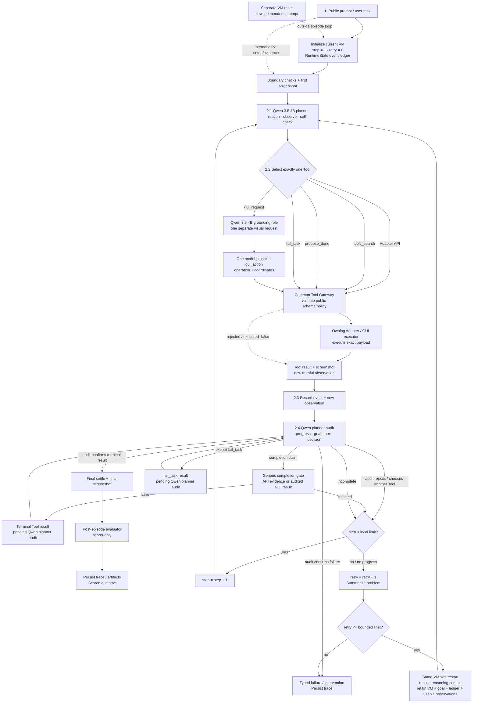
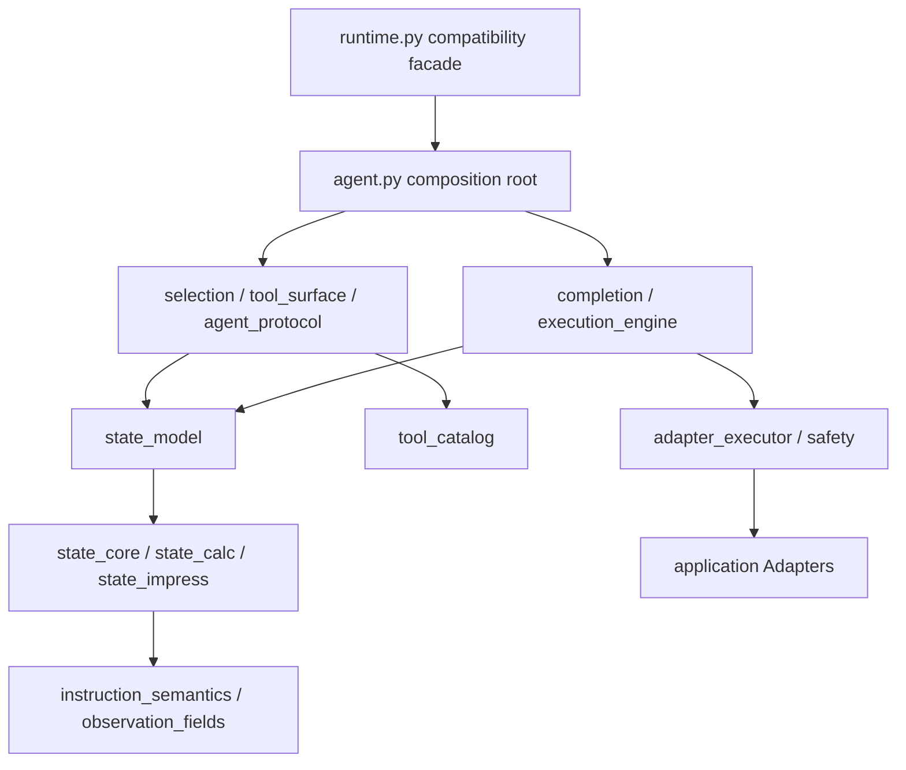

# Architecture

Updated: 2026-09-15

[Back to project index](index.md)

The parent model's optional `presence_penalty` is a per-condition decoding setting, not an action or
completion policy. The Runner reads it from the frozen `protocol` config and the model client records and
sends it unchanged. An absent setting omits the request field, preserving previous provider behavior;
The grounding role's decoding and the binary thinking switch are independent. No extra retry or gate is introduced.

The pure-Qwen full run described below was cancelled by the user on 2026-09-15; it is preserved configuration,
not an active evaluation. The linked v337-derived clean-hardened-v2 release (158/189) has its own independent
Git history under tag `archive/v337-clean-hardened-v2-20260816`; it has not replaced this runtime. See
[Version Control](archive/version-control.md#linked-v337-derived-release) for its exact identity and checkout.

## Runtime Flow (Current All-Qwen Configuration)

The current `qwen35-all-roles-fixed189-20260915-v1` condition assigns Qwen 3.5 4B to planning, tool selection,
result/terminal review, and the separate GUI grounding role. The authorized full run started at
2026-09-15 07:58 UTC and was later cancelled with 148 terminal outcomes. LiteAgent's generic API/GUI orchestration and episode flow remain unchanged. Six workers
use the direct Qwen endpoint; each worker's planner request, optional grounding request and next review are
separate sequential calls. Exact settings and result pointers are maintained in the
[current reference](current-repair-reference.md).

`provider=holo`, `--holo-*`, the `integrations/holo_agent/` module and Holo-named trace fields are existing
implementation labels. Actual requests, accepted response identities and served roots select Qwen only;
no Holo inference fallback is registered. The generic grounding prompt, normalized-coordinate conversion,
action validation and audit boundaries remain unchanged for this model switch.

The preserved all-Holo run measured 95/189; its individual repair queue is paused, not overwritten. The earlier
Qwen-Holo condition used Qwen planning and Holo grounding and measured 119/189. These source/service conditions
differ from the new run; neither establishes a pure model-only comparison or changes the promoted baseline.

## Ownership

Strict Calc saving exposes the optional output `url`: `{}` preserves the
active file and its format, while Save As to `.ods` or `.xlsx` uses the
owning Adapter's existing extension-to-format conversion. The strict model
surface omits the redundant native `filter_name`, as Impress saving already
does; direct use, search and Multi-Apps forwarding share the same contract.
CSV/PDF export remains a separate action. Legacy expert filters remain
available to non-strict callers; no new validation or argument rewriting
is introduced.

Impress `shape.delete` resolves the model's selector against the current shape
collection. Removing an object shifts positional paths, so the existing
duplicate-success check excludes this operation for both direct and
Multi-Apps calls. The same path may now identify a different object.
Native missing-object errors and their existing repeated-error handling
remain; the Runner never substitutes a target or adds an inspection gate.
The deletion receipt captures the actual object's name, type, text and path
before removal, alongside the owning slide, model-supplied selector and
remaining count. Usage and feedback warn that positional addresses may shift.
These observations identify what happened; they do not select or classify
the next object. Ordinary receipts use the existing model-result projection.

Impress `slide.create` inserts a new page at the model-selected insertion
index, or appends when omitted. Its public usage documents native layout
20 as blank and 0 as title/subtitle; omitting layout preserves the native
default. This is insertion, not navigation, and never includes image
selection, insertion, cleanup or save as an implicit sequence.

For ordered picture pages, strict required actions do not demand both
object deletion and page deletion. Cleanup tools remain advisory choices
in the ordinary tool surface; the model chooses a suitable operation from
current state. Inspection usage makes clear that empty title/subtitle
placeholders still count as objects. Generic save/readback and model review
remain; no legacy ordered-image plan or new blankness gate is enabled.

Impress page dimensions belong to the owning Adapter. The public
`presentation.set_page_size` accepts explicit width and height in 1/100 mm,
applies one shared canvas size to slides and masters, and reads it back through
the existing native verifier. It does not infer orientation, alter shapes or
save. The model chooses the dimensions and any subsequent save; inspection
projection retains the native orientation as well as width and height.

`presentation.inspect` can read explicitly model-selected zero-based slides;
omission keeps whole-deck behavior. It preserves absolute indices and reports
the inspected scope separately from the total page count. Model projections
retain native paragraph formatting; neither the Runner nor Adapter selects a
page from the instruction or previous mutation. Text mutation remains separate.
When whole-deck metadata and notes exceed the existing 12,000-character
presentation window, the owning projection retains complete early text/shape
observations with their selectors and counts omitted pages. It does not delete
all body text merely to retain every page's metadata. The model selects smaller
explicit page reads when omissions remain; full native evidence is unchanged.

Direct `shape.format_text` returns native character properties read over the
model-selected text range, reusing the existing semantic-role property reader.
An ineffective write reports the observed mismatch and possible partial changes;
requested properties are not presented as read-back. This immediate check does
not replace the independent post-save inspection or commit GUI text-edit buffers.

Initial presentation state accumulates each page's first observed record across
focused reads. Later observations of the same page cannot overwrite its original
formatting or geometry. Document-identity or page-order changes end that merge;
post-save read-back remains separate evidence. Existing completion rules consume
the combined observations without adding a new check or selecting model arguments.

Post-save Impress evidence likewise combines focused reads of compatible pages,
using the latest observation of each page. A later mutation, save, document or
page-count change prevents mixing snapshots. The combined view does not modify
the event ledger. A page not yet read is pending read-back, not a failed underline
or picture-edge mutation; observed incorrect state still requires correction.
Textbox underline completion also recognizes successful single- or multi-slide
role-format calls. Their native receipts must identify the same observed page,
shape path and underline property; later overrides retain their order. This
removes a redundant requirement to repeat the operation with `shape.format_text`.
The existing target coverage, save and post-save read-back remain required;
no model argument or application action is generated by this equivalence.

Single-title formatting accepts conjunctive selectors grounded in the same
native inspection. Every supplied field must identify the title consistently;
raw observed text is used for exact matching, not truncated display lines.
Paths address nested objects, while index without a path addresses the page's
top-level collection. The model's selector is preserved through dispatch.

The Impress edit-stage filter retains an already-selected presentation.inspect
alongside a pending picture/text mutation. The model can refresh observed
targets without first rediscovering the read action. Pending mutation selection,
public argument schemas and completion requirements are unchanged.

Persistence recovery keeps owning-Adapter inspection tools available, including
when the phase classifier sees only a save requirement. Multi-Apps keeps only
already-discovered reads in the owning Adapter. This prevents a save-only tool
surface from blocking post-save verification; completion requirements and raw
model-selected arguments remain unchanged.

Recovery tool descriptions include the current missing requirements from the
same completion result that selected the surface. A save or partial read can
change those requirements without a new model claim; the old rejection remains
historical evidence, not the sole current feedback. This adds no new check or
tool restriction and also applies to discovered Multi-Apps recovery routes.

The model-facing text_shapes view includes native grouped descendants with
their complete observed paths. Bounded projection retains text_style rather
than discarding alignment, font and underline evidence. The owning Adapter
normalizes native ParagraphAdjust values to named alignment and returns actual
whole-shape alignment in shape.format_text receipts. This does not select a
first textbox, infer a target or change mutation/completion semantics.
Inspection also exposes `text_style.bold` alongside unchanged `bold_weight`:
UNO 100 is normal, 150 and above are bold, and unknown weight0 yields null.
This translates existing observed formatting for the model without choosing
a target or adding a completion requirement.

The public slide parameter and model observations explain human numbering
versus zero-based indices. Shape indices/paths identify native stacking order,
not visual reading order; the model uses observed geometry or the screenshot
to resolve visual references. Text shapes now expose the same complete observed
tool_target (page and selector) pair as pictures. Their model-facing list uses
the shared geometric ordering helper: top-to-bottom, then left-to-right when
all coordinates are available; otherwise it preserves native order. The view
labels that order explicitly and retains truthful omission counts. Raw records,
native identifiers and application order remain unchanged. No instruction or
reference selects an object or supplies a model action argument.
The model-facing page summaries label the zero-based value `slide_index` and
retain the one-based `display_slide_number`. Canonical Adapter/context state
keeps `slide`, and the complete `tool_target.slide` remains the exact API
argument to copy. Both normal and bounded model projections use these labels;
the change does not rename historical events, requests or native receipts.

Strict semantic tool search retains public `.save` operations alongside the
declared mutations and observations. Saving must stay discoverable when the
instruction's required-action list names only content edits. This restores
candidate eligibility without adding a completion requirement or choosing a
save action, output path or parameter for the model. Export and unrelated
mutation eligibility keep their existing rules.

### Runner

Owns isolated task-setup projection, VM reset, screenshots, step limits, model endpoint selection, evaluator
invocation after the episode, and artifact persistence. Task ID exists only here as internal metadata.
`scripts/evaluation_boundary.py` reads the full task in a short-lived process and returns only `id`,
`instruction`, `config`, and `proxy`. The parent Runner does not load evaluator state or evaluator-only cache
artifacts until the Agent loop and final screenshot have completed.

In strict mode the Runner also binds legacy execution and golden deployment off, deploys every package through
`scripts/strict_deployment.py`, installs a task-independent Multi-Apps overlay, removes forbidden guest
artifacts, inventories the deployed files, and aborts if residue remains.

`scripts/run_lite_agent_pilot.py` imports strict-only helpers from `scripts/strict_runner_support.py`; it must
not import the historical `run_openapa_pilot.py` module (that name is absent from the active checkout) or any
coverage/task-hint module. A process-source manifest is checked
at Runner startup and again immediately before the first model request of every episode. A loaded legacy module,
full task UUID in loaded runtime source, source-hash drift, or missing boundary record fails closed before model
execution. This two-point check prevents a clean startup from hiding a later dynamic import.

Strict guest deployment is source removal, not merely Router denial. Task execution modules, task manifests,
golden/reference profiles, bytecode, and answer-bearing artifacts are excluded before packaging. The guest
inventory is then compared with the preregistered source allowlist and OSWorld cache hashes. LiteAgent and the
execution gateway still reject forbidden routes as defense in depth.

Screenshot observations are an environment boundary, not model state. The Runner requires non-empty bytes for
initial, post-action, and final captures, retries within a fixed three-observation budget, and raises a typed
environment error when capture remains unavailable. If an action already executed, its event is persisted before
the screenshot failure so the trajectory does not silently lose the mutation.

`integrations/openapa_osworld/provider.py` owns Docker/KVM container allocation. Port exclusion combines host
socket observations with `PublicPort` values from Docker's low-level container summaries. It deliberately avoids
high-level enumeration followed by per-container inspect, because another worker may remove a container between
those calls.

### Model-Free Direct API Harness

`scripts/run_direct_api_validation.py` is a development harness outside the Agent policy loop. For one selected
task it creates a fresh guest, deploys the strict generic Adapter surface, records each operator-authored public
API call and read-back unchanged, captures the final screen, and loads the original evaluator exactly once after
the operator finishes. It makes no model request, issues no direct Runner GUI action, does not run tool search or
completion, and cannot turn its result into an Agent baseline. A public semantic Adapter may still implement a
generic application shortcut behind its API contract. Corrective compositions and reusable Adapter additions
brought the completed 17-task campaign to `17/17` direct API composition passes. This is not an Agent result;
v337 remains unchanged.

### LiteAgent Core

Owns model messages, one structured tool call per turn, truthful execution state, generic retry behavior,
completion protocol, and trace events. It must not know task IDs, golden artifacts, evaluator expected state,
or application-specific answer plans.

`model_client.py` owns the OpenAI-compatible transport. It sends the already-validated messages and tools,
requires one structured tool call, disables parallel tool calls, and returns the actual served model ID and
usage. It does not select tools or interpret application semantics.

Unfinished Calc fill-down columns use the normal read/search tool surface;
they do not restrict the model to a single mutation tool. Existing completion
feedback still reports explicitly requested columns without successful coverage.
When a positional matrix is too large for model context, projection retains a
contiguous prefix of whole rows and marks it truncated. It must not concatenate
head/tail rows or remove interior columns under the original range coordinates.
The model chooses any smaller read range; no missing values are filled by the Runner.

### All-Holo Model Path (Active Architecture)

The active path uses Holo 3.1 4B as both the reasoning/orchestration model and the on-demand GUI-grounding
model. These remain distinct roles with separate messages and tool surfaces. A worker's two roles use the same
assigned endpoint serially; GUI delegation does not create an additional concurrent request from that worker.
The same LiteAgent loop, generic APIs, GUI Gateway, and result-review protocol serve both roles.

Historically, the 2026-08-31 full-189 repair condition used `Qwen/Qwen3.5-4B` for orchestration and Holo for
grounding. That condition and Holo-native GUI-only diagnostics remain separate evidence; neither contributes
results to the new all-Holo condition.

Holo in the planner role remains the single task coordinator. It understands the instruction, chooses API actions, searches the
public catalog, selects control Tools such as `tools_search`, `propose_done`, and `fail_task`, and decides when
visual interaction is necessary. A GUI turn is represented as a model-selected `gui_request` containing the
semantic intent and the current public context. The planner does not need to calculate screen coordinates itself.

When a `gui_request` is selected, Holo in the grounding role receives the latest screenshot and that request. It performs visual
grounding and returns exactly one model-selected `gui_action` containing the GUI operation and coordinates. It
does not own the full episode loop, call the evaluator, decide task completion, or execute a hidden sequence of
clicks. If it cannot ground the target, the gateway returns a structured grounding/execution error so the planner can
re-observe or replan.

Schema failures retain a bounded field path and public-schema expectation through grounding, the gateway,
and the next planner event. Invalid argument values and raw transport messages are not copied into this feedback.
Holo still gets one request per delegation; neither the gateway nor the Runner repairs coordinates or retries
grounding invisibly. Coordinate fields each contain one normalized integer, not a coordinate-pair array.

Scroll amounts follow the existing GUI contract: signed integer mouse-wheel counts, negative down and
positive up, passed unchanged to pyautogui.scroll. Holo adds no separate magnitude limit or clamping.

The existing left-click contract accepts optional model-selected modifier
keys. The gateway holds exactly those keys during that one click and releases
them afterward; omitted or empty modifiers retain ordinary click behavior.
The raw selected list is preserved with normalized coordinates, pixel-space
evidence, the executor command and the next planner observation. Neither the
Runner nor an application hint infers modifiers or a selection mode.

The common GUI Gateway validates the Holo action against the public GUI schema, screen bounds, and policy, then
executes the exact returned action. The Runner must not fill, infer, or rewrite coordinates or other arguments.
The trace records both the planner delegation and the grounding call, including their provenance and the exact payload
that reached the GUI executor. `holo_grounding_calls.jsonl` links `request_attempt`, `response_received`,
`grounding_selected`, `gateway_dispatch`, and `gateway_result` records by request ID, request hash, and episode
step; request or grounding failures use the same linkage. The response record preserves the complete serialized
Holo response and its hash, while screenshot bytes are represented only by their byte count and SHA-256. None of
this host-only transport evidence is projected into the next planner model context. The trajectory manifest seals the
Holo trace together with the other episode artifacts. API calls, GUI calls, catalog searches, and control Tools all
produce the same kind of execution event and result path. New delegations use `planner_to_holo` and record
`planner_model_requested`; the proposal's `model_actual` retains the provider response identity. Completion
processing also accepts historical `qwen_to_holo` records without rewriting preserved trajectories.

The planner-visible grounded-action receipt retains the ordered key list for a
hotkey and the selected `press_enter` boolean for typing, including `false`.
These fields report the action already dispatched; feedback does not add Enter or
choose another action. Raw grounding and executor provenance remain host-only.

After every Tool result, including a control Tool or a rejected GUI action, the Runner captures the result and
the latest screenshot into `RuntimeState`. Holo in the planner role then audits the truthful event ledger, determines whether the
result made progress, and chooses the next Tool. `propose_done` is therefore audited like any other Tool and
passes through the generic completion gate before final settle and post-episode evaluation.

An explicit completion claim can use an executed, validated, screenshot-backed Holo result already audited by
the planner while deferred terminal auditing is enabled and no result audit is pending. Read-only Adapter verification
and successful save-only persistence after that GUI result preserve its evidence. A later Adapter content write
or export restores ordinary API completion checks. Capturing
command stdout to a file counts as a write. GUI eligibility does not infer completion or narrow the next tool
set without a claim, and it does not prove that a visual edit or exported artifact is correct. Claim validation
and the planner's final terminal audit remain in place; no redundant Adapter mutation is required as GUI evidence.

When an existing completion check finds that the model explicitly admits
unfinished work, recovery uses the existing task-state guidance even if the
structural action checks passed. Claim-only recovery is reserved for argument
format errors without missing task state; it must not tell an unfinished
model to simply rewrite a success claim. Acceptance rules and the normal
available tools are unchanged by this classification.

Recovery is a same-VM soft restart. The Runner summarizes the failure, keeps the current VM, successful events,
task goal, and usable observations, and rebuilds the local reasoning context before asking the Holo planner for the next
Tool. A local replan counter may restart, but the global episode deadline, request budget, and event ledger do
not reset. A new VM is created only for an explicitly separate attempt, not for an in-episode replan.

Both Holo roles use a binary `enable_thinking` control in the current condition.
Each role records its own `reasoning_mode` and sends the
corresponding `chat_template_kwargs.enable_thinking` value; the generic
vLLM `reasoning_effort=max` enum is not treated as a provider capability.
Response `reasoning`/`reasoning_content` is retained as an operational
observation and an explicit contradictory mode is rejected, but no numeric
maximum is inferred from prose. A provider with a genuine tiered control can
continue through the legacy effort gate. The historical Qwen-Holo full-189 run demonstrated
the end-to-end split but also produced deadline, protocol, environment, and
normal evaluator failures. Focused repairs must preserve both model boundaries;
the split does not by itself solve long-document extraction or table reasoning.

Promotion-gated hybrid workers preflight both endpoint identities and reasoning
profiles before any task or VM lifecycle action. The supervisor passes workers
an immutable byte-for-byte config snapshot and its SHA-256; workers revalidate
that snapshot and the frozen source/repository inputs at exit. The supervisor
accepts a worker shard only after a zero process exit, a completed worker status,
successful final integrity revalidation, and an exact terminal task set, then
revalidates the config, source seal, and repository again before publishing a
terminal aggregate result.

### Agent Episode Flow (Active Architecture)

The following is the textual record of the supplied draw.io flow. It is the
same high-level episode flow as the diagram, with the Tool and audit semantics
made explicit.

The Agent follows one observable episode loop. The Runner receives the public task instruction, creates or
attaches to the current VM, initializes the `RuntimeState` event ledger, and captures the first screenshot. Task
identity remains Runner-internal and is never used to choose a model tool or an argument.

At each turn, LiteAgent presents the Holo planner with the latest screenshot, the bounded sanitized state projection, the
current public Tool surface, and the task instruction. The planner performs the reasoning step and selects exactly one
Tool. The Tool may be a direct Adapter action, a GUI delegation, `tools_search`, `propose_done`, or `fail_task`;
control Tools are not a separate execution bypass.

The selected Tool enters the common Tool Gateway. The gateway validates the public schema and policy, dispatches
the call to the owning Adapter or GUI path, and records whether it was executed. A rejected or invalid call is
recorded as `executed=false` and does not change the VM. For a GUI delegation, Holo receives the current
screenshot and the planner-selected visual intent, returns one concrete model-selected `gui_action`, and the same
gateway validates and executes that action without filling or rewriting its coordinates.

Holo retains one bounded public-schema error for the next grounding request with
the same public tool contract. The planner must choose another GUI delegation;
rephrasing its intent or fallback and refreshing the screenshot do not erase
the field/type correction. Only schema rules are retained, with no old target,
coordinate, path or invalid value. The feedback is consumed once, and a changed
tool contract clears it. The current planner request and screenshot still select
the operation; the actual request/evidence hash covers the complete new request.
Grounding remains one-shot with no automatic retry, coordinate correction or
change to blocking and execution rules. The feedback-bearing request is recorded normally.

`executed=false` is not by itself proof that the VM is unchanged. An Adapter
execution or verification failure can report partial effects, unlike a
pre-dispatch rejection. Model messages preserve that distinction and expose
the error's observed results without counting the failed call as success.

Protocol error hints descend into a union only when the submitted JSON type or enum/const discriminator
uniquely selects its branch. They preserve the nested field path and describe duplicate-list correction in
plain language. This changes error feedback only, not the schema validation decision or submitted arguments.

Bounded observation dictionaries retain explicit JSON nulls as observed data rather than treating them as
missing fields. Paragraph records retain their raw index, full text length and observed text before optional
formatting metadata. This keeps short source text usable even when a page's records share a small remaining
budget; longer text stays explicitly marked as partial. Ordinals and line spacing retain their ordinary
priority after those source fields. The original event payload, total context budgets, and model-owned target
selection are unchanged.

Calc `range.read` preserves the owning Adapter's A1-keyed `background_cells`
and `date_cells` through the model observation projection. The background map
contains observed non-white fills; an absent entry means white only when the
map is complete. Native numeric date cells expose an ISO date and English
weekday based on the document's actual `NullDate` and UNO DATE format bit.
Text dates and ordinary numbers are not inferred as dates. These observations
do not classify targets or choose formatting arguments. Existing bounded
projection marks truncation; the model selects a smaller range when needed.

Calc `range.format` also accepts an explicitly model-selected comma-separated
A1 area list with one shared format. The original native single/named-range
resolution remains available. For a declared area list, the owning Adapter
resolves all members before applying any format, then returns ordered
`formatted_ranges` and independent `range_results`, plus observed dates and
backgrounds after formatting. It never creates a bounding rectangle, infers
members or groups targets. Raw model and HTTP arguments remain unchanged;
the returned area list records each selected execution target. This is one
homogeneous operation, with no Runner-generated batch or new action.
Partial failures identify applied, failed and unattempted areas and preserve
the underlying error; a failed area's properties may be partially changed.
Existing merged-region formatting completion recognizes exact explicit area
members without adding any obligation or treating partial overlaps as complete.

Large formatting targets retain their complete native mutation scope, while
each area's returned cell preview is limited to its first 32 rows and 16
columns. A partial preview records `readback_range` and `truncated`; top-level
date/background maps also mark incomplete coverage. Missing map entries outside
the preview are not observations. The model may read another finite range;
the Adapter does not shorten the formatting target to the used range.

A derived date column does not require a separate fill operation when the
model writes its formulas explicitly. The existing fill API remains searchable
as an optional way to perform cell writing. Explicit user fill-down requests
retain their existing coverage checks; no replacement completion gate is added.

Writer `document.inspect` keeps preview text in an overview, with `text_length`
recording the native character count. Explicit paragraph pages return the selected
live text before bounded context projection; a one-paragraph page avoids the fixed
overview preview caps. Context truncation remains observable through the existing
`context_truncated` flag or string marker. The model selects each read and authors
any replacement; the Adapter does not reconstruct or split sentences.

Writer literal replacement preserves model-selected text outside the matched
range. Its replacement string uses CR (`\r` in JSON) for native paragraph
boundaries. For all-match replacements containing CR, the Adapter assigns the
unchanged string to native match ranges in reverse order, as the single-match
path does; the bulk replacement descriptor otherwise embeds CR without creating
paragraphs. Plain bulk replacements keep their existing native path. Match
cardinality and every replacement character remain model-selected.

Writer `paragraph.split` inserts native paragraph breaks after one explicit
literal or an ordered list of up to 32 literals in one model-selected paragraph.
Each literal matches its first occurrence after the preceding boundary. All
ranges are resolved before mutation, then applied in reverse offset order.
Existing text is not rewritten or normalized. The model selects every literal
and the shared blank-paragraph count; the Adapter preserves those arguments and
returns observed parts, offsets and final right-paragraph indices. It does not
detect sentences or compose subsequent calls. Single-boundary results retain
`split_offset`; the top-level `right_paragraph_index` identifies the final part.

Every Tool outcome, including a search result, a control result, a rejected call, and a GUI action, produces a
truthful event and a fresh observation when available. The result, screenshot, and bounded state projection are
then returned to the Holo planner for model audit. The planner checks whether the latest outcome made progress, whether the user
goal is satisfied, and whether another Tool or a replan is required. `propose_done` follows this same path; it is
only a completion claim, and the generic completion gate checks executed mutation, persistence, and structural
read-back evidence before accepting it. An accepted `propose_done` or `fail_task` result is held as a pending
terminal event until the next planner turn confirms it; that audit turn does not execute a duplicate terminal Tool.
If the planner selects another public Tool instead, the pending terminal claim is cleared and the same VM loop continues.

When the current plan can continue, the loop advances its local step counter and requests the next Tool. When a
no-progress cycle, repeated rejection, or budget boundary requires recovery, the Runner summarizes the problem
and performs a same-VM soft restart: it rebuilds the local reasoning context while retaining the VM, the task
goal, successful events, and usable observations. A local replan counter may restart, but the global episode
deadline, total request/step budget, and event ledger do not reset. A separate VM reset is an independent attempt
boundary, not an in-episode recovery transition.
The no-progress detector requires a complete window from the current retry; pre-restart events remain available
as prior action/result evidence but cannot immediately exhaust the restarted window. Repeated-error blocks and
the bounded restart count are retained.

The episode ends when the model and completion protocol accept the result, when a typed terminal condition is
reached, or when an explicit `fail_task` decision is recorded. The Runner then captures the final screenshot,
persists all model calls, Tool payloads, events, and recovery records, and invokes the original evaluator only
after the Agent episode has ended. The evaluator is a scorer and is never a Tool, a read-back API, or a model
completion oracle.

The historical `context_budget.py` and `context_token_counter.py` helpers are absent from the active tree. Their
bounded-request experiment is retained as dated diagnostic evidence. The active request boundary is implemented by
`agent_protocol.py`, `reasoning.py`, and `context_projection.py`: one canonical message projection protects the task
instruction, current screenshot, current tool surface, and recent execution evidence within the configured character
budget. This remains an overflow guard, not a demonstrated success-rate optimization.
The normal next-action instruction refers to the task instruction, latest tool results, and screenshot together;
it must not frame action selection as screenshot-only after supplying structural observations.

A frozen protocol may opt into `tool_call_stop_sequence` for a compatible
native tool parser. The model client forwards this exact provider-specific
sequence as `stop` and retains it with `include_stop_str_in_output=true`, so
a complete first tool call ends generation rather than merely filtering later
calls from the response. Missing configuration leaves requests unchanged.
This does not shorten the thinking budget or change tool validation, semantic
arguments, retries or grounding requests. The historical Qwen XML compatibility experiment
uses the full function/tool closing sequence; literal native delimiter text
inside reasoning or a free-form string remains a compatibility limitation.

Request artifacts preserve dictionary/property order, since the serving chat
template renders tool JSON and canonical equality does not imply identical
prompt tokens. The existing canonical digest remains order-insensitive;
artifact hashes and byte counts describe the actual ordered saved bytes.
Older sorted artifacts are immutable and need an independent ordered witness
before claiming identical rendered-prompt replay.

The implementation is split into a small composition root and focused modules. `runtime.py` is a compatibility
facade only; it re-exports the historical public names so Runner scripts and tests do not need a flag-day
rewrite. New code should import the owning module directly.

Completion uses executed evidence only. `generic_completion.py` owns the shared strict gate, while
`semantic_requirements.py` checks reusable application-semantic multiplicity and subgoal coverage by comparing
the instruction with successful model-selected calls. These checks may reject `done` and request a replan; they
never execute an action, manufacture an argument, inspect evaluator state, or consult task identity.
`completion_recovery.py` narrows to persistence and structural read-back only after the model explicitly
claims completion and that claim is rejected for missing closing evidence. A successful mutation alone must
not hide corrective editing or search; a later content mutation also reopens normal work after an older claim.
Both recovery classifiers use the same explicit read-action predicate. An error saying that an existing
read-back shows incorrect state keeps modification/search available; merely mentioning read-back must not
select read-only recovery. Completion still rejects the observed mismatch until corrected.
Save and read-only events may continue the existing rejected-claim recovery. `completion_policy.py` owns the
shared completion schema and fail-closed claim validation. `propose_done.evidence` accepts one nonempty
text statement or the existing array of strings/compact records. Text is opaque, even if it looks like JSON;
the original argument and raw call are retained. Both forms use the same contradiction, execution-ledger,
persistence, read-back and terminal-audit checks. The evaluator is never part of this decision.

`recovery_surface.py` owns the generic recovery surface. A single rejected
Adapter/GUI call only reorders the current public tools so alternatives appear
before the failed action; repeated structured errors additionally expose a
bounded replan surface with search, controls, and GUI fallback. The model still
selects the next action and all arguments. `context_projection.py` produces a
valid, recursively budgeted JSON view of observations, retains durable exact
handles and paths, and removes task/evaluator/golden metadata and
duplicate-detection signatures before the next model request. These modules
are application agnostic and do not consult evaluator state.

A repeated GUI rejection temporarily hides GUI only on the immediately next
replan surface. A later model-selected search or API action restores the GUI
tool; the exact failed request remains blocked under the existing policy.
Historical GUI argument blocks must not suppress all future GUI alternatives.
Thunderbird's existing `compose.set_recipients` public description and search
keywords identify receiver/recipient editing in an already-open compose window.
Draft opening, observed subject selection and each address remain model work;
the action does not create or send mail.

Repeated-error comparison uses the owning Adapter's error code and message
inside the existing forwarded response envelope. Different downstream
failures must not collapse to a generic transport status and trigger a
false repeat block; the repeat threshold and raw error feedback are unchanged.

Ordinary observed filenames and paths may contain UUIDs unrelated to the
task; UUID shape alone does not hide them. Arbitrary UUID filtering remains
in sensitive error/metadata contexts. The task-aware result sanitizer and
final request-boundary assertion still remove or reject the actual task
identity and its prefix, including encoded representations.

Within the existing compact budget, observed file `content` has the same
priority as cell matrices and is retained before usage `guidance`. Exact
paths and selectors keep their higher priority; this changes observation
retention only, not action selection or completion.

`file.read_text` observations reuse the existing bounded typed-text envelope
instead of first cutting source content to a separate small JSON prefix.
The owning file reader accepts model-selected Unicode `start_char` and
`max_chars`, returns exact source-window offsets and verifies the requested
slice against the saved file. A fitting small window remains complete in
normal model messages. Context-truncated windows retain observed chunk
offsets: the model can request a smaller window at the first chunk's end to
read an omitted middle section, or use `next_start_char` for unread source.
The observation identifies its reader and retains sibling-path/literal-edit
guidance; it does not apply a PDF basename parameter to a single-file read.
The reader returns text in the observation. Its guidance distinguishes this
from placing selected literal text in the system clipboard for a GUI paste.

Normal text-batch projection and recovery share metadata slimming and
actual-size body-window fitting. Under pressure, `handle.path` remains the
canonical path; chunks and table rows inherit identical `offset_basis` and
`source_total_chars` from their file when duplicate part fields are omitted.
`source_has_more` replaces its identical legacy part `has_more` alias, while
`context_has_more` still records text omitted from the model view. Normal
projection retains its declared budget for later durable/recovery fitting.
Final fitting propagates newly hidden chunk text to the enclosing file and
batch context-loss flags without changing source EOF or source cursors.
Guidance distinguishes a narrower basename read from source pagination;
the model still chooses the next file, range and action.

A complete requested text window is preserved under the existing total
budget, even when it starts after zero or `source_has_more=true`. Source
pagination is distinct from omitted context. Normal chunks use the existing
per-file allowance; recovery checks the observed offsets and text length
before preserving a window, and the final fitter still owns the hard limit.

Text-batch table windows retain the first contiguous nonnumeric, tab-separated
label block as `type=table_header` alongside a numeric row within the existing
two-window allowance. An observed numeric total retains its prior priority;
the header displaces a secondary row, without computing column roles or values.
The 480-character per-window cap and source/context truncation flags still
apply, and offsets use the returned source's actual representation basis.

Calc pivot `data_fields` use the owning Adapter's `PIVOT_DATA_FIELD` schema in
both direct and forwarded model tools. The existing display-mode enum and
usage text are not replaced by an unconstrained string in LiteAgent. Native
invalid-value feedback names the field's supported values without choosing a
mode or changing arguments; it does not imply that the field is unavailable.
Public pivot usage distinguishes category grouping in `row_fields` from
counting or summing `data_fields` within those groups. Descriptions do not
select source headers or impose an additional validation constraint.
The singular `pivot.create` result includes its observed destination sheet,
native `output_range`, one-based `output_last_row`, and `output_row_count`,
including headings and totals. Its destination accepts an A1 anchor or an
explicit `{below_range, blank_rows}` object owned by the Calc schema. The
model selects the reference and gap; the Adapter only converts that relative
position in the selected sheet to one A1 anchor. `requested_destination` and
resolved `destination` retain conversion provenance. No content discovery,
subsequent placement choice or next pivot call is performed. Existing compact
result projection retains these observations in direct and forwarded routes.
After insertion, `pivot.create` also reads actual native display text from
at most the first 32 rows and 16 columns of its own output. `readback.range`
identifies that preview and `readback.truncated` reports omitted cells;
`output_range` remains the full rectangle. A read failure is reported as
`readback_error` alongside successful creation metadata. It neither retries
the insertion nor substitutes calculated values. The model reviews the
displayed results against its intended aggregation and may select an explicit
`range.read` for more cells. This is result feedback, not a completion gate.
Application-domain action selection applies truthful state filtering before
Top-K so a satisfied read or blocked action does not leave a vacant tool slot.
This changes availability, not execution choices or the configured tool count;
Multi-Apps retains its existing route-discovery behavior.

Ordinary protocol/execution recovery keeps its 9000-character limit. When
the summary exceeds it, entries receive budget newest-first using actual
serialized sizes, with small reservations for older entries and audit
markers; the output remains chronological. This avoids equal shares
discarding the latest observation while leaving unused space. Multi-file
batch recovery retains its existing separate projection and budget.
Its latest typed text batch is fitted once under the existing 90% cap, but
only its actual serialized size is charged. Unused space goes to the existing
last four ordinary events, so short file reads do not erase recent tool
catalogs and errors. The fitted batch, chronological order and caller's hard
character limit remain unchanged; this affects observation delivery only.

Ordinary durable observations share the existing history budget by serialized
need: short receipts release unused space to larger observations, while each
declared observation cap still applies. Chronology, metadata sanitization,
the complete event ledger and the separate batch allocation are unchanged.
The durable batch branch likewise charges only actual projected batch demand,
up to its existing per-batch cap. A short text batch releases unused reservation
to ordinary observations, keeping later edit and command receipts readable
within the same history budget.
The durable key distinguishes the owning Adapter/action and already observed
file path, document URL or typed batch file paths. Different sources no longer
overwrite one another merely because they share adapter.call or a read action.
The latest observation still replaces older reads of the same resource, and
routes without resource identity keep their latest observation. Raw evidence,
model-visible event labels, sanitization and total budgets remain unchanged.

Failed Adapter responses retain their structured native error at the executor
boundary and in the host trace. They are not converted into legacy JSON-prefix
previews before model projection: sanitation discards those opaque previews and
would otherwise erase large command failures. Existing model sanitation and
budgets still apply; successful-response compaction is unchanged.
Error projection keeps its existing 1200-character budget but prioritizes nested
causes, error codes/messages, process return codes, and stdout/stderr over wrapper
logs and timing. Multi-Apps errors are read through `details.response.error`,
including when wrapped by a repeated-request rejection. Recovery hints reuse the
same metadata sanitizer as the state projection; they do not suppress ordinary
error wording merely because it contains a substring such as `unexpected`
or standalone `expected`/`reference` (for example, `expected dict` or an A1
`cell reference`). Both result and context sanitizers preserve that wording;
explicit hidden keys/identifiers such as `expected_state` and
`reference_profile` remain filtered.
Active request blocks retain the original structured failure in previous_error,
and later blocked results forward that same cause without nesting rejection
chains. Block decisions, lifetimes, and model arguments remain unchanged.

Audit/recovery markers accompany the bounded recent-event summary; they do not
replace or trim its newest results. The model must see the result named by its
pending audit, including a rejected call's error. Multi-Apps keeps an owning
API's dedicated context projection when available; otherwise it applies the
existing bounded metadata sanitizer to that API's actual result, instead of
discarding all output fields. Neither path supplies subsequent action arguments.

After a GUI open that names a spreadsheet without constraining its directory,
a successful verified Calc `workbook.inspect` establishes the active file when
its exact basename matches. A later background `workbook.read_file` neither
establishes nor replaces that active identity for this case. Explicit open paths
and named-directory constraints retain their existing exact identity checks.
Observation errors name the public current-workbook API; no directory or edit
argument is supplied by the Runner.

Calc `range.write` accepts JSON literal cells alongside its typed cells in the
existing flat or rectangular forms. The owning Adapter represents strings as
exact text (including `=` and date-looking text), finite numbers as numeric
cells, booleans as boolean cells and null as blank. Formulas and dates still
require explicit typed cells. Only destination geometry orients a flat list;
LiteAgent and forwarded payloads retain the model's original values.
When literals are represented as typed write inputs, the Adapter returns a
bounded `argument_conversion` record with the contract version, literal count,
target geometry and SHA-256 of the canonical matrix. The executor retains it
with the raw request in the host trace before feedback compaction, including
existing failure envelopes, and removes it only from the model-feedback copy.
The digest describes the selected write inputs, not successful storage;
native readback and existing completion checks remain separate.
Native Calc error 522 produces concise circular-reference/source-sheet guidance
in both formula write paths. Other native error handling and rollback stay
unchanged; the Adapter explains the failure without generating a replacement formula.

Calc scaled display acts on each current numeric cell value, including a
formula's calculated result, without changing the value or formula. Its
owning schema explains double scaling and divisor 1 for already-converted
values. Value transfer remains a separate model-selected operation; strict
completion does not prescribe copying as its only method. Scaled-display
coverage retains output column, unit, decimals and spacing requirements,
but does not equate the formatting divisor with the instruction's unit
scale independently of cell contents. Numeric correctness relies on native
readback and model review, not this operation-coverage check.

Calc workbook inspection retains native chart names, titles, types, source
sheets/ranges, and header flags. It reads value-series identities and primary
category axes from Chart2, including native series/category counts.
These are chart observations, not requested-state
inferences. A series-read error preserves the other chart fields and remains
visible to the model. Category previews keep explicit omission counts.
Inspection errors remain in the existing bounded projection.
Chart-detail omissions are counted without treating an empty cell
range as an absent chart. These observations do not select data or decide completion.
Chart creation reapplies the model-selected physical first-row/first-column
header flags after the native diagram's series orientation is established;
changing orientation must not transpose those flags. Native setters implement
the declared representation without changing selected source ranges or raw
arguments. Replacing a chart remains an explicit `replace=true` choice using
the observed name; conflicts explain this option and preserve the old chart.
Chart usage and readback guidance ask the model to inspect each source table's
header/boundary rows and compare actual category labels. Matching category
counts alone cannot establish coverage. These are model instructions; no
source-range selection, row classification or new completion gate is added.
Creation also returns native `column_headers` and `row_headers` immediately
so the model can review active defaults. Each getter failure is exposed in
`header_inspect_error`, while other available observations remain intact;
submitted/default flags are never substituted for an unavailable native read.

Workbook inspection also exposes `sheets[].pivot_tables`: each native pivot's
name and actual occupied `output_range`. Per-table read errors and inventory
enumeration errors remain explicit; missing inspection is not an empty-table
claim. The existing context projection retains the bounded inventory and its
omitted count. Pivot names share worksheet cells, so the model chooses any
non-overlapping destination from live ranges. Inspection does not refresh,
relocate, recreate, or reject an overlapping pivot.

The `multi_apps.adapter.call` transport facade is provenance-bound: it is not
visible until a successful model-selected public catalog search has supplied a
valid downstream `(adapter, action)` pair. The tool surface constrains that
pair to the public downstream schema, and the execution boundary rejects stale
or hand-authored routes. This prevents arbitrary cross-Adapter routing without
making the catalog choose parameters for the model.
The forwarded parameter schema also retains the owning API's top-level usage
description from the same canonical schema entry; it must not lose action semantics
while retaining only individual field descriptions.
Directly typed tools keep unique action guidance in the function description
and the complete contract in native parameters, without repeating the schema
as Python dictionary prose. Untyped actions retain their textual signatures;
catalog search signatures and ranking are unchanged.
Large Adapter read-backs retain the reported `filled_cells` count alongside
`written_cells` during compaction, including zero. These are observed counts,
not inferred completion or changed-state flags.
An optional condition-level `thinking_token_budget` is forwarded through the
parent model's existing serving request to bound reasoning within its total
output cap. It is not a numeric thinking mode; thinking remains the
explicit binary switch. Missing values preserve prior requests, and the separate grounding role is
unaffected. This setting originated in Qwen exploration and is not a new default.

`source_execution_semantics.py` owns the reusable Multi-Apps source-edit phase contract. For instructions that
explicitly require code completion plus persisted program output, it recognizes verified source reads, optional
named Writer-reference reads, source mutations, output captures, and exact output read-back. It may narrow the
next tool surface, but it never derives a path, edit, argv, output destination, provenance, or completion claim.
Named reference reading guides the initial edit. Once a verified source edit
exists, completion follows the actual capture and output-readback state;
it does not retrospectively require a particular reference-reading API/path.
This does not infer that all reference content was read or waive missing
source mutations, persisted output, or output readback.
During completion recovery, previously discovered source-output capture and
readback routes retain their owning Adapters across the latest mutation's
Adapter boundary. This keeps the existing OS command capture and VS Code
text reader available in their required phase; it does not discover a new
route or supply any call arguments.

`vscode_configuration_semantics.py` classifies public VS Code configuration intent and stages one reusable
semantic action until verified success. It returns action names only and never parses a setting value. Editor and
file-persistence mappings live in `vscode_adapter/editor.py` and `vscode_adapter/files.py`; debugging,
diagnostics, and Explorer mappings remain in their owning Adapter modules. The model-selected semantic fields
cross the Runner unchanged, and the Adapter owns stable VS Code identifier translation and JSON read-back.

`editor.inspect_active_file` is a bounded read contract owned by the VS Code Adapter. It reports the observable
active editor resource and optionally bounded content; it does not derive a requested path or stage a mutation.
Retrieval may expose it for active-editor ambiguity, but a successful evaluator result cannot substitute for an
observed model call when a prospective experiment requires that mechanism.

`thunderbird_filter_semantics.py` stages the public `filters.configure` operation for filter mutation intent and
keeps raw storage actions out of strict episodes. It never derives a rule name, condition, action, or folder.
`thunderbird_adapter/filter_contract.py` validates the model-selected `condition_mode` and condition array,
converts that explicit semantic call to native Thunderbird syntax, persists it, and verifies live read-back.

`verified_artifact_handoff.py` owns typed local-artifact continuity between selected producer and consumer
actions. It reads only preceding successful Adapter results and may enumerate compatible observed paths in one
consumer schema field. The model chooses the consumer, path, and all other arguments. The module rejects an
unobserved path without repairing it and never derives a filename from the instruction, task identity, or
expected state.

Thunderbird attachment selection uses the same observation-owned boundary. A successful `messages.query` may
expose complete attachment selectors in the next `attachments.save` schema as canonical JSON-string enum values.
The model must choose one complete value and its output file path; the Adapter decodes the representation and
rejects unobserved selectors or directory-only destinations. The Runner neither chooses nor rewrites either
field. The first paired diagnostic verified this local binding but added no end-to-end pass.

The former `causal_affordance_graph.py` and `strict_observation_surface.py` modules were opt-in prototypes for
cross-action observation leases. They are archived and absent from the active tree; their v395-v404 conditions and
flags remain historical evidence under `docs/archive/`. The active hybrid path uses
`adapter_results.py`, `context_projection.py`, `reasoning.py`, `recovery_surface.py`, `generic_routing.py`, and
`episode_control.py` to project bounded, verified observations and recovery state. These modules never select a
tool, transfer an argument, or execute a replacement on the model's behalf.

PDF composition is owned by the OS Adapter rather than a task-shaped LiteAgent parser. `pdf.outline.inspect`
returns a bounded page of exact outline titles and inclusive source ranges without creating or naming outputs.
`pdf.pages.extract` writes exactly one model-named range with an explicit backend and overwrite choice. The model
must select every independent extraction; LiteAgent never derives filenames, transfers ranges, infers a backend,
or loops over the outline. `recovery_alternative.py` owns the narrower protocol case where a current repeated
block is followed immediately by a model-authored search explicitly asking for an alternative.
It omits only that blocked action from the one recovery surface. It does not rank a replacement, create a call,
or fill arguments.

`os_adapter/pdf_tables.py` owns `pdf.tables.inspect`: native default table
detection on one model-selected PDF page and table, with a bounded row
window. Raw rows retain every column, null/empty cells and embedded newlines;
merged-cell spans come only from native cell geometry. LiteAgent's compact
observation represents each span as `[row, column, row_span, column_span]`
in full-table zero-based coordinates, preserves positional metadata before
whole leading rows, and explains how to retry a context-truncated window.
It never interprets labels, splits multiline cells into inferred records,
calculates values or supplies subsequent spreadsheet operations. The OS
deployment reuses the pinned Writer-vendored PyMuPDF wheel in its own private
installation; it does not depend on the Writer process being installed.

Calc and Impress action requests can passively ensure a UNO listener under the existing
action lock. `LibreOfficeLifecycle.prepare(restart_existing=False)` never
stops a live Office process or removes its profile locks: the standard
`--accept` invocation registers a listener through the existing same-profile
IPC when Office is already open. With no process, it starts the listener.
Readiness depends on the listener, including after the short IPC client exits.
The lifecycle attempt is recorded separately in the HTTP response, including
failures and attachment provenance, and consumes the same request deadline.
The original model action, document and semantic parameters reach the worker
unchanged. No document is reopened or setup replayed by this path; explicit
setup preparation retains its existing restart behavior.
Impress executes the selected action only once after readiness; a connection
failure during that execution is returned without replaying the mutation.
Recovering a missing listener after GUI reopening does not by itself establish
the cause or repair of the original native Office crash.
Writer likewise prepares a missing listener inside its action lock using its
existing passive `prepare(timeout_seconds)` contract, which has no restart
option. Preparation consumes the original action deadline and its lifecycle
status accompanies success or failure. Only the remaining operational timeout
changes; the selected document, action, parameters and verification are retained,
and preparation failure does not dispatch or replay the semantic action.

PDF form editing also stays in the OS Adapter. `pdf.form.inspect` exposes
the source AcroForm's exact full field names, labels, values and types;
`pdf.form.fill` fills explicit writable text fields in one chosen output.
It preserves the source pages and unselected fields and verifies the saved
values. LiteAgent retrieves these contracts and retains field observations;
its compact hint omits explicitly documented redundant metadata, while raw
Adapter results remain complete. Recovery containing PDF field observations
uses a 24K character budget so source records and exact target fields can
remain together; ordinary and text-batch-only recovery budgets are unchanged.
LiteAgent never maps spreadsheet columns, infers field values, or loops over records.
When history compaction hides returned fields, model-facing feedback directs
a smaller read at the current offset before advancing the PDF field cursor.
An unknown field name still fails before writing. If it exactly matches a
nonempty native PDF label, the error lists matching real field names for the
model to choose; labels are not accepted as aliases or silently substituted.
Schema recovery also explains undeclared fields at their actual object level
using public schema property names, without echoing arbitrary invalid values.

Impress persistence is implemented in `impress_adapter/uno_worker.py` and exposed through the Adapter manifest.
`impress_semantics.py` and the completion path validate the model-selected save/read-back sequence; the worker uses
`doc.store()` for the current document and `doc.storeAsURL()` for a distinct destination or explicit filter. The
former `persistence_contract.py` helper was merged into this path and is absent from the active tree. LiteAgent does
not rewrite the model-selected URL or select the save mode, and the Adapter reports the applied mode truthfully.

Strict Impress fitting uses `shape.fit_to_slide` with one exact path or index copied from
`presentation.inspect`. `impress_cover_semantics.py` validates the model-selected slide and fit mode and checks
post-save read-back; the Adapter schema rejects role-, orientation-, and rank-based selectors that would choose an
object on the model's behalf. The routing and validation path never selects an object or supplies arguments.

`vscode_workspace_context.py` records completion evidence for verified workspace mutations. The public, read-only
`workspace.inspect` action resolves the live active project's exact workspace roots from observable VS Code state and,
for a saved workspace, its exact `.code-workspace` path. Saving a folder project requires a separate model-selected
`workspace.write` call with an explicit destination path and folder list; changing a saved workspace requires an
explicit `workspace.add_folders` call with the inspected path. LiteAgent projects the observation but never copies it
into mutation arguments or derives the destination.

VS Code UI state is verified by `vscode_adapter/accessibility_state.py` and controller-backed accessibility
read-back. A caller supplies an observed `wmctrl` window ID; the Adapter binds it to the matching title and
requires one unique active Code frame before traversing that frame. `ui.open_view` requires a visible
selected/checked activity control, while
`ui.expand_section` requires one exact-name expandable element and reads back `STATE_EXPANDED` after pressing it.
Ambiguous windows, ambiguous section names, and presses without a state transition fail closed. Strict
deployment removes the former task-shaped `osworld.array-variables` extension instead of relying on route denial.
`extensions.install_vsix` installs only an explicit model/operator-selected local package; the strict host cache
pins official Python and Debugpy packages compatible with the fixed VS Code version and verifies their hashes.
`debug.breakpoint.set` acts on an explicit path and one-based line, then requires a checked exact-path entry in
the native Breakpoints tree. Debug session controls classify running and paused states from native controls, and
`debug.variables.read` accepts only a real paused session with one standard Debug Variables tree. These contracts
contain no source parser, expected variable names, task route, or synthetic variable view.

`terminal_output_semantics.py` recognizes only public instructions that explicitly require command output to
remain visible in a terminal. It stages `terminal.show_output` for that intent and removes the action from
unrelated tool surfaces, including expanded catalog results. The model supplies the complete finite argv,
working-directory source, and optional provenance unchanged. `os_adapter/active_directory.py` resolves live
focused terminal or Files context; `os_adapter/visible_terminal.py` executes, verifies, and leaves the terminal
open. The Adapter waits for its launched window, attempts one native GNOME overview close, and then uses the
existing window activation and focused-terminal read-back. GNOME Activities overview can otherwise retain focus
despite EWMH activation. An unavailable native overview service does not relax the read-back requirement.
Normal window-registration latency is handled within the existing deadline. Neither layer derives the command
or expected output.
Opening a visible-output terminal preserves existing terminals and their
running commands. Its unique title scopes focus and observation to the new
window; explicit lifecycle teardown retains responsibility for closing them.
Launch and accessibility polling consume the same action deadline. If the
command finished but its completion marker cannot be observed, the action
still fails and returns the actual exit status and bounded combined output;
captured output is not substituted for proof of visible terminal output.
The worker's existing terminal check reuses the complete matching window and
completion-marker observation from that same visible-command result. It does
not repeat the accessibility probe after success. An unrelated terminal check
or a result without that complete receipt retains the ordinary live probe;
command argv and exit-status verification remain separate.

`workspace.find_files` remains a generic read-only VS Code capability. Generic catalog retrieval can recall it
from workspace and file-discovery vocabulary; there is no dedicated instruction parser or forced consumer
sequence. `vscode_adapter/workspace_discovery.py` resolves the live workspace from the active Code window and VS
Code metadata, with bounded title fallback and fail-closed ambiguity handling. The model supplies every glob,
recursion, hidden-file, depth, and result-limit argument unchanged.

Focused `*_semantics.py` modules may classify a reusable instruction, name required public actions, stage
dependent actions, constrain a schema from prior public Adapter observations, validate the model-selected call,
or require completion evidence. They do not choose an argument value, repair a model call, execute an action,
or inspect task identity. `request_blocks.py` owns generic stale-block expiry after a later successful content
mutation; read-only and persistence events do not pretend that application state changed.
Success-only duplicate rejection excludes those already classified as read-only,
including canonical downstream reads. A model-selected reread executes normally
so compacted observations can be refreshed. Failed-request blocks, mutation
deduplication, and the existing equivalent-read stall detector remain separate.
Ordinary selection and explicit catalog search must not hide a parameterless
inspection merely because it previously succeeded; its usage remains available
when the model needs to refresh or interpret that observation.

`adapter_results.py` retains full truthful Adapter evidence but creates a bounded, complete model projection.
For Impress, this projection preserves stable path/index selectors and shape geometry while omitting verbose
notes and redundant shape properties. It retains early-slide graphics and text together instead of removing
every picture to retain later-slide text, and reports omitted objects explicitly. Picture `tool_target` uses
the zero-based `slide` accepted by existing shape APIs; `display_slide_number` is for human-facing numbering.
This avoids handing a small model a syntactically truncated inspection or an incompatible target object.
For `command.run`, it retains observed stdout/stderr up to the existing per-string
limit with original character counts and explicit truncation flags. An unsaved
stream remains an observation, not evidence of a persisted output file. This
contract applies equally to direct and Multi-Apps forwarded calls.

`AdapterExecutor` uses a model-selected `multi_apps.adapter.call` nested
`payload.timeout_ms` to extend the outer wait when explicitly longer than the
120000 ms default. The Runner binds its existing episode deadline once; the
executor caps the operational envelope and HTTP wait to the remaining time,
and Multi-Apps caps the forwarded timeout to both that envelope and the owning
Adapter's existing maximum, including when the nested timeout is explicit. The original model
arguments and command semantics are preserved. Host traces and proxy responses
record requested/effective timeout budgets; native errors and partial output
remain visible. This is API budget propagation, not a new evaluation gate or
a process-tree cancellation guarantee. Owning Adapter limits still apply.

Impress action handlers that already compute `verification_passed` must not
have a native `false` result overwritten by successful empty outer checks.
The worker returns `VERIFICATION_FAILED` with the measured result and a
partial-state warning; it does not retry, roll back or change model-selected
arguments. Geometry readback preserves an explicit path selector through the
existing path-aware shape summary. No additional completion gate is involved.

Impress audio.insert describes its single-slide audio-object scope separately
from playback across slides, looping, transition sound and saving. Its default
shape_properties check reads the created object's MediaURL against the URL
derived from the model-selected path. A mismatch returns VERIFICATION_FAILED
with expected/observed values and partial state; successful URL verification
does not claim playback settings or completion of an audio task.

The existing slide.set_background receipt distinguishes an open-document
edit from file persistence with saved_by_action=false and a short reminder
to select presentation.save. Its public description and the existing save
description explain this same boundary. No automatic save, new completion
condition or forced action is introduced; native style/color observations
alone do not prove a persisted bitmap.

Calc missing-file read errors expose a bounded `open_documents` list from the
existing live UNO session, with exact title/URL pairs and an omitted count.
These are possible recovery observations, not confirmed replacement files:
the Adapter does not select, open or read an alternative. Enumeration failure
cannot hide the original `FILE_NOT_FOUND`. The existing `workbook.inspect`
contract is discoverable through active-workbook/path queries and needs no
file path when there is only one open workbook; normal ambiguity rules remain.

Legacy dataset-mode branches still exist for labeled historical reproduction. They are isolated in the
completion and execution modules and are disabled by the strict configuration. Their presence does not make a
run admissible: audit schema v5 first proves they were not imported or deployed, then compares each captured
model tool call with the executed event and transport
payload, including failed forwards and GUI commands; missing evidence, a rewrite, or an injection makes that
episode invalid. Reusable argument adaptation must move
behind an explicit parameterized Adapter contract, while the model-selected action and model-facing arguments
reach that Adapter unchanged.

Impress formatting contracts are Adapter-owned. `slide.format_text_roles` and `slides.format_text_roles` have
disjoint single- and multi-slide schemas. They resolve public semantic roles (`title`, `content`/`body`, `table`,
and generic text) from live shapes and preflight all requested pages before mutation. Native title placeholders
win; an imported ordinary text shape is treated as a title only when it is the unique dominant upper-slide
heading, with ambiguous cases failing closed. `impress_adapter/tool_manifest.py` remains the schema source,
while `text_roles.py` owns role classification. Local presentation URLs are decoded exactly once before
save/export so encoded spaces do not become `%2520`.

Title-to-notes is deliberately not one Adapter operation. `presentation.inspect` exposes the live title text,
shape selector, and existing notes; the model then selects `slide.set_notes` and, when requested, a separate
`shape.format_text` call. Save and read-back are independent events. No Runner module derives the title text,
selector, conflict policy, or a hidden two-mutation plan.

`shape.insert_image` owns physical size conversion at the Impress boundary. The model supplies the source path,
structured mm/cm/in dimensions, and a public slide reference. A zero-based `slide` and one-based `slide_number`
may coexist only when they identify the same slide; strict semantics and the Adapter reject conflicts while
forwarding a consistent pair unchanged. The Adapter converts units, inserts the image, and verifies source load,
geometry, persistence, and structural read-back. LiteAgent only stages the public action and evidence sequence.

Personal-information cleanup is model-composed. `presentation.inspect` exposes live text and stable shape paths;
the model decides which observed text and icon shapes satisfy the instruction and submits one explicit
`shape.delete` call per selector. The retired `slide.remove_personal_information` action no longer classifies
content, associates nearby icons, or deletes an entire semantic group in one Adapter call. Title-role parsing
still scopes slide references to the title-format clause so an independent cleanup clause cannot expand the
formatting target set.

Heterogeneous textbox formatting is model-composed. `presentation.inspect` returns live structural selectors,
then each independently styled shape receives its own `shape.format_text` call. The removed single- and
multi-slide ordinal facades no longer discover, sort, resolve, mutate, and verify a task in one call.
`slide.format_text_roles` and `slides.format_text_roles` remain only for homogeneous role-based changes, where one
model-selected style rule is the native semantic operation applied to an explicit slide scope.

Writer tab-stop formatting receipts include a native count of selected paragraphs with and without actual Tab
characters. Informational guidance distinguishes configured stops from text separated by Tabs; configuring or
clearing stops without Tabs remains a successful operation. The existing Writer model-context projection retains
these concise counts and guidance before verbose paragraph previews, using the existing context fitter. It does
not insert text, select a word boundary, change completion requirements or rewrite model arguments.
Paragraph details also distinguish actual Tab positions (`tab_character_offsets`, zero-based character offsets
in the full native string) from literal backslash-t sequences (`literal_tab_escape_count`). These are textual
observations, not GUI coordinates or suggested edit boundaries; preview truncation does not change their basis.

Writer paragraph and table grouping are likewise model-composed. `paragraph.set_format` applies one explicit
style to one explicit paragraph group. Its `tab_stops` replaces explicit paragraph tabs using model-selected
measured positions (`mm`, `cm`, or `in`), alignment, and optional decimal/leader characters; an empty list clears
them. Conversion to native Writer values stays in the Adapter. This formatting never inserts tab characters or
rewrites words; local tab insertion uses model-selected `text.find_replace` with a unique observed anchor,
while complete paragraph rewrites use `paragraph.replace_text`. Inspection and formatting read-back retain
actual tab positions in mm and `has_tab_character`. `document.inspect.page_layouts` reports in-use native page
style dimensions and margins in mm; body width is derived before paragraph indents or columns. These
observations never choose a tab position or a later text edit for the model.
`paragraph.clear_text` clears the text of an explicit, required raw-index list with one shared operation.
Every target resolves before mutation. It preserves paragraph boundaries and verifies each selected text is
empty and native paragraph count unchanged before the existing save/verification path. The receipt retains
exact caller-selected indices and native read-back. It has no filter, inferred targets, retained-record logic,
default-all behavior or completion-policy special case. Emptying paragraph text is separate from deleting its
paragraph boundary; the model owns discovery and selection.
`document.read_file` reads body paragraphs and table text from one explicit saved local Writer file
through an independent hidden, read-only template load. It never saves or selects an open editor and
does not include unsaved edits, headers/footers, or image text. Macro execution and external updates are
disabled. Model-selected `start_char` and `max_chars` page the native body text; the response retains
the source path, total length, and `next_start_char` through the existing typed text observation.
The observation identifies `document.read_file` and retains its actual `path`,
`start_char`, and `max_chars` continuation contract through final context fitting.
Hidden returned text resumes at the visible head chunk's `end_char` with a
smaller requested window; `next_start_char` instead points beyond the native
returned window and can be null at source EOF while context still hides text.
Both cursors use `writer_body_text` character offsets.
This owning-Writer action is also available through generic `adapter.call`; the retired flat Multi-Apps
facade remains absent. No path, continuation, content interpretation, or downstream edit is chosen by the Runner.
The read and PDF-export descriptions explicitly distinguish saved-file reading
from activation: `document.export_pdf` uses the open Writer document, and its
`path` is a destination. The model opens/selects the source separately. Writer
deployment installs the pinned PyMuPDF wheel offline in its private service
directory for the existing DOCX normalization contract; no system package,
health-gate, normalization-default or model-argument change is involved.
`document.inspect` exposes paragraph indices and table names. Optional `paragraph_start` and
`paragraph_limit` read at most 12 paragraph previews per page when the overview omits the middle of a long
document. `next_paragraph_start` and `has_more` expose continuation; indices and text ordinals remain
document-wide. The no-argument overview is unchanged, and every page is selected by the model;
`table.read` returns every exact cell name, text value, and observed whole-cell font color from one selected
table, with row/column indices derived from its native cell names. `font_color` is `#RRGGBB`,
`automatic`, `mixed`, or null when unavailable; it is not reconstructed from previous write arguments.
The model-facing hint lists field names once in `cell_fields`, followed by `cells` rows in that order
(`[name, text, font_color, row_index, column_index]`). Native results keep their per-cell objects;
the hint preserves their order and exact values, using null for unavailable coordinates. This representation
reduces repeated labels without classifying content or choosing mutation targets.
The table hint declares an 8000-character budget, with the existing 1000-character wrapper allowance;
larger bounded observations may still omit cells and must not claim complete
formatting evidence when it does so. Meanwhile,
`table.set_cell_text_color` applies one color to one explicit homogeneous cell list. Repeated names reapply the
same color without changing model arguments; cells_changed counts distinct targets. All named cells must exist
before any write. The Adapter never classifies
words, derives groups, or chooses colors. It preflights every selected cell before mutation and verifies the
resulting document state after save.

`table.convert_text` converts one model-selected inclusive range of raw body paragraph indices in place.
The model supplies the literal delimiter; the Adapter selects the native range and dispatches Writer's
`ConvertTextToTable` once. It does not retype cell values, infer the range, or parse quoted CSV. Paragraph
breaks separate rows, and each row must have the same number of delimiter-separated fields. The range cannot
enclose an existing table. The native converter's delimiter is one non-NUL BMP character, excluding paragraph
breaks and surrogates; source text can contain nonbreaking spaces and astral characters. Read-back verifies
one new table, exact field contents and preserved outside paragraph text before ordinary save verification.
The receipt supplies the native table name and original selected range for a subsequent model-selected read.
`table.insert_after_text` remains a separate operation which inserts supplied cells and leaves source text intact.

Sentence separation is explicit Writer composition, not a benchmark-wording facade. `document.inspect` exposes
the live zero-based paragraph indices and text; `paragraph.replace_text` receives one exact index, the complete
replacement paragraph strings, and the selected blank-paragraph count. The Adapter performs no sentence
segmentation or text generation. The removed `paragraph.separate_sentences` alias cannot be dispatched or
retrieved in strict mode.

Paragraph inspection and formatting receipts include native whole-text
strikethrough state, distinct from the requested formats object. Native
CharStrikeout and PropertyState yield true/false for supported uniform states,
mixed for ambiguous ranges and null when unknown/unavailable. The existing
direct/forwarded projection preserves these observations; it does not infer
task completion or replace the model-selected formatting arguments.

Writer document inspection and document.set_font receipts expose native
font-family summaries for the setter's body/table-cell text scope. Each
western, Asian and complex-script property is read over the whole text object
with PropertyState. Known uniform font names are separate from mixed and
unknown object counts; requested font_name remains an input echo, not an
observation. This summary does not imply header/footer/frame coverage, change
formatting, or decide completion. The existing inspection projection retains it.

Writer application preferences are not document content. `settings.set_default_font`
commits the explicit model-selected font to the native profile and reads it back;
the existing `default_font` verifier uses the same native reader, never its input
as observed state. Its `application_settings` verification scope identifies profile
evidence. Office settings-only work can use this passed native read-back without
saving an unrelated document. Any document mutation or mixed document/settings
work retains normal document persistence/read-back requirements. This evidence
does not set completion; the model claim and deferred terminal audit still apply.

Writer `document.inspect` also reports native footer regions for in-use or
physical page styles. Shared, left, right and first-page regions remain
distinct according to the document's sharing flags. Each actual PageNumber
field carries its observed paragraph alignment, offset, numbering type and
subtype; literal digits are not classified as page-number fields. Disabled
footers are identified without accessing disabled content. The existing model
projection retains these observations within its unchanged budget. The reader
does not mutate/save the document or infer completion, and the existing
page_numbers verifier receives the same structural observation.

Writer `text.find` reads an explicit literal, current character-format criteria,
or their intersection. Format-only search enumerates native body-text portions
and returns exact text, paragraph index, half-open offsets and observed format;
it neither selects edit targets on behalf of the model nor changes/saves text.
Criteria describe the current style to find, not the requested replacement.
`format_counts` groups only returned matches by observed format; its explicit
scope excludes any omitted matches and does not assert task completion.
Existing literal searches and their explicit case policy remain supported.

Writer `text.set_format` changes only explicit character-format fields on one
body paragraph range. The model supplies zero-based half-open offsets and
exact expected text observed with `document.inspect` or `text.find`; the
Adapter does not search for or classify mutation targets. Font size, bold,
italic and native normal/subscript/superscript presets are independent choices.
Existing range validation, autosave and native format read-back remain in
the owning Writer Adapter. No matching macro or completion rule is added.
Its compact result preserves the exact range, text, observed format and native
save/verification evidence without repeating transport envelopes. The existing
length check reports both range and text lengths and end-exclusive offset
semantics; it never repairs or replaces the model's arguments.

Numbered-reference editing is also model-composed. `document.inspect` and `text.find` expose live paragraph and
offset evidence without inferring a reference section or next number. `paragraph.apply_numbering` copies an
explicit native numbering style, `bookmark.create` anchors an explicit observed text range, and
`cross_reference.insert` creates one native GetReference field at an explicit offset. The caller chooses every
paragraph, label, anchor, and insertion point; Writer only validates, executes, saves, and reads back each atomic
operation.
Numeric reference modes inspect the chosen bookmark's native paragraph numbering before replacing the
destination. An invalid source returns its observed state with destination_unchanged. This one insertion and
refresh uses a native undo context; on failure, only its own matching top undo action may be reversed. The
error reports whether the original destination was restored and any remaining field state. Generic citation
and reference search terms expose the existing source tools alongside the consumer, without choosing their
arguments or imposing a new completion rule.

Writer text-file composition is model-composed as well. The model reads each selected source through its owning
Adapter, then supplies explicit text to `paragraph.replace_text` or `document.append_paragraphs`. Formatting and
persistence remain separate `paragraph.set_format` and `document.save` calls. The retired
`document.create_from_text_files` action no longer reads, joins, formats, and saves an entire file list in one
call; the old `text.insert`/`text.insert_file` names are historical and absent from the active schema.

Matching-file copies are composed at the OS boundary. `filesystem.find` performs only model-bounded discovery;
`filesystem.create_directory` creates one explicit path; and each `filesystem.copy` call copies exactly one
explicit regular-file source to one explicit destination. The model chooses every root, pattern, recursion
bound, path, replacement policy, and mapping. The OS Adapter validates each single-file mutation but never
combines search, target derivation, flattening policy, and mutation into one call. Explicitly negated operations
are suppressed by generic strict retrieval rather than interpreted as positive tool intent.

Filesystem search feedback retains the Adapter's effective `kind` filter. A
zero-match result explains whether files or directories were excluded; the model
chooses any correction. The default stays `file`, with no hidden second search.

Age-based file organization is also model-composed. `filesystem.find` returns exact paths and modification
timestamps but does not classify them. The model decides the cutoff outcome and issues one `filesystem.rename`
for each exact move; each old regular file is handled by a separate `archive.compress_file` call with explicit
source, `.gz` destination, overwrite choice, and source-retention choice. The OS Adapter verifies each
single-file mutation and compressed output. It never reads the instruction, current clock, or dataset identity
to derive a classification, destination, or workflow.

Filesystem permission changes use the same explicit-discovery boundary. `filesystem.find(kind=file)` returns
ordinary non-symlink file paths and never turns a symlink into an outside mutation target. The model then passes
every selected path and one shared octal mode to `filesystem.set_permissions`. That mutation accepts no root,
recursive flag, glob, or current-directory source; it preflights the complete exact set, records prior modes,
applies and verifies one homogeneous operation, and rolls back earlier changes if a later path fails. LiteAgent
has no permission-specific plan or completion shortcut.

This boundary deliberately permits model failure rather than silently reassembling the removed workflow. In the
frozen v376 OS composition check, the model did not reliably perform discovery before mutation or sequence the
returned exact paths into later calls. Runner-side path repair, call synthesis, or automatic composition would
invalidate the generic-only contract; the negative trace is retained as an orchestration limitation instead.

VLC local-media opening uses the same boundary. `playback.open` accepts only one exact model-selected local path
or HTTP(S) URL and a loop preference; it performs no directory mapping, recursive discovery, extension
classification, or candidate choice. `generic_routing.py` and `tool_catalog.py` may expose the read-only OS
`filesystem.find` contract when public retrieval returns it, and strict deployment attests both owning Adapter
packages.
The route is a flat model tool: the model selects its arguments, observes its result, and must make a later
independent `playback.open` call. LiteAgent does not transfer the result, select a candidate, or auto-execute the
consumer. The v377 affected trace demonstrates this model-owned composition while separately exposing an
unresolved termination loop after playback was already verified.

`playback.status` resolves the status snapshot's native `currentplid` against VLC's
read-only playlist. It returns the original `source_uri` and a decoded absolute
`source` path for local file URIs, retaining stream/non-local URIs unchanged.
Display metadata is not a source path. Unavailable lookup leaves source null and
reports `source_error` without discarding the playback state. The model still
selects every subsequent extraction/open argument; the Adapter does not search
directories, choose another item, or execute a follow-on action.
The same read exposes `time_seconds` and raw `position_microseconds` from the
single active MPRIS player whose native media URI matches that source. Native
microseconds are converted to seconds without a fixed offset; the legacy HTTP
`time` remains whole seconds. Missing or ambiguous native position reports
`time_error` without fabricating precision or losing the source/playback state.

Git workflows are composed at the OS command boundary. `command.run` executes one finite model-selected argv
without shell parsing and preserves the selected `cwd_source`, provenance, and accepted return codes. A model
may separately inspect status, stage, commit, push, and compare local/remote state, but no Runner or Multi-Apps
facade supplies those commands or forces their order. Strict retrieval treats Git as one reusable command-domain
resource and suppresses persisted-stdout tools unless the query actually requests saved output.

The shared command/visible-terminal syntax check accepts find's native
execution terminators (`-exec`, `-execdir`, `-ok`, `-okdir` followed by `;`).
They are literal argv for find, not shell separators. Other existing shell
operator checks remain unchanged. Direct argv does not expand wildcards;
the model selects an explicit shell script or a program-native pattern.
No command or argument is rewritten by this compatibility rule.

### Tool Gateway

Builds the currently allowed schema set and rejects forbidden actions at execution time. Hiding a tool from the
model is not sufficient; `task.execute`, `task.inspect`, `artifact.materialize`, direct VLC profiles, and nested
variants through `multi_apps.adapter.call` must fail when manually injected. `tool_catalog.py` owns
discovery/schema selection, while strict routing ranks public identifiers and contracts without an answer plan.
Homogeneous semantic-role formatting remains available as an application operation, while heterogeneous
ordinal formatting is composed from `presentation.inspect` and repeated `shape.format_text` calls. No Impress
router generates a selector, style, note value, or mutation sequence. Strict schemas use the JSON Schema subset
accepted by the serving stack and avoid raw application
escape-hatch strings when a structured operation exists. `adapter_executor.py` owns the final network boundary
and writes an explicit `generic_only` or `legacy_dataset_routes` policy mode into its trace.

`gui_actions.py` is the single source of truth for GUI schemas and command conversion. It validates one
action-specific argument object without aliases or defaults. `execution_engine.py` calls that converter and the
Runner records the exact command immediately before handing it to OSWorld.

The default `tools_search` backend remains deterministic lexical retrieval. An experimental
`llm_full_catalog_rerank_v1` backend can send only public contract metadata to a separate audited Router model and
accept a bounded list of public route identifiers. It cannot execute an action or produce action arguments, and
its request, response, candidate-catalog hash, and selected identifiers are preserved for strict audit. The first
paired diagnostic added no pass while averaging 33.2k Router input tokens, so this backend remains default-off.
Any later model-assisted routing condition should use a compact hierarchical or hybrid candidate stage and must
again isolate routing from resource binding, context projection, and completion behavior.

The preserved full-189 trace includes served HTTP-200 responses with no structured tool call. The active recovery
path preserves such responses and may issue a bounded, generic protocol repair; it may not choose a tool,
synthesize arguments, or bypass the exact model-call-to-execution audit chain. Any future transport change must be
measured separately from long-workflow convergence and must not be described as a current baseline improvement.

### Application Adapters

Own reusable application semantics such as editing a range, formatting a shape, querying files, or changing a
preference. An Adapter API receives explicit semantic parameters or derives them from current application state,
not from task identity or golden artifacts.

For example, `os.desktop.applications.inspect` returns bounded installed Desktop Entries and their advertised
MIME types, then the model can select exact values for `os.desktop.mime_associations.set`. The owning Adapter
applies only those selected associations through `xdg-mime` and verifies each one by reading it back. Neither
action chooses a target or carries a task route.

VS Code configuration follows the same boundary. Public actions such as `editor.configure` and
`files.configure` accept application semantics, not raw benchmark answers. Their owning Adapter converts only
the fields explicitly selected by the model to stable settings keys, preserves unrelated settings, and verifies
the resulting JSON subset.

The active development tree retains these reusable contracts at the application boundary:

| Owner | Contract examples |
|---|---|
| Calc | freeze an A1 range; reorder named columns; cover multiple fill-down targets; resolve semantic stacked-pivot placement from live cells and DataPilot output; sort explicit tables; persist and verify genuine XLSX/ODS packages |
| Impress | semantic palette colors; precise slide background scope; live ordered text boxes; physical image insertion; live personal-information cleanup |
| Writer | highlighting read-back; cursor image insertion; inspection-constrained numbered references; paged table inspection; explicit homogeneous cell-color mutation |
| Multi-Apps | provenance-bound `adapter.call` access to owning Adapters; historical flat facades are not public actions |
| OS | explicit local-path normalization; unique basename rename; regular-file permissions; finite visible-terminal execution from live context; exact-title capture; read-only PDF outline and form inspection; one-range PDF extraction; explicit text fields in one output PDF |
| Thunderbird | native file-chooser readiness, bounded resubmission, semantic filter configuration, and accessibility read-back |
| VS Code | complete keybinding operations; active-workspace file discovery and folder addition; named current-project workspace save; stable command and natural trigger mapping |

Environmental representation conversion is Adapter-owned. Examples include expanding an explicit `~/` path,
mapping `/~/` to the current home, translating a public spreadsheet `source_path` to the downstream
`input_path`, or resolving the documented visible-terminal working directory. The model-selected public call
still reaches the Adapter unchanged.

Strict Multi-Apps installs the active `multi_apps_adapter/` package (`actions.py`, `schema.py`, `service.py`, and
`tool_manifest.py`) as the runtime implementation. Its public facade exposes only the declared generic contracts;
downstream task routes and dataset profiles are checked again inside the guest. The strict schema and workers do not
register a `task.execute` branch; legacy task modules are excluded from the package rather than left behind an
unreachable route. The former `generic_actions.py`/`generic_schema.py` names belong to an older snapshot and are not
importable in the active tree.

### Evaluator

Runs only after the episode and produces the official reward. Developers may inspect evaluator/golden offline
to design APIs, but the runtime never consults them.

### Baseline Evidence Boundary

Baseline promotion is outside the Agent data path. The Runner writes immutable raw traces and audit reports under
`experiments/`; a small promotion record under `experiments/baselines/` pins their hashes together with the
runtime/model/OSWorld condition. `experiments/baselines/current.json` is only a human and tooling pointer to
that record. It is never loaded into model messages, tool schemas, routing, completion, or Adapter execution.

## Source Layout

The active runtime is now organized by ownership rather than by historical task order:

| Module | Responsibility | Safe change boundary |
|---|---|---|
| `runtime.py` | Compatibility facade and `write_event` re-export | Do not add behavior here |
| `runtime_policy.py` | Request signatures, argument normalization, repeated-error type | Generic protocol only |
| `instruction_semantics.py` | Instruction-to-operation classes and reusable value parsing | No task IDs, golden values, or answer materialization |
| focused `*_semantics.py` modules | Reusable intent, staged actions, argument consistency, and completion coverage | Classify or reject only; never create arguments or execute |
| `semantic_requirements.py` | Completion-time coverage of explicit reusable subgoals | Successful model calls only; reject/replan, never execute or fill arguments |
| `request_blocks.py` | Episode request blocks and mutation-driven expiry | State-transition policy only |
| `recovery_surface.py` | Bounded first-error and repeated-error tool surfaces | Public action ordering and coarse error labels only; never arguments |
| `context_projection.py` | Budgeted model-facing observation and history projection | Sanitized structured context only; no evaluator or hidden metadata |
| `observation_fields.py` | Bounded extraction of rows, matrices, mappings, and dates from Adapter results | Pure result parsing; no VM writes |
| `state_model.py` | `ExecutionEvent`, dataclass fields, and state composition | Schema/state shape changes require trace tests |
| `state_core.py` | Shared event ledger, block/replan state, save evidence, completion staging | Cross-domain state only |
| `state_calc.py` | Calc range, formula, chart, pivot, sheet lifecycle, and read-back evidence | Calc observation and Adapter events only |
| `state_impress.py` | Impress slide, shape, image, table, note, and read-back evidence | Impress observation and Adapter events only |
| `action_selection.py` | Generic action ranking, staging, and stateful argument validation | Model-facing selection; never executes |
| `local_file_discovery.py` | Instruction-only phase boundary for one unresolved local input | May narrow the tool surface and observe successful find events; never derives paths or arguments |
| `source_execution_semantics.py` | Verified source/reference/edit/capture/read-back phase state | Model-selected successful events only; never materializes actions or arguments |
| `vscode_configuration_semantics.py` | Instruction-only VS Code configuration action staging | Public instruction and verified events only; never parses values or settings keys |
| `vscode_workspace_context.py` | Verified workspace-mutation completion context | Successful Adapter results only; never derives paths, names, or action arguments |
| `terminal_output_semantics.py` | Visible-terminal intent, staging, and completion evidence | Public instruction and exact model-selected calls only; never derives argv, cwd, or expected output |
| `spreadsheet_column_semantics.py` | Ordered one-column combination and explicit terminal-open staging | Public instruction and successful model-selected events only; never derives paths, separator, or overwrite policy |
| `batch_table_semantics.py` | One-record-per-observed-input table cardinality, sort/save lifecycle, and structural completion | Retains only public batch count and successful model calls; never derives headers, cells, paths, sort arguments, or expected content |
| `thunderbird_filter_semantics.py` | Instruction-only semantic filter staging | Public operation name only; never derives filter values or native syntax |
| `verified_artifact_handoff.py` | Typed producer-to-consumer local-path continuity | Prior successful verified Adapter results only; enumerate observed paths, never select or inject one |
| `recovery_alternative.py` | One-turn alternative surface after a repeated blocked action | Omit only the blocked action after an explicit model search; never select a replacement |
| `generic_routing.py` | Public action filtering and catalog-derived downstream route provenance | Validate public routes only; never infer task routes |
| `impress_cover_semantics.py` / `impress_tool_routing.py` | Impress fit argument/evidence checks and overlap-aware visibility | Public instruction and observed selectors only; never infer or transfer a selector |
| `impress_personal_information.py` | Contact-cleanup staging, argument checks, and completion evidence | Public instruction and verified Adapter results only; never supplies slide or icon policy |
| `tool_surface.py` | Builds the per-turn model tool schema and recovery surface | Schema policy; no guest HTTP |
| `agent_protocol.py` | System/user messages, screenshots, proposal transport, token budget | Message protocol; no app semantics |
| `episode_control.py` | Same-VM soft restart, audit handoff, and bounded successful-mutation ledger | Recovery state only; no model argument synthesis |
| `reasoning.py` | Reasoning/audit context assembly and model-facing summaries | Sanitized context only; no evaluator state |
| `completion.py` | Legacy and strict completion gates | Evidence checks only; evaluator stays outside |
| `execution_engine.py` | Proposal validation, one-tool execution, trace events, retry blocking | Final policy boundary before Adapter/GUI |
| `gui_actions.py` | GUI action-specific schema and exact pyautogui command conversion | No aliases, defaults, or task semantics |
| `integrations/holo_agent/grounding.py` | Screenshot-to-action visual grounding | Holo-selected GUI action only |
| `integrations/holo_agent/gateway.py` | Delegation validation and GUI execution boundary | Declared representation conversion only |
| `integrations/holo_agent/tools.py` | Holo public tool schemas and result projection | No task routing or evaluator data |
| `tool_catalog.py` | Canonical schemas, search, and public action discovery | Schema source of truth |
| `filesystem_contexts.py` | Bounded model context for rename and permission outcomes | Project verified Adapter state only |
| `integrations/openapa_osworld/provider.py` | Docker/KVM allocation and race-safe host-port inventory | Environment lifecycle only; no task semantics |
| `scripts/run_lite_agent_pilot.py` | VM episode lifecycle, screenshot validation, evaluator, and evidence persistence | Runner policy; never repair model arguments |
| `scripts/strict_runner_support.py` | Strict-only Runner helpers and loaded-source boundary | Never import legacy Runner or task-aware modules |
| `scripts/evaluation_boundary.py` | Isolated Agent setup projection and post-episode evaluator loading | Evaluator data must not cross the pre-model boundary |
| `scripts/strict_deployment.py` | Central strict guest package exclusions | Package policy only; no task selection |
| Per-run worker audit records and manifests in the immutable result directory | Request, transport, guest-hash, GUI, and evaluator-boundary audit | Read-only evidence validation; no standalone audit script is shipped in this checkout |
| `scripts/condition_seal.py` / `scripts/frozen_condition.py` | Source-tree seal and runtime condition enforcement | Fail closed on drift; never repair a condition |
| Hand-authored condition JSON validated by `scripts/frozen_condition.py` plus baseline records | Prospective gate configs and immutable promotion | Promotion metadata only; no standalone freeze/promote helper is shipped in this checkout |

Dependency direction is intentionally one-way:

`state_model.py` is the only state composition point. The Calc and Impress mixins may call shared state
methods, but they do not import `agent.py` or `runtime.py`; this prevents a domain API from becoming coupled
to model transport. `agent.py` composes the mixins and owns only construction. Public imports remain stable
through the facade while callers migrate to focused paths.

Application-specific planning does not belong in the Agent runtime. If behavior is reusable application
functionality, it belongs in the relevant Adapter. If it is a single-task answer route, it does not belong in
the active system at all.
