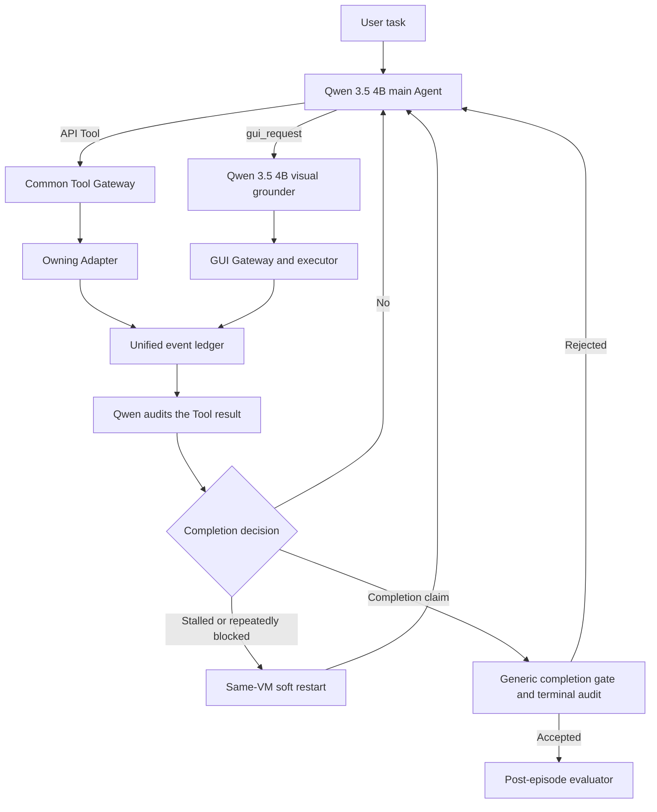

# Current Evaluation And Preserved Repair Reference

Updated: 2026-09-15

[Back to project index](index.md)

Current priority follows root `GOAL.md`: serial decomposition of six workflow APIs
from the linked clean-hardened-v2 archive, in the independent
`/home/liuhao/computer_use-v337-api-optimization` worktree. An API change is accepted
only after its affected task passes; a skipped candidate leaves the original API
unchanged. This is an isolated repair sequence, not a replacement integrated score.
See the [API review and progress link](archive/v337-workflow-api-review-20260915.md).
The cancelled and paused conditions below remain historical evidence.

The user **cancelled** `qwen35-all-roles-fixed189-20260915-v1` on 2026-09-15. The supervisor and workers have
exited. Its last aggregate retains 80 passed, 41 failed, 16 agent deadline, 6 transport, 3 protocol and 2 environment
failures: 148 terminal outcomes and 41 tasks without a terminal result. The raw `running` status was left stale
by termination; no final integrity record exists. This is partial evidence, not a complete 189-task score.
The all-Holo repair queue remains paused. See the [pure-Qwen report](archive/all-qwen-fixed189-20260915.md).

The subsequent Git association preserves the independently evaluated **v337-derived clean-hardened-v2 (158/189)**
under tag `archive/v337-clean-hardened-v2-20260816`, branch `codex/archive-v337-clean-hardened-v2`, and remote
`v337-archive`. Source and result hashes were verified from the imported Git objects. This is archival evidence;
original v337's 157/189 and this project's baseline pointer remain separate. See
[source identity and checkout instructions](archive/version-control.md#linked-v337-derived-release).

The [frozen config](../experiments/configs/qwen35-all-roles-fixed189-20260915-v1.json) launched at
`2026-09-15T07:58:02.847503+00:00`, supervisor PID 59925, with six workers initially booting. Config SHA-256:
`b108b3e52a5ea9ad2c1afb8490b6cea6177d6b46b9d0d7899ba6a8c03777bfd6`.
Freeze time is `2026-09-15T07:54:51.859201+00:00`; the unchanged latest source contains 535 files /
81,415,767 bytes, SHA-256 `5e43a92fd5285c49ef23ae4af7f4649f99456a8f857f9eeca27fd1f011a431ad`.
Source/tests were frozen for the run. The prelaunch host-only synthetic probe passed
for both Qwen thinking roles; it is not a benchmark PASS. Partial outcomes are retained in the
[new result directory](../experiments/qwen35-all-roles-fixed189-20260915-v1-run1/).

Both roles use `qwen3.5-4b` at `http://192.168.0.138:8001/v1` with binary thinking enabled. Six workers share
the endpoint; each worker sends its main and grounding requests sequentially. Main settings are temperature 0,
4096 output tokens and 240-second requests; grounding settings are temperature 0.8, 1024 output tokens and
180-second requests. Retain 100 global / 50 local steps, one soft restart, 1800 Agent seconds and the 30 GiB
disk stop. The existing `provider=holo` and `--holo-*` names identify the grounding implementation only;
requested and actual inference models are Qwen, with no Holo fallback. Runtime and validator code are unchanged
for this model switch. The original schedule was the same ordered 189 non-OAuth tasks once; cancellation
left it incomplete. This is non-promotable exploration, not a clean model-only ablation against older source conditions.

The all-Holo ledger remains paused at **32 isolated PASS, 48 skips, 118 actual attempts, 80/94 processed**,
with Order 151 prepared but unrun and 13 other tasks pending. These isolated outcomes do not change its
**95/189 (50.26%)** full-run result or count toward pure-Qwen results. The earlier Qwen-Holo **119/189 (62.96%)**
result is also preserved. `experiments/baselines/current.json` still identifies the promoted older-architecture
v337 result. Neither the new run nor the paused queue updates that pointer.

## Preserved All-Holo Condition

The preserved [frozen config](../experiments/configs/holo31-all-roles-fixed189-20260912-v1.json) assigned 14 workers,
seven each to `https://holo1.jinmaoapi.cc.cd/v1` and `https://holo2.jinmaoapi.cc.cd/v1`. Each worker's main and
grounding calls use the same endpoint sequentially. Both roles use `holo3.1-4b` with binary thinking enabled.
The source seal is `b5a82e1119db7488b3169abe71d5408dcf9af822b03267b692dd7febbf39877d` (508 files).
The run retains 100 global/50 local steps, one soft restart, 1800 Agent seconds and the 30 GiB disk stop.
Its individual repair workflow retests only the current failed task, without regression or control episodes;
that workflow remains paused after cancellation of the pure-Qwen full run.

## Completed All-Holo Full Run And Preserved Repair Queue

The [original results](../experiments/holo31-all-roles-fixed189-20260912-v1-run1/results.json) finalized at
2026-09-12 19:41:03 UTC with `metadata.status=completed` and `final_integrity.status=ok`; supervisor PID 64309
exited 0. The final integrity record retains the original source seal and config SHA-256
`3293a258b4e671d770787f593842be53d34a13554ece30863543a108e45632ce`.
Results SHA-256: `4c1c466066e0f8d9d4805daa423c587e626fa08d1b7ff8c3a5adf958989ea76a`.

| Terminal status | Count |
|---|---:|
| `passed` | 95 |
| evaluator `failed` | 42 |
| `agent_deadline_exhausted` | 22 |
| `model_protocol_failure` | 10 |
| `model_transport_failure` | 16 |
| `environment_failure` | 4 |
| Total scheduled | 189 |

The complete denominator gives **95/189 = 50.264550%**. Legacy metadata `success_rate=0.6934306569343066`
instead computes `95/(95+42)=95/137`; its 69.34% excludes all 52 abnormal terminal outcomes and must not be
presented as this run's full-189 success rate. Final integrity success does not confer promotion eligibility.

All **94 non-passing tasks**, including abnormal outcomes, form the host-only
[repair ledger](../experiments/work/all-holo-failed-task-ledger-20260912.json). At the transition to repair,
Order 42 is selected first for its confirmed singular/plural formatting completion mismatch; the other 93
remained pending in original order. Initial isolated counters were **0 new PASS and 0 skips**. Offline triage
does not mark a task skipped or repaired. The ledger and dated progress entries track subsequent attempts;
only the original post-episode evaluator's PASS can increase the isolated counter. Individual repair has
no regression/control episodes, does not alter this full-run numerator, and does not promote v337's replacement.

## Active Architecture



The detailed ownership, terminal-audit, and recovery rules are in [Architecture](architecture.md). The parent
model owns task reasoning and coordinate-free delegation; the separate Qwen grounding call owns the concrete
GUI action; the gateway only validates and executes the declared action. API and GUI results use the same event
and main-model audit path. The historical Holo implementation names do not select the inference model.

## Historical Immutable Qwen-Holo Full-189 Condition

| Item | Authoritative value |
|---|---|
| Experiment | `qwen35-holo31-hybrid-fixed189-20260831-thinking-mode` |
| Config | [`experiments/configs/qwen35-holo31-hybrid-fixed189-20260831-thinking-mode.json`](../experiments/configs/qwen35-holo31-hybrid-fixed189-20260831-thinking-mode.json) |
| Results | [`experiments/qwen35-holo31-hybrid-fixed189-20260831-thinking-mode-run1/results.json`](../experiments/qwen35-holo31-hybrid-fixed189-20260831-thinking-mode-run1/results.json) |
| Source seal | 413 files, 54,428,112 bytes, `a1dfe6a2bc6335bc09ef0fbc23349e9f8b1952145748735abea4943a8c422d12` |
| Source archive | tag `archive/qwen35-holo31-hybrid-20260831-a1dfe6`, commit `88484bcea3238c53fec993eb312f7d9269ccda79` |
| Config SHA-256 | `5da128f399afb55f47f38a1532980cd09f5af10046a5b164651c638e1d7964a4` |
| Manifest SHA-256 | `870c9074f24ee4ef8610d49f3c69dc9fa1303b179c94233ca316bcf3d4065a86` |
| Results SHA-256 | `705f9195c6f0ad4970e116b6d4dbbacd3515eeb60e47c6c6b2113a75fa0916f6` |
| Promotion status | exploratory, `baseline_candidate=false`, non-promotable |

The archive commit preserves the exact dirty active-v2 source scope recovered from the recorded Git tree. Restore
it into a separate detached worktree; do not reset or overwrite the current dirty worktree. The three referenced
Git LFS objects are present in the local `.git/lfs` store. The `v337-archive` remote links a different release and
does not back up this hybrid history; a Git tag does not contain LFS payloads. Treat the hybrid archive as local until those objects are backed up independently or
pushed to a durable LFS remote.

Read-only recovery checks:

```bash
git show-ref --tags -d | rg 'archive/qwen35-holo31-hybrid'
git rev-parse archive/qwen35-holo31-hybrid-20260831-a1dfe6^{commit}
git lfs fsck
git worktree add --detach /tmp/qwen-holo-hybrid-recovered archive/qwen35-holo31-hybrid-20260831-a1dfe6
```

The detached worktree is for inspection or comparison only. Verify the source seal against the condition before
using it in a diagnostic run, and keep any LFS backup outside the repository's ordinary Git tag.

## Historical Qwen-Holo Score And Queue

| Terminal status | Count |
|---|---:|
| `passed` | 119 |
| evaluator `failed` | 33 |
| `agent_deadline_exhausted` | 21 |
| `model_protocol_failure` | 12 |
| `environment_failure` | 3 |
| `agent_failure` | 1 |
| Total | 189 |

The complete scheduled-denominator result is **119/189 = 62.96%**. The `results.json` metadata field
`success_rate=0.782894...` is the legacy evaluator-terminal-only calculation `119/(119+33)=119/152`; it excludes
37 abnormal terminal episodes and must not be reported as the full-189 success rate.

The historical repair queue contains all 70 non-passing tasks from this condition. Later isolated affected/control results
are tracked chronologically in [Project Progress](project-progress.md). They may prove an individual repair, but
they use different source seals and do not change this measured numerator or define an aggregate rate.
The most recent Qwen-Holo repair campaign ended at +8 isolated PASS and 22 skips; neither is an all-Holo result.

## Relationship To Historical Results

- v337 remains the promoted older-architecture baseline at 157/189 (83.07%). It is a comparison, not the active
  repair queue.
- The linked clean-hardened-v2 release is a v337 derivative with its own 158/189 result and source seal;
  [its Git tag](archive/version-control.md#linked-v337-derived-release) does not identify original v337 or v335.
- Historical v210 also produced 119/189, but it is a different architecture and condition. The matching number
  does not make it the hybrid reference.
- Individual affected/control runs remain immutable evidence. Do not add their passes to the full-189 numerator
  unless one integrated condition reruns the selected scope.

## Maintenance Contract

- `GOAL.md` identifies the active repair condition and links here; `AGENTS.md` contains stable integrity rules and
  must not duplicate changing scores or endpoint facts.
- Update this page, `index.md`, `evaluation-protocol.md`, and `project-progress.md` when the integrated repair
  reference changes. Update only `project-progress.md` and the relevant task report for ordinary isolated runs.
- Update `experiments/baselines/current.json` only through an explicitly authorized promotion. Changing the repair
  reference does not change the promoted baseline pointer.
- Preserve the source archive tag, condition config, manifest, results, and LFS objects. Verify local LFS health
  with `git lfs fsck`; before treating the archive as portable, back up `.git/lfs/objects` or configure a remote
  and push both the tag and LFS objects. Never rewrite the historical result to make later repairs appear part of
  the original run.
